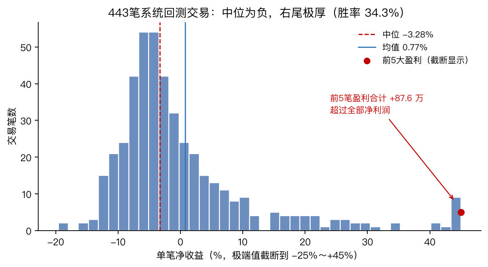
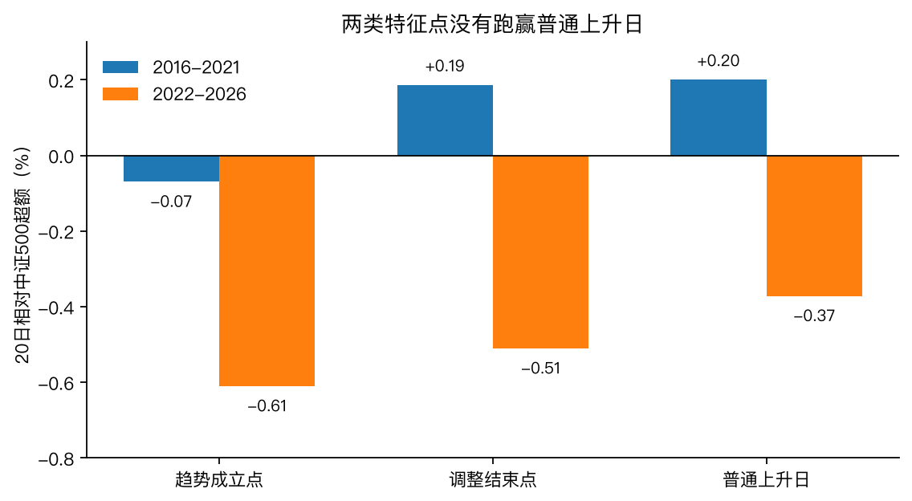
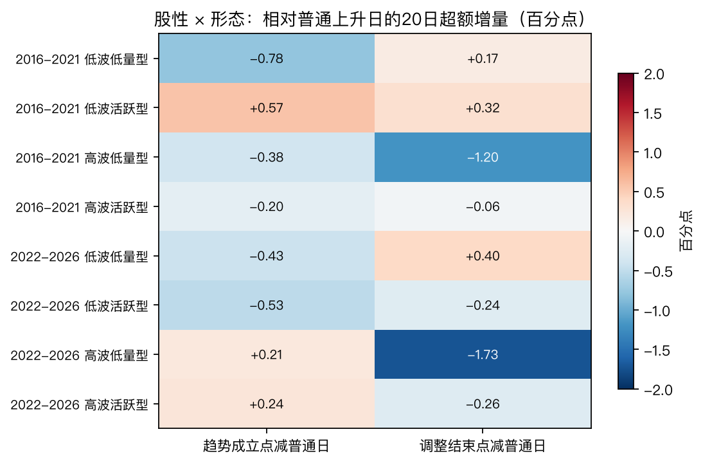
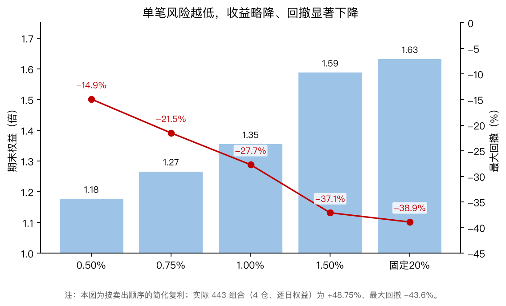

# 完整报告：这套“炒股秘诀”对不对？数据给出了什么答案

> 数据区间：2016-01～2026-09（部分对照到 2010–2025）  
> 样本：中证 500 时点成分股，1,284 只曾有资格进入样本的股票；日线后复权；含 0.30% 往返成本  
> 结论先行：**秘诀里的“风险纪律”大多是对的，“收益预期”是错的。它不是一套高胜率系统，而是一套低胜率、靠右尾的趋势系统。**
> 本文只做历史研究，不构成投资建议。

---

## 0. 先给结论

### 0.1 一句话

**“只做趋势成立点和调整结束点”这个方向没有错，但这两个形态本身没有稳定超额；真正决定结果的，是突破确认、股性/拥挤度、首周跟随、仓位和离场。**

### 0.2 三组最硬的数字

| 事实 | 数字 | 含义 |
|---|---:|---|
| 低波活跃 + 三法取二的 443 笔系统回测交易 | 胜率 **34.3%**，中位单笔 **-3.28%**，累计 **+48.75%** | 不是“成功率高”，是“少数大赢家撑起全部利润” |
| 前 5 笔盈利 | **+87.6 万元**，是全部净利润的 **179.7%** | 其余 438 笔合计 **-38.9 万元** |
| 两类特征点 vs 上升结构普通日（93,563 个事件） | 20 日超额：TB **-0.07%/-0.61%**，PB **+0.19%/-0.51%**，普通日 **+0.20%/-0.37%** | 两类“特征点”没有跑赢“随便一个上升日” |

> TB = 趋势成立点（60 日新高突破）；PB = 调整结束点（上升趋势中回踩后复位）；两段 = 2016–2021 / 2022–2026。

### 0.3 直接回答“你觉得呢”

这套秘诀**对在风险观，错在收益观**：

- 对：只做顺势、止损先设、按止损空间定仓位、不猜最高点、分批离场、连亏后停下来。
- 错：把趋势系统当成“高成功率”系统；把“两种形态”当成充分条件；把“3% 单笔风险”当成安全线；把“连亏两次暂停”当成统计优势。
- 最危险的一句话是“成功率高”。趋势跟踪的常态是 **35%–45% 胜率、1.5–2.5 盈亏比、长时间不赚钱**。如果你要求高胜率，你会在最该坚持的时候放弃。

---

## 1. 逐条检验：秘诀的 8 句话，哪几句站得住

| # | 秘诀原话 | 数据检验 | 判决 |
|---|---|---|---|
| 1 | 只做两种行情：趋势成立点、调整结束点 | 443 笔里，含突破的 378 笔合计 **+62.8 万元**；不含突破的 65 笔（仅均线+魏氏）合计 **-14.1 万元**。但宽口径的 60 日突破/回踩，相对普通上升日没有稳定超额 | **方向对，条件不够**：突破是必要，但不是充分；回踩只能算二等机会 |
| 2 | 止损点近、风险可控、成功率高、盈利空间大 | 443 笔胜率 34.3%，中位 -3.28%；事件研究胜率 39%–47%；止损触发率 46%–65% | **“成功率高”不成立**；止损近、盈利空间大成立，但两者是交换关系 |
| 3 | 其他时候不动 | 低波活跃系统约 40 笔/年，大量时间空仓；事件研究里普通上升日也有右尾，说明“不动”比“乱动”好 | **成立**，但“空仓”不是择时能力，是等待机会 |
| 4 | 止损进场前设好，到了就走 | 77 笔止损平均 **-10.13%**，最差 **-19.58%**；计划 8%，实际因跳空/跌停更大 | **原则对，执行要按“跳空后的实际损失”算** |
| 5 | 止盈按条件分批，不指望卖最高点 | 443 笔前 5 笔占净利润 179.7%；固定 2R/3R 止盈在事件研究里没有稳定优势；破 MA20 的 321 笔贡献 +153.7 万元 | **“不猜最高点”对；“过早分批”会砍掉右尾** |
| 6 | 单笔亏损不超过总资金 3%，仓位由止损空间决定 | 8% 止损对应 37.5% 仓位；4 笔就 150% 总仓位，不可能；现有系统 20% 仓位、8% 止损，实际单笔风险 1.53%，最大同时风险 6.4%，回撤仍 -38.9% | **3% 是上限，不是目标；对低胜率系统偏高** |
| 7 | 连续亏损两次暂停交易，复盘反思 | 连亏两次后下一笔胜率 26.5%，低于无条件 34.3%；但 2017/2019 连亏后反而更好，2021/2025 仍为正，2016/2020/2023 明显更差 | **作为风险纪律成立；作为统计优势不成立** |
| 8 | 不同股票具体分析 | 高波活跃型的趋势边际两段都最差（严格检验：设计期 -0.94%/20日、验收期 -1.16%）；低波类型的趋势也没有稳定为正；真正稳的是“高波活跃不要做简单趋势” | **对，但不是“四种股票四套魔法”；股性主要影响仓位和禁区** |

---

## 2. 我们用什么数据检验

### 2.1 两套证据

1. **系统回测交易**：2016–2026 年，中证 500 时点成分内，低波活跃型 + “三法取二” + 量能结合 + 原版离场，共 **443 笔**。这是“已经按一套规则做出来”的回测交易，不是事后挑出来的。
2. **大样本事件研究**：同一股票池，2016–2026 年，按预注册定义识别 **9,137 个趋势成立点（TB）**、**16,764 个调整结束点（PB）**、**67,662 个上升结构普通日（UT）**，统一按次日开盘入场、1–3 ATR 结构止损、0.30% 成本计算。共 **93,563 个有效事件**。

### 2.2 为什么要两者都看

- 只看 443 笔：容易把“这套系统的规则”当成“这两种形态的规律”。
- 只看事件研究：容易把“宽口径形态”当成“实战系统”，忽略量能、股性、市场过滤。
- 两者对照，才能区分：**形态本身有没有用** vs **这套特定规则有没有用**。

### 2.3 事件研究的两个形态（预注册）

**趋势成立点（TB）**：上升结构（close>MA60、MA20>MA60、MA60 上行）中，第一次突破前 60 日最高价；距 MA20 不超过 12%；5 日/20 日量比 ≤1.5；20 日均成交额 ≥3,000 万。

**调整结束点（PB）**：同一上升结构中，从前 20 日高点回调 3%–12%；最低价触及 MA10 或 MA20；当日收阳、收盘 > 昨日最高、收盘 > MA5/MA10；5 日/20 日量比 ≤0.95。

**普通日（UT）**：同一上升结构，但不是 TB/PB，距同类事件至少 10 个交易日。用来回答“特征点是否比随便一天更好”。

> 说明：这里的“上升结构”是“高点抬高、低点抬高”的程序化近似（MA 排列 + MA60 上行），不画 swing 点；所以它比主观趋势线更宽、更容易触发。

> **边界**：TB 是“上升结构中的第一次 60 日新高”，属于**趋势延续/再确认**，不是“下跌转上升的第一根反转”。后者需要 swing 低点/结构突破，本文没有预注册检验；不要把这组结论直接套到“抄底反转”。

---

## 3. 证据一：443 笔系统回测交易告诉了我们什么

### 3.1 收益结构：典型的“右尾生意”

| 指标 | 数值 |
|---|---:|
| 交易笔数 | 443 |
| 累计收益 | **+48.75%** |
| 年化 | +3.75% |
| 最大回撤 | **-43.6%** |
| 胜率 | **34.3%** |
| 平均单笔 | +0.77% |
| 中位单笔 | **-3.28%** |
| 平均盈利 / 平均亏损 | +13.74% / -6.00% |
| 盈亏比（PF） | 1.20 |
| 前 5 笔盈利 | **+87.6 万元（净利润的 179.7%）** |
| 其余 438 笔 | **-38.9 万元** |



**读法**：这不是“成功率高、稳定小赚”。它是“大多数交易小亏，少数交易大赚”。如果你在连续 10 笔小亏后放弃，你很可能刚好错过后面那 1–2 笔把曲线拉起来的大赢家。

### 3.2 方法组合：突破是“必要条件”，均线金叉不是

443 笔里只有四种组合（M1=MA5/MA20 金叉，M2=魏氏柱，M3=20 日新高放量突破）：

| 组合 | 含义 | 笔数 | 胜率 | 平均收益 | 总盈亏 |
|---|---|---:|---:|---:|---:|
| **011** | 魏氏 + 突破 | 320 | 35.9% | +0.94% | **+48.49 万** |
| **111** | 金叉 + 魏氏 + 突破 | 50 | 36.0% | +1.68% | **+11.07 万** |
| 101 | 金叉 + 突破 | 8 | 50.0% | +0.90% | +3.28 万 |
| **110** | 金叉 + 魏氏，**没有突破** | 65 | **23.1%** | **-0.78%** | **-14.08 万** |

**结论**：

- **没有突破的 65 笔是亏的**；突破是这套系统里唯一稳定的收益来源。
- “均线金叉”单独或与魏氏组合，不能支撑趋势；它更像“趋势已经走了一段”的滞后确认。
- 因此，秘诀里的“趋势成立点”如果指“均线金叉”，数据不支持；如果指“突破 + 量能确认”，数据支持。

### 3.3 股性与拥挤度：高热度是稳定的减分项

443 笔全部是“低波活跃型”，但在类型内部按特征分组仍有明显差异：

| 特征（低/中/高） | 低组平均 | 中组平均 | 高组平均 | 读法 |
|---|---:|---:|---:|---|
| 平台宽度 `contract` | **+3.75%** | +0.51% | **-1.86%** | 平台越宽，越容易失败 |
| 关注度 `s_heat` | +0.80% | +1.48% | **-0.20%**（胜率 24.8%） | 太热、太拥挤，胜率明显下降 |
| 250 日位置 `pos250` | +0.18% | -0.18% | **+2.63%** | 在这套“低波活跃 + 突破”里，高位不是主要风险；拥挤和宽平台才是 |
| 60 日涨幅 `runup60` | +1.69% | -0.01% | +0.90% | 非线性，不能简单说“涨多了就不能买” |
| 20 日波动 `s_vol` | +1.16% | +0.40% | +0.88% | 低波组略好，但不单调 |

**结论**：

- “不同股票具体分析”是对的，但**不是按行业或概念分类**，而是按**波动、活跃度、拥挤度、平台结构**分类。
- 最稳定的负向规则：**高波活跃型不要做简单趋势跟踪**；其次是**高热度、宽平台不要追**。
- 低波低量/低波活跃是相对更适合趋势的土壤，但也不是“买了就涨”。

### 3.4 首周跟随：买入后最强的“继续/放弃”信号

按买入后 5 个交易日收益分组（443 笔）：

| 首周收益 | 笔数 | 最终胜率 | 最终平均收益 |
|---|---:|---:|---:|
| < -5% | 95 | **3.2%** | **-7.65%** |
| -5%～-2% | 74 | 14.9% | -3.84% |
| -2%～0 | 66 | 19.7% | -2.40% |
| 0～+2% | 46 | 37.0% | +0.11% |
| +2%～+5% | 51 | 35.3% | +0.62% |
| **> +5%** | 111 | **81.1%** | **+13.28%** |

相关系数 0.629。**首周 >+5% 的交易，最终 81% 赚钱；首周 <-5% 的交易，最终只有 3% 赚钱。**

但把它做成“首周 < -5% 就清仓”的硬规则，分段不稳定：会避开大亏，也会砍掉先抑后扬的大赢家（如 603786、600707）。所以正确用法是：

- **首周 >+5%**：确认需求出现，持有；不追高，等新回踩再加。
- **首周 < -5%**：不加仓，减半或准备退出；是否清仓看止损距离，不做无条件一刀切。
- **首周 -2%～+2%**：持有观察，不动。

---

## 4. 证据二：两类“特征点”并没有跑赢普通上升日

### 4.1 总结果

| 形态 | 时期 | 样本 | 20 日净收益 | 20 日超额 | 20 日胜率 | 20 日 MAE | 20 日止损率 |
|---|---|---:|---:|---:|---:|---:|---:|
| TB | 2016–2021 | 4,578 | +0.54% | -0.07% | 47.0% | -8.67% | 46.2% |
| TB | 2022–2026 | 4,559 | +0.03% | -0.61% | 42.8% | -7.84% | 47.5% |
| PB | 2016–2021 | 8,067 | -0.34% | +0.19% | 43.2% | -8.97% | 58.5% |
| PB | 2022–2026 | 8,697 | -0.89% | -0.51% | 39.1% | -8.59% | 60.5% |
| UT | 2016–2021 | 31,297 | +0.36% | +0.20% | 45.1% | -8.86% | 59.6% |
| UT | 2022–2026 | 36,365 | -0.17% | -0.37% | 41.5% | -8.47% | 61.4% |



**读法**：

- 这里的 TB/PB 是**宽口径**：只要求趋势结构 + 突破/回踩，不带 443 系统的“动能确认”（金叉/魏氏）。所以这组结果回答的是“形态本身够不够”，不是“443 系统有没有效”。443 系统的 011/111 是特定组合，见 3.2。
- TB 和 PB 的 20 日超额都在 0 附近，且 2022–2026 都转负；没有一条“两段都为正”的稳定优势。
- 胜率 39%–47%，不是“高成功率”；中位收益全部为负。
- 止损率 46%–65%，说明“止损点近”确实会经常被触发。
- 年度也不稳定：TB 在 2017/2018/2020/2023/2024 为正，2016/2019/2021/2022/2025/2026 为负；PB 只有 2019/2020/2024 为正。没有“每年都有效”的形态。
- 40 日也没有改善：TB +0.63%/-0.79%，PB +0.61%/-0.36%，UT +0.63%/-0.44%。

### 4.2 股性矩阵：没有稳定的“类型 × 形态”优势，最稳的是负向规则

把每个形态减去同类型、同时期的普通日（UT），得到“形态的净增量”：

**20 日超额增量（TB/PB − UT，单位：百分点）**

| 时期 | 股性 | TB−UT | PB−UT | 判断 |
|---|---|---|---:|---|
| 2016–2021 | 低波低量 | -0.78 | **+0.17** | 回踩略好，突破反而差 |
| 2016–2021 | 低波活跃 | **+0.57** | +0.32 | 突破略好，但不稳定 |
| 2016–2021 | 高波低量 | -0.38 | **-1.20** | 回踩明显差 |
| 2016–2021 | 高波活跃 | -0.20 | -0.06 | 都不好 |
| 2022–2026 | 低波低量 | -0.43 | **+0.40** | 回踩仍略好 |
| 2022–2026 | 低波活跃 | -0.53 | -0.24 | 都转差 |
| 2022–2026 | 高波低量 | +0.21 | **-1.73** | 回踩继续差 |
| 2022–2026 | 高波活跃 | +0.24 | -0.26 | 仍不好 |



**结论**：

- 唯一两段都为正的格子：**低波低量型的回踩（+0.17/+0.40pp）**，但幅度很小，扣完成本后接近零，不能单独当系统。
- 低波活跃型的突破只在 2016–2021 略好，2022–2026 转负；所以“低波活跃 + 突破”不是全天候。
- 高波低量型的回踩两段都显著为负（-1.20/-1.73pp），应直接禁止。
- 高波活跃型两种形态的超额都为负，但“最差”的是高波低量型的回踩（-1.20/-1.73pp）；高波活跃的稳定负结论来自严格检验的趋势边际（两段为负），不是本表的所有格子。

### 4.3 “安静过滤”的反例：不要把一个样本里的规律当成普遍规律

既有 443 笔研究里，“安静 + 窄平台”的突破是主要 alpha。但把同样的“安静过滤”（5 日/20 日量比 ≤0.8、20 日平台 ≤0.18、20 日涨幅 ≤20%）套到宽口径事件上：

| 形态 | 时期 | 未过滤 20 日超额 | 安静过滤 20 日超额 | 安静样本数 |
|---|---|---:|---:|---:|
| TB | 2016–2021 | -0.05% | **-1.25%** | 80 |
| TB | 2022–2026 | -0.56% | **-2.59%** | 113 |
| PB | 2016–2021 | +0.54% | **-0.57%** | 2,564 |
| PB | 2022–2026 | -0.04% | **-1.54%** | 2,680 |

**这不是说“安静”没用，而是说：**

- 在 443 笔这个**已经被低波活跃 + 三法 + 量能筛过**的样本里，安静是加分项；
- 在全部 60 日突破/回踩里，安静过滤反而选出了一批“没人玩、突破失败”的股票；
- **同一个特征，在不同样本里可能反号。** 这就是为什么不能把“秘诀”当成普适规律。

### 4.4 右尾集中：所有形态的中位数都是负的

20 日收益的尾部集中度（不是组合收益，是事件收益求和）：

| 形态 | 时期 | 总收益（求和） | 前 1% 交易贡献 | 前 5% 交易贡献 | 正收益占比 |
|---|---|---:|---:|---:|---:|
| TB | 2016–2021 | +24.6 | +27.4 | +83.9 | 47.0% |
| TB | 2022–2026 | +1.4 | +27.1 | +77.1 | 43.0% |
| PB | 2016–2021 | -27.1 | +48.5 | +144.2 | 43.2% |
| PB | 2022–2026 | -76.0 | +56.6 | +155.0 | 39.7% |
| UT | 2016–2021 | +112.5 | +201.5 | +594.3 | 45.1% |
| UT | 2022–2026 | -62.8 | +250.5 | +692.6 | 42.0% |

**读法**：

- 每个形态的总收益都小于“前 1% 交易”的贡献；没有这些极端值，期望为负。
- 这不是“形态好”，而是“形态给你一张参与右尾的彩票”。
- 所以系统的核心不是“提高胜率”，而是**保证自己在右尾出现时还活着、还有仓位**。

### 4.5 预注册判据对照：六条假设，没有一条完整通过

跑数前写死的判据（见 [00_预注册](00_预注册_特征点检验.md)）与结果：

| 编号 | 判据 | 结果 | 判决 |
|---|---|---|---|
| H1 | TB 两段 20 日超额均 >0 | -0.07% / -0.61% | **不通过** |
| H2 | PB 胜率比 TB 高 ≥5pp，且 MAE 好 ≥2pp | PB 胜率 43.2%/39.1% vs TB 47.0%/42.8%（更低）；PB MAE -8.97%/-8.59% vs TB -8.67%/-7.84%（更差） | **不通过** |
| H3 | 高波活跃 TB 两段都低于低波两类 | 2016–2021：-0.27 vs -0.22/+0.59；2022–2026：-0.26 vs -0.78/-0.77，不满足“两段都低于” | **不通过（本表）；负向规则来自严格检验的趋势边际** |
| H4 | 安静过滤两段都改善 | TB 安静后 -1.25%/-2.59%（更差）；PB -0.57%/-1.54%（更差） | **不通过** |
| H5 | 趋势离场两段都优于固定止盈 | TB trail +0.15%/-0.45% vs 固定2R +0.03%/-0.38%，混合；PB 固定2R 略好 | **不通过** |
| H6 | 连亏两次后下一笔显著更差，且同年同月仍成立 | 26.5% vs 34.3%，但 2017/2019/2021/2025 为正；未做同日/同月配对，年度不稳定 | **弱支持，不能当统计优势** |

> 预注册的价值就在这里：如果跑完再挑“低波活跃 TB 2016–2021 +0.57pp”这种格子，很容易把它包装成系统；但六条主判据里没有一条完整通过（五条不通过、一条弱支持），说明**不能把事后好看的局部当成稳定规律**。

---

## 5. 证据三：离场、卖错、连亏

### 5.1 出场方案：没有一种“永远最优”，但趋势跟踪不能过早砍

事件研究里比较 6 种离场（均值，20 日/40 日路径）：

| 方案 | TB 2016–2021 | TB 2022–2026 | PB 2016–2021 | PB 2022–2026 |
|---|---:|---:|---:|---:|
| 止损 + 破 MA20 | **+0.15%** | **-0.45%** | -0.50% | -0.52% |
| 固定 2R | +0.03% | -0.38% | **-0.47%** | **-0.56%** |
| 固定 3R | +0.06% | -0.42% | -0.48% | -0.52% |
| 1/3 在 2R + 余仓 trail | +0.11% | -0.43% | -0.49% | -0.53% |
| 1/2 在 2R + 余仓 trail | +0.09% | -0.42% | -0.48% | -0.54% |
| 1R 后保本 + trail | +0.15% | -0.51% | -0.49% | -0.48% |

**结论**：

- 没有一种方案在两段、两形态都占优；差别只有几个基点。
- 对 TB，trail 在 2016–2021 最好，2022–2026 固定 2R 略好；对 PB，固定 2R 略好，但 PB 本身期望为负。
- **“破 MA20 离场”是 443 笔系统的主要利润来源**：321 笔 +153.7 万元；止损 77 笔 -159.8 万元。利润和亏损几乎对冲，真正拉高收益的是少数大赢家。
- 过早保本/固定止盈会砍右尾；但完全不止盈也会让利润回吐。折中：**核心仓 trail，最多 1/3 在 +2R 分批**。

### 5.2 止损后反弹：大多数会反弹，但很少回到买价

77 笔止损交易，卖出后：

| 指标 | 10 日 | 20 日 | 40 日 |
|---|---:|---:|---:|
| 期间最高反弹均值 | +9.53% | +14.50% | +20.23% |
| 最高反弹中位 | +5.73% | +7.50% | +11.16% |
| 反弹 >5% 占比 | 55.8% | 64.9% | 70.1% |
| **收盘回到买价上方占比** | **1.3%** | **1.3%** | **1.3%** |
| 继续持有对应天数的收益均值 | — | +1.37% | +2.71% |
| 继续持有对应天数的收益中位 | — | **-4.34%** | -2.92% |
| 继续持有 20 日为正的比例 | — | 32.5% | — |

**读法**：

- 止损后经常反弹，这是“卖错了”的错觉；但只有 1.3% 能回到买价上方。
- 继续持有 20 日的均值 +1.37%，中位 -4.34%，只有 32.5% 为正；**不止损的期望更差**。
- 所以：**不要因为反弹就追回去**；只有在“新形态 + 收复止损位”同时满足时，才允许重新入场。

### 5.3 连亏两次暂停：是风险纪律，不是统计优势

443 笔按卖出顺序：

| 条件 | 样本 | 下一笔胜率 | 下一笔平均 |
|---|---:|---:|---:|
| 无条件 | 443 | 34.3% | +0.77% |
| 前 1 笔亏损 | 290 | 29.3% | +0.18% |
| **前 2 笔亏损** | 204 | **26.5%** | **-0.26%** |
| 前 3 笔亏损 | 149 | 26.8% | -0.02% |

看起来“连亏后更差”，但分年看并不稳定：2017、2019、2021、2025 连亏两次后的下一笔平均为正；2016、2020、2023 明显为负。**连亏是“坏市况聚集”的结果，不是“亏损会传染”的规律。**

简单模拟“连亏 2 次后跳过 3 笔”（按卖出顺序、每笔 20% 仓位）：终值从 1.63 提高到 3.27，回撤从 -38.9% 降到 -21.7%。但这个结果对“跳过几笔”和样本路径非常敏感，不能当成可复现的 alpha。正确结论：

- **暂停是有价值的风险纪律**：避免在坏市况里连续送钱、避免报复性交易；
- **不要把它包装成统计优势**；用 3–5 个交易日冷却、接下来 2 笔半仓，而不是“固定跳过 3 笔”。

---

## 6. 证据四：3% 单笔风险的算术问题

### 6.1 先算清楚“3%”意味着什么

单笔风险 3%，仓位 = 3% ÷ 止损距离：

| 止损距离 | 仓位（3% 风险） | 4 笔合计 | 若跳空到 1.5 倍止损，账户亏 |
|---:|---:|---:|---:|
| 3% | 100% | 400% | 4.5% |
| 5% | 60% | 240% | 4.5% |
| 8% | **37.5%** | **150%** | 4.5% |
| 10% | 30% | 120% | 4.5% |
| 15% | 20% | 80% | 4.5% |

**问题**：

- A 股普通账户不能满仓加杠杆；4 笔 37.5% 已经 150%，做不到。
- 如果你把单票上限定在 20%，8% 止损的实际单笔风险只有 **1.6%**，不是 3%。
- 如果你真的按 3% 下注，单票 37.5%，一个跌停就 -3.75%，两个跌停 -7.5%；“单笔不超过 3%”只是计划，不是保证。

### 6.2 443 笔的仓位模拟（简化复利，不是逐日组合权益）

**先分清两个口径：**

- **实际组合**：443 笔、4 仓、每只 20% 当前权益、逐日权益、含成本 → 2016–2026 累计 **+48.75%**，年化 **+3.75%**，最大回撤 **-43.6%**（既有复盘）。
- **下表**：把同一批 443 笔按“卖出顺序”做简化复利，每笔按当时权益 × 权重，忽略同时持仓/现金约束。固定 20% 得到 1.632，和实际 +48.75% 不同；**两者不能混用**。风险预算行只用于比较方向，不是新组合的精确收益。

用 443 笔系统回测交易、每笔按“风险预算 ÷ 止损距离”、单票上限 20% 模拟：

| 简化复利口径 | 终值 | 最大回撤 | 平均仓位 | 平均单笔风险 | 最大同时风险 | 终值/回撤 |
|---|---:|---:|---:|---:|---:|---:|
| 简化复利·固定 20% | 1.632 | -38.9% | 20.0% | 1.53% | 6.40% | 4.19 |
| 0.50% | 1.177 | **-14.9%** | 6.7% | 0.50% | 2.00% | **7.91** |
| 0.75% | 1.266 | -21.5% | 10.0% | 0.75% | 3.00% | 5.89 |
| 1.00% | 1.355 | -27.7% | 13.2% | 1.00% | 4.00% | 4.89 |
| 1.50% | 1.588 | -37.1% | 19.0% | 1.45% | 6.00% | 4.28 |
| 2.00% | 1.632 | -38.9% | 20.0% | 1.53% | 6.40% | 4.19 |
| 3.00% | 1.632 | -38.9% | 20.0% | 1.53% | 6.40% | 4.19 |



> **口径提醒**：上表和图的“固定 20%”是简化复利终值 1.632；实际组合是 4 仓、逐日权益、含成本，2016–2026 累计 **+48.75%**、最大回撤 **-43.6%**。两者不要混用。风险预算行只用于比较方向，不是新 A/B 组合的精确收益。

**读法**：

- 3% 和 2% 的结果与固定 20% 一样，因为 20% 上限先触发；**3% 规则在这套系统里根本没有被执行**。
- 0.5%–1% 的单笔风险，收益更低但回撤显著更小；0.5% 的风险调整后最好。
- 对低胜率、右尾驱动的系统，**先活下来**比“单笔赚大”重要；建议 **0.5%–1.0%**，而不是 3%。

---

## 7. 那到底该怎么做：一套“能执行”的系统

> 详细规则见 [02_规则手册_买入卖出仓位与复盘.md](02_规则手册_买入卖出仓位与复盘.md)。
> 这里先给骨架。

### 7.1 系统定位

**名字**：趋势突破 + 风险预算（Trend Breakout with Risk Budget）  
**类型**：日线、纯多头、中低频、趋势跟踪  
**核心**：不预测高点，只做“突破确认 + 风险受限 + 让右尾奔跑”  
**预期**：约 40 笔/年（30–45）；胜率 35%–45%；盈亏比 1.5–2.5；最大回撤 25%–40%；大量时间空仓/小仓

### 7.2 买入：只做两类，但都要“确认”

**A. 趋势成立（主策略）**

```
上升结构（高点抬高、低点抬高；近似）：close > MA60，MA20 > MA60，MA60 高于 20 日前
突破：close > 前 20 日最高价
量能：成交量 ≥ 1.3 × 20 日均量
动能确认：MA5 上穿 MA20，或 魏氏柱>0 且 WDEA 上行（MACD 柱改善）
不过热：5 日/20 日量比 ≤ 1.5；距 MA20 ≤ 10%；20 日涨幅 ≤ 20%
不拥挤：s_heat ≤ 0.7（最好 ≤ 0.5）；平台宽度 ≤ 20%
股性：低波活跃核心；低波低量只做观察/小仓；高波低量只做放量确认；高波活跃不做
```

> 为什么加“动能确认”：443 笔里 011（魏氏+突破）320 笔 +48.5 万、111（三者）50 笔 +11.1 万；而 110（金叉+魏氏、无突破）65 笔 -14.1 万。突破是必要，但要和至少一个动能条件同时成立；只有突破、没有动能确认的宽口径版本（TB）没有稳定超额。

**B. 调整结束（辅策略，半仓）**

```
同一上升结构
回调：前 20 日高点回撤 3%–12%
触均线：最低价触及 MA10 或 MA20
缩量：5 日/20 日量比 ≤ 0.8
复位：收阳，close > 昨日最高，close > MA5/MA10
股性：只做低波低量 / 低波活跃；高波类型不做
```

**C. 反转（可选，研究仓）**

高波活跃型跌深后的反转，有初步正证据，但 2020–2021、2026 会失效；只适合小仓位、严止损，不作为核心。

### 7.3 买多少

```
单笔风险 r = 0.75%（绿区 0.75%–1.0%；黄区 0.5%–0.75%；红区 0.5%）
仓位 = r ÷ 止损距离
单票上限：低波 20%；高波低量 12%；高波活跃 10%
组合上限：4 只（绿区）/ 3 只（黄区）/ 2 只（红区）
组合热预算：Σ(仓位×止损距离) ≤ 3%（绿区）/ 2%（黄区）/ 1%（红区）
流动性：单票金额 ≤ 20 日均成交额的 1%
```

### 7.4 买对了怎么办

- 首周 >+5%：确认，持有；只在**新的回踩**加仓，最多加 0.5% 风险；不追高。
- +2R：可卖 1/3 锁利；剩余 2/3 跟 MA20。想最大化期望，就不分批，直接 trail。
- 出现更高低点：止损上移到新低点下方，不凭空移到成本价。
- 首周 -2%～+2%：持有，不加。
- 首周 < -5%：不加，减半或准备退出；不要因为“跌了便宜”补仓。

### 7.5 买错了怎么办

- 触止损：全卖，不犹豫；跳空/跌停卖不出，次日继续卖。
- 不补仓、不摊平、不“等反弹”。
- 止损后 3 个交易日不新开同一只；只有“新形态 + 收复止损位”才允许半仓再入。
- 连续 2 次止损：冷却 3–5 个交易日，接下来 2 笔半仓；复盘是规则问题还是市况问题。

### 7.6 卖出：止损、移动止盈、时间

| 触发 | 卖多少 | 执行 |
|---|---:|---|
| 初始止损 | 100% | 触价卖；收盘确认则次日开盘 |
| 收盘 < MA20 | 剩余 100% | 次日开盘 |
| MA5 < MA20 | 剩余 100% | 次日开盘 |
| 持有 40 个交易日 | 剩余 100% | 收盘/次日开盘 |
| +2R 可选 | 1/3 | 触价；剩余 trail |
| 首周 < -5% | 50% | 次日开盘；若接近止损则直接 100% |
| 期末/需要现金 | 100% | 按规则 |

### 7.7 卖对了/卖错了怎么办

- **卖对了（继续涨）**：不追；等新的回踩/突破；若 3 日内放量收复 MA20 且形成新形态，可半仓再入。
- **卖错了（止损后反弹）**：不因为反弹买回；统计上只有 1.3% 回到买价；等新形态。
- **分批卖飞**：接受；剩余仓位仍在；不要用加仓弥补“卖飞”的情绪。
- **清仓后踏空**：记录为“规则内成本”，不改规则；只在新形态出现时再入。

### 7.8 停手规则

- 连亏 2 笔：3–5 个交易日不开新仓；接下来 2 笔半仓；复盘。
- 连亏 3 笔或 -6R：停 2 周；纸面交易；恢复时 0.5% 风险。
- 账户回撤 >15%：风险减半；>20%：停止新开仓，全面复盘；>25%：纸面交易，直到连续 20 笔正期望。
- 单月亏损 >8%：停止当月新开仓；检查是否违反规则/是否市场 regime 变了。

---

## 8. 不同股性的操作矩阵

> 证据等级：A=较硬；B=样本内/中等；C=弱/观察。  
> “允许”不等于“一定赚”，只表示相对更适合。

| 股性 | 趋势突破 A | 回踩 B | 反转 C | 单票上限 | 止损 | 备注 |
|---|---|---|---|---|---|---|
| **低波低量** | 观察/小仓（C） | **相对最好（B）** | 不做 | 20% | 6%–8% | 回踩两段都略正，但幅度小；突破两段都负，别当核心 |
| **低波活跃** | **核心（B）** | 半仓（C） | 不做 | 20% | 6%–8% | 443 笔的土壤；2022–2026 转弱，别把样本内当未来 |
| **高波低量** | 只做放量确认（C） | **禁止（A）** | 不做 | 12% | 8%–10% | 回踩两段都显著为负（-1.20/-1.73pp） |
| **高波活跃** | **不做简单趋势（A）** | 禁止（A） | 小仓研究（C） | 10% | 8%–12% | 趋势跟踪 2017–2025 每年都不为正；反转有证据但不稳定 |

**一句话**：股性不是“换一套指标”的理由，而是“允不允许做、做多大、止损多宽”的理由。

---

## 9. 这套系统的真实预期（不要把回测当承诺）

| 项目 | 合理预期 | 说明 |
|---|---|---|
| 年交易数 | 30–45 笔 | 低波活跃 + 过滤后约 40 笔/年 |
| 胜率 | 35%–45% | 不要期待 60%+ |
| 盈亏比 | 1.5–2.5 | 靠少数大赢家 |
| 年化 | 0%–8%（长期） | 样本内 +3.75%；降风险后约 2%–3%，不要用 +48.75%/10 年线性外推 |
| 最大回撤 | 25%–40% | 443 笔为 -43.6%；仓位减半可降到 -20% 左右 |
| 最长不赚钱 | 2–3 年 | 2016–2018、2021–2023 都出现过 |
| 最坏单笔 | -15%～-25% | 跳空/跌停；8% 止损不是保证 |

**如果你不能接受“连续 2 年不赚钱、回撤 30%”，这套系统不适合你。** 这不是系统缺陷，是趋势跟踪的代价。

### 9.1 如果你坚持要“高胜率”，数据里有什么？

有，但不是更好，只是另一种赔率：

| 方法 | 20 日胜率（设计/验收） | 20 日平均（设计/验收） | 问题 |
|---|---:|---:|---|
| 高波活跃型反转 | 45.2% / 48.2% | +0.39% / +2.47% | 2020–2021、2026 失效；中位接近 0；靠右尾 |
| 低波低量型反转 | 48.8% / 50.8% | +0.67% / +1.56% | 2023–2026 是上行市，不能外推 |
| 低波低量型趋势 | 46.4% / 44.8% | +1.01% / -0.03% | 2021 后转负 |

**结论**：最高也就 50% 左右，而且中位数经常是负的；不存在“80% 胜率 + 大空间”的稳定形态。想要高胜率，就要接受“小赚多次、偶尔大亏”的另一种风险；那不是这套趋势系统。

---

## 10. 局限与诚实声明

1. **样本内**：443 笔、事件研究都来自 2016–2026；参数（20 日、1.3 倍量、8% 止损、40 日）不是预注册优化出来的。  
2. **没有真正的 2027 样本外**：所有“有效”都只能算历史描述。  
3. **股票池限制**：中证 500 时点成分，不是全 A；小盘/微盘的流动性、涨跌停、退市偏差更大。  
4. **事件重叠**：同一波趋势里多个事件高度相关，t 值不能当独立样本。  
5. **成本/容量**：0.30% 往返；大资金冲击成本更高；没有计入融券、停牌、ST。  
6. **没有基本面/新闻/情绪**：只有价量；真正的“需求”很多在数据外。  
7. **股性会漂移**：基础类型半年保持率 51%–57%，子类 71%–87%；不要用一年前的标签做今天。  
8. **“安静过滤”反例**：同一个特征在 443 笔里有效、在宽口径事件里反号；说明样本选择会制造规律。  
9. **连亏暂停的模拟**：跳过 3 笔的结果对路径敏感，不能当策略；只能当风险纪律。  
10. **不是投资建议**：实盘前先纸面/小资金，至少 100 笔再评估。  
11. **这套规则是“443 笔系统 + 事件研究”的合成，不是新的独立组合回测**：A/B 的精确组合（20 日突破 + 动能确认 + 类型过滤 + 风险预算 + 分批）没有单独跑一条完整权益曲线。它的作用是“把有证据的部分固定成可执行流程”，不是“证明这套合成一定赚”。先纸面 100 笔，是系统的一部分，不是可选项。

---

## 11. 三个反问（如果我要盘问这套秘诀）

**第一问：你的“趋势成立点”，去掉突破、量能、股性之后，还剩多少超额？**

答：宽口径 60 日突破，20 日超额 -0.07%/-0.61%；普通上升日 +0.20%/-0.37%。**形态本身不剩多少。** 443 笔里真正有用的是“突破 + 量能 + 低波活跃 + 动能确认”的组合，不是“趋势”两个字。

**第二问：你说成功率高，胜率、盈亏比、最大回撤、样本数分别是多少？**

答：443 笔，胜率 34.3%，盈亏比 1.20，最大回撤 -43.6%，中位单笔 -3.28%。**这不是高胜率系统。** 如果你用“成功率”做决策，你会在最该坚持的时候放弃。

**第三问：3% 单笔风险、4 个仓位，遇到集体跌停/跳空，账户会怎样？**

答：4 × 3% = 12% 热预算；一次集体 -10% 就是 -12%，两次就是 -24%。而 443 笔在 20% 仓位、8% 止损下已经 -43.6% 回撤。**3% 不是安全线，是加速器。**

> 这三问的答案，就是这套系统为什么要改成“0.5%–1% 风险 + 20% 单票上限 + 3% 组合热预算 + 突破确认”。

---

## 12. 一页纸结论

- **秘诀的风险观可用，收益观要改**：不是高胜率，是低胜率 + 右尾。
- **只做突破，不做均线金叉**：443 笔里没有突破的 65 笔亏 14 万；突破是必要条件。
- **回踩只做低波低量/低波活跃，半仓**；高波类型的回踩是负期望。
- **高波活跃不做简单趋势**：这是最稳的负向规则。
- **仓位用 0.5%–1% 风险，不是 3%**；单票 20% 上限，组合热预算 ≤3%。
- **止损先设，触价就走**；止损后不追反弹，等新形态。
- **让右尾跑**：最多 1/3 在 +2R 分批，剩余跟 MA20；不要固定 3R 全卖。
- **首周是继续/放弃的信号**：>+5% 持有，<-5% 减半/退出，不硬砍。
- **连亏两次冷却，不是统计优势**；3–5 天 + 半仓，比“固定跳过几笔”更稳。
- **先纸面 100 笔**：这套系统的最大风险不是买错，是在右尾出现前失去耐心。

---

*配套文件：*
- [00_一页纸_决策卡.md](00_一页纸_决策卡.md)
- [02_规则手册_买入卖出仓位与复盘.md](02_规则手册_买入卖出仓位与复盘.md)
- [03_数据与复现说明.md](03_数据与复现说明.md)
- [交易系统_数据表.xlsx](交易系统_数据表.xlsx)
