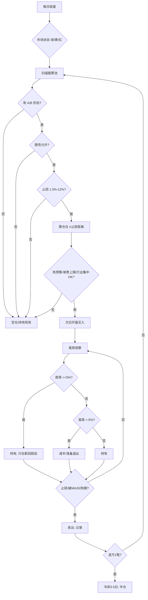

# 规则手册：趋势突破 + 风险预算

> 适用：A 股日线、纯多头、中低频、自己管账户的投资者  
> 目标：不是“高胜率”，而是“亏损可控、右尾不漏、长期正期望”  
> 资金：建议先用 10 万–50 万小资金或纸面交易；不要用生活资金/杠杆  
> 版本：2026-10-20；所有参数先固定，至少 100 笔后再评估

---

## 1. 系统一句话

**在上升结构中，等“突破确认”或“回踩复位”，用 0.5%–1% 的单笔风险入场，止损先设，错了就走，对了跟 MA20，让少数大赢家覆盖大量小亏。**

---

## 2. 股票池与“不交易”清单

### 2.1 股票池

- 沪深 A 股，主板 / 创业板 / 科创板；优先中证 500、中证 1000 成分或日均成交额靠前的中小盘。
- 上市 ≥ 120 个交易日。
- 20 日均成交额 ≥ **5,000 万元**（比研究口径 3,000 万更保守；小资金可放宽到 3,000 万）。
- 价格 ≥ 2 元；非 ST/*ST；非退市整理期；非长期停牌。
- 不做北交所（流动性/制度差异大）。

### 2.2 不交易清单（任一命中就不买）

1. 没有 A/B 形态（见第 4 节）。
2. 明日开盘一字涨停，或高开 >5%。
3. 初始止损距离 >12%，或 <1.5%。
4. 未来 3 个交易日有财报/重大事件（避开跳空）。
5. 20 日均成交额 <5,000 万（小资金可放宽到 3,000 万），或单票计划金额 >20 日均额的 1%。
6. 高波活跃型 + 简单趋势（禁止）。
7. 高波低量型 + 回踩（禁止）。
8. 最近 2 笔连续亏损，仍在冷却期。
9. 账户回撤 >20%，仍在停机复盘期。
10. 同一行业已有 2 只持仓（相关性风险）。

---

## 3. 市场状态：只做“风险油门”，不做“预测开关”

> 数据结论：用“中证 500 在 MA60 上”做硬过滤，2016–2021 会 -36.5%，2022–2026 会 +62.2%，两段方向相反。  
> 所以市场状态只用来**调仓位**，不用来**决定买不买**。

| 状态 | 条件 | 最大持仓 | 总仓位上限 | 单笔风险 |
|---|---|---:|---:|---:|
| 绿区 | 中证 500 > MA60，且全 A 站上 MA20 的比例 ≥50% | 4 只 | 80% | 0.75%–1.0% |
| 黄区 | 中证 500 > MA60 但宽度 30%–50%，或中证 500 < MA60 但宽度 >50% | 3 只 | 60% | 0.5%–0.75% |
| 红区 | 中证 500 < MA60 且宽度 <30% | 2 只 | 30% | 0.5% |

- 宽度数据：全 A 站上 MA20 的股票占比；没有数据源时，用中证 500 的 MA20/MA60 + 涨跌家数近似。
- **50%/30% 是风险预算的默认值，不是回测优化出来的**；它们的作用是“红区降风险”，不是预测方向。你可以按自己的风险承受度改成 40%/20%，但不要频繁调。
- **红区不是“不能买”**，而是“只做 A+，最多 2 只，单笔 0.5%”。
- 市场状态每天收盘后更新一次，不盘中改。

---

## 4. 买入：A/B/C 三类形态

### 4.1 A 类：趋势成立（主策略，正常仓位）

**适用股性**：低波活跃核心；低波低量只做观察/小仓；高波低量只做“放量确认”；高波活跃不做。

**必须同时满足**：

```
1. 上升结构：高点抬高、低点抬高；程序化近似为 close > MA60、MA20 > MA60、MA60 高于 20 个交易日前
2. 突破：close > 前 20 个交易日最高价（不含当日）
3. 量能：当日成交量 ≥ 1.3 × 20 日均量
4. 动能确认（二选一）：
   a) MA5 上穿 MA20（当日 MA5>MA20，前一日 MA5≤MA20）
   b) 魏氏柱 > 0 且 WDEA 上行（或 MACD 柱 >0 且较前一日改善）
   这是“三法取二”的简化：突破 + 至少一个动能确认；只有突破、没有动能确认的版本没有独立验证。
5. 不过热：5 日/20 日量比 ≤ 1.5
6. 不延伸：close/MA20 - 1 ≤ 10%
7. 不暴涨：20 日涨幅 ≤ 20%
8. 平台：前 20 日平台宽度（最高/最低-1）≤ 20%
9. 不拥挤：s_heat ≤ 0.7（最好 ≤0.5）
10. 流动性：20 日均成交额 ≥ 5,000 万
```

**加分项（不是必须）**：

- 平台宽度 ≤18%；
- 突破前 10 日量能收缩（10 日量/60 日量 ≤1.2）；
- 收盘接近当日最高（上影线短）；
- 行业指数不在单边下跌。

**入场**：

- 信号日收盘后确认；次日开盘买入。
- 若次日高开 >5% 或一字涨停：放弃，不追。
- 若次日开盘已低于初始止损：放弃。
- 买入价按开盘价 × (1+0.1%) 估算滑点。

**初始止损**：

```
结构低点 = 5 日最低价 × 0.995
波动下限 = 买入价 - 3.0 × ATR20
波动上限 = 买入价 - 1.0 × ATR20
止损 = min( max(结构低点, 波动下限), 波动上限 )
```

- 结果：止损距离永远在 1–3 个 ATR 之间；若 <1.5% 或 >12%，放弃。
- 止损在买入前写进交易计划，不盘中改。

### 4.2 B 类：调整结束（辅策略，半仓）

**适用股性**：低波低量（相对最好）、低波活跃（半仓）；高波低量/高波活跃禁止。

**必须同时满足**：

```
1. 上升结构：同 A 类
2. 回调：前 20 日最高价 / close - 1 在 3%–12%
3. 触均线：当日最低价 ≤ MA10×1.015 或 ≤ MA20×1.015
4. 缩量：5 日/20 日量比 ≤ 0.8
5. 复位：收阳；close > 昨日最高价；close > MA5 且 close > MA10
6. 流动性：20 日均成交额 ≥ 5,000 万
```

**入场/止损**：

- 次日开盘买入；高开 >3% 放弃（回踩买点不追）。
- 止损 = min(5 日最低价, MA20×0.99) × 0.995；再用 A 类的 1–3 ATR 约束。
- 仓位 = A 类的一半（风险预算 0.375%–0.5%）。

**注意**：

- B 类不是“跌了就买”；必须是“上升结构 + 缩量 + 复位”三件事同时发生。
- B 类在 2022–2026 的低波活跃里也转负；所以只做半仓，不做核心。

### 4.3 C 类：高波活跃反转（可选，研究仓）

**适用**：高波活跃型，20 日跌幅处于同类型后 20%，出现“收阳 + 收复昨日高点 + 放量”，止损设在前低下方。

- 这是唯一有初步正证据的“高波活跃”用法（H2：设计期 +0.53%/20 日，验收期 +1.40%/20 日，扣 0.30% 成本仍正），但 2020–2021、2026 会失效。
- 只给 0.25%–0.5% 风险，单票 ≤10%，不把它当核心。
- 没有 100 笔纸面记录前，不建议实盘。

### 4.4 明确不买

- 均线金叉单独出现（443 笔里“金叉+魏氏、无突破”亏 14.1 万）。
- 下跌趋势中的回踩/抄底。
- 高波活跃型的突破/回踩。
- 高波低量型的回踩。
- 放量长上影、涨停打开、尾盘跳水。
- 连续 2 根大阳后追第三根。

---

## 5. 买多少：公式、表格、例子

### 5.1 公式

```
单笔风险金额 = 账户权益 × r
股数 = floor(单笔风险金额 ÷ (买入价 - 止损价) ÷ 100) × 100
仓位金额 = 股数 × 买入价
仓位比例 = 仓位金额 ÷ 账户权益

约束：
仓位比例 ≤ 单票上限（低波 20%；高波低量 12%；高波活跃 10%）
仓位金额 ≤ 20 日均成交额 × 1%
组合热预算 = Σ(仓位比例 × 止损距离) ≤ 3%（绿区）/2%（黄区）/1%（红区）
```

### 5.2 单笔风险表

| 止损距离 | r=0.5% 仓位 | r=0.75% 仓位 | r=1.0% 仓位 | r=3.0% 仓位 |
|---:|---:|---:|---:|---:|
| 3% | 16.7% | 25.0% | 33.3% | 100% |
| 5% | 10.0% | 15.0% | 20.0% | 60% |
| 8% | 6.3% | 9.4% | 12.5% | 37.5% |
| 10% | 5.0% | 7.5% | 10.0% | 30% |
| 15% | 3.3% | 5.0% | 6.7% | 20% |

> 这张表说明：**r=0.75% 时，仓位通常只有 5%–15%**，远低于“满仓一只”的直觉；这是低胜率系统能活下来的原因。

### 5.3 例子（账户 100 万）

- 买入价 10.00 元，止损 9.20 元（8%），r=0.75%。
- 风险金额 = 7,500 元；股数 = 7,500 ÷ 0.80 = 9,375 → 9,300 股。
- 仓位 = 93,000 元 = 9.3%；若跳空到 9.00 卖出，亏 9,300 元 = 0.93%；若跳到 8.50，亏 13,950 元 = 1.40%。
- 组合 4 只、平均止损 8%，总热预算 = 4 × 0.75% = 3.0%，符合绿区上限。

### 5.4 3% 规则怎么改

- 把“单笔亏损不超过 3%”改成 **“单笔计划风险 0.75%，最坏跳空不超过 1.5%；组合热预算不超过 3%”**。
- 3% 只能作为**绝对上限**：当止损距离 15%、仓位 20% 时，风险正好 3%；止损距离更小时，20% 上限会先触发，实际风险低于 3%。
- 不要为了“用满 3%”而放大仓位；那是把上限当目标。

---

## 6. 买对了怎么办

### 6.1 首周（1–5 个交易日）

| 首周表现 | 动作 |
|---|---|
| > +5% | 确认需求出现；持有；不追高；等新回踩再加 |
| +2%～+5% | 持有；不加 |
| -2%～+2% | 持有；观察 |
| -5%～-2% | 不加；检查止损距离；准备减半 |
| < -5% | 不加；减半或退出；若已接近止损，直接按止损处理 |

> 数据：首周 >+5% 的 111 笔，最终胜率 81.1%，平均 +13.28%；首周 <-5% 的 95 笔，最终胜率 3.2%，平均 -7.65%。  
> 但硬砍规则分段不稳定；所以用“减半/准备退出”，不无条件清仓。

### 6.2 加仓

- 只在**新的 B 类回踩**加仓；不在上涨途中追。
- 每次加仓风险 ≤0.5%；加完后总仓位 ≤单票上限；止损上移到新的更高低点下方。
- 加仓后如果跌回成本，先减掉加仓部分，不把底仓一起砍。

### 6.3 移动止损

- 出现新的更高低点：止损上移到该低点下方 0.5%–1%。
- 不要因为“已经赚了”就把止损移到成本价；数据里“1R 后保本”并不比 trail 好，反而略差。
- 只有当价格已经 +2R 且出现明显结构破坏时，才考虑把止损移到成本。

### 6.4 分批止盈

- 默认：**不固定止盈**，让剩余仓位跟 MA20。
- 如果心理上需要落袋：最多 **1/3 在 +2R** 卖出；剩余 2/3 跟 MA20。
- 不要“+2R 卖一半、+3R 全卖”；443 笔的利润来自少数 +50%～+139% 的大赢家，过早卖会砍掉右尾。
- 若出现“高位放量滞涨/长上影/跌破 MA10”：可以再卖 1/3，剩余按 MA20。

---

## 7. 买错了怎么办

### 7.1 止损执行

- 触价即卖；不要“再等等”“看看收盘”。
- 若收盘才确认：次日开盘卖；接受跳空。
- 若跌停/停牌卖不出：每天挂跌停价排队，直到卖出；不补仓。
- 止损后不在当天买回；至少等 3 个交易日。

### 7.2 止损后重新入场

必须同时满足：

1. 出现新的 A/B 形态（不是“跌多了”）；
2. 价格重新站回原止损位/突破位；
3. 市场状态不是红区；
4. 只给半仓（r=0.375%–0.5%）。

### 7.3 禁止事项

- 不摊平、不补仓、不“把成本做低”。
- 不因为“基本面好”就取消止损。
- 不因为“已经跌了很多”就抄底。
- 不因为“上次止损后反弹了”就这次不止损。

---

## 8. 卖出：什么情况、卖多少

| 优先级 | 触发 | 卖多少 | 执行 |
|---:|---|---:|---|
| 1 | 触初始止损 | 100% | 触价卖；收盘确认则次日开盘 |
| 2 | 收盘 < MA20 | 剩余 100% | 次日开盘 |
| 3 | MA5 < MA20 | 剩余 100% | 次日开盘 |
| 4 | 持有 ≥40 个交易日 | 剩余 100% | 收盘/次日开盘 |
| 5 | 首周 < -5% | 50% | 次日开盘；接近止损则 100% |
| 6 | +2R（可选） | 1/3 | 触价；剩余 trail |
| 7 | 高位放量滞涨/长上影 | 1/3 | 收盘/次日开盘 |
| 8 | 期末/需要现金 | 100% | 按规则 |

**卖出顺序**：先止损，再止盈/结构，再时间。不要因为“想落袋”而跳过止损。

### 8.1 卖对了（卖出后继续涨）

- 不追；等新的 B 类回踩或 A 类突破。
- 若 3 个交易日内放量收复 MA20，且形成新形态：可半仓再入，止损设在新形态低点。
- 不因为“卖飞”而加大下一次仓位。

### 8.2 卖错了（止损后反弹）

- 数据：77 笔止损后，20 日内 64.9% 最高反弹 >5%，但只有 1.3% 收盘回到买价上方；继续持有 20 日的中位收益 -4.34%。
- 所以：**反弹不等于卖错**；只有“新形态 + 收复止损位”才考虑再入。
- 不要用“买回”来缓解情绪；那是第二次独立交易，按新交易重新算风险。

### 8.3 分批卖飞

- 接受；剩余仓位仍在。
- 记录“卖飞”的原因：是规则内（+2R 分批）还是规则外（恐慌/贪心）。
- 规则内的卖飞不改规则；规则外的卖飞写进复盘。

---

## 9. 连亏、回撤与停机

| 触发 | 动作 | 恢复条件 |
|---|---|---|
| 连亏 2 笔 | 3–5 个交易日不开新仓；接下来 2 笔半仓 | 出现 A+ 形态，且市场不是红区 |
| 连亏 3 笔或 -6R | 停 2 周；纸面交易 | 连续 5 笔纸面正期望；风险恢复到 0.5% |
| 账户回撤 15% | 单笔风险减半 | 回撤修复到 10% 以内 |
| 账户回撤 20% | 停止新开仓，全面复盘 | 连续 20 笔纸面/小仓正期望 |
| 账户回撤 25% | 纸面交易，暂停实盘 | 至少 3 个月 + 100 笔纸面记录 |
| 单月亏损 8% | 当月不再新开仓 | 下月重新评估市场状态 |

> 连亏暂停是风险纪律，不是统计优势；数据里连亏后下一笔胜率 26.5%，但分年不稳定。  
> 不要用“固定跳过 3 笔”这种回测拟合出来的规则；用“冷却 + 半仓 + 复盘”。

---

## 10. 每日/每笔/每周/每月流程

### 10.1 每日收盘后（20 分钟）

1. 更新市场状态（绿/黄/红）。
2. 扫描股票池：A 类、B 类。
3. 对每个候选算：止损、仓位、热预算、行业集中度。
4. 写次日计划：买什么、买多少、止损多少、什么情况下放弃。
5. 检查持仓：是否触止损/破 MA20/到期/首周异常。

### 10.2 每笔交易前（8 项清单）

- [ ] 市场状态允许？
- [ ] 股性允许这类形态？
- [ ] A/B 形态全部条件满足？
- [ ] 不是高波活跃趋势 / 高波低量回踩？
- [ ] 止损距离 1.5%–12%？
- [ ] 仓位 = r ÷ 止损距离，且 ≤单票上限？
- [ ] 组合热预算 ≤3%？
- [ ] 未来 3 天无财报/重大事件？

### 10.3 每笔交易后（6 项记录）

- 入场类型（A/B/C）、股性、市场状态；
- 止损距离、仓位、计划风险；
- 首周收益；
- 离场原因（止损/破 MA20/MA5/到期/分批）；
- 实际 R 倍数；
- 是否违反规则（0/1），违反哪一条。

### 10.4 每周（15 分钟）

- 持仓相关性：同行业是否 >2 只；
- 组合热预算是否超；
- 本周有没有“计划外交易”；
- 下周财报/事件日历。

### 10.5 每月（30 分钟）

- 胜率、平均盈利/亏损、PF、平均 R；
- 前 5 笔盈利占比（是否又靠少数交易）；
- 规则违反次数；
- 最大回撤、连续亏损；
- 与中证 500/同暴露基准对比（不要只看绝对收益）。

### 10.6 每季度（1 小时）

- 重新计算股性标签（只用当时数据）；
- 检查策略是否失效：滚动 20 笔期望 <0 且胜率 <30%；连续 2 个季度信号平均超额 <0；
- 不因为一个季度亏损就改参数；至少 100 笔再评估。

---

## 11. 复盘模板字段

| 字段 | 说明 |
|---|---|
| 交易编号 | 日期+代码 |
| 信号日/买入日/卖出日 | 时点 |
| 股性 | 低波低量/低波活跃/高波低量/高波活跃 |
| 市场状态 | 绿/黄/红 |
| 形态 | A 突破 / B 回踩 / C 反转 |
| 入场价/止损价/止损距离 | 计划 |
| 仓位/计划风险/实际风险 | 风险 |
| 首周收益 | 1–5 日 |
| 最大浮盈/最大浮亏 | MFE/MAE |
| 离场原因 | 止损/破 MA20/MA5/到期/分批 |
| 实际收益/R 倍数 | 结果 |
| 是否违反规则 | 0/1 |
| 违反哪条 | 文本 |
| 复盘结论 | 规则问题/执行问题/市场问题 |

---

## 12. 参数总表（先固定，不要频繁改）

| 参数 | 值 | 说明 |
|---|---:|---|
| 股票池 | 沪深 A，非 ST，上市≥120 日 | 优先 500/1000 |
| 20 日均成交额 | ≥5,000 万 | 小资金可 3,000 万 |
| 趋势 | close>MA60，MA20>MA60，MA60 上行 | 日线 |
| 突破回看 | 20 日 | A 类 |
| 放量倍数 | ≥1.3×20 日均量 | A 类 |
| 量比上限 | ≤1.5 | 不过热 |
| 距 MA20 | ≤10% | 不延伸 |
| 20 日涨幅 | ≤20% | 不暴涨 |
| 平台宽度 | ≤20% | 不宽 |
| 回踩深度 | 3%–12% | B 类 |
| 回踩缩量 | 5 日/20 日 ≤0.8 | B 类 |
| 止损 | 1–3 ATR / 结构低点 | 1.5%–12% |
| 单笔风险 | 0.75%（0.5%–1.0%） | 绿区 |
| 单票上限 | 低波 20%；高波低量 12%；高波活跃 10% | 按股性 |
| 最大持仓 | 4/3/2 | 绿/黄/红 |
| 组合热预算 | 3%/2%/1% | 绿/黄/红 |
| 首周确认 | >+5% | 持有/可加 |
| 首周失败 | <-5% | 减半/准备退出 |
| 分批止盈 | 最多 1/3 在 +2R | 可选 |
| 移动止盈 | 收盘<MA20 / MA5<MA20 | 剩余 |
| 时间止损 | 40 个交易日 | 剩余 |
| 连亏冷却 | 2 笔→3–5 日；3 笔→2 周 | 风险纪律 |
| 回撤停机 | 15%/20%/25% | 减半/停/纸面 |

---

## 13. 不同股性操作矩阵（速查）

| 股性 | A 突破 | B 回踩 | C 反转 | 单票上限 | 止损 |
|---|---|---|---|---|---|
| 低波低量 | 观察/小仓 | **相对最好** | 不做 | 20% | 6%–8% |
| 低波活跃 | **核心** | 半仓 | 不做 | 20% | 6%–8% |
| 高波低量 | 只做放量确认 | **禁止** | 不做 | 12% | 8%–10% |
| 高波活跃 | **禁止简单趋势** | 禁止 | 小仓研究 | 10% | 8%–12% |

---

## 14. 常见错误（对照检查）

1. 把“均线金叉”当趋势成立；没有突破。
2. 把“跌了很多”当调整结束；没有上升结构。
3. 追高：距 MA20 >10%、20 日涨幅 >20%、平台太宽。
4. 高波活跃做趋势；反复被大波动打脸。
5. 高波低量做回踩；两段都是负期望。
6. 单笔 3% 风险 + 4 只 = 12% 热预算；一次集体止损就 -12%。
7. 止损设在盘中，却用收盘价确认；实际亏损超过计划。
8. 止损后当天买回；报复性交易。
9. 首周 <-5% 还加仓；把亏损摊大。
10. +2R 卖一半、+3R 全卖；砍掉右尾。
11. 连亏两次后“加倍赚回来”；最大回撤来源。
12. 用一个月/一个季度的结果改参数；过拟合。

### 14.1 最小可行版本（先跑这个）

如果上面的规则太多，先只做这一套：

```
只做 A 类（突破 + 量能 + 动能确认）
只做低波活跃型
单笔风险 0.5%；最多 2 只；单票 ≤20%
止损 8% 或结构低点（取更近的，但不超过 12%）
收盘 < MA20 或持有 40 日 → 卖
不补仓、不追高、不当天买回
连亏 2 笔 → 停 3 个交易日，接下来 2 笔半仓
```

先纸面 50 笔；能稳定遵守，再扩展到 B 类、4 个仓位和股性矩阵。

---

## 15. 执行流程图


---

## 16. 最后三句话

1. **这套系统不保证赚钱；它只保证“亏的时候亏得小，对的时候还在场内”。**
2. **不要用胜率评价它；用 100 笔的期望、最大回撤和规则遵守率评价它。**
3. **先纸面 100 笔，再小资金 1 年；如果做不到，说明系统不适合你的性格，不是市场的问题。**

---

## 17. 附录：指标计算与最小数据源

### 17.1 均线与波动

- `MA5/10/20/60`：收盘价的简单移动平均。
- `ATR20`：研究口径为 20 日 `(最高-最低)` 均值；实盘建议用真实波幅：
  `TR = max(最高-最低, |最高-昨收|, |最低-昨收|)`，`ATR20 = mean(TR, 20)`。后者略保守。
- `平台宽度`：`前20日最高价 / 前20日最低价 - 1`。
- `5/20量比`：`mean(成交量,5) / mean(成交量,20)`。
- `20日涨幅`：`close / close.shift(20) - 1`。
- `距MA20`：`close / MA20 - 1`。

### 17.2 动能确认

**方案一：均线金叉（最简单）**

```
MA5 > MA20 且 前一日 MA5 <= MA20
```

**方案二：魏氏柱（研究口径的代理）**

```
WDIFF = EMA(close, 34) - EMA(close, 200)
WDEA  = EMA(WDIFF, 13)
WHIST = 2 × (WDIFF - WDEA)
确认 = WHIST > 0 且 WDEA > WDEA.shift(1)
```

**方案三：标准 MACD（最容易获取）**

```
DIF = EMA(close,12) - EMA(close,26)
DEA = EMA(DIF,9)
MACD柱 = 2 × (DIF - DEA)
确认 = MACD柱 > 0 且 MACD柱 > 前一日
```

三选一即可；不要同时要求三个，否则信号太少。443 笔里 `魏氏+突破` 是核心组合，`金叉+魏氏+突破` 略好但样本只有 50 笔。

### 17.3 股性分数（s_vol / s_heat）

```
s_vol  = mean( rank_pct(120日年化波动), rank_pct(250日振幅) )
s_heat = mean( rank_pct(20/120日量能变化),
               rank_pct(250日涨跌停占比),
               rank_pct(250日跳空>2%占比) )
```

- `rank_pct` 是**当日全市场横截面**分位（0–1），不是全样本分位。
- 剔除北交所、上市不足约一年、60 日均成交额 <2,000 万的股票。
- 四类：`s_vol≥0.5 & s_heat≥0.5` 高波活跃；`≥0.5 & <0.5` 高波低量；`<0.5 & ≥0.5` 低波活跃；`<0.5 & <0.5` 低波低量。
- 没有全市场数据时，可以简化：用该股票 250 日涨跌停/跳空/量能变化的**历史分位**代替横截面分位；精度下降，但方向可用。
- 每季度重算；不要用一年前的标签。

### 17.4 市场宽度

```
宽度 = 全A中 close > MA20 的股票数 / 有效股票数
```

- 没有全 A 数据时，用中证 500 + 中证 1000 成分的宽度代替；再没有，就用指数 MA20/MA60 + 涨跌家数。
- 宽度只用于第 3 节的仓位油门，不用于预测方向。

### 17.5 最小数据源

| 数据 | 免费来源 | 用途 |
|---|---|---|
| 日线 OHLCV | AkShare / Tushare / baostock | 全部规则 |
| 复权因子 | 同上 | 回测/实盘一致 |
| 全 A 列表/ST | AkShare | 股票池 |
| 行业分类 | 申万/中信（时点） | 行业集中度 |
| 财报日历 | AkShare/交易所 | 避事件 |
| 指数/宽度 | AkShare | 市场状态 |

> 不要用“当前成分股”回测历史；必须用当时可得的成分/分类。否则会重复 MACD 报告里“事后 20 龙头 +12.48%，时点 500 -3.35%”的偏差。

