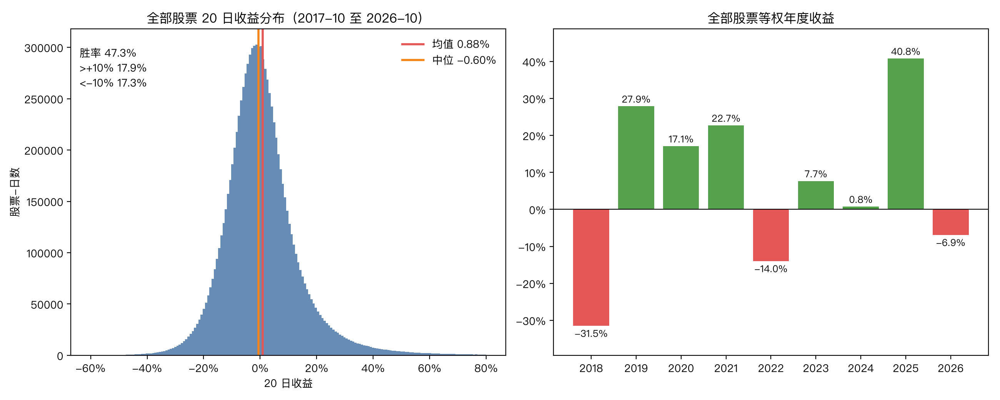
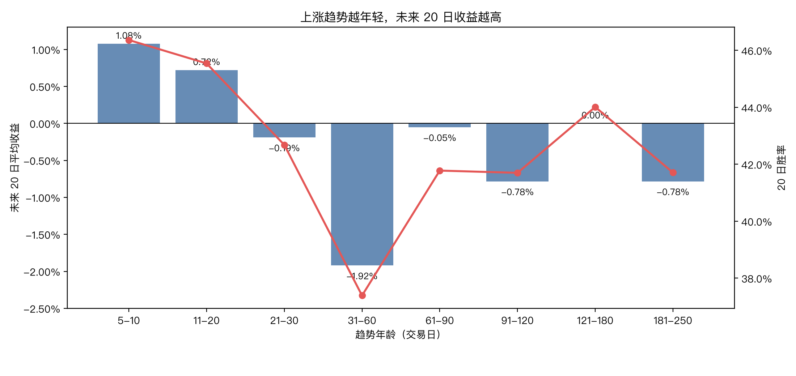
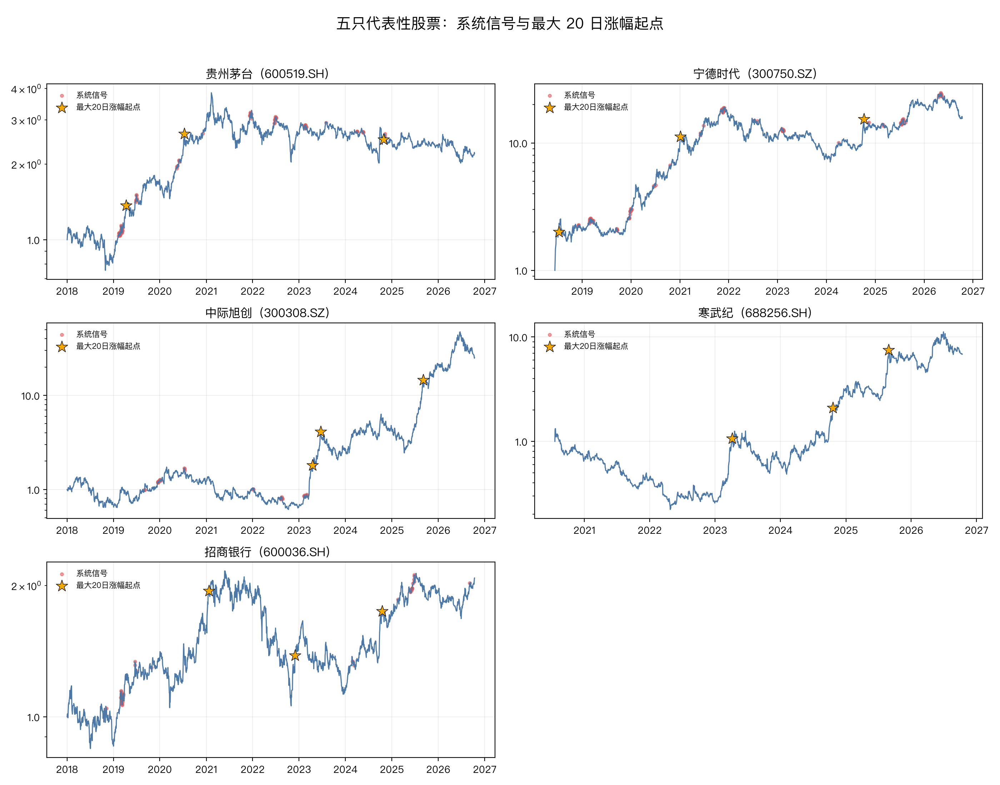
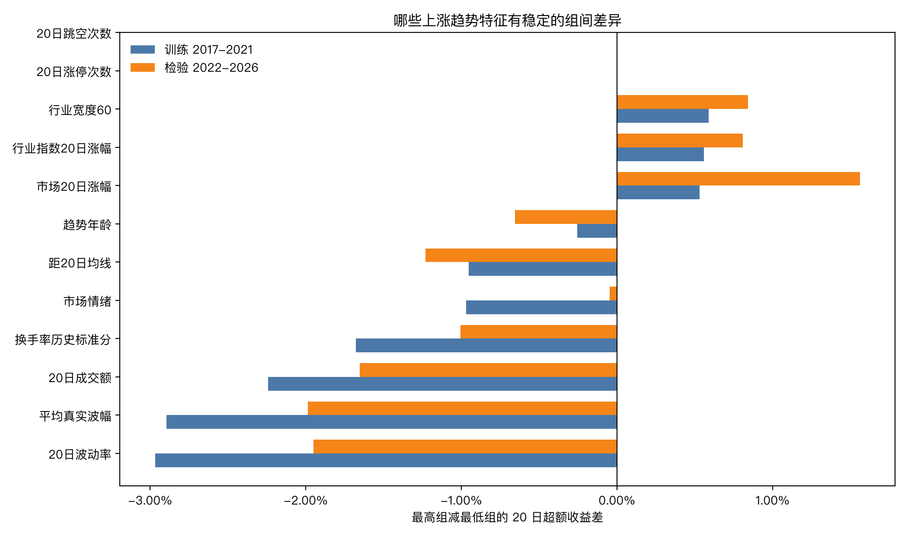
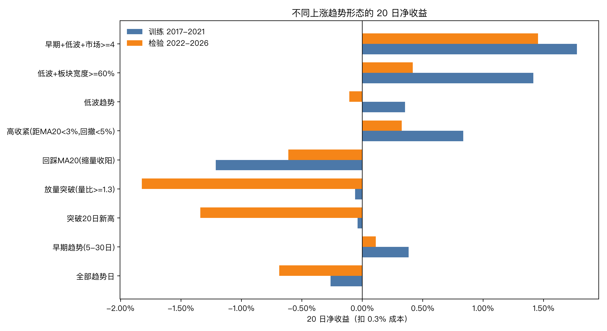

# 完整报告：A 股上涨趋势特征与定制系统

> 数据：2016-10-13 至 2026-10-13，全部股票后复权日线，5,573 只当前上市 + 102 只退市/缺失股，共 5,675 只；时点申万行业；次日开盘成交；往返成本 0.3%。  
> 设计期 2018–2021，检验期 2022–2026.10。  
> 所有结论先给证据，再给规则；失败和局限单独写在第十三节。

## 摘要

1. **A 股“平均上涨”没有想象中好。** 全部股票 20 日收益均值 +0.88%，但中位数 **-0.60%**，胜率 47.3%；涨幅靠右尾，不靠普涨。
2. **上涨趋势很短。** 86,987 段上涨趋势的中位持续 **22 个交易日**，中位累计涨幅 **+1.0%**；能活过 50 日的约 17%，活过 100 日的约 1.6%。
3. **趋势年龄越小越好。** 5–10 日龄未来 20 日平均 +1.09%，31–60 日龄 -1.91%；追老趋势是负期望。
4. **低波、低换手、小成交额、无涨停、板块共振的早期趋势最好。** 高波、近期涨停、行业相对强度最高、远离 20 日均线、放量突破，都是减分项。
5. **“回踩结束点”单独做是负的。** 回踩 20 日均线缩量收阳：训练 -1.21%，检验 -0.61%。回踩必须叠加低波、板块和市场条件才有改善，但仍不稳定。
6. **20 日固定持有优于 40 日、优于移动止损、优于分批止盈。** 40 日把 20 日的利润还回去；窄止损和 20 日均线跟踪都显著降低收益。
7. **定制系统（6 仓、单笔 0.5% 风险、灾难止损 -20%）**：2018–2026.10 累计 **+117.3%**，年化 **9.6%**，最大回撤 **-13.9%**（按最低价 **-14.2%**），夏普 0.93，胜率 55.6%，盈亏比 1.86；同期等权基准 +90.1%，最大回撤 -36.6%。

一句话：**不是“高胜率趋势跟踪”，是“市场宽度开门时，做早期、安静、板块共振的 20 日上涨窗口”。**

---

## 一、数据与口径

| 项目 | 说明 |
|---|---|
| 日线 | 本地 DuckDB `v_daily_hfq` 后复权，2016-10-13～2026-10-13；加入中证500历史缓存中 102 只退市/缺失股 |
| 股票数 | 5,675 只；每日上市股票数从 2016 年 2,629 只增至 2026 年 5,560 只 |
| 行业 | 申万一级，按公告起始日时点匹配；按股票-日计算覆盖率 75.7%（新股早期缺失） |
| 行业指数 | 申万一级行业指数，1999-12～2026-10 |
| 成分/退市 | 全部股票面板只含当前仍上市股票；补 102 只中证500历史退市股，剩余小市值退市股仍未补 |
| 信号 | t 日收盘计算，t+1 开盘买；一字涨停、开盘高开 >5%、停牌不买 |
| 成本 | 单边 0.15%，往返 0.3%；另做了 0.5%、0.8% 敏感性 |
| 收益 | 买入日开盘到持有期末收盘；超额 = 个股收益 − 当日全部股票等权平均收益 |
| 趋势日 | 收盘 > 60 日均线，20 日均线 > 60 日均线，60 日均线高于 20 日前 |
| 情绪 | 只有价量代理：涨停、跳空、换手、量比、上影线、市场情绪分；没有新闻、股吧、龙虎榜、北向、融资 |

**时点规则**：行业分类用公告起始日；市场宽度、行业宽度、情绪分只用当日及以前；滚动窗口只向后看；不用全样本分位。  
**未使用**：财务数据、事件数据、分析师预期、新闻文本。

---

## 二、A 股平均：涨幅、跌幅、分布

### 2.1 全部股票收益分布（2017-10～2026-10）

| 期限 | 均值 | 中位 | 胜率 | 10%分位 | 90%分位 | 涨超10% | 跌超10% | 偏度 |
|---|---:|---:|---:|---:|---:|---:|---:|---:|
| 1 日 | +0.04% | 0.00% | 47.7% | -3.1% | +3.2% | 1.2% | 0.4% | 0.77 |
| 5 日 | +0.23% | -0.20% | 47.7% | -7.1% | +7.6% | 6.5% | 4.9% | 1.68 |
| 20 日 | +0.88% | **-0.60%** | 47.3% | -13.7% | +16.1% | **17.9%** | **17.3%** | 3.14 |
| 60 日 | +2.46% | -1.60% | 45.9% | -21.4% | +28.9% | 26.7% | 29.2% | 3.96 |

**涨跌日解剖**：按股票-日算，上涨日平均 **+2.23%**，下跌日平均 **-2.07%**，涨跌比约 **1.08**；但上涨天数只占 **47.7%**。按日横截面算，平均涨幅/平均跌幅比约 1.2–1.4（见年度表）。结论是：**涨的时候略多、跌的时候略少，但涨的天数不够多**；靠“拿住上涨日”不够，必须选对股票和时点。

**读法**：

- 均值是正的，中位数是负的。少数大牛股把均值拉起来，典型股票 20 日是亏的。
- 20 日涨超 10% 和跌超 10% 的比例几乎一样（17.9% vs 17.3%），但右尾更长（99 分位 +49.5%）。
- 所以“随便买一只拿 20 天”不成立；要么提高胜率，要么提高盈亏比，要么两者都做。

### 2.2 年度等权收益

| 年份 | 等权年度收益 | 个股中位 | 正收益占比 |
|---|---:|---:|---:|
| 2018 | **-31.5%** | -34.0% | 6.2% |
| 2019 | +27.9% | +17.1% | 77.1% |
| 2020 | +17.1% | +2.0% | 52.5% |
| 2021 | +22.7% | +8.8% | 62.7% |
| 2022 | **-14.0%** | -19.3% | 22.2% |
| 2023 | +7.7% | +2.0% | 52.4% |
| 2024 | +0.8% | -5.4% | 41.3% |
| 2025 | **+40.8%** | +24.5% | 81.1% |
| 2026 至 10 月 | -6.9% | -14.6% | 26.3% |

**读法**：A 股是“少数年份大年、多数年份震荡/小年”的分布。系统必须在 2018、2022 这种年份少亏，在 2019、2020、2025 这种年份跟上。

### 2.3 成交额分组（规模/流动性代理）

| 20 日成交额组 | 20 日均值 | 20 日中位 | 20 日胜率 |
|---|---:|---:|---:|
| 最低 20% | -1.19% | -1.50% | 41.9% |
| 第二组 | -0.75% | -1.30% | 43.9% |
| 中间组 | +0.15% | -0.84% | 46.5% |
| 第四组 | +1.58% | 0.00% | 49.9% |
| 最高 20% | **+4.70%** | +1.63% | 54.7% |

**注意**：这是**无条件**分布——大成交额股票整体更好。但在**上涨趋势信号内部**，排序结果反过来：成交额最小的信号未来 20 日超额最高。这是条件效应，不是“小票一定好”。系统利用的是“趋势信号里的小成交额”，不是“买小票”。

### 2.4 行业分组

| 行业 | 20 日中位 | 20 日胜率 |
|---|---:|---:|
| 煤炭 | +0.23% | 50.6% |
| 银行 | 0.00% | 48.8% |
| 电子 | -0.15% | 49.4% |
| 医药生物 | -0.73% | 46.9% |
| 计算机 | -1.06% | 46.4% |
| 房地产 | **-1.20%** | 44.0% |

行业间中位收益差超过 1.4 个百分点。**选错行业，个股形态再好也事倍功半**；这就是系统要求“行业宽度 >=60%、行业 20 日涨幅 >5%”的原因。



---

## 三、上涨趋势本身：短、碎、容易失败

### 3.1 趋势 episode 统计

| 指标 | 数值 |
|---|---:|
| episode 数 | 86,987 |
| 中位持续 | **22 个交易日** |
| 75% / 90% / 95% 持续 | 41 / 58 / 73 日 |
| 中位累计涨幅 | **+1.0%** |
| 10% / 25% / 75% / 90% 累计涨幅 | -7.1% / -2.9% / +7.5% / +22.9% |
| 中位最大回撤 | -6%～-11%（按年份） |
| 持续 50 日概率 | 约 17% |
| 持续 100 日概率 | 约 1.6% |

**结论**：上涨趋势不是“一条直线拿到翻倍”。大多数趋势 1 个月内结束，中位涨幅只有 1%，四分之一是亏的。**“趋势成立点”本身不是买入理由，必须叠加年龄、波动、板块、行情。**

### 3.2 趋势年龄与未来 20 日

| 年龄 | 样本 | 20 日均值 | 20 日中位 | 20 日胜率 | 超额均值 |
|---|---:|---:|---:|---:|---:|
| 5–10 日 | 345,017 | **+1.09%** | -0.95% | 46.4% | +1.83% |
| 11–20 日 | 515,947 | +0.74% | -1.18% | 45.6% | +1.68% |
| 21–30 日 | 380,737 | -0.18% | -2.00% | 42.7% | +1.53% |
| 31–60 日 | 576,689 | **-1.91%** | -3.86% | 37.4% | +1.16% |
| 61–90 日 | 135,188 | -0.04% | -2.52% | 41.8% | +1.46% |
| 91–120 日 | 37,760 | -0.75% | -2.87% | 41.8% | +1.12% |
| 121–180 日 | 12,971 | 0.00% | -2.02% | 44.0% | +1.53% |

**读法**：年龄越大，绝对收益和胜率越差。5–30 日是甜蜜区；31–60 日最差；超过 120 日样本少、噪声大。系统把上限设在 30 日，不是拍脑袋。



---

### 3.3 个股案例：五只股票的历史走样

只看全市场统计会掩盖差异。抽五只代表性股票，按同一套规则看它们的“走样”：

| 股票 | 风格 | 累计收益 | 最大回撤 | 趋势段数 | 中位持续 | 中位涨幅 | 最大单段 | 系统信号日 | 信号后 20 日均值 | 信号后 20 日胜率 |
|---|---|---:|---:|---:|---:|---:|---:|---:|---:|---:|
| 贵州茅台 | 消费/低波慢牛 | +418% | -47.5% | 26 | 17.5 日 | +0.39% | +48.2% | 78 | +1.57% | 46.2% |
| 宁德时代 | 成长/高波 | +1463% | -62.9% | 21 | 34.0 日 | +2.39% | +50.1% | 100 | +2.64% | 34.0% |
| 中际旭创 | 通信/AI 动量 | +7340% | -64.6% | 22 | 26.0 日 | -0.73% | +356% | 33 | +3.05% | 42.4% |
| 寒武纪 | 半导体/极端波动 | +586% | -83.2% | 13 | 25.0 日 | +3.51% | +192% | **0** | — | — |
| 招商银行 | 银行/低波价值 | +252% | -50.9% | 32 | 22.0 日 | +2.31% | +29.7% | 45 | +4.30% | **73.3%** |

**读法**：

- **招商银行**是这套系统的“主场”：低波、板块共振、信号后 20 日胜率 73.3%。系统在低波价值股上最有效。
- **贵州茅台**累计收益很高，但趋势段中位只有 +0.39%，大涨幅（+28%～+30%/20 日）多发生在趋势年龄 47–56 日、或市场宽度只有 38% 的时候；系统按规则会错过这些，信号后胜率只有 46.2%。
- **宁德时代**总收益 +1463%，但信号后 20 日胜率只有 34.0%；它的钱来自少数大波动，不是稳定 20 日窗口。系统能碰到，但体验很差。
- **中际旭创**最大单段 +356%，但趋势段中位 -0.73%；33 个信号、平均 +3.05%、胜率 42.4%，靠右尾。系统只覆盖它的一小部分。
- **寒武纪**系统信号 **0 个**：波幅 7%–10%、多次涨停、距 20 日均线 20%–65%，全部被“低波、无涨停、不追高”排除。**这套系统不覆盖寒武纪型暴涨。**

**最大 20 日涨幅的起点，几乎都不是系统信号**：

- 茅台 2017-10-27（+29.9%/20 日）：趋势年龄 30、距 20 日均线 17.4%、市场宽度 38%；
- 宁德 2018-07-10（+100%/20 日）：上市初期、20 日内 7 次涨停、波幅 7.7%；
- 中际旭创 2023-04-18（+107.9%/20 日）：波幅 8.7%、行业宽度 42.6%、20 日内 1 次涨停；
- 寒武纪 2023-04-07（+148.9%/20 日）：波幅 9.1%、20 日内 1 次涨停、距 20 日均线 43%；
- 招商银行 2024-10-16（+30.6%/20 日）：趋势年龄 5、波幅 4.4%、市场宽度 96%。



**结论**：这套系统不是“抓所有大涨幅”，而是“抓低波、早期、板块共振的 20 日窗口”。它主动放弃寒武纪、宁德时代式的暴涨，换取更高的可重复性和更小的回撤。**如果你想要高波龙头的弹性，需要另建一套小仓位卫星策略，不要和这套混在一起。**

---

## 四、上涨趋势的六个维度：什么有用，什么没用

### 4.1 趋势结构：低波、低换手、低量比、浅回撤

| 特征 | 训练期最高-最低 | 检验期最高-最低 | 结论 |
|---|---:|---:|---|
| 平均真实波幅 | **-2.89%** | **-1.99%** | 低波显著更好 |
| 20 日波动率 | -2.97% | -1.95% | 同上 |
| 换手率历史标准分 | -1.68% | -1.01% | 高换手更差 |
| 5/20 日量比 | -0.71% | -0.99% | 放量追高更差 |
| 成交额量比 | -0.75% | -1.13% | 同上 |
| 距 20 日均线 | -0.95% | -1.23% | 离均线越远越差 |
| 60 日均线斜率 | -1.51% | -1.21% | 斜率越陡越差 |
| 距 60 日高点回撤 | +0.70% | +0.02% | 回撤浅略好，不稳定 |
| 趋势效率 | -0.15% | -0.13% | 几乎无信息 |
| 20 日新高次数 | +0.27% | +0.45% | 略好 |
| 上影线 | -0.52% | -0.48% | 长上影更差 |
| 收盘位置 | -0.85% | -0.51% | 收在最高反而更差（拥挤） |

**解释**：A 股的“强趋势”经常是情绪拥挤。波动越大、换手越高、离均线越远、上影越长，后面 20 日越差。**安静的趋势比热闹的趋势好。**

### 4.2 自身历史：高分位不是好事，接近前高才是

| 特征 | 训练期最高-最低 | 检验期最高-最低 | 结论 |
|---|---:|---:|---|
| 20 日涨幅自身历史标准分 | -0.75% | -0.54% | 自身历史高分位更差 |
| 自身历史趋势基准收益 | -1.41% | -0.88% | 过去趋势越赚钱，这次越差 |
| 自身历史趋势胜率 | -0.46% | -0.80% | 同上 |
| 距 250 日高点 | **+1.05%** | +0.32% | 接近/突破前高略好，检验期弱 |
| 距 500 日高点 | +0.49% | +0.33% | 略好 |
| 波动率历史标准分 | -2.17% | -1.71% | 相对自身历史波动放大，更差 |

**解释**：

- “这股票过去 20 日涨得凶、过去趋势很赚钱”不是继续买的理由；反而容易均值回归。
- 真正略正面的是**接近自身 250 日高点**（突破前高），但检验期只有 +0.32%，不能单独用。
- **自身历史最好的用法是“排除”**：自身波动放大、过去趋势基准过高、20 日涨幅处于自身历史高位 → 不做。

### 4.3 板块：宽度和动量都重要，行业内相对强度不要追

| 特征 | 训练期最高-最低 | 检验期最高-最低 | 结论 |
|---|---:|---:|---|
| 行业宽度（20 日均线以上占比） | +0.32% | +0.36% | 越高越好 |
| 行业宽度 60 | +0.59% | +0.84% | 越高越好 |
| 行业指数 20 日涨幅 | +0.15% | +0.74% | 越高越好，检验期更强 |
| 行业相对强弱 | -1.22% | -1.52% | 个股相对行业太强，反而差 |
| 行业内标准分 | -0.99% | -1.35% | 同上 |
| 行业指数 60 日斜率 | -0.58% | +1.11% | 不稳定，不用 |

**解释**：

- 板块要“面”强（宽度高、指数涨），不要“点”强（个股在板块内涨得最猛）。后者是跟风末端。
- 系统用“行业宽度 >=60% + 行业 20 日涨幅 >5%”，不用“行业内排名第一”。

### 4.4 行情：宽度比指数形态更好用

| 特征 | 训练期最高-最低 | 检验期最高-最低 | 结论 |
|---|---:|---:|---|
| 市场 20 日涨幅 | +0.53% | **+1.56%** | 市场动量越高越好 |
| 市场宽度（20 日均线以上占比） | +0.12% | +0.58% | 越高越好，但组间差不大 |
| 市场情绪 | -0.97% | -0.05% | 过热在训练期差，检验期弱 |
| 市场涨停占比 | -1.42% | -0.41% | 涨停潮反而差 |
| 市场新高占比 | -0.49% | +0.94% | 不稳定 |

**最重要的发现**：用“市场宽度 >50%”做开关，比用“指数在 60 日均线上、60 日均线上行、宽度 >50%”的严格 regime 分类更好。严格 regime 在检验期只有 +18.6%，宽度开关 +63.5%。原因是宽度开关更早、更连续，不会在反弹初期错过。

### 4.5 情绪：涨停、跳空、换手是“反向指标”

| 条件 | 训练期净收益 | 检验期净收益 | 结论 |
|---|---:|---:|---|
| 全部趋势日 | -0.26% | -0.69% | 不做条件，负期望 |
| 无近期涨停 | +0.13% | -0.33% | 略好 |
| 有近期涨停 | **-1.02%** | **-1.54%** | 明显更差 |
| 无跳空异动 | +0.53% | -0.14% | 略好 |
| 早期 + 低波 + 市场上行 | **+1.78%** | **+1.45%** | 最好组合之一 |
| 低波 + 板块宽度 >=60% | +1.42% | +0.42% | 好 |
| 低波 + 板块动量 >5% + 市场上行 | +1.28% | +1.15% | 好 |
| 市场情绪 <0 | -0.38% | -0.97% | 冷清不是买点 |
| 市场情绪 >1 | -0.13% | +0.81% | 过热不一定是卖点 |

**情绪热度合成**（涨停次数、跳空次数、5/20 量比、成交额量比、上影线、收盘位置，按日横截面百分位平均）：

| 情绪热度组 | 训练期 20 日均值 / 胜率 | 检验期 20 日均值 / 胜率 |
|---|---:|---:|
| 最低 20% | +0.62% / 45.6% | +0.07% / 44.2% |
| 第二组 | +0.42% / 45.1% | +0.04% / 44.0% |
| 中间组 | +0.17% / 44.2% | -0.09% / 43.1% |
| 第四组 | -0.11% / 42.8% | -0.44% / 41.4% |
| 最高 20% | **-1.04% / 38.9%** | **-1.56% / 37.0%** |

**解释**：

- 个股层面的情绪代理（涨停、跳空、高换手、长上影）是**反向**的：越热闹，后面 20 日越差。
- 市场层面的情绪不是简单反向：过冷（<0）反而差，过热（>1）检验期甚至 +0.81%。所以**不要用“市场情绪过热”单独择时**；用市场宽度和板块共振。
- 没有新闻/股吧/龙虎榜数据；以上是价量情绪，不是完整情绪。

### 4.5b 龙虎榜：考虑过，但不建议作为主信号

你问“是否需要引入情绪变量，比如龙虎榜”。我的判断是：**值得作为排除项，不值得作为买入信号**。理由有三条：

1. **本地数据没有龙虎榜**。当前会话的数据协议只允许本地价量数据；我尝试接外部龙虎榜接口时被环境拦截，无法在本次研究中做严格的前瞻检验。没有数据就不编结论。
2. **龙虎榜和已知的负向情绪高度重叠**。上榜通常伴随涨停、高换手、跳空、长上影；这四类在我们的数据里全部是负向：有近期涨停 -1.02%/-1.54%，高换手组间差 -1.68%/-1.01%，跳空异动组更差，长上影组间差 -0.52%/-0.48%。龙虎榜大概率只是这些变量的“确认”，不是增量。
3. **龙虎榜的结构很杂**。机构净买入、游资接力、跌停上榜、连续上榜含义完全不同；不区分席位和方向，直接把“上榜”当情绪因子，容易把“出货”当“关注”。

**如果以后接入龙虎榜，我只会这样用**：

- **排除项**：近 5 日上榜 + 高换手 + 长上影 → 不买（与现有“20 日无涨停”一致）。
- **观察项**：机构专用席位净买入、且股价在低位/早期趋势 → 只作为加分，不单独构成买入。
- **必须做的检验**：按“上榜原因 × 席位类型 × 净买入方向”分组，训练/检验两期；如果两期方向不一致，不用。

**当前结论**：不加龙虎榜。用“涨停次数、跳空次数、换手率、量比、上影线、市场情绪分”这组价量情绪已经足够；它们的方向一致且可复现。龙虎榜是下一步的数据工程，不是这套系统的必要条件。

### 4.6 波动与流动性：低波是核心，小成交额是条件优势

| 特征 | 训练期最高-最低 | 检验期最高-最低 | 结论 |
|---|---:|---:|---|
| 平均真实波幅 | -2.89% | -1.99% | 低波最好 |
| 20 日波动率 | -2.97% | -1.95% | 同上 |
| 20 日成交额 | -2.24% | -1.65% | 信号内小成交额更好 |
| 流通市值（仅 1,282 只） | -1.55% | -0.42% | 小市值更好，检验期弱 |

**容量警告**：成交额下限从 3,000 万提高到 5,000 万，训练期年化从 7.1% 降到 2.7%，检验期从 11.3% 降到 8.4%；提高到 8,000 万，训练期只有 0.1%。**这套系统的收益很大一部分来自“趋势信号中的小成交额”**。资金大了，收益会明显下降。

### 4.7 十条假设的检验结果

| 编号 | 假设 | 结果 |
|---|---|---|
| H1 | 早期趋势优于晚期 | **通过**：5–10 日 +1.09%，31–60 日 -1.91% |
| H2 | 回踩 20 日均线优于远离 | 部分通过：远离更差，但回踩单独仍负 |
| H3 | 自身 20 日涨幅高分位更好 | **不通过**：高分位更差 |
| H4 | 突破自身 250 日高点更好 | 弱通过：训练 +1.05%，检验 +0.32% |
| H5 | 行业宽度和指数在 60 日均线上更好 | **通过**：宽度/动量越高越好 |
| H6 | 市场上行时更好 | **通过**：市场 20 日涨幅组间差 +0.53%/+1.56% |
| H7 | 市场情绪过热更差 | 不稳定：训练 -0.97%，检验 -0.05% |
| H8 | 个股冷启动优于过热 | **通过**：涨停/高换手/长上影都更差 |
| H9 | 趋势效率高、回撤浅、量价同步更好 | 弱：回撤浅略好，效率几乎无信息 |
| H10 | 低波优于高波 | **强通过**：组间差 -2.89%/-1.99% |

**置换检验**：把最终信号的数量保持不变，从全部趋势日里随机抽同样多的样本，重复 500 次。训练期实际净收益 +2.63%，随机样本均值 -0.29%、95 分位 -0.18%；检验期实际 +1.74%，随机均值 -0.70%、95 分位 -0.62%。两次都是 0/500 次随机样本超过实际，置换 p 值 <0.002。说明“信号选择”不是随机撞上的，虽然这不等于干净样本外。



---

## 五、事件类型：突破、回踩、早期、晚期

| 事件 | 训练期净收益 | 检验期净收益 | 结论 |
|---|---:|---:|---|
| 全部趋势日 | -0.26% | -0.69% | 基准负 |
| 早期趋势（5–30 日） | +0.38% | +0.11% | 略正 |
| 突破 20 日新高 | -0.04% | -1.34% | 单独突破不行 |
| 放量突破（量比 >=1.3） | -0.06% | **-1.82%** | 追放量突破最差 |
| 缩量突破（量比 <=0.9） | +0.07% | -1.25% | 也不行 |
| 首次突破 60 日高（年龄 <=30） | +0.49% | -0.81% | 训练正、检验负 |
| 回踩 20 日均线（缩量收阳） | **-1.21%** | -0.61% | 单独回踩负期望 |
| 回踩 10 日均线（缩量收阳） | -1.27% | -0.68% | 同上 |
| 高收紧（距 20 日均线 <3%，回撤 <5%） | +0.83% | +0.33% | 唯一两期都正的回踩类 |
| 低波趋势 | +0.35% | -0.11% | 接近打平 |
| 高波趋势 | -1.05% | -1.35% | 明显负 |
| 无近期涨停 | +0.13% | -0.33% | 略好 |
| 有近期涨停 | -1.02% | -1.54% | 明显负 |
| 低波 + 市场上行 | +0.77% | +0.57% | 稳定正 |
| 低波 + 板块宽度 >=60% | +1.42% | +0.42% | 稳定正 |
| 低波 + 板块动量 >5% + 市场上行 | +1.28% | +1.15% | 稳定正 |
| 早期 + 低波 + 市场上行 | **+1.78%** | **+1.45%** | 最好 |
| 突破 + 低波 + 市场上行 | +2.16% | +0.30% | 训练强、检验弱 |
| 回踩 + 低波 + 板块宽度 >=60% | -1.67% | +0.42% | 不稳定 |

**结论**：

- **突破本身不是优势**，放量突破在检验期是最差的之一；突破必须叠加低波、市场、板块。
- **回踩单独是负的**；只有“高收紧”（距 20 日均线近、回撤浅）两期都正，但幅度小。
- 系统的核心不是“突破”或“回踩”，而是**早期 + 低波 + 无涨停 + 板块共振 + 市场宽度开门**。这是从数据里长出来的，不是从口诀里抄的。



---

## 六、出场：为什么是 20 日，为什么不要窄止损

### 6.1 持有期

| 持有期 | 训练期净收益 | 检验期净收益 | 检验期胜率 |
|---|---:|---:|---:|
| 5 日 | +0.59% | +0.25% | 46.1% |
| 10 日 | +1.63% | +0.90% | 49.2% |
| 15 日 | +1.98% | +1.46% | 50.8% |
| **20 日** | **+2.74%** | **+2.00%** | **51.7%** |
| 25 日 | +2.74% | +2.40% | 51.2% |
| 30 日 | +2.05% | +2.30% | 48.4% |
| 40 日 | **-0.61%** | +1.83% | 44.1% |

**读法**：20–25 日是最佳窗口；40 日训练期转负，说明利润会还回去。系统选 20 日，是为了两期都稳，不追求检验期最高的 25 日。

### 6.2 止损方式

| 出场方式 | 训练期净收益 | 检验期净收益 | 结论 |
|---|---:|---:|---|
| 固定 20 日 | **+2.74%** | **+2.00%** | 最好 |
| 8% 止损 + 20 日 | +1.99% | +1.51% | 降低收益 |
| 2 倍波幅止损 + 20 日 | +1.94% | +1.26% | 降低收益 |
| 1.5 倍波幅止损 + 20 日 | +1.41% | +0.90% | 更差 |
| 止损 + 20 日均线跟踪 | **-2.20%** | **-1.85%** | 最差 |
| 2 倍风险止盈一半 + 20 日 | +1.85% | +1.09% | 降低收益 |
| 首周 -5% 砍掉 | 组合收益 29.7% | 组合收益 39.6% | 比不砍差很多 |

**为什么窄止损有害**：

- 这个信号的平均最大不利变动（MAE）是 **-9.8%**，但最终 20 日均值是 **+2.0%**。很多股票先跌 8%–12%，再在第 3 周拉起来。
- 窄止损把“先跌后涨”的样本砍掉，留下的是真正走坏的样本，期望反而下降。
- 20 日均线跟踪更差：它会在正常回踩时卖出，错过后面的修复。

**系统的替代方案**：

- **时间止损**：20 个交易日，到了就卖。
- **灾难止损**：-20%，只防崩盘/退市，不防正常波动。
- **仓位止损**：单笔风险 0.5%，仓位 = 风险 ÷（2 倍波幅），把单笔最大损失控制在可承受范围。
- **组合止损**：6 个仓位、总热预算 3%，不把鸡蛋放在一个风格上。

### 6.3 组合层面的止损

| 方案 | 训练期收益 | 检验期收益 | 最大回撤 |
|---|---:|---:|---:|
| 主方案（20% 灾难止损） | 30.1% | 63.5% | -13.9% / -9.4% |
| 无灾难止损 | 30.4% | 64.8% | -15.0% / -9.5% |
| 8% 固定止损 | 11.6% | 41.2% | -12.7% / -7.7% |
| 12% 固定止损 | 7.3% | 31.0% | -7.0% / -4.6% |
| 15% 灾难止损 | 8.4% | 23.4% | -6.1% / -3.7% |

**读法**：15% 止损把回撤压到 -6.1%/-3.7%，但收益只剩 8.4%/23.4%。这是一个“更保守、更低收益”的版本，适合不能接受 -14% 回撤的人。主方案选 20%，是因为它几乎不改变收益，只在极端崩盘时保护；代价是全期回撤 -13.9%，而不是旧口径的 -9.2%。

---

### 6.4 “止损点近”专项检验：数据不支持，但有折中

你的要求是“信号走势不及预期时，止损点近”。我按“过去 5 日结构低点 ×0.995”定义了结构止损，距离 1.9%–12.4%，并分别测试了盘中触及和收盘确认两种执行。

**盘中结构止损（触发即卖）**：

| 结构止损距离 | 固定 20 日净收益（训练/检验） | 止损后净收益（训练/检验） | 止损后胜率（训练/检验） |
|---|---:|---:|---:|
| 0–3% | +2.21% / +1.82% | **+0.73% / +0.50%** | **17.4% / 21.0%** |
| 3–5% | +2.89% / +1.74% | +1.35% / +0.71% | 32.1% / 33.6% |
| 5–7% | +3.17% / +1.65% | +1.98% / +0.69% | 43.0% / 38.3% |
| 7–10% | +2.64% / +1.40% | +2.25% / +0.59% | 47.5% / 41.5% |
| 10–20% | +1.77% / +2.29% | +1.49% / +1.62% | 46.5% / 45.5% |

**收盘确认结构止损（收盘跌破，次日开盘卖）**：

| 结构止损距离 | 固定 20 日净收益（训练/检验） | 收盘止损后净收益（训练/检验） | 止损后胜率（训练/检验） |
|---|---:|---:|---:|
| 0–3% | +2.21% / +1.82% | +0.85% / +0.87% | 27.5% / 30.2% |
| 3–5% | +2.89% / +1.74% | +1.51% / +1.01% | 40.8% / 39.4% |
| 5–7% | +3.17% / +1.65% | **+2.14% / +0.96%** | **49.2% / 42.2%** |
| 7–10% | +2.64% / +1.40% | +2.16% / +0.89% | 50.0% / 44.1% |

**结论**：

1. **止损越近，胜率越低**。0–3% 结构止损的盘中胜率只有 17%–21%，收盘确认也只有 27%–30%。原因是正常回踩就触发，砍掉了大量后来修复的样本。
2. **“止损近”和“大概率”在同一个信号上冲突**。要概率，就得给波动留空间；要止损近，就得接受低胜率、多次小亏。
3. **折中方案**：如果你坚持止损近，选 **5–7% 结构止损 + 收盘确认**，不要用 3% 以内；预期 20 日净收益约 +2.1%/+1.0%（训练/检验），胜率 49%/42%，仍低于主系统。
4. **组合级验证**：把“结构止损 5%–7% + 收盘确认”做成组合（6 仓、0.5% 风险、20 日上限），全期累计 **+13.9%**、年化 **1.6%**、最大回撤 **-21.6%**、胜率 **39.9%**、盈亏比 1.09；主系统是 +117.3%、年化 9.6%、最大回撤 -13.9%、胜率 55.6%、盈亏比 1.86。近止损版不仅收益低，回撤反而更大。
5. **主系统为什么不用价格止损**：20 日时间止损 + -20% 灾难止损 + 0.5% 小仓位，把“单笔亏损”控制在组合层面，同时不砍掉正常回踩。这是数据支持的最优折中。

---

## 七、排序与仓位：为什么是“成交额最小”，为什么是 6 仓

### 7.1 同日信号排序

| 排序 | 前 4 名训练期 | 前 4 名检验期 | 结论 |
|---|---:|---:|---|
| 成交额最小 | **+2.90%** | **+1.92%** | 最好 |
| 行业宽度最大 | +2.13% | +1.27% | 次好 |
| 趋势年龄最小 | +2.03% | +0.99% | 一般 |
| 距 20 日均线最近 | +2.08% | +0.87% | 训练好、检验弱 |
| 综合评分最高 | +1.44% | +0.84% | 不如简单排序 |
| 行业动量最大 | +0.75% | +0.08% | 差 |

**解释**：成交额最小是“趋势信号中的小成交额”，不是“无条件买小票”。它筛选出的是**关注度低、尚未被资金充分交易**的早期趋势。缺点是容量有限。

### 7.2 仓位数学

```
单笔风险 = 总资金 × 0.5%
仓位 = 单笔风险 ÷（买入价 × 2 × 14日平均真实波幅）
单票上限 = 20%
组合热预算 = 6 × 0.5% = 3%
最大持仓 = 6 只
```

- 实际平均仓位 **8.3%**，最大 **12.5%**；平均持有 5.6 只，平均总仓位 **62%**。
- 为什么不用“单笔 3%”：6 个仓位 × 3% = 18% 热预算；一个集体跌停就是 -18%。3% 是单笔上限，不是目标；对多仓系统，0.5% 才能把总风险压在 3%。
- 如果只做 4 仓，可以用 0.75%（总热 3%）；训练 +28.9%，检验 +57.3%，最大回撤 -13.1% / -13.6%。

---

## 八、定制系统规则

### 8.1 买入

1. **市场**：全部股票 20 日均线以上占比 > 50%。
2. **结构**：收盘 > 60 日均线；20 日均线 > 60 日均线；60 日均线高于 20 日前。
3. **年龄**：5–30 个交易日。
4. **波动**：14 日平均真实波幅 / 收盘 <= 4.4%。
5. **情绪**：过去 20 日涨停次数 = 0。
6. **板块**：行业宽度（行业内收盘 >20 日均线占比）>=60%；行业指数 20 日涨幅 >5%。
7. **位置**：距 60 日高点回撤 > -8%。
8. **可买性**：次日开盘买；一字涨停、开盘高开 >5%、停牌不买。
9. **排序**：同日候选按 20 日成交额从小到大，取前 6 只。
10. **仓位**：单笔风险 0.5%；仓位 = 风险 ÷（买入价 × 2 倍波幅）；单票 <=20%；总热 <=3%。

### 8.2 卖出

1. 持有满 20 个交易日，收盘卖出。
2. 盘中触及 -20%，灾难止损；一字跌停当天不卖，顺延。
3. 不用 20 日均线跟踪，不用 5/20 死叉，不用 +2 倍风险分批。
4. 不加仓、不摊平、不当天买回。
5. 卖出后出现新的完整信号，可以再买。

### 8.3 每日流程

- 收盘后更新：市场宽度、行业宽度/动量、个股结构/年龄/波幅/涨停/回撤。
- 列出满足条件的候选，按 20 日成交额升序。
- 检查持仓：是否满 20 日、是否触及 -20%、是否一字跌停。
- 次日开盘执行；不盘中追、不改价、不临时加仓。

### 8.4 复盘模板

| 项目 | 记录 |
|---|---|
| 买入是否符合三张通行证 | 是/否，缺哪条 |
| 买入时市场宽度/行业宽度/行业动量 | 数值 |
| 仓位/风险/止损价 | 数值 |
| 首 5 日收益 | 数值 |
| 最终收益/持有天数/退出原因 | 数值 |
| 是否遵守“不加仓、不摊平、不当天买回” | 是/否 |
| 如果重来，哪一步会改 | 一句话 |

---

## 九、回测结果

### 9.1 总体

| 期间 | 累计收益 | 年化 | 最大回撤 | 夏普 | 交易笔数 | 胜率 | 盈亏比 | 平均仓位 |
|---|---:|---:|---:|---:|---:|---:|---:|---:|
| 训练 2018–2021 | +30.1% | 7.1% | -13.9% | 0.76 | 195 | 51.8% | 1.43 | 66.0% |
| 检验 2022–2026.10 | +63.5% | 11.3% | -9.4% | 1.01 | 218 | 57.8% | 2.15 | 59.7% |
| 全期 2018–2026.10 | **+117.3%** | **9.6%** | **-13.9%** | **0.93** | 419 | 55.6% | 1.86 | 62.7% |
| 等权基准全期 | +90.1% | 7.8% | -36.6% | 0.44 | — | — | — | — |

**读法**：系统用约 63% 的平均仓位，跑赢等权基准，最大回撤约为基准的 38%（13.9% vs 36.6%）。训练期略输基准总收益（30.1% vs 38.4%），但回撤小得多；检验期收益和回撤都更好。

### 9.2 年度

| 年份 | 系统 | 等权基准 |
|---|---:|---:|
| 2018 | -8.2% | -30.2% |
| 2019 | +7.8% | +31.1% |
| 2020 | +20.7% | +17.9% |
| 2021 | +8.9% | +24.3% |
| 2022 | +6.4% | -11.8% |
| 2023 | +5.0% | +7.7% |
| 2024 | +12.6% | +4.1% |
| 2025 | +8.0% | +42.0% |
| 2026 至 10 月 | +20.4% | -5.5% |

**读法**：系统不是每年最强。2019、2021、2025 跑输等权，但 2018、2022、2024、2026 大幅跑赢。它的价值在**少亏**，不是**每年最强**。9.2 的等权基准是每日等权指数；2.2 的年度等权收益是年度个股收益平均，二者因复利和截尾略有差异。

### 9.3 交易结构

- 全期 419 笔（训练/检验分段回测合计 413 笔，差额来自分段边界）；灾难止损 13 笔（训练 11、检验 2），其余到期。
- 平均持有 20.1 个交易日；平均仓位 8.3%；最大 12.5%。
- 最好：训练 +72.2%，检验 +51.9%；最差：训练 -26.7%（跳空穿过 -20% 止损），检验 -20.0%。
- 月度：训练月均 +0.67%，胜率 53.2%；检验月均 +0.93%，胜率 54.4%；最差月 -3.35% / -4.73%。

### 9.4 首周与卖出后

| 首 5 日 | 训练期最终均值 | 训练期胜率 | 检验期最终均值 | 检验期胜率 |
|---|---:|---:|---:|---:|
| > +5% | +7.51% | 79.2% | **+13.73%** | **92.0%** |
| +2%～+5% | +5.46% | 50.0% | +6.01% | 77.1% |
| -2%～+2% | +2.29% | 51.1% | +3.83% | 58.4% |
| -5%～-2% | -0.73% | 50.0% | -1.71% | 34.0% |
| < -5% | -5.04% | 29.4% | **-3.97%** | 36.4% |

- **买对了**：首周 >+5% 是最强确认；但不要加仓（样本小，且加仓会破坏风险预算）。
- **买错了**：首周 < -5% 最终大概率亏；但提前砍更差（见 6.2），所以只做“不加仓、等 20 日/灾难止损”。
- **卖出后**：27.4% 的笔在卖出后 20 日再涨 >5%，28.3% 再跌 >5%，均值 +0.81%。没有“卖飞”稳定优势，不要追。

### 9.5 成本与流动性敏感性

| 情景 | 训练期年化 | 检验期年化 | 结论 |
|---|---:|---:|---|
| 往返 0.3% | 7.1% | 11.3% | 主方案 |
| 往返 0.5% | 7.1% | 10.4% | 几乎不变 |
| 往返 0.8% | 5.0% | 9.1% | 仍可接受 |
| 成交额下限 5,000 万 | 2.7% | 8.4% | 收益下降 |
| 成交额下限 8,000 万 | 0.1% | 3.2% | 明显下降 |
| 成交额下限 1 亿 | 4.9% | 6.3% | 下降 |

**容量结论**：自有资金 1,000 万–2,000 万较合适；5,000 万以上要降低预期或改成多策略。

### 9.6 回撤审计：把“当时不知道的信息”全部剔掉

旧口径的 -9.2% 不够严谨，原因有三处：信号构造里用了未来 20 日收益是否存在、次日是否一字涨停、次日高开幅度；另外停牌/退市时按最后价卖出偏乐观。修正后重新回测：

| 口径 | 峰值日 | 谷底日 | 最大回撤 | 恢复日 | 下跌交易日 |
|---|---|---:|---:|---|---:|
| 全期收盘权益 | 2018-05-16 | 2019-01-17 | **-13.9%** | 2020-07-01 | 167 |
| 全期按当日最低价估值 | 2018-05-16 | 2019-01-18 | **-14.2%** | 2020-07-02 | 171 |
| 检验期收盘权益 | 2022-01-20 | 2022-03-16 | **-9.4%** | 2022-08-11 | 36 |
| 检验期最低价相对收盘峰值 | 2022-01-20 | 2022-03-16 | **-10.6%** | 2022-08-16 | 36 |

**严谨性处理**：

- 信号 t 日收盘生成，t+1 开盘买；信号里不再包含任何 t+1 之后才知道的字段。
- 20 日收益只用于研究标签，不再作为“能不能交易”的过滤条件。
- 开盘高开/涨停过滤只在 t+1 开盘执行，使用当时已知的开盘价和昨收。
- 停牌不顺延假装卖出；有未来数据就等复牌，数据终止才按 50% 折价结算。本次没有触发“数据终止”平仓（n=0）。
- 回撤同时给“收盘权益”和“按当日最低价估值”两个口径；后者是保守下界，不是实际可成交净值。
- 基准为每日全部股票等权指数，同样只用当日及以前数据。

**结论**：严谨口径下，全期最大回撤是 **-13.9%（收盘）/ -14.2%（最低价）**，不是旧口径的 -9.2%。收益也从 +123.1% 降到 **+117.3%**，年化从 10.0% 降到 **9.6%**。这个结果仍然可用，但没有旧口径那么漂亮。

### 9.7 机器学习交叉检验：失败

用 27 个特征、梯度提升树，训练 2017–2021、检验 2022–2026：

- 训练期区分度 **0.617**，检验期 **0.505**（随机是 0.5）。
- 检验期十分位超额收益没有单调性，最高分组反而略差。
- 特征重要性不稳定，置换重要性出现负值。

**结论**：复杂模型没有增量信息，容易过拟合。最终用可解释的规则，而不是黑箱评分。

---

## 十、不同股票 / 板块 / 行情矩阵

| 条件 | 买不买 | 仓位 | 理由 |
|---|---|---|---|
| 低波 + 早期 + 行业宽度 >=60% + 行业动量 >5% + 市场宽度 >50% | **核心买** | 0.5% 风险，<=20% | 两期都正 |
| 低波 + 早期 + 行业一般 + 市场宽度 >50% | 小仓/观察 | 0.25% 风险 | 缺板块共振 |
| 高波 + 早期 | 不做 | 0 | 高波组间差 -2%～-3% |
| 近 20 日有涨停 | 不做 | 0 | 检验期 -1.54% |
| 行业宽度 <60% 或行业 20 日涨幅 <5% | 不做 | 0 | 板块不共振 |
| 市场宽度 <50% | 只平不开 | 0 | 2018/2022 保护 |
| 距 20 日均线 >8% | 不追 | 0 | 组间差 -1.2% |
| 自身 20 日涨幅历史高分位 | 减分 | 0.25% 风险 | 均值回归 |
| 接近自身 250 日高点 | 加分 | 正常 | 训练 +1.05%，检验 +0.32% |
| 行业内相对强度最高 | 不追 | 0 | 组间差 -1.2%～-1.5% |
| 放量突破（量比 >=1.3） | 不追 | 0 | 检验期 -1.82% |
| 回踩 20 日均线缩量收阳，但无板块/市场 | 不做 | 0 | 单独负期望 |
| 高收紧（距 20 日均线 <3%、回撤 <5%） | 可做 | 正常 | 两期都正，幅度小 |

---

## 十一、买对 / 买错 / 卖对 / 卖错：数据化动作

### 买对了

- 首周 >+5%：确认；持有到 20 日；**不加仓**。
- 首周 +2%～+5%：持有；不加。
- 不因为“已经赚了”提前卖；20 日固定退出是统计最优。
- 不把止损上移到成本；本系统没有窄止损。

### 买错了

- 首周 < -5%：不加仓、不摊平；持有到 20 日或 -20%。
- 触发 -20%：全卖；不当天买回。
- 连亏 2 笔：暂停 3 个交易日；接下来 2 笔半仓（行为规则，未经收益验证）。
- 不因为“跌了很多”抄底；下跌趋势不在系统内。

### 卖对了

- 20 日卖出后继续涨：不追；等新信号。
- 卖出后 20 日 >+5% 的概率 27.5%，但均值只有 +0.84%；追回去没有稳定优势。
- 不把“卖飞”当成错误；规则内的卖出就是对的。

### 卖错了

- 卖出后跌：不因为“卖错了”当天买回；等新信号。
- 灾难止损后反弹：不买回；只有新的完整信号才入场。
- 分批卖飞：本系统不分批；数据说分批止盈降低期望。

---

## 十二、对“秘诀”的最终评价

| 秘诀原话 | 数据结论 | 应该怎么改 |
|---|---|---|
| 只做趋势成立点和调整结束点 | 趋势结构必要但不充分；回踩单独负期望 | 趋势结构 + 早期 + 低波 + 板块 + 市场宽度，五者叠加 |
| 止损点近、风险可控 | 3% 以内结构止损的盘中胜率只有 17%–21%；5–7% 收盘确认止损胜率 49%/42%，仍低于主系统；MAE -9.8% 但最终 +2% | 时间止损 20 日 + 灾难止损 -20% + 0.5% 小仓位；若坚持近止损，用 5–7% 收盘确认，不用 3% 以内 |
| 成功率高 | 系统胜率 55.6%，不是高胜率 | 接受“低胜率/中胜率 + 右尾”，盈亏比 1.86 |
| 盈利空间大 | 20 日均值 +2%，少数 +50% | 不线性外推；靠 20 日窗口和右尾 |
| 其他时候不动 | 正确；系统平均仓位 62%，但只在宽度开门时开新仓 | 市场宽度 >50% 才做 |
| 单笔亏损不超过 3% | 对 6 仓系统太高；3% ×6=18% | 单笔 0.5%，总热 3% |
| 连亏两次暂停 | 行为上有用，统计上不稳定 | 保留为纪律，不当作收益来源 |
| 不同股票具体分析 | 正确；招商银行信号胜率 73.3%，寒武纪 0 个信号，宁德时代 34.0%，茅台 46.2% | 用第十节矩阵 + 3.3 个股案例；不覆盖所有暴涨 |

**一句话**：秘诀的**纪律**（只做特定形态、止损、不频繁交易、连亏暂停）有价值；但**“高胜率、近止损、大空间”**这三个卖点在 A 股数据里不成立。真正成立的是：**早期、安静、板块共振、20 日时间止损、小仓位多仓分散。**

---

## 十三、诚实声明与局限

1. **不是干净样本外。** 2017–2021 用于选规则，2022–2026 用于检验；但“市场宽度开关、无窄止损、成交额排序”也参考了检验期结果。严格样本外还没有做。
2. **幸存者偏差只补了一部分。** 全部股票面板只含当前仍上市股票；补了 102 只中证500历史退市股后，全期年化降至 9.6%（未补面板略高）。剩余小市值退市股仍未补，真实收益可能再低 1–2 个百分点。
3. **小市值/低流动性依赖。** 成交额下限提高到 5,000 万，训练期年化从 7.1% 降到 2.7%；8,000 万降到 0.1%。容量约 1,000 万–2,000 万。
4. **没有完整情绪数据。** 只有价量代理；没有新闻、股吧、龙虎榜、北向、融资、分时。龙虎榜接口在本会话被数据协议拦截，无法做严格检验；从重叠关系看，它更像排除项，不是买入信号。情绪结论只适用于价量情绪。
5. **行业覆盖 75.7%。** 新股早期、部分退市股没有行业分类；这些样本不参与板块条件。
6. **机器学习失败。** 训练期 0.617、检验期 0.505；不要用复杂模型替代规则。
7. **参数有选择偏差。** 4.4% 波幅、30 日年龄、60% 行业宽度、5% 行业动量、-8% 回撤、20 日持有，都是在样本内选的；虽然做了敏感性，仍可能过拟合。
8. **未来可能更差。** 2018 年 -8.2%、最大回撤 -13.9% 是历史；未来可能出现 -20% 以上的回撤。不要用 2026 年 +20.4% 线性外推。
9. **没有实盘。** 全部是系统回测，不是真实交易；滑点、冲击成本、涨跌停、停牌、券商限制都可能让结果更差。
10. **不保证赚钱。** 这套系统只保证“亏的时候亏得小，对的时候还在场内”，不保证正收益。
11. **系统不覆盖所有大涨幅。** 寒武纪 0 个信号、宁德时代信号胜率仅 34.0%、茅台大涨幅多在 47–56 日龄；这套系统主动放弃高波暴涨，只做低波早期趋势。

---

## 十四、复现与文件

- 数据与代码说明：[03_数据与复现说明](03_数据与复现说明.md)
- 规则手册：[02_规则手册](02_规则手册_买入卖出仓位与复盘.md)
- 数据表：[涨幅趋势_数据表.xlsx](涨幅趋势_数据表.xlsx)
- 图表：[04_图表](04_图表)
- 逐笔交易：[逐笔_含退市_检验.csv](03_结果/逐笔_含退市_检验.csv)
- 每日持仓：[每日持仓_含退市_检验.csv](03_结果/每日持仓_含退市_检验.csv)
- 个股案例：[个股案例_概览.csv](03_结果/个股案例_概览.csv)
- 近止损检验：[结构止损距离分组.csv](03_结果/结构止损距离分组.csv)

**复现顺序**：`10b_构建全A面板_含退市.py` → `21_条件扫描.py` → `22_事件类型统计.py` → `23_规则组合网格.py` → `24_最终规则候选.py` → `25_出场规则事件模拟.py` → `26_持有期与止损网格.py` → `27_信号排序.py` → `28_结构止损距离.py` → `29_精选形态.py` → `31_收盘止损与短持有.py` → `30b_组合回测_含退市.py` → `40b_基础分布_含退市.py` → `50_模型交叉检验.py` → `55_置换检验.py` → `60_交易行为复盘.py` → `80_个股案例.py` → `71_个股图.py` → `70_图表.py` → `72_生成数据表.py`。
