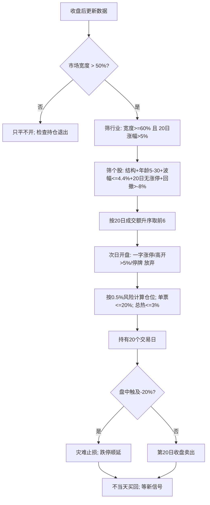

# 规则手册：买入、卖出、仓位与复盘

> 配套文件：[一页纸](00_一页纸_上涨趋势系统.md)、[完整报告](01_完整报告_上涨趋势特征与系统.md)。  
> 本手册只讲“怎么做”，不重复论证；所有参数都能在完整报告找到证据。

## 一、适用范围

| 项目 | 规则 |
|---|---|
| 市场 | 沪深全部股票（含创业板、科创板；不含北交所） |
| 资金 | 自有资金 1,000 万–2,000 万元以内；更大资金要降低预期 |
| 周期 | 日线，收盘后选股，次日开盘交易 |
| 持仓 | 最多 6 只；平均持有 20 个交易日 |
| 单笔风险 | 0.5%（保守 0.25%） |
| 单票上限 | 20% |
| 组合热预算 | 3% |
| 成本假设 | 单边 0.15%，往返 0.3% |
| 不适用 | 不能接受 20 日时间止损、不能接受 -20% 灾难止损、需要日内交易、资金容量 >5,000 万 |

## 二、每天收盘后要更新的数据

1. 全部股票后复权收盘价、开盘价、最高价、最低价、成交量、成交额。
2. 5/10/20/60 日均线；20 日、60 日均线斜率。
3. 14 日平均真实波幅（真实波幅 = 最高−最低、|最高−昨收|、|最低−昨收| 的最大值）。
4. 20 日成交额均值；20 日涨停次数；20 日跳空次数；5/20 日量比。
5. 行业分类（时点）；行业内收盘在 20 日均线以上的比例；行业指数 20 日涨幅。
6. 全部股票收盘在 20 日均线以上的比例（市场宽度）。

**时点要求**：行业分类用公告起始日；所有滚动窗口只向后看；不要用今天的全市场分位去回填历史。

## 三、市场闸门

```
市场宽度 = 全部股票中“收盘价 > 20 日均线”的比例
市场宽度 > 50% → 允许开新仓
市场宽度 <= 50% → 只平不开
```

- 每天只算一次，收盘后算，次日执行。
- 不用“指数在 60 日均线上”替代；数据说宽度开关更稳。
- 市场宽度在 45%–55% 之间时，不预测，按 50% 硬阈值执行。

## 四、个股筛选：五张通行证

### 4.1 趋势结构

```
收盘价 > 60 日均线
20 日均线 > 60 日均线
60 日均线 > 20 个交易日前的 60 日均线
```

### 4.2 趋势年龄

```
从“结构第一次成立”算起，连续处于上升结构的天数
5 <= 趋势年龄 <= 30
```

- 超过 30 日不追；低于 5 日不买（样本太少，噪声大）。
- 结构中断一天，年龄清零；重新成立后重新计数。

### 4.3 低波动

```
14 日平均真实波幅 / 收盘价 <= 4.4%
```

- 4.4% 是训练期 40 分位；不要用全样本分位。
- 如果个股波幅在 4.4%–5.0%，降到半仓；>5.0% 不做。

### 4.4 情绪/拥挤

```
过去 20 日涨停次数 = 0
```

- 只要有过一次涨停（包括一字板），20 日内不买。
- 不买近期有连续涨停、放量长上影、开盘高开 >5% 的股票。

### 4.5 板块

```
行业宽度 = 行业内“收盘 > 20 日均线”的股票占比
行业宽度 >= 60%
行业指数 20 日涨幅 > 5%
```

- 行业宽度用当时行业分类；行业指数用申万一级。
- 行业宽度 <60% 或行业 20 日涨幅 <5%：不做，即使个股形态很好。

### 4.6 位置

```
距 60 日高点回撤 = 收盘 / 60 日最高收盘 - 1
回撤 > -8%
```

- 回撤超过 8% 说明趋势已经被破坏，不买。
- 距 20 日均线 >8% 也不追（组间差为负）。

## 五、排序：同一天太多信号怎么办

```
候选池 = 满足五张通行证的全部股票
按 20 日成交额从小到大排序
取前 6 只
```

- 成交额最小 = 关注度最低、尚未被充分交易；不是“买小票”。
- 如果前 6 只中有停牌、一字涨停、开盘高开 >5%，顺延到下一只。
- 不按行业分散强制；但同一行业最多 2 只（防止板块集中）。

## 六、买入执行

| 时点 | 动作 |
|---|---|
| t 日收盘 | 计算信号，生成候选 |
| t+1 日 9:25 | 看开盘价；高开 >5% 放弃 |
| t+1 日 9:30 | 开盘价买入；一字涨停买不到就放弃 |
| t+1 日盘中 | 不追、不改价、不临时加仓 |

- 买入价按实际成交价记录；不要用收盘价回填。
- 如果开盘涨停但未一字（有成交），可以买；一字板（最高=最低）不买。
- 停牌不买；复牌当天不买（等新信号）。

## 七、仓位：公式与例子

```
单笔风险金额 = 总资金 × 0.5%
每股风险 = 买入价 × 2 × 14日平均真实波幅
仓位股数 = 单笔风险金额 ÷ 每股风险
仓位市值 = 仓位股数 × 买入价
上限：仓位市值 <= 总资金 × 20%
组合热预算：所有持仓的风险金额之和 <= 总资金 × 3%
```

**例子**：总资金 100 万，买入价 10 元，14 日平均真实波幅 3%。

```
单笔风险 = 5,000 元
每股风险 = 10 × 2 × 3% = 0.60 元
股数 = 5,000 ÷ 0.60 = 8,333 股
市值 = 83,330 元 = 8.3%
```

- 如果波幅 6%，股数 4,167，市值 4.2%。
- 如果波幅 2%，股数 12,500，市值 12.5%，仍低于 20% 上限。
- 6 只都满仓时，总风险 3%，总市值约 50%–75%。

**为什么不用单笔 3%**：6 只 × 3% = 18% 热预算；一次集体跌停就是 -18%。3% 是单笔上限，不是目标。

## 八、卖出执行

| 优先级 | 触发 | 动作 |
|---:|---|---|
| 1 | 盘中触及 -20% | 全部卖出；一字跌停当天不卖，次日继续 |
| 2 | 持有满 20 个交易日 | 收盘全部卖出 |
| 3 | 停牌 | 不能卖；复牌后按规则处理 |
| — | 跌破 20 日均线 | **不卖**（检验期更差） |
| — | 5 日均线下穿 20 日均线 | **不卖** |
| — | +2 倍风险 | **不分批** |

- 20 日从买入日算起，买入当天算第 1 天；第 20 个交易日收盘卖出。
- 如果第 20 日一字跌停，顺延到下一个可卖日。
- 灾难止损用盘中价；如果开盘跳空低于 -20%，按开盘价卖。
- 不把止损上移到成本；不因为“赚了”提前卖。

## 九、买对了怎么办

| 首 5 日 | 动作 |
|---|---|
| > +5% | 确认；持有到 20 日；**不加仓** |
| +2%～+5% | 持有；不加 |
| -2%～+2% | 持有；观察 |
| -5%～-2% | 不加；准备时间退出 |
| < -5% | 不加；不提前砍；等 20 日或 -20% |

- 首周 >+5% 的样本最终胜率 80%–92%，但加仓会破坏风险预算；不加。
- 不把盈利单做成“趋势单”长期拿；20 日到了就卖。

## 十、买错了怎么办

- 触发 -20%：全卖；不补仓、不摊平、不当天买回。
- 首周 < -5%：不加仓；不抄底；持有到 20 日或 -20%。
- 连亏 2 笔：暂停 3 个交易日；接下来 2 笔用半仓（0.25% 风险）。
- 连亏 3 笔或组合回撤 -8%：暂停 1 周，只做纸面；复盘是否遵守规则。
- 不因为“跌了很多”买回；不因为“上次卖飞了”追高。

## 十一、卖对了 / 卖错了

- **卖对了（继续涨）**：不追；等新的完整信号。
- **卖错了（卖后跌）**：不因为“卖错了”当天买回。
- **卖飞**：27.5% 的概率卖出后 20 日再涨 >5%，但均值只有 +0.84%；追回去没有稳定优势。
- **灾难止损后反弹**：不买回；只有新的五张通行证才入场。
- **分批卖**：本系统不分批；数据说分批止盈降低期望。

## 十二、再入场

满足以下全部条件才可以再买同一只：

1. 距离上次卖出至少 3 个交易日。
2. 重新满足五张通行证（趋势年龄重新计数）。
3. 上次是灾难止损的，需要“新形态 + 收复 -20% 价位”才考虑；否则不做。
4. 不因为“上次卖错了”而买回。

## 十三、每日 / 每周 / 每月流程

### 每日收盘后（20 分钟）

1. 更新市场宽度；记录是否 >50%。
2. 更新行业宽度/行业 20 日涨幅；列出合格行业。
3. 在合格行业中筛个股：结构、年龄、波幅、涨停、回撤。
4. 候选按 20 日成交额升序；取前 6。
5. 检查持仓：持有天数、是否 -20%、是否一字跌停。
6. 写下次日执行清单：买什么、买多少、卖什么。

### 每周（30 分钟）

1. 统计本周交易：几笔、胜率、平均收益、是否遵守规则。
2. 检查是否有“未按规则”的交易；标记原因。
3. 检查组合热预算、行业集中度（单行业 <=2 只）。
4. 不因为一周亏损改参数。

### 每月（1 小时）

1. 统计月度收益、最大回撤、交易笔数。
2. 对比等权基准；不因单月跑输改规则。
3. 检查参数是否漂移：波幅阈值、年龄、行业宽度、成交额排序。
4. 更新“错题本”：每笔违规交易写一句“当时怎么想的”。

## 十四、复盘模板

| 字段 | 内容 |
|---|---|
| 买入日期 / 代码 |  |
| 市场宽度 / 行业宽度 / 行业 20 日涨幅 |  |
| 趋势年龄 / 波幅 / 20 日涨停次数 / 距 60 日高点 |  |
| 买入价 / 仓位 / 单笔风险 / 灾难止损价 |  |
| 首 5 日收益 |  |
| 卖出日期 / 卖出价 / 持有天数 / 退出原因 |  |
| 最终收益 / 盈亏比 |  |
| 是否遵守：不加仓、不摊平、不当天买回 | 是/否 |
| 如果重来，哪一步会改 | 一句话 |

## 附：龙虎榜

**不作为主信号。** 龙虎榜通常伴随涨停、高换手、跳空、长上影；这四类在本研究里全是负向。当前数据协议不允许接外部龙虎榜接口，因此没有做严格检验。以后若有数据，只用于“近 5 日上榜 + 高换手 + 长上影 → 不买”，不单独构成买入。

个股情绪热度合成（涨停+跳空+量比+成交额量比+上影线+收盘位置）：最低组 20 日均值 +0.62%/+0.07%，最高组 -1.04%/-1.56%。系统用“20 日无涨停 + 低波 + 距 60 日高点回撤 >-8%”间接覆盖，不额外加合成分，避免过拟合。

## 十五、参数总表

| 参数 | 值 | 备注 |
|---|---:|---|
| 市场宽度阈值 | 50% | 只用 20 日均线宽度 |
| 趋势年龄 | 5–30 日 | 超过 30 日不追 |
| 波幅上限 | 4.4% | 14 日平均真实波幅 / 收盘 |
| 20 日涨停次数 | 0 | 有涨停不做 |
| 行业宽度 | >=60% | 行业内收盘 >20 日均线占比 |
| 行业 20 日涨幅 | >5% | 申万一级行业指数 |
| 距 60 日高点回撤 | >-8% | 不买刚崩塌 |
| 单笔风险 | 0.5% | 保守 0.25% |
| 单票上限 | 20% | 实际平均 8.3% |
| 最大持仓 | 6 只 | 4 只版可用 0.75% 风险 |
| 组合热预算 | 3% | 6 × 0.5% |
| 持有期 | 20 个交易日 | 收盘卖 |
| 灾难止损 | -20% | 盘中；跌停不卖 |
| 成本 | 0.3% 往返 | 单边 0.15% |
| 成交额下限 | 3,000 万 | 低于不做 |
| 单行业上限 | 2 只 | 防集中 |

## 十六、不同股票 / 板块 / 行情矩阵

| 条件 | 买入 | 仓位 | 备注 |
|---|---|---|---|
| 低波 + 早期 + 行业宽度 >=60% + 行业动量 >5% + 市场宽度 >50% | 是 | 0.5% 风险 | 核心 |
| 低波 + 早期 + 行业一般 + 市场宽度 >50% | 小仓 | 0.25% 风险 | 缺板块共振 |
| 高波 + 早期 | 否 | 0 | 高波组间差负 |
| 近 20 日有涨停 | 否 | 0 | 检验期 -1.54% |
| 行业宽度 <60% 或行业 20 日涨幅 <5% | 否 | 0 | 板块不共振 |
| 市场宽度 <50% | 只平不开 | 0 | 保护 2018/2022 |
| 距 20 日均线 >8% | 否 | 0 | 不追高 |
| 自身 20 日涨幅历史高分位 | 减分 | 0.25% 风险 | 均值回归 |
| 接近自身 250 日高点 | 加分 | 正常 | 弱证据 |
| 行业内相对强度最高 | 否 | 0 | 不追跟风末端 |
| 放量突破（量比 >=1.3） | 否 | 0 | 检验期 -1.82% |
| 回踩 20 日均线缩量收阳，无板块/市场 | 否 | 0 | 单独负期望 |
| 高收紧（距 20 日均线 <3%、回撤 <5%） | 可做 | 正常 | 两期都正，幅度小 |

## 十六点五、个股适用性

| 股票 | 系统信号日 | 信号后 20 日胜率 | 结论 |
|---|---:|---:|---|
| 招商银行 | 45 | **73.3%** | 主场：低波价值 |
| 贵州茅台 | 78 | 46.2% | 能做，但大涨幅多在 47–56 日龄，系统会错过 |
| 宁德时代 | 100 | 34.0% | 高波，钱在少数大波动；体验差 |
| 中际旭创 | 33 | 42.4% | 靠右尾，系统只覆盖一小部分 |
| 寒武纪 | **0** | — | 高波+涨停+追高，全部被排除 |

**这套系统不覆盖寒武纪、宁德时代式的暴涨。** 它换的是“低波、早期、板块共振”的可重复性；想要高波龙头，另建小仓位卫星策略，不要混在一起。

## 十七、常见错误

1. 把“均线金叉”当趋势成立；没有 60 日均线结构。
2. 把“跌了很多”当调整结束；没有上升结构。
3. 追高：距 20 日均线 >8%、20 日涨幅处于自身历史高分位。
4. 买近期涨停股；情绪最热的时候进去。
5. 行业宽度 <60% 还做；个股形态好，板块不共振。
6. 市场宽度 <50% 还开新仓；2018/2022 的主要亏损来源。
7. 用 8% 窄止损；把先跌后涨的样本砍掉。
8. 用 20 日均线跟踪；正常回踩就卖，错过后面的修复。
9. +2 倍风险卖一半；砍掉右尾。
10. 首周 < -5% 还加仓；把亏损摊大。
11. 止损后当天买回；报复性交易。
12. 单笔 3% 风险 + 6 只 = 18% 热预算；一次集体跌停就 -18%。
13. 用一个月/一个季度结果改参数；过拟合。
14. 用复杂模型代替规则；检验期区分度只有 0.505。

## 十八、最小可行版本

```
市场宽度 > 50%
趋势年龄 5–30 日；波幅 <= 4.4%；20 日无涨停
行业宽度 >= 60%；行业 20 日涨幅 > 5%
次日开盘买；4 个仓位；单笔风险 0.5%；单票 <= 20%
持有 20 个交易日；-20% 灾难止损
不加仓、不摊平、不当天买回
连亏 2 笔 → 停 3 个交易日，接下来 2 笔半仓
```

先纸面 50 笔；能稳定遵守，再扩展到 6 个仓位。

## 十九、如果你坚持止损近

数据结论先说：**止损越近，胜率越低**。下面是同一批信号按“过去 5 日结构低点”做收盘确认止损的结果：

| 结构止损距离 | 训练期净收益/胜率 | 检验期净收益/胜率 | 建议 |
|---|---:|---:|---|
| 0–3% | +0.85% / 27.5% | +0.87% / 30.2% | **不要用** |
| 3–5% | +1.51% / 40.8% | +1.01% / 39.4% | 不推荐 |
| 5–7% | +2.14% / 49.2% | +0.96% / 42.2% | **最紧可用** |
| 7–10% | +2.16% / 50.0% | +0.89% / 44.1% | 可用，但不如时间止损 |

执行方式：

- 止损位 = 过去 5 日最低价 ×0.995；**收盘跌破才卖，次日开盘执行**，不要盘中触发。
- 仓位仍按 0.5% 风险计算；止损越近，仓位越大，单票 20% 上限会先触发。
- 组合级回测：年化 **1.6%**、最大回撤 **-21.6%**、胜率 **39.9%**、盈亏比 1.09；明显不如主系统。不要用 3% 以内的止损。
- 如果你不能接受这种胜率，回到主系统：20 日时间止损 + -20% 灾难止损。

## 二十、保守版本

如果 -9% 回撤仍然太大：

- 用 4 个仓位、单笔 0.75% 风险、单票 <=20%：训练 +28.9%，检验 +57.3%，最大回撤 -13.1% / -13.6%。
- 或用 15% 灾难止损：训练 +8.4%，检验 +23.4%，最大回撤 -6.1% / -3.7%。
- 代价是收益明显下降；不要同时用“窄止损 + 满仓”，那会把系统做死。

## 二十一、执行流程图


