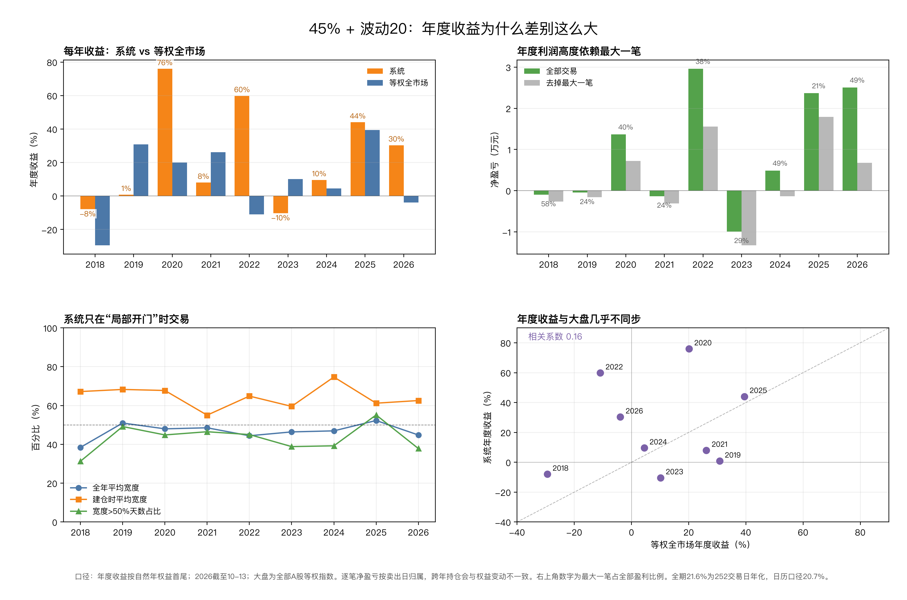

# 45% + 波动20：2 万元上涨趋势交易系统

> 这是从“涨幅趋势”研究里单独拆出来的 **2 万元、最多 2 只、单票 45% × 市场波动系数** 版本。
> 数据：2018-01-01 至 2026-10-13；全 A 后复权日线，含 102 只退市/缺失股，共 5,675 只。
> 口径：t 日收盘出信号，t+1 开盘买；100 股整手；单边 0.15% 或最低 5 元；不融资、不 T+0。
> 本目录只放这一套系统，配套逐笔记录、权益曲线和 Excel。

## 〇、一页纸

**一句话：市场宽度 >50% 时，做“趋势年龄 5–30 日、低波、20 日内无涨停、行业宽度和行业动量都强”的上涨趋势；最多 2 只，每只 45% × 波动系数；持有 20 个交易日，-20% 灾难止损。**

### 买入（缺一不可）

```
市场：全A收盘在20日均线以上的比例 >50%
结构：收盘 >60日均线；20日均线 >60日均线；60日均线高于20日前
年龄：5–30 个交易日
波动：14日ATR / 收盘 <=4.4%
情绪：过去20日涨停次数 =0
板块：行业宽度 >=60%；行业指数20日涨幅 >5%
位置：距60日高点回撤 >-8%
可买：价格>=2元；20日成交额>=3000万元；上市>=250日
执行：次日开盘买；高开>5%、一字涨停、停牌不买
排序：同日候选按20日成交额从小到大，取前2只
```

### 仓位

```
波动系数 = min(1, 20% ÷ 全A等权指数20日已实现波动)，下限 0.3
单票目标 = 当前权益 × 45% × 波动系数
股数 = 单票目标 ÷ 买入价，向下取整到100股
两只合计 <=90%；现金不足减手；不足100股跳过
```

### 卖出

```
持有满20个交易日，收盘卖完
盘中触及 -20%，灾难止损；一字跌停不卖，顺延
停牌不卖；数据终止按50%折价
不设均线止损、移动止盈、分批止盈、窄止损
```

### 不做

- 不追高开 >5%、不追一字涨停、不买停牌。
- 不加仓、不摊平、不当天买回。
- 不用 25.8% 旧版当预期；不把 21.6% 当新账户每年收益。
- 不因为“跌多了”抄底；不因为“卖飞了”追回。

## 一、先接受四个数字

| 项目 | 数值 | 说明 |
|---|---:|---|
| 全期连续年化 | **21.6%** | 2018 年开始一直持有，期末 10.42 万 |
| 分段拼接年化 | **17.3%** | 2021 年末清仓、2022 年重新起算 |
| 2022 年新账户年化 | **18.5%** | 2022-01 起 2 万，最接近“今天开始” |
| 最大回撤 | **-26.4%**（收盘）/ -26.8%（最低价） | 2022-12-16 至 2024-08-27 |
| 交易笔数 / 胜率 / 盈亏比 | 150 笔 / 55.3% / 2.16 | 平均持有 20.7 个交易日 |
| 最差单笔账户亏损 | **-7.6%** | 002719，停牌/跳空后 -26.7% 卖出 |
| 前五笔账户贡献 | **83%** | 去掉前五笔，年化只剩 8.3% |
| 自举 5% 最坏回撤 | **-43.6%** | 历史 -26.4% 不是最坏情况 |

**最重要的一句：21.6% 是全期连续资金，不是新账户预期。** 2021-12-10 买入、2022-01-07 卖出的 002694（+92.4%，账户贡献 +40.8%）跨了训练/检验边界；训练期只建仓没卖出，检验期已错过建仓，只有全期连续资金完整吃到。新账户用 **17.3%–18.5%** 做计划。

## 二、这套系统赚什么钱

它不赚“长期拿大趋势”的钱。A 股上涨趋势的中位寿命只有 22 个交易日、中位涨幅只有 +1.0%；这套系统只做其中“早期、安静、板块共振”的 20 日窗口。

四类条件同时成立时才买：

1. **市场不差**：宽度 >50%，有赚钱效应。
2. **趋势刚成立**：年龄 5–30 日，不追晚期。
3. **波动低**：ATR <=4.4%，避免高波暴涨。
4. **板块共振**：行业宽度 >=60%，行业 20 日涨幅 >5%。

它主动放弃：高波龙头、近期涨停、放量突破、回踩 20 日均线单独做、行业内最强。这些在这批数据里都是负期望。

**收益来源是右尾。** 前五笔：002694 +92.4%、002219 +81.1%、603058 +62.8%、688548 +51.9%、300018 +34.0%。这不是“每年稳定 20%”的曲线，而是“多数小赚小亏 + 少数大波动”的曲线。

## 三、买入规则（逐条）

### 3.1 市场通行证

```
全A收盘价在20日均线以上的股票占比 >50%
```

不满足就只平不开。不要用“指数涨了”代替宽度；宽度是参与度，指数可能被少数权重股拉红。

### 3.2 个股通行证

| 条件 | 具体规则 | 不满足 |
|---|---|---|
| 趋势结构 | 收盘 >60 日均线；20 日均线 >60 日均线；60 日均线高于 20 日前 | 不买 |
| 趋势年龄 | 连续处于上升结构 5–30 个交易日 | <5 或 >30 不买 |
| 波动 | 14 日 ATR / 收盘 <=4.4% | 不买 |
| 情绪 | 过去 20 日涨停次数 =0 | 不买 |
| 位置 | 距 60 日高点回撤 >-8% | 不买 |
| 流动性 | 20 日平均成交额 >=3,000 万元；收盘价 >=2 元 | 不买 |
| 上市时间 | 至少 250 个交易日 | 不买 |

### 3.3 板块通行证

```
行业宽度 = 行业内收盘在20日均线以上的比例 >=60%
行业动量 = 行业指数20日涨幅 >5%
```

行业分类用时点数据（申万，按公告起始日），不用今天的行业快照回填。行业缺失的股票不参与板块条件。

### 3.4 可买性

- t 日收盘出信号，**t+1 开盘买**。
- 开盘高开 >5%：不买。
- 一字涨停：不买。
- 停牌：不买。
- 开盘价无效或现金不足：跳过。

### 3.5 排序

同一天有多只候选，按 **20 日成交额从小到大** 排序，取前 2 只。成交额最小的先买，是这批数据里最有效的排序；按行业宽度、低波、贴近 MA20 排序都更差。

### 3.6 买入检查表（打印用）

```
日期：
市场宽度：            >50%？  是/否
代码：
收盘 >60日均线：      是/否
20日均线 >60日均线：  是/否
60日均线高于20日前：  是/否
趋势年龄：            5–30？
ATR/收盘：            <=4.4%？
20日涨停次数：        0？
行业宽度：            >=60%？
行业20日涨幅：        >5%？
距60日高点：          >-8%？
20日成交额：          >=3000万？
价格：                >=2元？
次日开盘高开：        <=5%？
一字涨停/停牌：       否？
波动系数：            ____
目标股数：            ____
```

## 四、买多少

### 4.1 公式

```
波动系数 = min(1, 20% ÷ 全A等权指数20日已实现波动)，下限 0.3
单票目标 = 当前权益 × 45% × 波动系数
股数 = 单票目标 ÷ 买入价，向下取整到100股
单票上限 = 当前权益 × 45% × 波动系数
两只合计 <=90%；现金不足减手；不足100股跳过
组合热预算 <=10%（按 2×ATR 估算）
```

“全A等权指数 20 日已实现波动”= 等权指数日收益过去 20 日的标准差 × √252，用 t-1 及以前的数据。

### 4.2 波动系数速查

| 市场20日波动 | 波动系数 | 单票上限（占权益） |
|---:|---:|---:|
| 15% | 1.00 | 45% |
| 20% | 1.00 | 45% |
| 25% | 0.80 | 36% |
| 30% | 0.67 | 30% |
| 40% | 0.50 | 22.5% |
| 60% | 0.33 | 15% |
| 70% 以上 | 0.30（下限） | 13.5% |

### 4.3 三个例子（本金 2 万）

**例 1：股价 20 元，市场波动 25%**

```
波动系数 = 20/25 = 0.8
单票目标 = 20,000 × 45% × 0.8 = 7,200 元
股数 = 7,200 ÷ 20 = 360 → 300 股（6,000 元）
两只约 12,000 元，现金 8,000 元
```

**例 2：股价 14 元，市场波动 25%**

```
单票目标 7,200 元
股数 = 7,200 ÷ 14 = 514 → 500 股（7,000 元）
```

**例 3：股价 80 元，市场波动 25%**

```
单票目标 7,200 元
股数 = 7,200 ÷ 80 = 90 → 不足100股，跳过
```

### 4.4 价格上限

- 单票 45% 是 9,000 元；股价 >90 元，100 股就超过 9,000 元，买不了。
- 波动系数 0.8 时，单票 7,200 元；股价 >72 元，100 股就超过 7,200 元，买不了。
- 这是 2 万账户的硬约束，不是选股偏好。

### 4.5 现金与集中度

- 两只最多 90%，至少留 10% 现金。
- 只有一只信号时，只买 45%×系数，不强制满仓。
- 不加杠杆、不融资、不借券。
- 两只可能同涨同跌；不要因为“两只都是成长”就以为分散了。

## 五、卖出规则

| 触发 | 动作 | 细节 |
|---|---|---|
| 持有满 20 个交易日 | 收盘卖完 | 买入日记为第 1 天，第 20 个交易日收盘卖 |
| 盘中触及 -20% | 灾难止损 | 跳空低于 -20% 按开盘价卖；一字跌停不卖，顺延 |
| 停牌 | 不卖，顺延 | 不假装按停牌前价格成交 |
| 数据终止 | 按最后价 50% 折价 | 回测口径；实盘遇到退市按实际处理 |

**不设**：均线止损、移动止盈、+20% 分批、+2 倍风险止盈、窄止损。数据里这些都降低收益；这套系统只靠“20 日时间退出 + -20% 灾难止损”。

## 六、每日执行清单

### 收盘后（15:00–17:00）

1. 更新市场宽度：全A收盘在 20 日均线以上的比例。
2. 更新市场 20 日波动，算明天的波动系数。
3. 跑筛选：结构、年龄、ATR、涨停、行业宽度/动量、回撤、成交额、价格。
4. 候选按 20 日成交额从小到大排序；排除已持有。
5. 对前 2 名算目标股数；检查现金、100 股、价格上限。
6. 写下次日委托计划：代码、目标股数、上限价（不追高）。

### 次日开盘（9:30）

1. 看开盘是否高开 >5%；是则放弃。
2. 看是否一字涨停/停牌；是则放弃。
3. 按计划买入；成交后记录实际价格、股数、费用。
4. 不临时加候选、不因为“感觉好”超仓。

### 盘中

- 只看一件事：持仓是否触及 -20%。
- 触及就卖；一字跌停卖不出就顺延。
- 不看分时、不因为绿盘恐慌提前卖，也不因为红盘追买。

### 收盘

- 检查当天是否有持仓满 20 个交易日；有就收盘卖。
- 更新账户权益、现金、持仓数。
- 记录当天是否遵守规则（是/否 + 原因）。

### 每周/每月

- 对账：股数、现金、盈亏与券商一致。
- 统计：交易笔数、胜率、盈亏比、平均账户贡献、最大回撤。
- 检查规则违背次数；违背次数比短期盈亏更重要。

## 七、回测结果

### 7.1 总表

| 口径 | 年化 | 最大回撤 | 期末 |
|---|---:|---:|---:|
| 全期连续（2018–2026） | 21.6% | -26.4% | 10.42 万 |
| 分段拼接（2021 末清仓） | 17.3% | -25.5% | 7.68 万 |
| 训练（2018–2021） | 15.8% | -25.5% | 3.53 万 |
| 检验/新账户（2022–2026） | 18.5% | -25.5% | 4.35 万 |
| 成本 0.35% | 18.0% | -28.9% | — |

### 7.2 年度

| 年份 | 收益 | 交易笔数 | 净盈亏（按卖出日归属） |
|---|---:|---:|---:|
| 2018 | -8.0% | 11 | -982 |
| 2019 | +0.8% | 18 | -454 |
| 2020 | +76.0% | 20 | +13,656 |
| 2021 | +8.1% | 20 | -1,328 |
| 2022 | +59.9% | 19 | +29,607 |
| 2023 | -10.3% | 18 | -9,910 |
| 2024 | +9.6% | 14 | +4,870 |
| 2025 | +44.1% | 18 | +23,674 |
| 2026 至 10 月 | +30.4% | 12 | +25,051 |

**这不是每年 20% 的曲线。** 2018、2023 是负的；2020、2022、2025 很大。不要用 2026 的 +30.4% 线性外推。年度收益按年末权益计算，净盈亏按卖出日归属；跨年持仓/浮动盈亏会让两者略有差异（如 2019、2021）。

**年度差异的完整解释见 [年度差异与大盘状态](年度差异与大盘状态.md)**：系统年度收益与等权全市场年度收益的相关性只有 0.16；2019、2021 大盘上涨，系统只 +0.8%/+8.1%；2022、2026 大盘下跌/走平，系统 +59.9%/+30.4%。73% 的建仓发生在指数 60 日均线上方，上方 110 笔合计 +8.56 万、下方 40 笔合计 -0.14 万；但**实际加 60 日均线过滤回测是 12.7%/-38.0%**，不能看着分组结果直接加规则。



### 7.3 集中度与尾部

- 前五笔账户贡献约 **83%**；去掉前五笔，年化 **8.3%**。
- 最差单笔账户亏损 **-7.6%**（002719，停牌/跳空后 -26.7% 卖出）。
- 最好单笔账户盈利 **+40.8%**（002694）。
- 平稳块自举 2,000 次：年化 5%/50%/95 分位约 **7.2% / 21.0% / 40.8%**；最大回撤 5%/50%/95 分位 **-43.6% / -28.9% / -19.8%**。
- Deflated Sharpe（按约 119 次尝试）约 **0.267**，统计上不显著。它是一个可执行的风险缩小版，不是“被证明的 edge”。

### 7.4 信号覆盖与涨停

- 9 年有 **156,301 个候选股票-日、40,533 个独立信号段**，只买 **150 笔/150 段**；99.5% 的候选日、99.8% 的漏买段是 **2 个仓位已满**。4,979 只股票出现过信号，只买了 146 只。
- 系统不买“过去 20 日有涨停”的股票。其他条件都满足、仅因涨停被排除的 19,817 个股票-日，未来 20 日平均 **+1.42%**、胜率 **47.4%**；未涨停组 **+2.34%**、**52.7%**。2 次涨停 +0.57%/39.8%，3 次以上 -2.47%/32.9%。
- **龙虎榜数据不在当前面板，不能直接检验。** 换手异常、成交额突增、跳空这些价量代理没有稳定正优势；跳空高反而更差。
- 完整表见 [信号覆盖与涨停](信号覆盖与涨停.md)。

### 7.5 全部信号按每笔1万元

- 4,979 只股票出现过信号，4,976 只有可执行第一笔。每股只做第一笔、每笔1万：平均 **+249.66 元（+2.50%）**，胜率 **53.8%**；**46.2% 的股票第一笔是亏的**。
- 全部 40,279 个可执行信号段、每段一笔：平均 **+177.19 元（+1.77%/20日）**，中位只有 +5.16 元，胜率 50.3%，盈亏比 1.48；前1%交易贡献 41.8% 总利润。
- **全信号 2022/2023 平均是负的（-2.03%/-1.29%），但2仓系统2022年+59.9%**；差异来自2仓路径抓到了002219/002694，不是信号普遍好。
- 优化扫描：27个特征、216个阈值，训练/检验都稳的只有“市场宽度20≥0.7769”；但把它做成更高闸门，2仓年化降到12.1%。**全信号分组有效，不等于账户有效。**
- 完整逐笔、年度、按股票、特征分箱和候选方案见 [全信号一万与信号优化](../2026-10-22_全信号_买卖时间_优先级研究/全信号一万与信号优化.md)。

## 八、这套系统的弱点

1. **右尾依赖**：前五笔贡献 83%；去掉前五笔只剩 8.3%，和等权指数同期 7.9% 差不多。
2. **回撤仍然大**：历史 -26.4%，自举 5% 最坏 -43.6%；2 万账户要按“可能亏 4 成”做准备。
3. **20 日持有期是尖峰**：15 日 10.8%、20 日 21.6%、25 日 -2.2%；改 5 天就变样。
4. **不是干净样本外**：2022–2026 参与过规则选择；只能等 2027 年以后或实盘 50 笔验证。
5. **幸存者偏差**：只补了 102 只退市股；小市值退市股仍未补全，真实收益大概率更低。
6. **2 只集中**：单票 -20% 就是账户 -9%（45% 仓位）；两只同时灾难止损约 -18%，跳空更深。
7. **高价股买不了**：2 万账户天然偏向 90 元以下；这不是风格选择，是资金约束。
8. **没有情绪/新闻数据**：只有价量代理；龙虎榜、股吧、北向都没纳入。

## 九、常见错误

| 错误 | 为什么错 |
|---|---|
| 把 21.6% 当每年预期 | 全期连续口径；新账户 17.3%–18.5% |
| 把 25.8% 旧版当目标 | 84% 利润来自 5 笔；去掉前五笔 10.4% |
| 加 3% 窄止损 | 盘中胜率只有 17%–21%；5%–7% 收盘止损组合只有 1.6% 年化 |
| 加均线止损/移动止盈 | 数据里降低收益；这套系统靠 20 日时间退出 |
| 加市场 MA60 过滤 | 12.7%/-38.0%，回撤没降、收益大降 |
| 加“转弱只砍亏损仓” | 9.4%/-36.5%，砍在低点 |
| 按低波/贴近 MA20 排序 | 8.0%/-44.1%、-6.0%/-64.8% |
| 亏了摊平/加仓 | 单票上限 45%，不加仓、不摊平 |
| 高开追进去 | 高开 >5% 不买；回测最大开盘跳空 2.38% |
| 同一天买第三只 | 最多 2 只；多一只不是分散，是超预算 |
| 用生活费等不起的钱 | 可能 -26% 到 -44%；只用风险资金 |

## 十、纸面 50 笔与复盘

### 10.1 先纸面 50 笔

- 用真实收盘数据、真实次日开盘价，不用模拟成交。
- 每笔记录：日期、代码、买入价、股数、卖出价、费用、盈亏、退出原因。
- 至少 50 笔再考虑实盘；50 笔内不要改规则。
- 如果 50 笔胜率 <45%、盈亏比 <1.2、最大回撤 >-20%，停下来复查，不要加仓。

### 10.2 复盘模板

```
统计区间：
交易笔数：
胜率：
盈亏比：
平均账户贡献：
前五笔贡献占比：
最大回撤：
规则违背次数：
最大的一笔盈利/亏损及原因：
下一次只改一件事：
```

**只改一件事**：如果一定要优化，一次只改一个参数，并且用 50 笔新样本验证；不要同时改仓位、止损、持有期。

## 十一、文件与数据

| 文件 | 内容 |
|---|---|
| `逐笔交易记录.csv` | 150 笔逐笔，中文表头，含买入/卖出金额、费用、账户贡献 |
| `交易记录模板.csv` | 空表头，纸面 50 笔直接填 |
| `逐笔交易记录.xlsx` | 系统统计、逐笔交易、年度统计、规则摘要、说明 |
| `权益曲线.csv` | 每日权益、现金、持仓数、最低价权益、回撤 |
| `权益与回撤.png` | 权益与回撤图 |
| `年度统计.csv` | 按卖出日归属的年度统计 |
| `系统统计.csv` | 汇总指标 |
| `年度差异与大盘状态.md` | 年度收益差异、建仓时大盘状态、集中度与跨年口径 |
| `信号覆盖与涨停.md` | 信号覆盖、漏买原因、涨停/龙虎榜关系 |
| `全信号一万与信号优化.md` | 全信号1万逐笔、盈利、特征扫描与优化候选 |
| `全信号_一万_逐笔.csv` | 40,279 笔全信号，每笔1万，不止损/止损两套 |
| `全信号_一万_每股首笔.csv` | 4,976 只股票各取最早一笔 |
| `全信号_一万_按股票.csv` / `全信号_一万_年度.csv` | 按股票/年度汇总 |
| `全信号_特征分箱.csv` / `全信号_特征相关.csv` | 训练/检验特征分析 |
| `信号优化_候选.csv` | 9 个候选方案的真实2仓结果 |
| `量能换手_分箱.csv` / `量能换手_相关.csv` | 成交量/换手率分箱与相关 |
| `成交额股价网格.csv` | 6×5 成交额/股价网格 |
| `组合脆弱性.csv` | 7000万/15元的成本、去大赢家、分段 |
| `7015_单笔一万_再优化.md` | 70/15子池单笔1万不限仓的再优化 |
| `7015_子池汇总.csv` / `7015_阈值前沿.csv` | 70/15子池候选与阈值前沿 |
| `7015_买入时间.md` | 买入月份、季度与回测起点敏感性 |
| `7015_买入月份.csv` / `7015_起点敏感性.csv` | 月份分组、起点敏感性数据 |
| `市场状态与大赢家_怎么判断.md` | 市场状态指标、阈值与大赢家的事后判断 |
| `市场状态_大赢家.csv` / `市场状态_分组.csv` / `市场状态_前10对比.csv` | 大赢家与市场状态分组数据 |
| `优先级回测_mcap.md` | 市值升序 vs 成交额升序的优先级回测 |
| `优先级_回测.csv` / `优先级_年度成本.csv` / `优先级_起点.csv` | 排序、成本、起点审计 |
| `全信号_一万_分布.png` | 1万逐笔盈亏分布 + 年度平均 |
| `年度_收益与大盘.csv` | 每年系统/大盘收益、回撤、宽度、波动、仓位 |
| `年度_交易与建仓状态.csv` | 每年交易、胜率、集中度、建仓时大盘状态 |
| `逐笔交易记录_含建仓时大盘.csv` | 150 笔逐笔 + 每笔建仓时的大盘状态 |
| `建仓状态_分组表现.csv` | 按均线/宽度/20日收益/波动/状态分组 |
| `年度收益与大盘状态.png` | 四面板年度对照图 |
| `信号候选明细.csv` | 156,301 个候选日及漏买原因（约23MB） |
| `独立信号段.csv` | 40,533 个独立信号段 |
| `信号覆盖_原因汇总.csv` 等 | 漏买原因、买入/漏买表现、排序、入场过滤、涨停分组 |
| `信号覆盖与涨停.png` | 漏买原因 + 涨停次数分组图 |
| `10_生成记录.py` | 从源数据重新生成记录/图/Excel |
| `11_年度与大盘状态.py` | 重新生成年度分析 CSV/图 |
| `12_信号覆盖与涨停.py` | 重新生成信号覆盖/涨停分析 |
| `13_全信号一万与信号优化.py` / `14_全信号图.py` / `15_信号优化候选.py` | 重新生成全信号逐笔、图、候选 |
| `16_成交额股价网格.py` / `17_组合脆弱性.py` / `18_量能换手.py` | 网格、脆弱性、量能分析 |
| `19_7015子池优化.py` | 70/15子池单笔1万再优化 |
| `20_买入时间.py` / `21_买入时间图.py` | 买入月份与起点敏感性 |
| `22_市场状态与大赢家.py` | 市场状态与大赢家分析 |
| `23_优先级回测.py` | 70/15优先级排序回测（含随机零分布） |

**源数据/完整审计**：

- [05_25%回测审计与回撤优化.md](../2026-10-20_涨幅趋势_全维度定制/05_25%回测审计与回撤优化.md)
- [04_两万账户_1-2只持仓版.md](../2026-10-20_涨幅趋势_全维度定制/04_两万账户_1-2只持仓版.md)
- [00_一页纸_上涨趋势系统.md](../2026-10-20_涨幅趋势_全维度定制/00_一页纸_上涨趋势系统.md)

> 本目录是研究记录，不构成投资建议。历史结果不代表未来；实盘前先纸面 50 笔。
