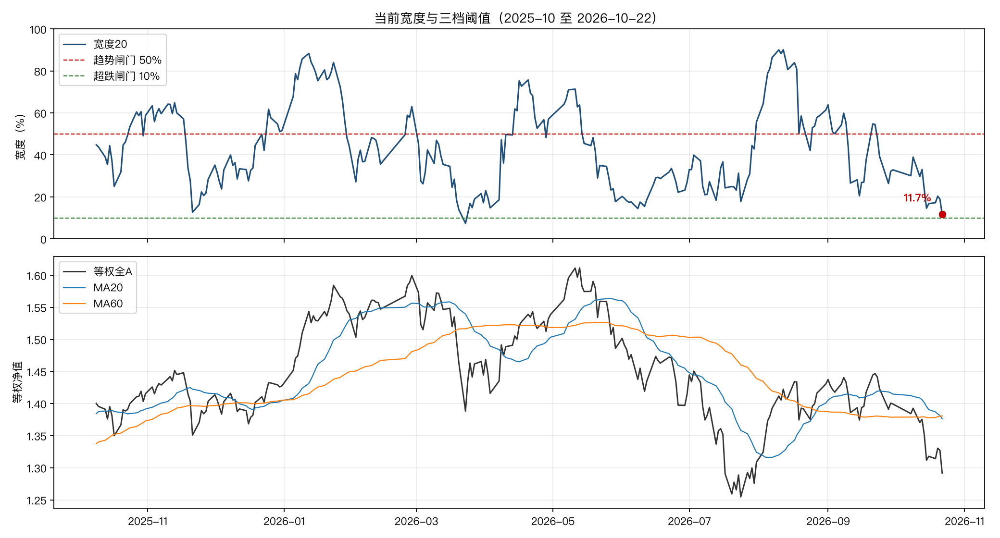

# 当前时段策略总报告：宽度 11.7% 下，最优解是“空仓等触发”

> 2026-10-22 收盘。回答一个问题：**以今天的信号和市场状态，什么策略盈利最高、回撤可控、胜率最高？**
>
> 先给结论：今天 **0 个有效信号**。市场宽度 11.7%，处在历史期望很差的 10–20% 区间；同区间“近信号”胜率只有 43.9%、均值 -0.45%。**现在最优的动作是空仓/货基，等宽度>50% 做 70/15，或等宽度<10% 做小仓位超跌卫星。** 全周期最稳的引擎仍是 70/15：**+30.3% 年化、-19.6% 最大回撤、62.1% 胜率、盈亏比 2.97**。加上极端超跌可以做到 +37.4%/-19.7%/62.9%，但它只增加了 19 笔净交易（24 笔超跌替换了 5 笔趋势）、延迟 1 天就掉到 29.2%、去掉最好一笔只剩 31.8%，**不能当核心，只能当卫星/研究候选**。
>
> **板块口径更正（2026-10-23）**：本文的 30.3%/37.4% 都是**全板块**结果。账户只能买主板时，重跑为 **17.7%/-29.8%**（+超跌 2×45% 为 19.2%/-21.2%，2×35% 为 15.2%/-16.6%）。非主板 23 笔贡献 42.8% 的净盈亏，不能把本文收益直接用于主板账户。详见 [14_主板约束.md](14_主板约束.md)。

## 0. 先看哪个

| 你可能想知道 | 直接看 | 一句话 |
|---|---|---|
| 今天买什么 | [一页纸](09_当前时段_策略一页纸.md) / 本文 §6 | **0 买入**；13 个近信号（主板 11 个）全部卡行业闸门 |
| 为什么不能抄底 | 本文 §1–§2 | 10–20% 宽度是“负期望区”；同宽度近信号历史胜率 43.9%、均值 -0.45% |
| 最适合当下的策略 | 本文 §4 | 三档开关：>50% 做 70/15；10–50% 空仓；<10% 小仓位超跌 |
| 回撤到底多大 | 本文 §5 | 实际 -19.6%，但 1 年 P95 -24%、3 年 P95 -30%；按尾部准备 |
| 37.4% 能不能信 | 本文 §3.3 / §5.4 | 24 笔超跌替换 5 笔趋势、净增 19 笔；延迟 1 天 29.2%，去掉最好一笔 31.8%；**不要当核心** |
| 怎么复现 | 本文 §8 | `08_组合策略_回测.py` → `10_回撤与稳健性.py` |
| 闸门没开/当前同态赚多少 | [12_闸门关闭与当前同态.md](12_闸门关闭与当前同态.md) | 无闸门 14.1%/-23.0%；仅闸门关 0%/-49.9%；当前同态近信号组合 -1.25%~+1.63%（回撤 -37%~-46%） |

## 1. 当前时段诊断：一次快速的全面风险关闭

### 1.1 今天的数据

| 指标 | 2026-10-22 | 读数 |
|---|---:|---|
| 市场宽度 20（收盘>MA20 占比） | **11.7%** | 闸门关（阈值 50%） |
| 市场宽度 60（收盘>MA60 占比） | 15.2% | 中期结构也弱 |
| 市场宽度 120（收盘>MA120 占比） | 13.2% | 长期结构弱 |
| 等权全 A 距 9/22 高点 | **-10.7%** | 一个月快速回撤 |
| 等权全 A 20 日收益 | -7.3% | 下跌加速 |
| 市场 20 日年化波动 | 21.8% | 高波动，仓位系数会被压低 |
| 均线位置 | 低于 MA20/60/120 | 空头排列 |
| MA60 斜率（20 日） | 约 0% | 中期趋势刚转平，未修复 |
| 行业 | 31 个行业中 30 个 20 日负收益；传媒 +1.6% 唯一为正，但宽度 23.8% 不达标 | 无达标的避风港 |
| 最大行业宽度 | 28.6%（银行） | 远低于 60% |
| 最大行业 20 日收益 | +1.6%（传媒） | 远低于 5% |
| 70/15 有效信号 | **0** | 0 买入 |
| 今日中位涨跌 / 下跌占比 | -2.5% / 89.8% | 普跌 |
| 跌超 5% 占比 | 15.3% | 恐慌，但未全面跌停 |
| 涨停 / 跌停 | 33 / 70 | 跌停多于涨停 |
| 成交额 / 20 日均值 | 1.54 万亿 / 0.91 倍 | 缩量下跌 |
| 70/15 近信号 | 13 | 全部卡在行业闸门 |

数据来源：`05_今日信号_70_15.py`、`09_今日超跌观察.py`；市场状态见 [09_今日市场状态_2026-10-22.csv](09_今日市场状态_2026-10-22.csv)。



上图：2025-10 至 2026-10-22 的全 A 宽度 20 与等权指数。宽度从 2025-11 的高点、2026-01 的 80%+、2026-05 的 70%+，一路掉到今天的 11.7%，刚好在 10% 超跌阈值上方；等权指数跌破 MA20/MA60。**这是“趋势闸门关闭、超跌闸门未触发”的中间地带。**

今天的盘面是“普跌但缩量”：5,567 只股票中 89.8% 下跌、15.3% 跌超 5%，中位数 -2.5%；涨停 33 只、跌停 70 只；成交额 1.54 万亿，只有 20 日均值的 0.91 倍。缩量说明抛压没有出现放量衰竭，也没有恐慌性换手；它本身不构成抄底信号。

> 涨跌停按主板 9.8%、创业/科创 19.6%、北交所 29.6% 估算；ST 未单独按 5% 处理，所以 33/70 是近似值。

这不是“普通回调”。宽度从 9/21 的 54.8% 一路掉到 11.7%，只用了约一个月；等权全 A 跌 10.7%，31 个行业中 30 个 20 日负收益，唯一为正的传媒也只有 +1.6%、宽度 23.8%。**这是一个同步去风险的阶段，不是一个适合选股做多的阶段。**

### 1.2 历史同态：平均值是正的，但路径很痛

把 2017-10 以来的交易日按宽度分桶，看等权全 A 的未来收益：

| 宽度 20 | 天数 | 未来 5 日 | 未来 10 日 | 未来 20 日 | 未来 60 日 | 20 日胜率 | 20 日路径最低均值 | 20 日路径最低最差 |
|---|---:|---:|---:|---:|---:|---:|---:|---:|
| **<10%** | 67 | +2.36% | +3.54% | **+7.13%** | +5.85% | **80.6%** | -3.10% | -20.09% |
| **10–20%** | 270 | +0.28% | +0.61% | **+1.23%** | +3.13% | 54.8% | -4.13% | **-24.46%** |
| 20–30% | 365 | +0.03% | +0.12% | +0.22% | +3.32% | 46.3% | -4.78% | -26.88% |
| 30–50% | 686 | -0.25% | -0.35% | +0.07% | +2.31% | 49.3% | -4.48% | -27.49% |
| 50–70% | 591 | -0.01% | +0.04% | -0.15% | +1.29% | 47.4% | -4.19% | -20.34% |
| >70% | 430 | +0.87% | +1.47% | +2.07% | +0.93% | 67.4% | -3.34% | -17.72% |

怎么读：

- **今天在 10–20% 桶，不是 <10% 的极端桶。** 10–20% 的未来 20 日均值只有 +1.23%，胜率 54.8%，但路径最低均值 -4.13%、最差 -24.46%。这是一个“期望很薄、尾部很厚”的区间。
- **<10% 才是真正的极端恐慌。** 未来 20 日均值 +7.13%，胜率 80.6%；但路径最低均值仍有 -3.10%，最差 -20.09%。**平均正，不代表买入后不先亏 10–20%。**
- **20–50% 是垃圾区间。** 20–30% 胜率 46.3%，30–50% 胜率 49.3%，均值接近 0；不值得交易。
- **>70% 的指数胜率 67.4%，但 50–70% 只有 47.4%。** 宽度高不等于马上涨，真正的趋势需要更强确认；这也是 70/15 用 50% 而不是 70% 的原因（但个股选择贡献了大部分收益）。

> 口径提醒：表中的“天数”是交易日，未来 20 日收益按日重叠，270 天不是 270 个独立事件；统计量用于比较不同宽度的相对优劣，不应按独立样本做显著性检验。

再看两个更贴近今天的条件：

| 条件 | 样本天数 | 未来 20 日均值 | 胜率 | 路径最低均值 | 最差 |
|---|---:|---:|---:|---:|---:|
| 宽度<20% + 低于 MA20/60/120 + MA60 斜率<0 | 140 | +4.72% | 74.3% | -3.05% | -19.75% |
| 宽度<15% + 20 日跌幅<-8%（快速下跌） | 97 | +5.90% | 75.0% | -3.49% | -20.09% |

这两个条件都比当前更极端，平均值更好，但**最差路径仍接近 -20%**。如果你用 2 只股票、每只 45% 的仓位去接，组合在反转前先跌 15–20% 是完全可能的。这就是“回撤必须严谨”的第一层含义：**不要用平均值代替路径。**

## 2. 今天 13 个“近信号”为什么不买

13 个近信号全部满足个股条件（上升结构、趋势年龄 5–30、ATR≤4.4%、20 日无涨停、距 60 日高点>-8%、成交额≥3000 万），但全部卡在行业闸门：行业宽度 9.5–17.2%，行业 20 日收益 -1.8% 到 -8.0%。

| 代码 | 名称 | 实际收盘 | 后复权收盘 | 20日均成交额(万) | ATR/收盘 | 距60日高 | 趋势年龄 | 20日收益 | 行业 | 行业宽度 | 行业20日收益 |
|---|---:|---:|---:|---:|---:|---:|---:|---:|---|---:|---:|
| 603111.SH | 康尼机电 | 5.99 | 7.09 | 3,161 | 2.2% | -3.0% | 26 | +2.0% | 机械设备 | 15.2% | -8.0% |
| 002098.SZ | 浔兴股份 | 7.79 | 8.23 | 3,773 | 3.1% | -7.4% | 27 | 0.0% | 纺织服饰 | 9.5% | -4.9% |
| 002363.SZ | 隆基机械 | 6.96 | 8.59 | 3,965 | 3.8% | 0.0% | 5 | +4.2% | 汽车 | 13.4% | -4.6% |
| 603711.SH | 香飘飘 | 11.74 | 13.09 | 4,017 | 3.1% | -4.5% | 6 | +5.8% | 食品饮料 | 17.2% | -1.8% |
| 601518.SH | 吉林高速 | 2.83 | 4.67 | 4,067 | 1.9% | -2.8% | 10 | +1.1% | 交通运输 | 12.8% | -4.0% |
| 600495.SH | 晋西车轴 | 4.11 | 4.22 | 4,172 | 2.4% | -2.4% | 5 | +1.5% | 机械设备 | 15.2% | -8.0% |
| 000856.SZ | 冀东装备 | 8.54 | 8.58 | 4,563 | 3.9% | -7.6% | 23 | -0.6% | 机械设备 | 15.2% | -8.0% |
| 600035.SH | 楚天高速 | 3.65 | 5.26 | 4,631 | 2.0% | -5.0% | 21 | 0.0% | 交通运输 | 12.8% | -4.0% |
| 300479.SZ | 神思电子 | 14.58 | 14.71 | 5,122 | 4.1% | -5.4% | 25 | +1.8% | 计算机 | 17.1% | -3.4% |
| 300326.SZ | ST凯利 | 6.70 | 12.75 | 5,840 | 3.2% | -0.4% | 8 | +9.8% | 医药生物 | 15.0% | -3.2% |
| 600679.SH | 上海凤凰 | 10.61 | 10.80 | 5,990 | 2.9% | -3.8% | 25 | +8.2% | 汽车 | 13.4% | -4.6% |
| 603055.SH | 台华新材 | 9.15 | 14.67 | 6,471 | 3.3% | -5.7% | 29 | -3.1% | 纺织服饰 | 9.5% | -4.9% |
| 601107.SH | 四川成渝 | 6.38 | 8.82 | 6,891 | 3.0% | -3.0% | 24 | +6.2% | 交通运输 | 12.8% | -4.0% |

关键统计，直接按宽度分层看“近信号”的历史表现：

| 宽度 | 口径 | 样本数 | 均值 | 中位 | 胜率 | 盈亏比 | 路径最低均值 | 路径最低最差 |
|---|---|---:|---:|---:|---:|---:|---:|---:|
| <10% | 近信号（个股条件） | 2,107 | +2.42% | +1.16% | 55.4% | 1.89 | -6.30% | -39.42% |
| **10–20%** | **近信号（个股条件）** | **17,775** | **-0.45%** | **-1.16%** | **43.9%** | **0.89** | **-8.02%** | -67.04% |
| 20–50% | 近信号（个股条件） | 164,662 | -0.10% | -1.47% | 43.1% | 0.98 | -8.13% | -67.73% |
| >50% | 近信号（个股条件） | 270,190 | +1.76% | +0.22% | 50.7% | 1.51 | -7.08% | -56.08% |
| **10–20%** | **70/15 完整（含行业/子池）** | **42** | **-1.55%** | **-2.62%** | **42.9%** | **0.58** | **-7.63%** | -27.06% |
| >50% | 70/15 完整（含行业/子池） | 24,573 | +3.61% | +2.18% | 60.1% | 2.41 | -6.35% | -47.13% |

> 口径提醒：这里的“样本数”是股票-日，高度重叠，不是 17,775 个独立机会；它用于比较不同宽度的相对优劣，不应按独立样本做显著性检验。

结论很直接：

- **在今天的 10–20% 宽度里，近信号是负期望。** 胜率 43.9%，均值 -0.45%，中位 -1.16%，盈亏比 0.89。买它们不是“提前布局”，是“逆着统计做”。
- **70/15 的 edge 不在个股条件，而在“宽度>50% + 行业强”的共振。** 同样的个股条件，宽度>50% 时均值 +1.76%；加上行业/子池后 +3.61%、胜率 60.1%、盈亏比 2.41。宽度 10–20% 时完整条件只有 42 个样本、均值 -1.55%、胜率 42.9%。
- **13 个近信号里还有 ST 凯利。** ST 的 5% 涨跌停没有在回测里单独建模，实盘更不应该碰。

所以，今天“有 13 个近信号”不等于“有 13 个机会”。**它们只是观察名单，不是买入名单。**

## 3. 弱势里试过的策略：什么不行、什么能用

为了回答“适合当下的策略”，我把弱势里常见的几类做法都跑了组合回测。统一口径：2018-01-01 至 2026-10-13，2 万起点，100 股整数倍，单边 0.15% 费用、最低 5 元，20 日持有（除非另注），-20% 止损（除非另注）。

### 3.1 不行的做法

| 做法 | 规则 | 年化 | 最大回撤 | 交易数 | 胜率 | 盈亏比 | 结论 |
|---|---|---:|---:|---:|---:|---:|---|
| 底部抄底（宽<15%） | 2 仓 45%，RSI<30，持有 10 日，-10% 止损 | -6.1% | -41.7% | 96 | 44.8% | 0.62 | 连续止损，回撤失控 |
| 底部抄底（宽<15%） | 2 仓 45%，20 日跌>15%，持有 10 日，-10% 止损 | -7.0% | -46.2% | 100 | 44.0% | 0.60 | 更差 |
| 底部抄底（宽<15%） | 2 仓 45%，DD60<-20%，持有 10 日，-10% 止损 | -5.6% | -39.2% | 99 | 45.5% | 0.68 | 仍然差 |
| 防守低波（宽<20%） | 5 仓 19%，ATR≤3%，成交额≥1亿，20 日 | -3.3% | -33.2% | 215 | 48.8% | 0.77 | 低波不等于抗跌 |
| 宽度推力 + 趋势 | 宽度>30% 且 5 日内曾<15%，再叠加 70/15，-20% 止损 | +29.1% | -29.4% | 160 | 60.0% | 2.39 | 比基准差，回撤更大 |
| 市场转弱退出 | 宽度<35% 砍亏损仓 | +8.0% | -27.5% | 148 | 37.8% | 1.48 | 把亏损卖在低点 |

这些结果说明：**“跌多了就买”在组合层面不是策略。** 横截面上超跌股的平均反弹收益看起来很高（宽<10% 时 RSI<30 的 20 日均值 +4.8%、胜率 61.8%），但组合从第一笔信号开始买、只有 2 个仓位、还会连续止损，路径会非常难看。**平均值是别人的，回撤是你的。**

### 3.2 能用，但只能当卫星

| 做法 | 规则 | 年化 | 最大回撤 | 交易数 | 胜率 | 盈亏比 | 定位 |
|---|---|---:|---:|---:|---:|---:|---|
| 极端超跌（宽<10%） | 5 仓 19%，RSI<30，ATR≤6%，成交额≥1亿，20 日，-15%，按成交额升序 | 4.2% | -16.1% | 91 | 64.8% | 2.16 | 卫星，不是核心 |
| 同上，按 DD60 升序 | 5 仓 19%，同上，按 DD60 升序 | 7.1% | -18.0% | 93 | 68.8% | 2.56 | 选股排序的敏感性 |
| 同上，随机选股 | 5 仓 19%，随机 | 3.4–5.7% | -12.1% 至 -16.8% | 88–93 | 62.4–68.2% | 1.72–2.93 | 说明 edge 主要来自“极端宽度”，不是选股 |
| 宽度推力 | 5 仓 19%，宽度>30% 且 5 日内曾<15%，20 日，-15% | +4.4% | -13.7% | 93 | 59.1% | 2.57 | 早期再入场，收益低 |
| 现金/货基 | 0 仓 | 0%（回测） | 0% | 0 | — | — | 当前档位 |

极端超跌卫星的细节：

- **触发条件很窄**：市场宽度<10%，不是<15%、也不是<20%。参数敏感性显示，宽度阈值从 10% 调到 12%，年化从 37.4% 掉到 20.0%，回撤从 -19.7% 扩大到 -27.2%。这是一个悬崖，不是斜坡。
- **选股贡献有限**：同样在宽度<10% 触发，随机选 5 只也有 3.4–5.7% 年化、-12% 至 -17% 回撤。真正起作用的是“极端宽度后的反弹”，不是“RSI 最低”或“成交额最小”。
- **单独做只有 4–7% 年化**，不如 70/15 的一个零头。它的价值是“在 70/15 空仓时提供一点正期望”，不是替代 70/15。

### 3.3 核心：70/15 仍然是全周期最强稳健引擎

| 方案 | 年化 | 最大回撤 | 卡玛 | 交易数 | 胜率 | 盈亏比 | 平均仓位 | 前五笔净盈亏占比 |
|---|---:|---:|---:|---:|---:|---:|---:|---:|
| **70/15 基准** | **+30.3%** | **-19.6%** | **1.54** | **140** | **62.1%** | **2.97** | 48.5% | **68.7%** |
| 70/15 + 极端超跌 | +37.4% | -19.7% | 1.90 | 159 | 62.9% | 3.25 | 53.3% | 62.8% |
| 增强 + 回撤节流 | +31.5% | -17.6% | 1.79 | 159 | 62.9% | 3.07 | 47.1% | 63.2% |
| 等权全 A 买入持有 | +7.9% | -36.6% | 0.22 | — | — | — | 100% | — |

70/15 基准的年度：

| 年份 | 70/15 基准 | +超跌 | +回撤节流 |
|---|---:|---:|---:|
| 2018 | -4.6% | +0.9% | +0.9% |
| 2019 | +9.3% | +4.7% | +3.4% |
| 2020 | +92.4% | +92.8% | +70.6% |
| 2021 | +27.9% | +27.5% | +27.7% |
| 2022 | +47.0% | +81.0% | +86.7% |
| 2023 | -4.0% | +12.2% | +5.3% |
| 2024 | +11.4% | +10.2% | -0.4% |
| 2025 | +86.6% | +102.7% | +108.4% |
| 2026（至 10/13） | +24.0% | +24.0% | +9.1% |

注意：

- **2018 和 2023 是负年份。** 70/15 不是每年赚钱；它的 30.3% 年化主要来自 2020、2022、2025 三个大年。
- **+超跌的 2022 年 +81.0%，其中 688617.SH（2022-09-27 买入）一笔 +93.1%、净赚约 1.66 万，是重要贡献，但不是全部。** 这不是可持续的年度分布。
- **回撤节流版 2024 年 -0.4%、2026 年至 10/13 只有 +9.1%**，因为它在大回撤后长期压低仓位；到 2026-10-13 仍未修复 2025-08 的高点。节流能降回撤，但会延长水下时间。

## 4. 推荐：三档市场状态剧本

### 4.0 三个目标不能同时最优

先把“盈利最高、回撤可控、胜率最高”拆开看，避免用一个数字掩盖取舍：

| 目标 | 第一 | 第二 | 第三 | 说明 |
|---|---|---|---|---|
| 盈利最高 | 增强 +37.4% | 回撤节流 +31.5% | 基准 +30.3% | 增强有 24 笔超跌；趋势从 140 降到 135，去掉最好一笔 +31.8% |
| 回撤最低 | 回撤节流 -17.6% | 基准 -19.6% | 增强 -19.7% | 节流到 10/13 仍未修复 2025-08 高点 |
| 胜率最高 | 超跌卫星 64.8–68.8% | 增强 62.9% | 基准 62.1% | 卫星只有 4.2–7.1% 年化，胜率高但赚得少 |
| 综合最稳 | **70/15 基准** | 回撤节流 | 增强（研究候选） | 基准样本最长、规则最早固定、去掉最好交易仍 30% 量级 |

**没有一套同时拿三个第一。** 如果只能选一个，选 70/15 基准；如果回撤承受力低，选回撤节流；增强版只适合当研究/小卫星，不适合当核心。

### 4.1 决策树

```text
每个交易日收盘后，计算全 A 市场宽度 20：

宽度 > 50%
  → 70/15 趋势核心：最多 2 只，单票 45%×波动系数，持有 20 日，-20% 止损

宽度 < 10%
  → 极端超跌卫星（可选）：最多 5 只，单只 19%×卫星资金，持有 20 日，-15% 止损
  → 若不想做卫星，继续空仓

10% ≤ 宽度 ≤ 50%
  → 空仓/货基，不做新买入
```

**今天：宽度 11.7% → 第三档，空仓。**

### 4.2 档位 A：70/15 趋势核心（宽度>50%）

| 环节 | 规则 |
|---|---|
| 市场闸门 | 全 A 宽度 20（收盘>MA20 占比）> **50%** |
| 个股结构 | 收盘>MA60；MA20>MA60；MA60>20 日前 |
| 趋势年龄 | 连续处于上升结构 **5–30 日** |
| 波动 | ATR14/收盘 ≤ **4.4%** |
| 涨停 | 过去 20 日**无涨停** |
| 行业 | 申万一级行业宽度 ≥ **60%**；行业 20 日收益 > **5%** |
| 位置 | 距 60 日高点 > **-8%** |
| 流动性/价格 | 20 日均成交额 ≥ **3000 万**；收盘（后复权）≥ **2 元** |
| 70/15 子池 | 20 日均成交额 ≤ **7000 万**；收盘（后复权）≤ **15 元** |
| 买入 | 信号次日**开盘**；高开>5%、一字涨停、停牌不买；已持有/仓位满不买 |
| 排序 | 同日多个信号，按 20 日均成交额**升序**，先买最小的 |
| 仓位 | 单票 **45% × min(1, 20%/市场 20 日波动)**，下限系数 0.3；100 股整数倍 |
| 风险上限 | 组合 heat ≤ **10%**：单票风险 `股数×买入价×clip(2×ATR,4%,12%)` |
| 卖出 | 持有 **20 个交易日**收盘卖；盘中 **-20%** 灾难止损；一字跌停顺延 |
| 成本 | 单边 0.15%，最低 5 元；无滑点/冲击成本假设 |

完整规则、特征定义、复现见 [06_70_15_完整策略.md](06_70_15_完整策略.md)。

### 4.3 档位 B：极端超跌卫星（宽度<10%，可选）

| 环节 | 规则 |
|---|---|
| 市场闸门 | 全 A 宽度 20 < **10%** |
| 个股 | RSI14 < **30**；ATR14/收盘 ≤ **6%**；20 日均成交额 ≥ **1 亿**；收盘（后复权）≥2；非 ST |
| 买入 | 信号次日开盘；高开>5%、一字涨停、停牌不买 |
| 排序 | 按 20 日均成交额**升序**，最多 5 只 |
| 仓位 | 单只 **19% × 卫星资金**（5 只约 95%）；卫星资金 ≤ 总账户 20% |
| 卖出 | 持有 **20 个交易日**收盘卖；盘中 **-15%** 止损 |
| 历史 | 单独做 4.2%（按成交额升序）至 7.1%（按 DD60 升序）年化、-16.1% 至 -18.0% 回撤、64.8–68.8% 胜率、91–93 笔 |
| 注意 | 这是“卫星资金本身”的收益；若卫星只占总账户 20%，对总账户的贡献约 0.8–1.4%/年，回撤也按 20% 缩放 |
| 注意 | 宽度阈值 10% 是悬崖；延迟 1 天入场，增强组合年化从 37.4% 掉到 29.2% |

如果不想承担卫星的额外复杂度，**直接跳过档位 B**，只在宽度>50% 做 70/15，其余时间空仓。这是更干净、更可执行的选择。

### 4.4 档位 C：空仓/货基（10–50%）

- 不做新买入；已有持仓按各自规则退出。
- 现金放货基/逆回购，按 1.5% 年化估算；回测里现金按 0 计，所以实盘会略好（按平均 50% 现金，约 +0.7 个百分点/年，未计入上表）。
- 这个档位不是“没有策略”，而是策略的一部分。**70/15 的 30.3% 年化，正是靠在这段时间不交易保住了本金。**

### 4.5 回撤节流（可选，适合不能承受 -20% 的人）

```text
账户权益相对历史峰值回撤 ≥ 10%：新开仓 size 减半
回撤 ≥ 18%：停止新开仓，直到回撤修复到 -10% 以内
```

历史效果：+31.5% 年化、-17.6% 最大回撤、62.9% 胜率、盈亏比 3.07；代价是 2024 年 -0.4%、2026 年至 10/13 只有 +9.1%，且到 10/13 仍未修复 2025-08 的高点。**节流是“用收益换回撤”，不是免费午餐。**

## 5. 回撤严谨审计

### 5.1 已实现回撤与风险指标

| 指标 | 70/15 基准 | +超跌 | +回撤节流 |
|---|---:|---:|---:|
| 年化 | +30.3% | +37.4% | +31.5% |
| 年化波动 | 22.4% | 23.2% | 21.7% |
| 夏普 | 1.30 | 1.49 | 1.37 |
| 索提诺 | 1.71 | 2.05 | 1.87 |
| 最大回撤（收盘） | -19.6% | -19.7% | -17.6% |
| 最大回撤（盘中） | -20.6% | -20.7% | -18.3% |
| 卡玛 | 1.54 | 1.90 | 1.79 |
| 回撤持续指数 | 0.082 | 0.071 | 0.082 |
| 最长水下天数 | 449 | 236 | **500** |
| 最差 20 日 | -11.8% | **-15.5%** | -15.5% |
| 最差月 | -7.1% | -7.4% | -7.0% |
| 平均仓位 | 48.5% | 53.3% | 47.1% |
| 期末权益（2 万起点） | 18.68 万 | 29.22 万 | 20.24 万 |

最大回撤发生的时间：

- 基准与增强：2025-08-19 峰值 → 2025-12-26 谷底 → 2026-02-26 修复，本次最大回撤历时约 4 个月。
- 表中的“最长水下天数”是**最长连续低于历史峰值的天数**，不一定是本次最大回撤：基准 449 天、增强 236 天、回撤节流 500 天。基准的 449 天包含更早的多次未修复高点；不要把它和本次 4 个月的回撤混为一谈。
- 回撤节流：2025-08-19 峰值 → 2026-03-23 谷底 → **到 2026-10-13 仍未修复**。这是节流的代价，不能只看 -17.6% 的数字。

### 5.2 压力窗口

| 窗口 | 70/15 基准 | +超跌 | +回撤节流 |
|---|---:|---:|---:|
| 2018 全年 | -4.6% | +0.9% | +0.9% |
| 2018Q4 急跌 | -5.3% | -1.4% | -1.4% |
| 2020 疫情 | +17.6% | +17.7% | +9.3% |
| 2021Q4–2022Q1 | +48.9% | +48.3% | +49.1% |
| 2022Q3 | +5.9% | **+34.9%** | **+38.2%** |
| 2024 年初 | 0.0% | +2.9% | +0.1% |
| 2024 下半年 | +11.9% | +6.0% | -0.3% |
| 2025Q4 | +28.6% | +29.1% | +33.0% |
| 2026Q1 | -5.1% | -5.1% | -5.1% |
| 当前回撤（9/22–10/13） | +0.3% | +0.3% | +0.3% |

当前回撤窗口 +0.3%，同期等权全 A 约 -4.9%。**这不是策略“抗跌”，而是它在 9 月下旬宽度跌破 50% 后已经空仓。** 闸门的作用是避开下跌，不是预测下跌。

10/13–10/22 的 7 个交易日，等权全 A 再跌约 **-6.1%**（1.1961 → 1.1234）；策略仍空仓，净值不变。**今天继续空仓，等于继续避开这段下跌。**

### 5.3 自举：-19.6% 不是底线

用 10 日 block bootstrap 重排日收益，模拟 1 年和 3 年路径（3000 条）：

| 期限 | 策略 | 中位回撤 | P95 回撤 | P99 回撤 | P(回撤>20%) | P(回撤>30%) | 最差 |
|---|---|---:|---:|---:|---:|---:|---:|
| 1 年 | 70/15 基准 | -13.2% | **-23.9%** | -30.1% | 12.7% | 1.1% | -44.6% |
| 1 年 | +超跌 | -13.3% | **-24.0%** | -29.4% | 12.8% | 0.8% | -41.1% |
| 1 年 | +回撤节流 | -12.7% | **-23.4%** | -28.7% | 10.6% | 0.7% | -39.6% |
| 3 年 | 70/15 基准 | -18.8% | **-30.8%** | -37.1% | 42.3% | 5.9% | -51.0% |
| 3 年 | +超跌 | -18.5% | **-30.0%** | -36.5% | 38.8% | 5.1% | -50.5% |
| 3 年 | +回撤节流 | -18.0% | **-29.5%** | -36.0% | 35.4% | 4.6% | -50.7% |

怎么用这张表：

- **如果你只准备 -20% 的回撤，这套策略会在约 13% 的年份里超出你的承受能力。**
- **如果看 3 年，约 35–42% 的路径会经历超过 -20% 的回撤，约 5–6% 会超过 -30%。**
- 实盘还有滑点、冲击成本、停牌、ST 跌停等，实际回撤大概率比回测更深。
- **如果账户只能承受 -15%，不要满仓这套策略；要么减半仓位，要么加回撤节流，要么只做 70/15 的 50% 资金。**

> 方法边界：block bootstrap 只是把日收益按 10 日块重排，假设块内可重排、市场状态切换不复制；它给的是尾部量级，不是精确概率。实盘的滑点、停牌、ST 跌停会让尾部更厚。

### 5.4 集中度：收益高度依赖少数交易

| 指标 | 70/15 基准 | +超跌 | +回撤节流 |
|---|---:|---:|---:|
| 交易数 | 140 | 159 | 159 |
| 单笔净均值 | +4.31% | +5.01% | +5.01% |
| 单笔净中位 | +2.05% | +2.32% | +2.32% |
| 净胜率 | 62.1% | 62.9% | 62.9% |
| 盈亏比 | 2.97 | 3.25 | 3.07 |
| **前五笔净盈亏占比** | **68.7%** | 62.8% | 63.2% |
| 最差单笔 | -20.3% | -20.3% | -20.3% |
| 最好单笔 | +93.7% | +93.7% | +93.7% |

增强版的 24 笔超跌交易：

- 增强版不是简单的“140 笔趋势 + 24 笔超跌”：趋势交易从 140 降到 135，超跌占用了一部分仓位；总交易 159 笔。
- 24 笔超跌，净均值 +8.6%，胜率 66.7%，合计净盈亏约 3.94 万，占总净盈亏约 14.5%。
- 其中 688617.SH（2022-09-27 买入）一笔 +93.1%，净赚约 1.66 万，占超跌净盈亏的 42%。
- 2024-01-23 有一笔 -20.3% 止损（002519.SZ），以及一笔 +12.1%（600757.SH）；如果没有 600757 的对冲，2024 年初的回撤会更深。

**去掉最好交易的敏感性：**

| 方案 | 年化 | 最大回撤 | 说明 |
|---|---:|---:|---|
| 增强版原样 | +37.4% | -19.7% | 159 笔 |
| 去掉最好 1 笔 | **+31.8%** | -16.9% | 接近基准 |
| 去掉最好 3 笔 | **+29.0%** | -20.5% | 低于基准 |
| 去掉最好 5 笔 | **+21.2%** | -20.5% | 明显低于基准 |

**这就是为什么不能把 37.4% 当核心预期。** 它的超额收益主要来自 1–3 笔交易；去掉最好一笔，就和 70/15 基准差不多。**基准的 30.3% 也有 68.7% 的前五笔集中度，但它的样本更长、规则更早固定，可信度更高。**

### 5.5 参数敏感性与安慰剂：哪里是悬崖

对增强版做单参数扫描（其他参数不变）：

| 参数 | 取值 | 年化 | 最大回撤 | 结论 |
|---|---:|---:|---:|---|
| 宽度阈值 | 8% | +33.8% | -23.5% | 更极端，回撤更大 |
| 宽度阈值 | 9% | +34.5% | -19.7% | 稳定 |
| **宽度阈值** | **10%** | **+37.4%** | **-19.7%** | 选定 |
| 宽度阈值 | 11% | +35.3% | -19.7% | 稳定 |
| 宽度阈值 | 12% | **+20.0%** | **-27.2%** | **悬崖** |
| 趋势闸门 | 45% | +27.0% | -21.3% | 变差 |
| 趋势闸门 | **50%** | **+37.4%** | -19.7% | 选定 |
| 趋势闸门 | 55% | +21.0% | -19.6% | 悬崖 |
| 持有天数 | 10 | +20.1% | -22.6% | 太短，右尾没吃到 |
| 持有天数 | 15 | +22.3% | -19.7% | 不够 |
| **持有天数** | **20** | **+37.4%** | **-19.7%** | 选定 |
| 持有天数 | 25 | **+5.9%** | **-26.4%** | **悬崖，回吐** |
| 止损 | 15% | +35.9% | -19.7% | 稳定 |
| 止损 | 20% | +37.4% | -19.7% | 选定 |
| 止损 | 25% | +36.6% | -19.7% | 稳定 |
| 成交额阈值 | 0.5 亿 | +35.9% | -19.7% | 稳定 |
| 成交额阈值 | 1.0 亿 | +37.4% | -19.7% | 选定 |
| 成交额阈值 | 1.5 亿 | +30.7% | **-28.7%** | 选股变化导致回撤跳升 |
| 成交额阈值 | 2.0 亿 | +33.8% | -19.7% | 稳定 |

**延迟入场安慰剂**（把超跌信号推迟 k 个交易日，趋势部分不变）：

| 延迟 | 年化 | 最大回撤 | 说明 |
|---:|---:|---:|---|
| 0 日 | +37.4% | -19.7% | 原版 |
| 1 日 | +29.2% | -17.0% | 超额基本消失 |
| 3 日 | +27.1% | -24.3% | 更差 |
| 5 日 | +28.1% | -30.5% | 回撤更大 |
| 10 日 | +16.2% | -22.0% | 明显衰减 |

**结论：**

- **宽度 10% 和持有 20 日是两个悬崖。** 宽度 12% 年化掉到 20.0%、回撤扩到 -27.2%；持有 25 日年化掉到 5.9%、回撤扩到 -26.4%。这不是“参数不敏感”，而是“必须在很窄的窗口里做对”。
- **超跌的 edge 高度依赖次日开盘执行。** 延迟 1 天，增强组合从 37.4% 掉到 29.2%，已经低于基准；延迟 3–5 天更差。实盘如果因为涨停/停牌/犹豫买不到，收益会明显缩水。
- **随机选股也有 3.4–5.7% 年化**，说明超跌部分的 edge 主要来自“极端宽度后的反弹”，不是“选到最好的超跌股”。这也意味着选股规则不是核心，**不要为了选股再过度优化**。

## 6. 今天的执行清单

### 6.1 今天：0 买入

| 检查项 | 结果 | 动作 |
|---|---|---|
| 市场宽度>50% | 11.7%，否 | 70/15 不启动 |
| 行业宽度≥60% 且行业 20 日>5% | 0 个行业 | 无候选 |
| 70/15 有效信号 | 0 | 不买 |
| 宽度<10% | 11.7%，否 | 超跌卫星不启动 |
| 已有持仓 | 无（策略空仓） | 无卖出 |

如果你今天“一定要有仓位”，最容易想到的替代是银行/高速/公用事业等低波防御。历史数据不支持：宽度<20% 时，低波+高流动性的 5 仓组合是 **-3.3% 年化、-33.2% 最大回撤、48.8% 胜率、盈亏比 0.77**。**低波不等于抗跌，防御不等于正收益。** 今天不做这个替代。

### 6.2 观察名单

**13 个近信号**：见 [今日70_15近信号_2026-10-22.csv](今日70_15近信号_2026-10-22.csv)。它们只差行业闸门；如果未来市场宽度>50%、行业宽度/收益转强，它们中的一部分可能变成有效信号。**今天不是买点。** 账户只能买主板时，其中 11 个可买；300479.SZ 神思电子、300326.SZ ST凯利是创业板，已排除，见 [今日70_15主板近信号_2026-10-22.csv](今日70_15主板近信号_2026-10-22.csv)。

**超跌观察**：如果明天收盘宽度<10%，按规则排序的前 5 只（成交额最小、≥1亿）是：

| 代码 | 名称 | 实际收盘 | 后复权收盘 | RSI14 | ATR/收盘 | 20日均成交额(万) | 20日收益 | 距MA20 |
|---|---|---:|---:|---:|---:|---:|---:|---:|
| 002274.SZ | 华昌化工 | 5.39 | 10.36 | 24.4 | 2.9% | 10,046 | -9.6% | -6.8% |
| 603402.SH | 陕西旅游 | 51.31 | 68.15 | 16.6 | 3.2% | 10,055 | -11.2% | -11.6% |
| 688556.SH | 高测股份 | 6.74 | 32.61 | 21.1 | 4.3% | 10,060 | -12.0% | -6.5% |
| 920238.BJ | 长鹰硬科 | 53.69 | 53.69 | 28.7 | 5.7% | 10,121 | -19.3% | -9.7% |
| 300861.SZ | 美畅股份 | 13.72 | 25.06 | 11.7 | 3.1% | 10,124 | -14.6% | -7.8% |

注：920238.BJ 是北交所标的，权限/流动性与沪深不同；如果没有权限或觉得滑点大，跳过它，顺延到 600736.SH 苏州高新（成交额 10,193 万、RSI 25.3）。

完整的 563 只观察名单见 [09_今日超跌观察_2026-10-22.csv](09_今日超跌观察_2026-10-22.csv)，RSI<25 的 159 只见 [09_今日超跌重点_2026-10-22.csv](09_今日超跌重点_2026-10-22.csv)。**这些都不是今天的买入指令；只有宽度<10% 才触发。**

### 6.3 明天收盘后

1. 重算全 A 宽度 20、行业宽度、行业 20 日收益。
2. 如果宽度>50%：按 70/15 规则选股，次日开盘买；没有信号就继续等。
3. 如果宽度<10%：按超跌卫星规则选 5 只（或跳过），次日开盘买。
4. 如果 10–50%：不做新买入；已有持仓按 20 日/止损规则退出。
5. 只在收盘后判断，不盘中追涨杀跌。

## 7. 边界与失败约束

### 7.1 这份研究能证明什么

- 在当前宽度 11.7% 的状态下，**空仓是历史期望最好的动作之一**；10–20% 宽度的近信号是负期望。
- 70/15 在 2018–2026 的全周期回测中，**+30.3% 年化、-19.6% 回撤、62.1% 胜率**；这是本研究里最可信的核心数字。
- **回测净值截至 2026-10-13（面板最后一天）。** 10-14 至 10-22 的 7 个交易日没有计入 30.3%/37.4%；这段时间宽度从 33% 掉到 11.7%，闸门关闭，策略保持空仓，未产生交易。今天的决策用 10-22 的宽度，不用 10-13 的净值。
- 极端超跌卫星在宽度<10% 时有正期望，但只有 4–7% 年化，且参数悬崖、执行敏感。
- 增强版 +37.4% 是**研究候选**，不是可承诺的实盘收益；去掉最好一笔只有 31.8%。

### 7.2 这份研究不能证明什么

- **不是干净样本外。** 70/15 的规则在 2022–2026 参与过选择；2018–2021 也不是完全未看过。30.3% 是样本内结果，实盘会打折。研究里跑了上百组参数/组合变体，没有做正式的 DSR/PBO 多重检验；参数悬崖、延迟安慰剂、去掉最好交易这三项已经说明：**37.4% 不能当预期，30.3% 也要打折看。**
- **没有模拟滑点/冲击成本。** 70/15 的子池是 20 日均成交额≤7000 万的小票，2 万账户单笔约 9000 元，冲击不大；20 万账户单笔约 9 万，相当于 7000 万成交额的 0.13%，看似不大，但小票盘口薄、涨跌停时买不到，实盘滑点会明显上升。**资金放大前先做容量测试。**
- **没有单独建模 ST 的 5% 涨跌停。** 回测按 9.8%/19.6% 处理，ST 的连续跌停风险被低估。今天 13 个近信号里就有 ST 凯利，实盘应直接排除。
- **没有处理退市/长期停牌的极端情况。** 面板含退市股，但 20 日内退市的路径无法完全复现；最差单笔 -20.3%，不代表尾部只有 -20%。
- **后复权价格。** 70/15 的“≤15 元”和 100 股整数倍都是后复权口径；按实际价≤15 执行会改变信号集，必须重跑，不能直接套 30.3%。
- **20 日持有是日线近似。** 同日“收盘卖、开盘买”的资金衔接、盘中触及止损的成交价、一字跌停顺延，都有实盘差异。
- **不构成投资建议。** 这是一份研究记录，不是收益承诺。

### 7.3 什么情况下应该放弃/降级这套策略

- 宽度>50% 的 70/15 连续 2 年跑输等权全 A，且回撤超过 -25%。
- 未来去掉前 5 笔盈利后，年化低于 5%（说明 edge 完全依赖少数交易）。当前增强版去掉前 5 笔仍有 +21.2%，但已明显低于基准。
- 实盘滑点/费用超过单边 0.3%，或小票容量导致买不到。
- 市场结构变化：注册制/退市/量化占比导致小市值低流动性溢价消失。
- 你无法承受 -25% 至 -30% 的尾部回撤；那就不要用这套策略，或者只用 20–30% 资金。

## 8. 文件与复现

### 8.1 主要文件

| 文件 | 内容 |
|---|---|
| [09_当前时段_策略一页纸.md](09_当前时段_策略一页纸.md) | 一页纸：今天怎么答、三档开关、核心规则、回撤尾部 |
| **09_当前时段_策略总报告.md** | 本文：完整推导、证据、压力测试、失败约束 |
| [09_当前宽度与阈值.png](09_当前宽度与阈值.png) | 当前宽度、50%/10% 闸门、等权指数与 MA20/60 |
| [09_当前时段_策略.xlsx](09_当前时段_策略.xlsx) | 中文表头汇总：一页纸、当前状态、策略对比、年度、压力、自举、逐笔、参数、观察 |
| [12_闸门关闭与当前同态.md](12_闸门关闭与当前同态.md) | 闸门关闭/当前同态的历史盈利拆解 |
| [11_闸门关闭_情景对比.csv](11_闸门关闭_情景对比.csv) / [11_闸门开关_日收益分解.csv](11_闸门开关_日收益分解.csv) | 情景对比与闸门开关日收益分解 |
| [11_当前同态_指数前瞻.csv](11_当前同态_指数前瞻.csv) | 当前同态/极端超跌的指数未来 20 日 |
| [10_权益与回撤.png](10_权益与回撤.png) | 三套策略的权益曲线与回撤 |
| [10_压力测试.png](10_压力测试.png) | 压力窗口收益对比 |
| [10_滚动收益分布.png](10_滚动收益分布.png) | 滚动 252 日收益分布 |
| [10_策略对比.csv](10_策略对比.csv) | 年化、波动、夏普、索提诺、最大回撤、卡玛、回撤持续指数、水下天数 |
| [10_年度表现.csv](10_年度表现.csv) | 2018–2026 年度收益与年内回撤 |
| [10_压力测试.csv](10_压力测试.csv) | 10 个压力窗口 |
| [10_自举回撤.csv](10_自举回撤.csv) | 1 年/3 年 block bootstrap 回撤分布 |
| [10_逐笔统计.csv](10_逐笔统计.csv) | 笔数、均值、中位、胜率、盈亏比、前五笔占比 |
| [08_trend_逐笔.csv](08_trend_逐笔.csv) | 70/15 基准 140 笔逐笔 |
| [08_liq1e8_逐笔.csv](08_liq1e8_逐笔.csv) | 增强版 159 笔逐笔（含超跌 24 笔） |
| [08_liq1e8_dd_逐笔.csv](08_liq1e8_dd_逐笔.csv) | 回撤节流版 159 笔逐笔 |
| [07_宽度分桶_前瞻.csv](07_宽度分桶_前瞻.csv) | 宽度分桶的未来 5/10/20/60 日收益、胜率、路径最低 |
| [07_近信号_分宽度.csv](07_近信号_分宽度.csv) | 近信号/70-15 完整条件分宽度统计 |
| [07_当前同态_样本.csv](07_当前同态_样本.csv) | “宽度<20%+低于三线+斜率<0”的 140 个历史样本 |
| [08_参数敏感性.csv](08_参数敏感性.csv) | 宽度/RSI/ATR/成交额/闸门/止损/持有天数敏感性 |
| [08_超跌信号延迟_安慰剂.csv](08_超跌信号延迟_安慰剂.csv) | 延迟 0/1/2/3/5/10/20 日 |
| [08_超跌选股_安慰剂.csv](08_超跌选股_安慰剂.csv) | 成交额/RSI/20日收益/DD60/随机选股 |
| [09_今日超跌观察_2026-10-22.csv](09_今日超跌观察_2026-10-22.csv) | 今天 563 只超跌观察 |
| [09_今日超跌重点_2026-10-22.csv](09_今日超跌重点_2026-10-22.csv) | 今天 RSI<25 的 159 只 |
| [09_今日市场状态_2026-10-22.csv](09_今日市场状态_2026-10-22.csv) | 今天的宽度、均线、20 日收益、波动、涨跌停、成交额 |

### 8.2 复现命令

```bash
cd "/Users/admin/WorkSpace/trading/2026-10-22_持仓天数_涨跌路径"

# 1) 基础统计：宽度分桶、同态样本、近信号分宽度
python3 07_当前时段_基础统计.py

# 2) 三套策略回测：70/15 基准、+超跌、+回撤节流
python3 08_组合策略_回测.py

# 3) 回撤审计：策略对比、年度、压力、滚动、bootstrap、图
python3 10_回撤与稳健性.py

# 4) 今天的超跌观察名单（只观察，不产生买入）
python3 09_今日超跌观察.py
python3 09_当前宽度图.py

# 5) 今天的 70/15 信号（0 有效）
python3 05_今日信号_70_15.py

# 6) 中文 Excel 汇总
python3 11_生成Excel.py
```

数据依赖：

- 全 A 面板（8.3G，未入库）：`/Users/admin/WorkSpace/trading/2026-10-20_涨幅趋势_全维度定制/01_数据/全A面板_2016_2026_含退市.pkl`
- 本地 DuckDB：`/Users/admin/Library/Application Support/hithink-finance/data/market.duckdb`（已同步至 2026-10-22）
- 今日 70/15 信号输出：`今日70_15有效信号_2026-10-22.csv`（空）、`今日70_15近信号_2026-10-22.csv`（13 只）

## 9. 一句话总结

**今天的最佳策略是“不交易”：宽度 11.7% 落在历史负期望区，同宽度近信号历史胜率只有 43.9%。等宽度>50% 做 70/15（+30.3%/-19.6%/62.1%），或等宽度<10% 做小仓位超跌卫星（4–7%）；两者都没到，就空仓。回撤不要按 -19.6% 准备，按 1 年 -24%、3 年 -30% 的尾部准备。**

> 研究记录，不构成投资建议。
