# 个股跌停前的特征与概率

> 研究区间：2016-10-14～2026-10-13；全 A 股 5,675 只（含 102 只退市/缺失股）。  
> 主样本：9,569,164 个股票-日；收盘跌停 37,412 次；次日收盘跌停基准率 **0.391%**。  
> 一句话：**跌停前最常见的是“高波动 + 前期强势/涨停 + 市场转弱”，但单一特征只能把 0.39% 的概率抬到几个百分点；最强的是“昨天已经跌停/连板后”，可到 10%～29%，但样本少、且已经发生。**

## 先读哪一篇

1. **[一页纸](00_一页纸_跌停风险清单.md)**：5 分钟看清结论和风险清单。
2. **本报告**：全部证据、失败假设、模型样本外、稳健性和边界。
3. **[执行版风险清单](02_风险清单_执行版.md)**：六条规则、评分、日常检查步骤。
4. **[数据与复现](03_数据与复现说明.md)**：口径、脚本、偏差、复现顺序。
5. **[数据表](跌停前特征_数据表.xlsx)**：32 个工作表，所有底表可筛选。
6. **[图表](04_图表)**：12 张中文图。

---

## 一、结论摘要

### 1. 基准率很低，但年度差异极大

- 主样本次日收盘跌停率 **0.391%**；盘中触及跌停率 **0.716%**；5 日内至少一次收盘跌停率 **1.718%**。
- 年度跌停率：2018 年 **0.72%**、2024 年 **0.53%** 最高；2023 年 **0.11%** 最低；2025 年 0.42%、2026 年至 10 月 0.35%。
- 分板块：主板 **0.487%**、创业板 10% 时代 **0.762%**、创业板 20% 时代 **0.052%**、科创板 **0.033%**。20% 跌停板让“收盘跌停”变得稀有，但一旦发生，次日的惯性更强。

### 2. 最强的单条件是“已经跌停/连板”，不是普通技术指标

| 条件（T-1 收盘） | 样本数 | 次日跌停概率 | 提升倍数 | 5 日内跌停 |
|---|---:|---:|---:|---:|
| 昨日一字跌停 | 4,626 | **28.97%** | 74.1× | 32.8% |
| 昨日收盘跌停（全部） | 37,942 | **12.34%** | 31.6× | 17.7% |
| 昨日非一字封死 | 33,316 | **10.03%** | 25.7× | 15.6% |
| 连续涨停 ≥3 天 | 9,729 | **11.50%** | 29.4× | 49.8% |
| 20 日涨停 ≥6 次 | 28,065 | **9.56%** | 24.5× | 30.0% |
| 昨日收盘打开跌停 | 31,352 | **5.49%** | 14.0× | 11.2% |
| 前 1 日跌幅 ≥9.5% | 63,636 | **7.51%** | 19.2× | 11.3% |
| 昨日涨停 | 116,219 | **2.68%** | 6.9× | 15.7% |
| 昨日 ≥2 连板 | 25,085 | **7.05%** | 18.0× | 35.9% |

**读法**：28.97% 是“昨天已经一字跌停，今天再跌停”的概率；它不是“随便一只股票明天跌停”的概率。基准只有 0.391%，所以 29% 确实高，但仍有 71% 不再跌停。

### 3. 普通特征里，波动、前期涨幅、放量、位置最有用

| 条件（T-1） | 次日跌停概率 | 提升倍数 | 事件覆盖率 |
|---|---:|---:|---:|
| 20 日涨幅 ≥50% | 5.63% | 14.4× | 11.8% |
| 距 20 日线 ≥20% | 5.03% | 12.9× | 19.4% |
| 成交额/20 日均额 ≥5 | 5.50% | 14.1× | 5.4% |
| 20 日波动 ≥70% | 1.36% | 3.5× | 35.0% |
| 20 日涨幅 30%～50% | 2.10% | 5.4× | 11.2% |
| 20 日涨幅 20%～30% | 0.87% | 2.2× | 8.0% |
| 20 日内曾跌停 | 1.67% | 4.3× | 26.8% |
| 距 60 日线 ≤-30% | 2.27% | 5.8× | 2.1% |
| 20 日涨幅 ≤-30% | 2.07% | 5.3× | 3.0% |

位置和涨幅都是**双峰**：高位加速危险，深度破位也危险；中间最安全。  
- 距 20 日线：≥20% 为 5.03%，10%～20% 为 0.82%，-5%～0% 为 0.20%，≤-20% 为 3.40%。  
- 距 60 日线：≥20% 为 2.17%，0%～10% 为 0.22%，≤-30% 为 2.27%。  
- 20 日涨幅：≤-30% 为 2.07%，0%～10% 为 0.19%，≥50% 为 5.63%。

### 4. 市场状态是“背景”，不是充分条件

- 全市场跌停占比 1%～2% 时，次日个股跌停率 **2.99%**（7.6×）；但 ≥4% 时反而降到 **1.45%**，2%～4% 为 0.80%。  
  **极端恐慌的次日往往反抽，真正危险的是“中度恐慌 + 个股自身脆弱”。**
- 市场宽度 20%～30% 时为 **0.835%**（2.1×），≤20% 为 0.734%，30%～40% 为 0.307%，40%～50% 为 0.201%。也不是越弱越危险。
- 仅用市场特征做模型，样本外排序能力只有 **0.672**；个股特征模型为 **0.892**。市场状态解释“什么时候容易集体跌停”，个股特征解释“同一天里谁更危险”。

### 5. 跌停前有两类原型，但 41% 是“中性”

| 原型（T-1） | 事件侧占比 | 次日跌停概率 | 提升倍数 |
|---|---:|---:|---:|
| 高位强势型：20 日涨>10% 且距 60 日线>0 | **37.9%** | 0.953% | 2.44× |
| 下跌延续型：20 日涨<-10% 且距 60 日线<0 | **18.6%** | 0.481% | 1.23× |
| 中性：其余 | **41.4%** | 0.240% | 0.61× |
| 超跌反弹型：20 日跌>10% 但仍在 60 日线上 | 1.5% | 0.631% | 1.61× |
| 高位回落型：20 日涨>10% 但已跌破 60 日线 | 0.6% | 0.229% | 0.59× |

事件侧画像：全部跌停事件中，**62.1%** 在 T-1 的 20 日波动 ≥50%，**31.0%** 的 20 日涨幅 >20%，**21.5%** 的 20 日涨幅 <-10%，**26.8%** 在 20 日内已经有过跌停，**40.4%** 处在“宽度<40% 且指数<MA60”的弱市场。  
这不是“所有跌停都因为涨多了”，而是“高波动/高情绪 + 市场转弱”两类力量叠加。

### 6. 六条风险清单最好用

六条（每条 1 分）：

1. 昨日收盘跌停；
2. 昨日 ≥2 连板；
3. 20 日年化波动 ≥50%；
4. 全市场跌停占比 ≥0.5%；
5. 20 日涨幅 ≥20%；
6. 成交额/20 日均额 ≥2。

| 评分 | 样本数 | 次日跌停概率 | 提升倍数 | 覆盖跌停事件 |
|---:|---:|---:|---:|---:|
| 0 | 5,601,675 | **0.069%** | 0.18× | 10.4% |
| 1 | 2,865,507 | **0.438%** | 1.12× | 33.5% |
| 2 | 889,012 | **1.19%** | 3.05× | 28.3% |
| 3 | 181,335 | **4.03%** | 10.3× | 19.5% |
| 4 | 29,321 | **9.19%** | 23.5× | 7.2% |
| 5 | 2,314 | **17.03%** | 43.6× | 1.1% |

- 评分 ≥3：占样本 2.2%，覆盖 **27.8%** 的跌停事件，次日跌停率 4.88%。  
- 评分 ≥4：占样本 0.33%，覆盖 **8.3%** 的跌停事件，次日跌停率 9.77%。  
- 弱市场（宽度<40% 且指数<MA60）会放大：评分 4 为 11.63% vs 8.39%，评分 5 为 21.17% vs 15.04%。

### 7. 模型能排序，但不能“精准预测”

- 样本外（2022-01～2026-10）梯度提升模型：ROC 面积 **0.881**，平均精确率 0.0466，布里尔分数 0.00334（基准 0.00341）。  
- 前 1% 风险名单：精度 **8.76%**，捕获 **25.6%** 的跌停事件，提升 25.6×。  
  **前 1% 里仍有 91% 不会在次日跌停**；它不是“明天必跌”名单。
- 整体 ROC 0.881 有明显市场择时成分；同一天内比较个股的 ROC 为 **0.822**，日内 top10% 跌停率 21.2% vs 当日基准 12.7%，日内提升只有 **1.67×**。
- 六条简单清单的样本外 ROC 为 0.856，日内 top10% 提升 1.73×，与复杂模型接近。  
  **复杂模型主要改善极端头部的排序，不足以替代简单、透明的风险清单。**

### 8. 连续跌停风险

| 昨日状态 | 次日跌停 | 按日聚类 95% 区间 | 5 日内跌停 |
|---|---:|---:|---:|
| 一字跌停 | **28.97%** | 15.1%～49.3% | 32.8% |
| 非一字封死 | **10.03%** | 8.1%～12.5% | 15.6% |
| 收盘打开 | **5.49%** | 3.9%～7.6% | 11.2% |
| 昨日无跌停 | 0.326% | 0.25%～0.42% | 1.62% |

一字跌停的次日惯性最强，但按日聚类区间很宽（15%～49%），因为样本只有 4,626 个、且高度聚集在少数股灾日。**不要用单点 29% 做精确仓位计算。**

---

## 二、数据与跌停口径

### 2.1 数据

| 数据 | 来源 | 区间 | 用途 |
|---|---|---|---|
| 全部 A 股日线（未复权） | 本地行情数据库 `v_daily` | 2016-10-13～2026-10-13 | 计算真实跌停价 |
| 全部 A 股日线（后复权） | 本地行情数据库 `v_daily_hfq` | 同上 | 收益、均线、波动 |
| 退市/缺失补充 | 中证 500 历史缓存 | 2008-12～2025-12 | 补 102 只退市/缺失股，单独标记 |
| 时点申万行业 | `申万行业分类_时点.csv` | 1990～2026 | 行业归属、行业宽度 |
| 申万一级行业指数 | `申万一级行业指数.csv` | 1999～2026 | 行业动量、行业趋势 |
| 市场状态 | 从全 A 面板自算 | 2016-10～2026-10 | 市场宽度、跌停占比、情绪 |

**没有使用**：分时、盘口、新闻、公告、龙虎榜、融资融券、北向、分析师预期。  
因此本报告能回答“跌停前的日线特征与概率”，不能回答“当天几点封死、为什么封死、是否有突发利空”。

### 2.2 跌停价与事件定义

以前一交易日收盘价为基准，按除权除息调整：

```
调整前收 = 当日未复权收盘 × 前一日后复权收盘 ÷ 当日后复权收盘
跌停价   = round(调整前收 × (1 - 限制比例), 2)
收盘跌停 = 收盘 = 最低 = 跌停价
盘中触及 = 最低 = 跌停价
```

限制比例：主板 10%；创业板 2020-08-24 前 10%、之后 20%；科创板 20%；北交所 30%。  
**5% 跌停**（主板特别处理股代理）单独识别：收盘=最低=5% 跌停价，不混入主口径。

### 2.3 口径校验

| 项目 | 结果 |
|---|---|
| 主板精确事件数 | 34,456 |
| 与“收益≤-9.8% 且收盘=最低”阈值口径对比 | 精确率 **99.7%**，召回率 **97.7%** |
| 主板 5% 事件数 | 13,028 |
| 5% 事件中 30 日内也出现 10%/20% 核心事件的占比 | 8.7%（其余更可能是真特别处理股） |

阈值口径的 796 个漏报主要是低价股四舍五入导致收益略高于 -9.8%；107 个误报是精确跌停但收益未到 -9.8%。精确口径更干净。

### 2.4 样本过滤

- 剔除北交所（样本少、30% 限制、流动性差异大），主结论只覆盖沪深主板/创业板/科创板。
- 剔除 2016-10-13 之后上市、且上市不足 **60 个交易日**的股票-日；新股无涨跌停阶段会污染 20/60 日收益、波动和均线。
- 剔除“特别处理股代理”：过去 60 日出现过 5% 涨/跌停的股票-日；主口径只统计 10%/20%/30% 跌停。
- 剔除 102 只退市近似股；另做包含它们的稳健性检验。
- 剔除当日/前一日无有效成交的股票-日。
- 最终 **9,569,164** 个股票-日，37,412 个收盘跌停。

### 2.5 时点

- 所有特征取 **T-1 收盘及以前**；标签为 T 日收盘跌停。
- 行业按公告起始日匹配，不用当前行业回填。
- 市场/行业宽度只用当日横截面；自身历史分位只用过去数据。
- 训练期 2016-10～2020-12；校准 2021；检验 2022-01～2026-10。单特征表另给 2016-2021 / 2022-2026 两段。

---

## 三、基准率：先知道“正常有多常见”

### 3.1 总体

| 指标 | 数值 |
|---|---:|
| 主样本股票-日 | 9,569,164 |
| 收盘跌停事件 | 37,412 |
| 次日收盘跌停率 | **0.391%** |
| 次日盘中触及跌停率 | **0.716%** |
| 5 日内至少一次收盘跌停率 | **1.718%** |

### 3.2 年度

| 年份 | 跌停率 | 年份 | 跌停率 |
|---|---:|---|---:|
| 2016（10–12 月） | 0.18% | 2022 | 0.32% |
| 2017 | 0.26% | 2023 | **0.11%** |
| 2018 | **0.72%** | 2024 | **0.53%** |
| 2019 | 0.41% | 2025 | 0.42% |
| 2020 | 0.66% | 2026（至 10 月） | 0.35% |
| 2021 | 0.26% |  |  |

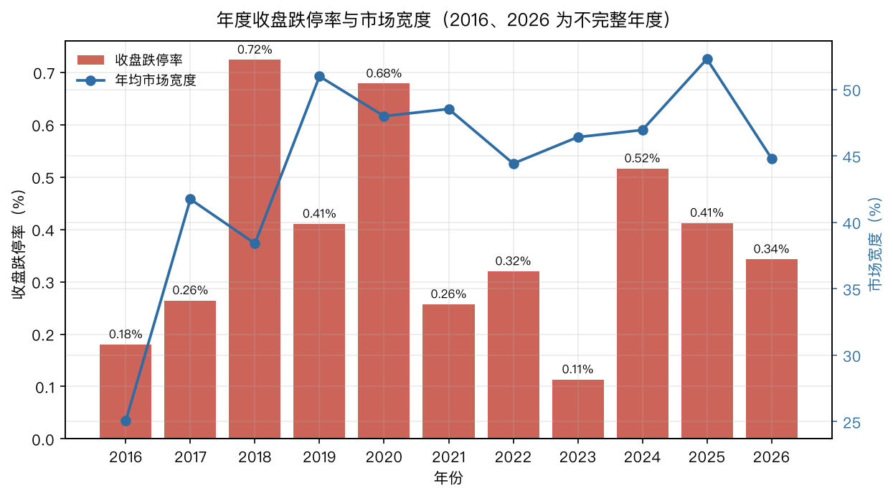

2018 与 2024 是明显的跌停高发年；2023 是低发年。**任何“平均概率”都必须带上年份/市场状态，否则会被股灾年主导。**

### 3.3 分板块

| 板块/时期 | 样本数 | 收盘跌停数 | 跌停率 |
|---|---:|---:|---:|
| 主板 | 6,512,744 | 31,690 | **0.487%** |
| 创业板 10% 时代（2020-08-24 前） | 601,343 | 4,584 | **0.762%** |
| 创业板 20% 时代（2020-08-24 后） | 1,757,409 | 909 | **0.052%** |
| 科创板 | 697,668 | 229 | **0.033%** |

20% 跌停板把“收盘跌停”的概率压到主板的约 1/9；但条件概率（昨日跌停后）反而更高：

| 条件 | 主板 | 创业板 10% 时代 | 创业板 20% 时代 | 科创板 |
|---|---:|---:|---:|---:|
| 基准 | 0.487% | 0.762% | 0.052% | 0.033% |
| 昨收跌停 | 13.16% | 9.10% | 3.70% | 2.08% |
| 昨收涨停 | 2.93% | 2.52% | 0.435% | 0.265% |
| ≥2 连板 | 7.43% | 6.13% | 1.89% | 0.562% |
| 20 日涨≥20% | 2.89% | 2.35% | 0.132% | 0.046% |
| 20 日波动≥50% | 1.30% | 1.24% | 0.078% | 0.049% |
| 市场跌停占比 1%～2% | 3.38% | 6.66% | 0.043% | 0.165% |

**结论**：20% 板不能直接套用主板的“跌停概率”，但“跌停后的惯性”方向一致；创业板 20% 时代的“市场跌停占比 1%～2%”甚至不升反降（0.83×），说明 20% 板的跌停更多由个股/板块事件驱动，而不是全市场情绪。

---

## 四、事件侧：跌停前长什么样

### 4.1 全部跌停事件的 T-1 画像

| 特征 | 数值 |
|---|---:|
| 20 日收益中位数 | +3.7% |
| 20 日波动中位数 | 59.8% |
| 距 20 日线中位数 | +0.33% |
| 距 60 日线中位数 | +5.0% |
| RSI14 中位数 | 52.7 |
| 成交额/20 日均额中位数 | 1.12 |
| 收盘位置中位数 | 0.355 |
| 20 日涨>20% 占比 | **31.0%** |
| 20 日跌>10% 占比 | **21.5%** |
| 20 日波动≥50% 占比 | **62.1%** |
| 成交额量比≥1.5 占比 | **34.2%** |
| 20 日内有跌停占比 | **26.8%** |
| 昨日涨停占比 | **8.3%** |
| 弱市场占比（宽度<40% 且指数<MA60） | **40.4%** |

事件侧不是单峰：**31% 是前期强势股，21.5% 是已经下跌的弱势股，41% 是中性**。把“跌停前都涨多了”当成普遍规律是错的。

### 4.2 首次跌停 vs 连续跌停

| 指标 | 首次跌停（32,729） | 连续跌停（4,683） |
|---|---:|---:|
| 20 日涨>20% | 31.1% | 30.2% |
| 20 日跌>10% | 20.1% | **31.3%** |
| 20 日波动>50% | 59.5% | **80.0%** |
| 昨日涨停 | 9.5% | 0% |
| 20 日内有跌停 | 17.6% | **91.1%** |
| 弱市场 | 37.9% | **57.9%** |

连续跌停更多是“高波动 + 已经跌停 + 弱市场”的延续；首次跌停更多是“强势股/涨停后”的第一次断裂。

### 4.3 原型

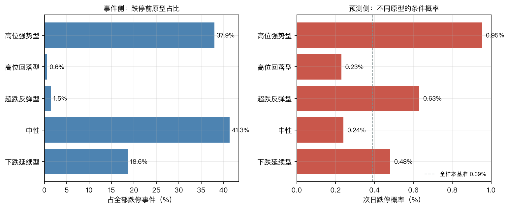

| 原型 | 事件侧占比 | 次日跌停概率 | 提升倍数 |
|---|---:|---:|---:|
| 高位强势型 | 37.9% | 0.953% | 2.44× |
| 下跌延续型 | 18.6% | 0.481% | 1.23× |
| 中性 | 41.4% | 0.240% | 0.61× |
| 超跌反弹型 | 1.5% | 0.631% | 1.61× |
| 高位回落型 | 0.6% | 0.229% | 0.59× |

**高位强势型**是最大单一原型：20 日涨>10% 且仍在 60 日线上；事件中占 37.9%，条件概率 0.95%。  
**下跌延续型**占 18.6%，条件概率 0.48%；它更多出现在弱市场（71.5%）。

### 4.4 事件窗口：市场先转弱，个股后断裂

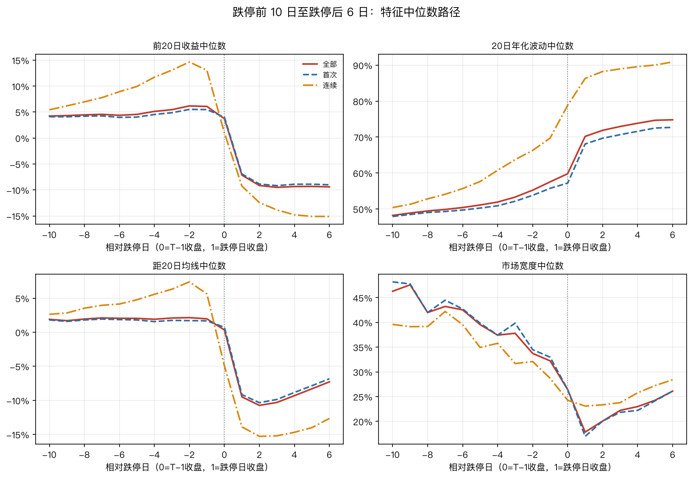

| 指标 | T-10 | T-2 | T-1（offset 0） | 跌停日（offset +1） |
|---|---:|---:|---:|---:|
| 20 日收益中位数 | +4.2% | +6.2% | +3.7% | -7.1% |
| 20 日波动中位数 | 48.2% | 55.2% | 59.8% | 70.2% |
| 距 20 日线 | +1.9% | +2.1% | +0.3% | -9.5% |
| 市场宽度 | 46.3% | 33.7% | 26.4% | 17.8% |

市场宽度在跌停前 10 日已经从 46% 降到 32%，个股 20 日收益在 T-2 还在加速（+6.2%），T-1 开始转弱，跌停日断裂。  
**这更像“市场先转弱、个股最后补跌/杀高位”，不是单纯的个股突发利空。** 但没有新闻数据，不能排除事件驱动。

---

## 五、预测侧：不同特征出现后，跌停概率是多少

> 基准率 0.391%。下表的“概率”都是 P(次日收盘跌停 | T-1 特征)，不是 P(特征 | 跌停)。

### 5.1 单条件提升倍数排名

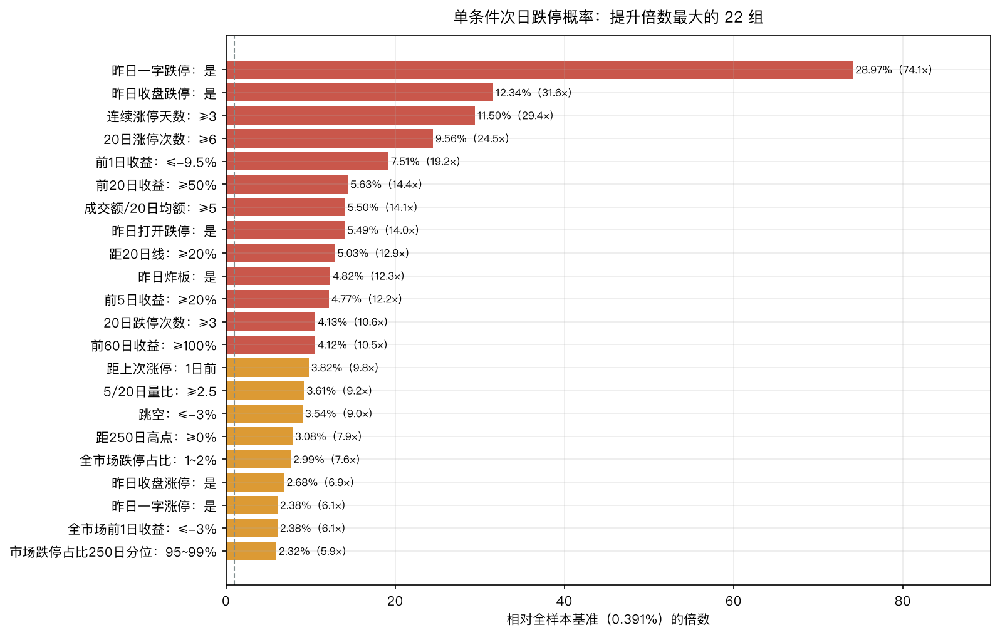

| 条件 | 样本数 | 次日跌停 | 提升 | 5 日内 |
|---|---:|---:|---:|---:|
| 昨日一字跌停 | 4,626 | **28.97%** | 74.1× | 32.8% |
| 昨日收盘跌停 | 37,942 | **12.34%** | 31.6× | 17.7% |
| 连续涨停 ≥3 天 | 9,729 | **11.50%** | 29.4× | 49.8% |
| 昨日非一字封死 | 33,316 | **10.03%** | 25.7× | 15.6% |
| 20 日涨停 ≥6 次 | 28,065 | **9.56%** | 24.5× | 30.0% |
| 前 1 日跌幅 ≥9.5% | 63,636 | **7.51%** | 19.2× | 11.3% |
| 昨日 ≥2 连板 | 25,085 | **7.05%** | 18.0× | 35.9% |
| 20 日涨 ≥50% | 78,026 | **5.63%** | 14.4× | 18.5% |
| 成交额量比 ≥5 | 36,779 | **5.50%** | 14.1× | 13.1% |
| 昨日收盘打开跌停 | 31,352 | **5.49%** | 14.0× | 11.2% |
| 距 20 日线 ≥20% | 144,075 | **5.03%** | 12.9× | 16.5% |
| 昨日炸板 | 56,965 | **4.82%** | 12.3× | 11.0% |
| 20 日跌停 ≥3 次 | 28,060 | **4.13%** | 10.6× | 11.5% |
| 昨日涨停 | 116,219 | **2.68%** | 6.9× | 15.7% |
| 市场跌停占比 1%～2% | 264,985 | **2.99%** | 7.6× | 6.3% |

### 5.2 连续特征：位置、波动、量能

**20 日收益**（U 形）：

| 20 日收益 | 样本数 | 次日跌停 | 提升 |
|---|---:|---:|---:|
| ≤-30% | 54,510 | 2.07% | 5.3× |
| -30%～-20% | 256,604 | 0.86% | 2.2× |
| -20%～-10% | 1,282,109 | 0.37% | 0.94× |
| -10%～0% | 3,343,037 | 0.23% | 0.60× |
| 0%～10% | 2,905,417 | 0.19% | 0.50× |
| 10%～20% | 1,018,882 | 0.35% | 0.89× |
| 20%～30% | 346,725 | 0.87% | 2.2× |
| 30%～50% | 199,120 | 2.10% | 5.4× |
| ≥50% | 78,026 | **5.63%** | 14.4× |

**距 20 日线**（U 形）：

| 位置 | 次日跌停 | 提升 |
|---|---:|---:|
| ≤-20% | **3.40%** | 8.7× |
| -20%～-10% | 0.92% | 2.4× |
| -10%～-5% | 0.42% | 1.07× |
| -5%～0% | 0.20% | 0.51× |
| 0%～5% | **0.15%** | 0.39× |
| 5%～10% | 0.27% | 0.69× |
| 10%～20% | 0.82% | 2.1× |
| ≥20% | **5.03%** | 12.9× |

**距 60 日线**：≤-30% 为 2.27%，-30%～-15% 为 0.57%，中间 0.20%～0.23%，≥20% 为 2.17%。  
**最安全的区间是“贴着 20 日线、涨幅不大、波动不高”**；不是“越强越安全”，也不是“越跌越安全”。

**20 日波动**：

| 波动 | 次日跌停 | 提升 | 事件覆盖 |
|---|---:|---:|---:|
| ≤20% | 0.091% | 0.23× | 2.3% |
| 20%～30% | 0.150% | 0.38× | 8.5% |
| 30%～40% | 0.194% | 0.50× | 10.8% |
| 40%～50% | 0.308% | 0.79× | 13.4% |
| 50%～70% | 0.577% | 1.48× | 27.1% |
| ≥70% | **1.364%** | 3.5× | 35.0% |

**成交额/20 日均额**：

| 量比 | 次日跌停 | 提升 |
|---|---:|---:|
| ≤0.5 | 0.433% | 1.11× |
| 0.5～0.8 | 0.234% | 0.60× |
| 0.8～1.0 | 0.243% | 0.62× |
| 1.0～1.5 | 0.344% | 0.88× |
| 1.5～2.5 | 0.577% | 1.48× |
| 2.5～5 | 1.565% | 4.0× |
| ≥5 | **5.50%** | 14.1× |

极低量比也略高于基准（0.433%），但远不如放量危险；**放量是更强的信号**。

**其他**：

- RSI14：≤20 为 0.861%，20～30 为 0.439%，中间 0.25%～0.31%，70～80 为 0.572%，≥80 为 **1.782%**。超卖和超买都危险，超买端更极端。
- 跳空：≤-3% 为 **3.54%**，-3%～-1% 为 0.82%，-1%～1% 为 0.20%～0.25%，≥3% 为 **2.76%**。向下跳空更危险，向上跳空也危险。
- 收盘位置：0～10% 为 **0.699%**，10%～30% 为 0.391%，50%～70% 为 0.294%，70%～90% 为 0.237%，90%～100% 为 0.475%。弱收盘危险；强收盘也略升（可能是高位加速）。
- 上影线 ≥4% 为 **1.77%**，0～1% 为 0.285%。长上影是分布/炸板信号。
- 换手率相关只覆盖约 14% 的股票，未进入主表；在子样本中方向与量比一致。

### 5.3 市场状态：中度恐慌最危险

| 全市场跌停占比 | 样本数 | 次日跌停 | 提升 |
|---|---:|---:|---:|
| 0 | 848,685 | 0.218% | 0.56× |
| 0～0.2% | 5,425,398 | 0.175% | 0.45× |
| 0.2%～0.5% | 2,028,893 | 0.396% | 1.01× |
| 0.5%～1% | 812,316 | 0.985% | 2.5× |
| 1%～2% | 264,985 | **2.99%** | 7.6× |
| 2%～4% | 95,796 | 0.804% | 2.1× |
| ≥4% | 93,091 | 1.45% | 3.7× |

**不是“越恐慌越危险”**。1%～2% 是危险区；≥4% 的极端恐慌日，次日往往有修复/反抽，概率反而下降。  
市场宽度：20%～30% 最高（0.835%），≤20% 为 0.734%，30%～40% 为 0.307%，40%～50% 为 0.201%，50%～60% 为 0.205%，≥60% 为 0.220%。

**全市场前 1 日收益**：≤-3% 为 2.38%，-3%～-1% 为 0.474%，-1%～0% 为 0.408%，0%～1% 为 0.231%，1%～3% 为 0.246%，≥3% 为 0.732%。市场大跌次日危险；市场大涨次日也略升（0.73% vs 0.23%），但远弱于大跌。

### 5.4 行业

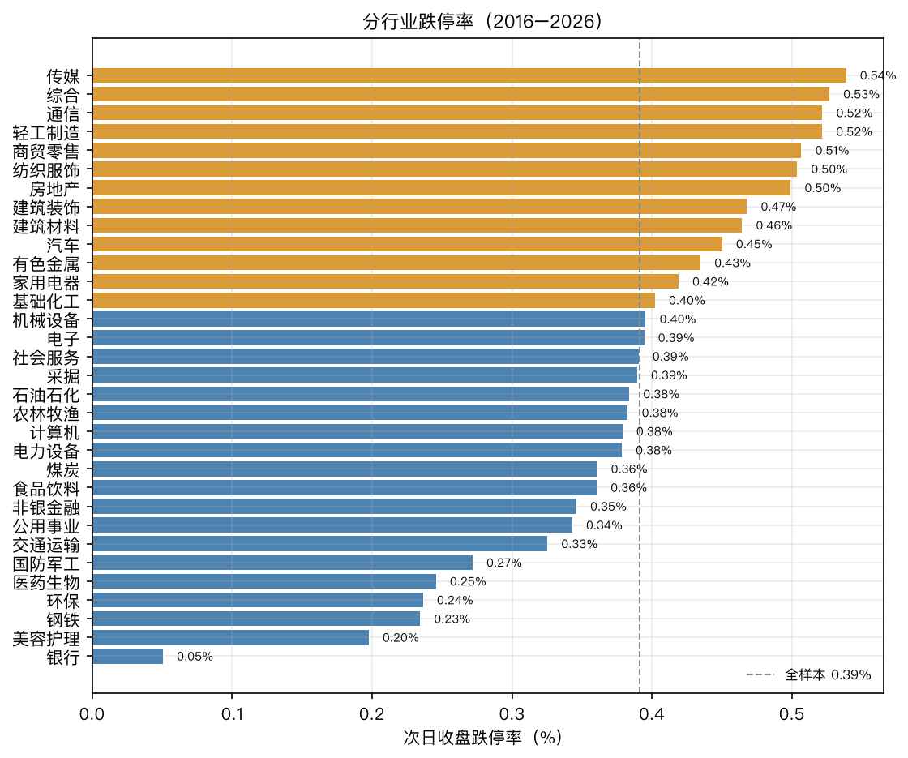

| 行业 | 跌停率 | 提升 |
|---|---:|---:|
| 传媒 | 0.539% | 1.38× |
| 综合 | 0.527% | 1.35× |
| 通信 | 0.522% | 1.34× |
| 轻工制造 | 0.522% | 1.33× |
| 商贸零售 | 0.507% | 1.30× |
| … | … | … |
| 国防军工 | 0.272% | 0.70× |
| 医药生物 | 0.246% | 0.63× |
| 环保 | 0.236% | 0.60× |
| 钢铁 | 0.234% | 0.60× |
| 美容护理 | 0.198% | 0.51× |
| 银行 | 0.051% | 0.13× |

行业差异存在，但幅度小于个股波动/位置。**行业跌停占比**（T-1）2%～5% 时，个股次日跌停率 2.28%；≥5% 为 1.76%；0 为 0.222%。行业恐慌有传染，但同样不是单调。

### 5.5 二维交互：两个条件叠加

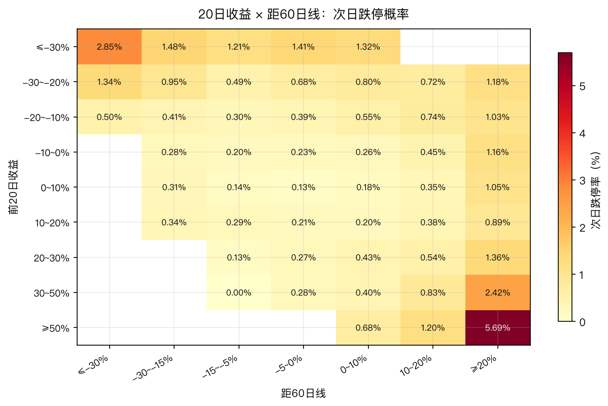

- 20 日涨 ≥50% 且距 60 日线 ≥20%：**5.69%**（n=72,038）。  
- 20 日涨 30%～50% 且距 60 日线 ≥20%：2.42%。  
- 20 日涨 ≤-30% 且距 60 日线 ≤-30%：**2.85%**。  
- 20 日涨 0%～10% 且距 60 日线 0%～10%：0.18%。

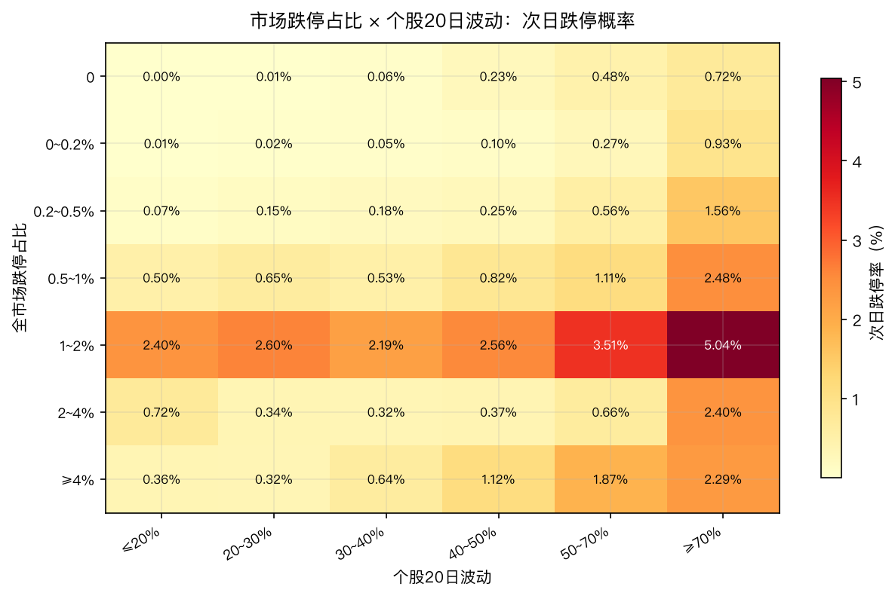

- 市场跌停占比 1%～2% 且个股 20 日波动 ≥70%：**5.04%**。  
- 市场跌停占比 1%～2% 且个股波动 ≤20%：2.40%。  
- 市场跌停占比 0 且个股波动 ≤20%：0.004%。  
- 市场跌停占比 ≥4% 且个股波动 50%～70%：1.87%；≥4% 且 ≤20%：0.36%。

**市场弱 + 个股高波**是最危险的组合；单看市场或单看个股都会低估/高估。

### 5.6 特征族：谁最强

| 特征族 | 最强单组 | 概率 | 提升 | 稳定强组数 |
|---|---|---:|---:|---:|
| 跌停惯性 | 距上次跌停：昨日 | 12.34% | 31.6× | 3 |
| 涨停过热 | 连续涨停 ≥3 天 | 11.50% | 29.4× | 6 |
| 位置动量 | 前 1 日跌幅 ≥9.5% | 7.51% | 19.2× | 9 |
| 量能流动性 | 成交额量比 ≥5 | 5.50% | 14.1× | 3 |
| 盘口技术 | 跳空 ≤-3% | 3.54% | 9.0× | 3 |
| 市场状态 | 全市场跌停占比 1%～2% | 2.99% | 7.6× | 4 |
| 行业状态 | 行业 5 日收益 ≤-10% | 2.32% | 5.9× | 5 |
| 波动尾部 | 20 日波动 ≥70% | 1.36% | 3.5× | 2 |

**特征族的最强组排名不等于“族内每个特征都强”**：跌停惯性/涨停过热是“事件状态”，概率最高但样本少；位置动量/波动/量能是“连续状态”，覆盖率更高。  
若只看“纯位置”而不看昨日涨跌，20 日涨 ≥50% 为 5.63%（14.4×），距 20 日线 ≥20% 为 5.03%（12.9×）。

---

## 六、形态组合：概率与覆盖率的权衡

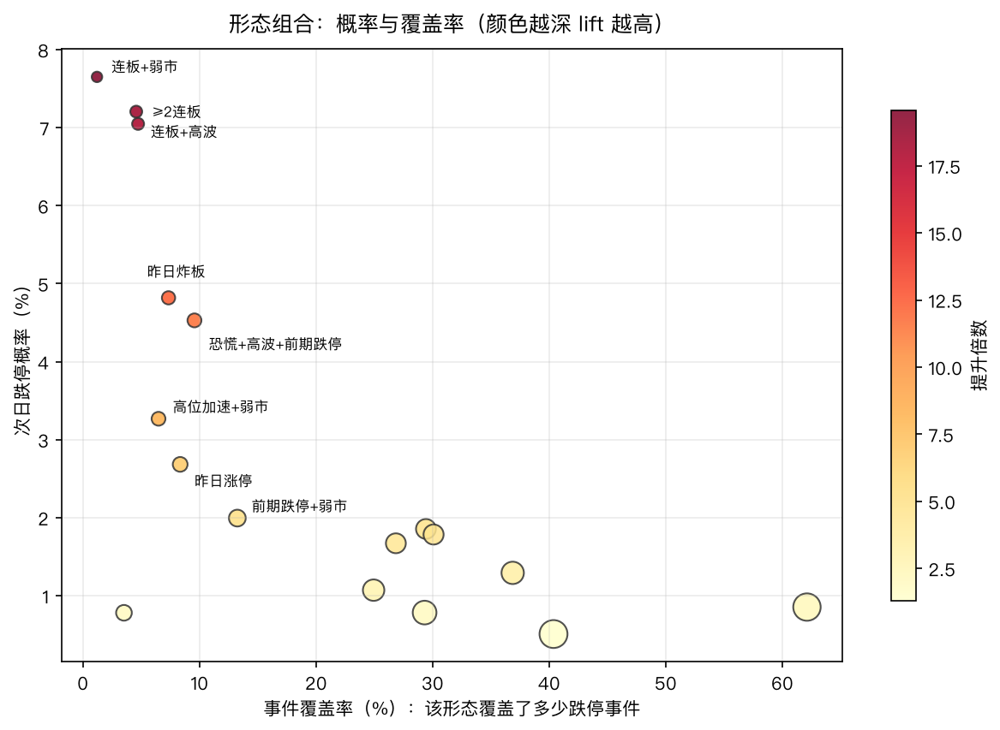

| 形态 | 类型 | 样本数 | 次日跌停 | 提升 | 5 日内 | 事件覆盖 | 训练/检验 |
|---|---|---:|---:|---:|---:|---:|---:|
| 连板 + 弱市场 | 探索 | 5,869 | **7.65%** | 19.6× | 36.9% | 1.2% | 13.7× / 25.1× |
| 连板 + 高波动 | 探索 | 23,718 | **7.21%** | 18.4× | 36.5% | 4.6% | 12.3× / 24.5× |
| 昨日 ≥2 连板 | 预注册 | 25,085 | **7.05%** | 18.0× | 35.9% | 4.7% | 12.0× / 24.1× |
| 昨日炸板 | 预注册 | 56,965 | **4.82%** | 12.3× | 11.0% | 7.3% | 8.2× / 16.6× |
| 市场恐慌 + 高波动 + 前期跌停 | 探索 | 78,971 | **4.53%** | 11.6× | 10.2% | 9.6% | 7.6× / 16.0× |
| 高位加速 + 弱市场 | 预注册 | 74,162 | **3.27%** | 8.4× | 11.1% | 6.5% | 6.4× / 10.2× |
| 昨日涨停 | 预注册 | 116,219 | **2.68%** | 6.9× | 15.7% | 8.3% | 5.0× / 8.8× |
| 前期跌停 + 弱市场 | 探索 | 248,237 | **2.00%** | 5.1× | 5.4% | 13.2% | 3.3× / 7.5× |
| 高位加速（20 日涨>20% 且距 60 日线>-3%） | 预注册 | 592,952 | **1.86%** | 4.7× | 7.0% | 29.4% | 4.2× / 5.3× |
| 远离均线（距 20 日线>10%） | 预注册 | 630,324 | **1.79%** | 4.6× | 7.0% | 30.1% | 3.9× / 5.3× |
| 前期跌停（20 日内有收盘跌停） | 预注册 | 600,405 | **1.67%** | 4.3× | 5.1% | 26.8% | 3.1× / 5.7× |
| 市场恐慌（跌停占比 250 日≥90 分位） | 预注册 | 1,066,350 | **1.29%** | 3.3× | 3.8% | 36.9% | 4.1× / 2.7× |
| 高波动 + 弱市场 | 探索 | 870,397 | **1.07%** | 2.7× | 3.7% | 24.9% | 2.3× / 3.2× |
| 高波动（20 日波动>50%） | 预注册 | 2,718,093 | **0.855%** | 2.2× | 3.3% | 62.1% | 2.1× / 2.3× |
| 破位（跌破 20 日线且 5 日跌>5%） | 预注册 | 1,398,201 | **0.784%** | 2.0× | 2.4% | 29.3% | 2.2× / 1.8× |
| 放量滞涨 | 预注册 | 168,302 | **0.781%** | 2.0× | 3.2% | 3.5% | 1.8× / 2.2× |
| 弱市场（宽度<40% 且指数<MA60） | 预注册 | 2,966,274 | **0.509%** | 1.30× | 1.9% | 40.4% | 1.2× / 1.4× |

**关键取舍**：

- 连板/炸板类形态概率最高，但覆盖率只有 1%～7%；适合“重点排查”，不适合全市场筛选。
- 高波动、高位加速、前期跌停覆盖 25%～62% 的事件，但概率只有 1%～2%；适合做“风险分层”，不能单独作为卖出信号。
- **“弱市场”单独只有 1.30×**，这是很多人会误判的地方：市场弱并不够，必须叠加个股自身的波动/位置/跌停历史。

按日聚类区间（节选）：

| 形态 | 概率 | 聚类 95% 区间 |
|---|---:|---:|
| 连板 + 弱市场 | 7.65% | 6.73%～8.68% |
| 连板 + 高波动 | 7.21% | 6.65%～7.84% |
| ≥2 连板 | 7.05% | 6.52%～7.66% |
| 昨日炸板 | 4.82% | 3.93%～6.12% |
| 恐慌 + 高波 + 前期跌停 | 4.53% | 3.33%～5.99% |
| 高位加速 + 弱市场 | 3.27% | 2.96%～3.62% |
| 高波动 | 0.855% | 0.733%～0.984% |

---

## 七、六条风险清单：把概率变成可执行的分层

### 7.1 规则

> **透明度说明**：这六条是从单特征/形态结果中挑出的可执行组合，阈值在看完单特征后确定，**不是预注册规则**；2022–2026 的评分表是描述性稳定性，不是严格样本外。它的价值是“把已发现的概率变成可执行分层”，不是“证明这套清单未来一定有效”。

每条 1 分，共 6 条（实际最高 5 分，因为“昨日跌停”和“≥2 连板”互斥）：

1. 昨日收盘跌停；
2. 昨日 ≥2 连板；
3. 20 日年化波动 ≥50%；
4. 全市场收盘跌停占比 ≥0.5%；
5. 20 日涨幅 ≥20%；
6. 成交额/20 日均额 ≥2。

### 7.2 评分表

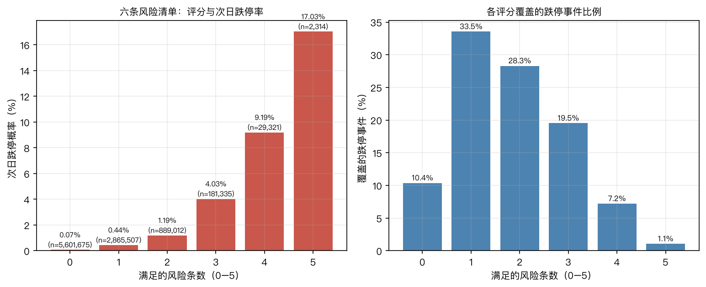

| 评分 | 样本数 | 次日跌停 | 提升 | 5 日内 | 覆盖事件 | 训练期 | 检验期 | 聚类区间 |
|---:|---:|---:|---:|---:|---:|---:|---:|---:|
| 0 | 5,601,675 | **0.069%** | 0.18× | 0.66% | 10.4% | 0.116% | 0.035% | 0.044%～0.105% |
| 1 | 2,865,507 | **0.438%** | 1.12× | 2.02% | 33.5% | 0.528% | 0.367% | 0.257%～0.656% |
| 2 | 889,012 | **1.19%** | 3.05× | 4.49% | 28.3% | 1.33% | 1.09% | 0.93%～1.51% |
| 3 | 181,335 | **4.03%** | 10.3× | 11.7% | 19.5% | 4.02% | 4.03% | 3.55%～4.62% |
| 4 | 29,321 | **9.19%** | 23.5× | 25.4% | 7.2% | 8.60% | 9.61% | 7.81%～10.58% |
| 5 | 2,314 | **17.03%** | 43.6× | 39.2% | 1.1% | 15.25% | 19.01% | 14.04%～20.35% |

**弱市场放大**：

| 评分 | 弱市场（宽度<40% 且指数<MA60） | 非弱市场 |
|---:|---:|---:|
| 0 | 0.121% | 0.050% |
| 1 | 0.451% | 0.430% |
| 2 | 1.50% | 1.02% |
| 3 | 5.43% | 3.48% |
| 4 | 11.63% | 8.39% |
| 5 | 21.17% | 15.04% |

### 7.3 怎么用

- **0～1 分**：正常风险，不需要因为“跌停”单独减仓；仍要遵守个股止损。
- **2 分**：观察名单；检查是否同时有高位放量/长上影/行业跌停扩散。
- **3 分**：风险偏高（4.03%），不建议新开仓；已有仓位收紧止损/降低集中度。
- **4～5 分**：高风险（9.19%～17.03%），优先处理流动性、避免加仓/摊薄；若同时是一字跌停/连板后，按连续跌停风险管理。
- **评分不是卖出信号**：0 分也有 0.069% 的跌停；5 分也有 83% 不跌停。它只是把“风险预算”从平均分配变成按概率分配。

---

## 八、多变量模型：能排序，但别把概率当确定

### 8.1 三组对照

训练 2016-10～2021-12；检验 2022-01～2026-10；训练集负样本 10:1 下采样并加权还原。  
> 注：8.1 的训练窗口到 2021-12，8.2 的训练窗口到 2020-12、用 2021 做校准；两组数值不可直接逐项比较，但结论一致。

| 模型 | 特征数 | ROC 面积 | 平均精确率 | 前 1% 精度 | 前 1% 捕获 | 前 5% 提升 | 前 10% 提升 |
|---|---:|---:|---:|---:|---:|---:|---:|
| 仅市场 | 13 | 0.672 | 0.0060 | 0.66% | 1.9% | 1.28× | 2.15× |
| 仅个股 | 45 | **0.892** | 0.0637 | **10.29%** | **30.0%** | 11.1× | 6.9× |
| 市场+个股 | 58 | **0.893** | 0.0639 | **10.30%** | **30.1%** | 11.0× | 6.7× |

**市场特征单独很弱；个股特征已经包含大部分可排序信息；把市场特征叠加进去，整体排序几乎不提升，前 5%/10% 甚至略降。**  
这不是说市场状态没用，而是说：市场状态决定“哪天整体危险”，个股特征决定“同一天里谁更危险”；两者回答不同问题。

### 8.2 校准后的样本外表现

训练 2016-10～2020-12；2021 年等渗校准；检验 2022-01～2026-10。

| 指标 | 市场+个股（校准） | 六条清单（校准） |
|---|---:|---:|
| ROC 面积 | **0.881** | 0.856 |
| 平均精确率 | 0.0466 | 0.0405 |
| 布里尔分数 | **0.003339** | 0.003338 |
| 基准布里尔 | 0.003414 | 0.003414 |
| 前 1% 精度 | **8.76%** | 6.75% |
| 前 1% 捕获 | **25.6%** | 19.7% |
| 前 5% 精度 | 3.47% | 3.05% |
| 前 10% 精度 | 2.15% | 1.99% |

布里尔分数只比“始终预测基准率”好一点点（0.003339 vs 0.003414）。**概率的绝对校准很难；模型的价值在排序和分层，不在精确概率。**

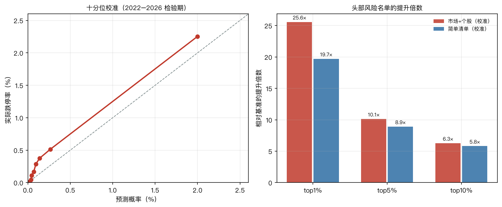

十分位校准（检验期）：

| 十分位 | 预测均值 | 实际跌停率 | 提升 |
|---:|---:|---:|---:|
| 1 | 0.0035% | 0.0025% | 0.007× |
| 2 | 0.0148% | 0.0066% | 0.019× |
| 3 | 0.0235% | 0.0154% | 0.045× |
| 4 | 0.0359% | 0.0436% | 0.127× |
| 5 | 0.0425% | 0.1124% | 0.328× |
| 6 | 0.0700% | 0.1690% | 0.493× |
| 7 | 0.0944% | 0.2864% | 0.836× |
| 8 | 0.139% | 0.376% | 1.10× |
| 9 | 0.265% | 0.514% | 1.50× |
| 10 | **1.998%** | **2.252%** | **6.57×** |

头部略低估（预测 2.00%，实际 2.25%），但整体单调性良好。

### 8.3 整体 vs 日内：0.881 有多少是市场择时？

| 指标 | 市场+个股 | 六条清单 |
|---|---:|---:|
| 整体 ROC | 0.881 | 0.856 |
| **日内 ROC**（同一天内比较个股） | **0.822** | 0.753 |
| 日内 top10% 跌停率 | 21.17% | 21.95% |
| 当日基准（有跌停的交易日） | 12.70% | 12.70% |
| 日内 top10% 提升 | **1.67×** | **1.73×** |

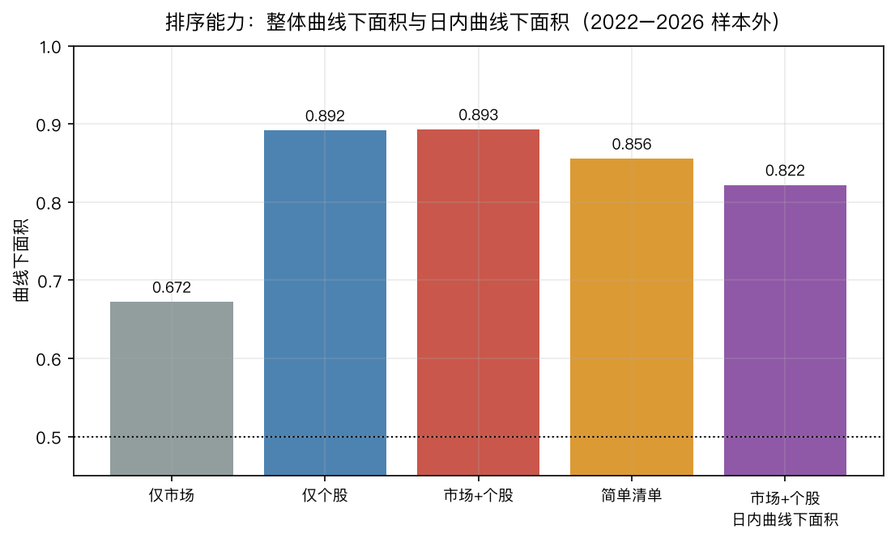

**整体 0.881 中有相当一部分来自“识别股灾日”**；同一天内，模型只能把 top10% 的跌停率从 12.7% 抬到 21.2%（1.67×）。  
这仍然有用，但和“25.6× 前 1% 提升”给人的印象不同。简单清单在日内 top10% 甚至略好（1.73×），说明复杂模型没有形成压倒性优势。

### 8.4 前 1% 名单的构成

| 构成 | 占比 |
|---|---:|
| 昨日跌停 | 15.6% |
| 昨日涨停 | 14.1% |
| ≥2 连板 | 8.2% |
| 20 日波动 ≥50% | 83.2% |
| 20 日涨幅 ≥20% | 56.3% |
| 成交额量比 ≥2 | 43.9% |
| 市场跌停占比 ≥0.5% | 42.3% |
| 弱市场 | 63.8% |

前 1% 不是“单一的跌停惯性名单”，而是**跌停惯性 + 涨停过热 + 高波动 + 弱市场**的混合。  
其中 83% 是高波动股，说明模型主要在找“脆弱的高波股”，而不是找“所有高位股”。

### 8.5 置换重要性

| 特征 | ROC 面积下降 |
|---|---:|
| 全市场跌停占比 | 0.0199 |
| 板块 | 0.0178 |
| 市场跌停占比 250 日分位 | 0.0172 |
| 真实波幅/收盘 | 0.0113 |
| 成交额/20 日均额 | 0.0083 |
| 市场宽度 60 | 0.0068 |
| 昨日跌停 | 0.0054 |
| 全市场 5 日收益 | 0.0052 |
| 市场宽度 20 | 0.0051 |
| 距上次跌停 | 0.0051 |
| 前 1 日收益 | 0.0048 |
| 市场 60 日收益 | 0.0047 |
| 距 20 日线 | 0.0028 |

**板块重要性高**，主要反映不同板块的跌停制度/基准率差异（主板 0.487% vs 科创板 0.033%），不是因果；真实波幅、量比、市场跌停占比是更可解释的风险变量。

### 8.6 模型边界

- 这是**排序模型**，不是“明天哪只一定跌停”的预测器；前 1% 精度只有 8.76%。
- 绝对概率依赖市场状态和样本期；2021 校准后，2024/2025 的头部仍可能低估/高估。
- 特征只有日线；没有分时、公告、新闻、龙虎榜，无法识别突发利空。
- 训练集负样本下采样会损失部分信息；但全量训练的“仅个股/市场+个股”对照结论一致。
- 不应单独作为做空/卖出系统；A 股跌停后流动性差、次日可能继续一字，交易执行风险高。

---

## 九、连续跌停：持仓风险管理

### 9.1 昨日跌停三态

| 昨日状态 | 样本数 | 次日跌停 | 提升 | 聚类 95% 区间 | 5 日内 | 盘中触及 |
|---|---:|---:|---:|---:|---:|---:|
| 一字跌停 | 4,626 | **28.97%** | 74.1× | 15.1%～49.3% | 32.8% | 63.3% |
| 非一字封死 | 33,316 | **10.03%** | 25.7× | 8.1%～12.5% | 15.6% | 20.8% |
| 收盘打开 | 31,352 | **5.49%** | 14.0× | 3.9%～7.6% | 11.2% | 8.6% |
| 昨日无跌停 | 9,499,870 | 0.326% | 0.83× | 0.25%～0.42% | 1.62% | 0.59% |

### 9.2 跌停日三态（含盘中打开）

| 跌停日类型 | 事件数 | 次日跌停 | 次日触及 | 未来 5 日跌停 |
|---|---:|---:|---:|---:|
| 一字跌停 | 4,280 | **26.44%** | 62.5% | 30.3% |
| 非一字封死 | 33,125 | **9.99%** | 20.7% | 15.6% |
| 盘中打开 | 31,081 | **5.48%** | 8.6% | 11.2% |
| 全部 | 68,486 | **8.96%** | 17.8% | 14.5% |

**含义**：

- 一字跌停最危险，但也是最少见的；它的按日聚类区间很宽，不能把 26%～29% 当成精确值。
- 收盘打开跌停的次日风险只有 5.48%，但 5 日内仍有 11.2%；不要因为“当天打开了”就认为风险解除。
- 收盘跌停样本（不含盘中打开）的次日跌停率约 **11.9%**；加上盘中打开后降到 **8.96%**；**样本定义会显著影响“连跌概率”**，报告时必须写清楚。

> 9.1 是“昨日状态 → 次日”，9.2 是“今日跌停日类型 → 次日”，两者口径不同：一字跌停 28.97% vs 26.44%。差异来自“昨日一字”与“今日一字”的样本不同（今日一字包含昨日也是一字的连续事件）。

### 9.3 板块差异

收盘跌停样本的次日跌停率（旧口径，仅收盘跌停）：

| 板块 | 次日跌停率 |
|---|---:|
| 主板 | 12.72% |
| 创业板 | 7.31% |
| 科创板 | 1.32% |

20% 板的跌停更“稀有但惯性弱”？主板的连续跌停风险更高，可能与主板特别处理股/低价股/流动性结构有关；科创板样本少（229 个收盘跌停），区间很宽。

---

## 十、稳健性

### 10.1 分年

关键条件的提升倍数在不同年份差异很大：

| 条件 | 2018 | 2020 | 2023 | 2024 | 2025 |
|---|---:|---:|---:|---:|---:|
| 昨收跌停 | 20.8× | 11.7× | 105.9× | 26.3× | 22.6× |
| ≥2 连板 | 6.1× | 9.4× | 67.4× | 18.7× | 19.6× |
| 20 日涨≥20% | 3.1× | 3.5× | 13.6× | 3.6× | 3.8× |
| 20 日波动≥50% | 1.5× | 1.5× | 4.6× | 1.8× | 1.9× |
| 市场跌停占比 1%～2% | 5.3× | 19.0× | — | 2.7× | 1.4× |

方向大多一致，但**幅度不稳定**；2023 年基准率极低（0.11%），导致提升倍数看起来极高。**不要用单一年份的 lift 做规则。**

### 10.2 危机年 vs 平静年

| 条件 | 危机年（2018/2024） | 平静年（2019/2021/2023/2025） |
|---|---:|---:|
| 基准率 | 0.597% | 0.292% |
| 昨收跌停 | 14.26% | 10.17% |
| ≥2 连板 | 8.13% | 6.88% |
| 20 日涨≥20% | 1.93% | 1.66% |
| 20 日波动≥50% | 0.978% | 0.780% |
| 市场跌停占比 1%～2% | 2.71% | 2.08% |
| 高位加速+弱市场 | 3.73% | 2.91% |

**绝对概率在危机年更高，但提升倍数的方向稳定。** 这说明清单在平静年也有用，但平静年的绝对风险更低。

### 10.3 退市近似样本

102 只退市/缺失股（近似口径）：

| 条件 | 样本数 | 次日跌停 | 提升 |
|---|---:|---:|---:|
| 基准 | 89,889 | **0.742%** | 1.0× |
| 昨收跌停 | 679 | **27.1%** | 36.5× |
| ≥2 连板 | 286 | 5.25% | 7.1× |
| 20 日涨≥20% | 4,921 | 1.99% | 2.7× |
| 20 日波动≥50% | 24,332 | 1.71% | 2.3× |
| 市场跌停占比 1%～2% | 2,939 | 4.66% | 6.3× |

退市股基准率更高（0.742% vs 0.391%），方向与主样本一致；剔除它们会略微低估风险，但不会改变结论。

### 10.4 特别处理股（5% 跌停）

| 条件 | 样本数 | 5% 跌停 | 概率 | 提升 |
|---|---:|---:|---:|---:|
| 基准（特别处理股代理） | 317,045 | 11,247 | **3.55%** | 1.0× |
| 昨日 5% 跌停 | 12,917 | 4,292 | **33.23%** | 9.4× |
| 昨日 5% 涨停 | 17,420 | 950 | 5.45% | 1.54× |
| 20 日内 5% 跌停≥1 | 118,942 | 11,247 | 9.46% | 2.67× |
| 20 日涨≥20% | 28,246 | 2,096 | 7.42% | 2.09× |
| 20 日波动≥50% | 89,884 | 4,944 | 5.50% | 1.55× |
| 市场跌停占比 1%～2% | 9,112 | 846 | 9.28% | 2.62× |
| 弱市场 | 98,404 | 4,812 | 4.89% | 1.38× |

特别处理股的基准率是主样本的 9 倍；昨日 5% 跌停后的继续跌停概率 33.2%。**不要把特别处理股和普通主板股混在一个概率表里。**

### 10.5 多重检验与聚类

- 单特征表有 200+ 个分组，q 值大多接近 0（样本 957 万，统计功效极强）；**统计显著不等于有用**。本报告主要看提升倍数、事件覆盖率、两段稳定性和聚类区间。
- 跌停高度聚集于少数交易日；普通 Wilson 区间偏窄。关键形态和连续跌停表另给按交易日重采样的 cluster 区间。
- 一字跌停的 cluster 区间 15.1%～49.3%，说明单点 29% 的不确定性很大。

---

## 十一、行业差异

| 行业 | 跌停率 | 提升 |
|---|---:|---:|
| 传媒 | 0.539% | 1.38× |
| 综合 | 0.527% | 1.35× |
| 通信 | 0.522% | 1.34× |
| 轻工制造 | 0.522% | 1.33× |
| 商贸零售 | 0.507% | 1.30× |
| 纺织服饰 | 0.504% | 1.29× |
| 房地产 | 0.499% | 1.28× |
| 建筑装饰 | 0.468% | 1.20× |
| 国防军工 | 0.272% | 0.70× |
| 医药生物 | 0.246% | 0.63× |
| 环保 | 0.236% | 0.60× |
| 钢铁 | 0.234% | 0.60× |
| 美容护理 | 0.198% | 0.51× |
| 银行 | 0.051% | 0.13× |

行业效应存在，但远小于“个股波动 + 位置 + 市场状态”。银行股跌停率极低，部分是因为低波、低换手、机构持仓；传媒/通信/轻工更高，部分是因为高波、小市值、题材属性。  
**行业跌停占比**可作为传染指标：行业跌停占比 2%～5% 时，个股次日跌停率 2.28%；但行业本身不能替代个股风险清单。

---

## 十二、常见误区

1. **“跌停股里 62% 是高波动，所以高波动股票 62% 会跌停。”**  
   错。P(高波动|跌停)=62.1%，但 P(跌停|20 日波动>50%)=0.855%，只有 2.2× 基准。事件侧占比和预测侧概率是两件事。

2. **“市场弱就危险，弱市场应该空仓。”**  
   弱市场单独只有 1.30×；市场宽度 20%～30% 才 2.1×。必须叠加个股高波/高位/跌停历史。极端弱（≤20%）反而略低于 20%～30%。

3. **“极端恐慌最危险。”**  
   不是。全市场跌停占比 1%～2% 时 2.99%，≥4% 时 1.45%。极端恐慌后常有反抽；中度恐慌 + 个股脆弱更危险。

4. **“AUC 0.88 就能精准预测。”**  
   前 1% 精度只有 8.76%，日内 top10% 提升只有 1.67×。整体 AUC 含市场择时，不能当成“个股预测准确率”。

5. **“跌停前都涨多了。”**  
   只有 31.0% 的跌停事件在 T-1 的 20 日涨幅 >20%；21.5% 已经跌 >10%；41.4% 是中性。存在明显的“下跌延续型”。

6. **“特别处理股和普通股一样。”**  
   特别处理股 5% 跌停基准率 3.55%，昨日 5% 跌停后 33.2%；与主板 10% 口径完全不同。

7. **“一字跌停最安全，因为卖不出去。”**  
   一字跌停次日再跌停 28.97%，5 日内 32.8%；它不是安全，而是流动性风险最高的状态。

8. **“打开跌停就没事了。”**  
   收盘打开跌停的次日跌停率 5.49%，5 日内 11.2%；风险下降但未消失。

---

## 十三、可执行清单

### 13.1 每天收盘后 5 分钟

1. 算全市场收盘跌停占比（主板+创业板+科创板，非特别处理股口径）。
2. 对自己的持仓/观察池，逐只打六条分：
   - 昨日收盘跌停？
   - 昨日 ≥2 连板？
   - 20 日年化波动 ≥50%？
   - 全市场跌停占比 ≥0.5%？
   - 20 日涨幅 ≥20%？
   - 成交额/20 日均额 ≥2？
3. 按评分分层：
   - 0～1：正常；
   - 2：观察；
   - 3：不新开仓，收紧止损；
   - 4～5：高风险，优先降低集中度/流动性风险。
4. 若持仓昨日已跌停，先看三态：
   - 一字跌停：次日继续跌停 29%，按“无法卖出”做最坏打算；
   - 非一字封死：10%；
   - 收盘打开：5.5%。
5. 若市场跌停占比进入 1%～2%，提高警惕；若 ≥4%，不要盲目追空，次日可能反抽。

### 13.2 风险预算

- 单票风险预算按“评分”调整：0～1 分正常；3 分减半；4～5 分只保留可承受流动性风险的仓位。
- 不要用跌停概率做空/满仓反向；A 股跌停后可能连续一字，执行价格不可控。
- 不要因为“模型说 8.76%”就认为大概率跌停；91% 的前 1% 名单不会次日跌停。

### 13.3 监控指标

- 全市场收盘跌停占比（1%～2% 危险区）；
- 市场宽度 20（20%～30% 危险区）；
- 行业跌停占比（2%～5%）；
- 个股 20 日波动、20 日涨幅、成交额量比、距 20/60 日线；
- 昨日跌停三态/连板/炸板。

---

## 十四、假设检验结果（对照预注册）

| 编号 | 假设 | 结果 | 关键证据 |
|---|---|---|---|
| H1 | 市场状态是最大单一因素 | **部分成立** | 单市场模型 ROC 0.672；市场跌停占比 1%～2% 7.6×；但非单调，市场特征叠加个股几乎无增量 |
| H2 | 前期涨幅越高越危险 | **成立** | 20 日涨 ≥50% 5.63%（14.4×）；30%～50% 2.10% |
| H3 | 昨日涨停/连板后危险 | **成立** | 昨日涨停 2.68%（6.9×）；≥2 连板 7.05%（18.0×） |
| H4 | 位置双峰 | **成立** | 距 20 日线 ≥20% 5.03%，≤-20% 3.40%，中间 0.15%～0.20% |
| H5 | 高波动更危险 | **成立** | ≥70% 波动 1.36%（3.5×）；≤20% 0.091% |
| H6 | 放量危险，极低流动性也偏高 | **成立** | 量比 ≥5 5.50%；≤0.5 0.433% |
| H7 | 过去 20 日曾跌停，次日再跌停高 | **成立** | 1.67%（4.3×）；昨日跌停 12.34% |
| H8 | 技术弱势（RSI 低/收盘弱/长上影） | **成立但较弱** | RSI≤20 0.861%；收盘位置 0～10% 0.699%；上影≥4% 1.77% |
| H9 | 行业弱/行业跌停多更危险 | **成立但幅度小** | 行业跌停占比 2%～5% 2.28%；行业基准差异 0.05%～0.54% |
| H10 | 组合形态可达 10× 以上 | **成立** | 连板+弱市场 7.65%（19.6×）；连板 7.05%（18.0×） |
| H11 | 事件侧两类原型 | **成立** | 高位强势 37.9%，下跌延续 18.6%，中性 41.4% |
| H12 | 控制市场后个股有增量，但样本外有限 | **部分成立（超出预注册区间）** | 整体 ROC 0.881（预注册 0.65–0.75），日内 0.822；前 1% 精度 8.76%、日内 top10% 仅 1.67×；排序强、绝对概率弱 |

---

## 十五、边界与失败

1. **不是干净样本外**：2022–2026 已用于最终规则/清单选择；严格样本外尚未做。  
2. **只有日线**：没有分时/盘口/新闻/公告/龙虎榜/融资；无法回答“几点封死、为什么封死”。  
3. **历史特别处理股名称缺失**：5% 口径用价格规则代理；8.7% 的 5% 事件与核心事件在 30 日内重叠，可能有个别非特别处理股的 5% 巧合。  
4. **退市股只补 102 只**：仍可能有小市值退市股缺失；主样本跌停率可能略低估 0.05～0.1 个百分点。  
5. **跌停高度聚集**：普通置信区间偏窄；关键结论用按日 cluster 区间，但一字跌停区间仍很宽（15%～49%）。  
6. **模型概率校准有限**：布里尔分数只比基准好一点；绝对概率不要外推到新市场状态。  
7. **板块/行业重要性不是因果**：主板/科创板差异反映制度与基准率，不是“板块本身导致跌停”。  
8. **不保证未来**：2016–2026 包含 2018、2024 两轮股灾；未来制度/流动性/参与者结构变化会让概率漂移。

---

## 十六、文件与复现

### 目录

```
2026-10-22_跌停前特征_全A/
├── 00_预注册_跌停前特征.md
├── 00_一页纸_跌停风险清单.md
├── 01_完整报告_跌停前特征与概率.md
├── 02_风险清单_执行版.md
├── 03_数据与复现说明.md
├── README.md
├── 跌停前特征_数据表.xlsx
├── 01_数据/
│   ├── 跌停事件表_主.parquet
│   ├── 跌停事件表_补充.parquet
│   ├── 分析面板.parquet
│   ├── 代码表.csv / 市场日表.csv / 行业日表.csv
│   ├── 跌停事件清单.csv / 涨停事件清单.csv
│   ├── 基准率.csv / 字段说明.csv
├── 02_代码/（10、20、30、35、40、45、50、55、60、70）
├── 03_结果/（所有 CSV 底表）
└── 04_图表/（12 张 PNG）
```

### 复现顺序

1. `02_代码/10_构建跌停事件表.py`（需要本地行情数据库）
2. `02_代码/20_构建分析面板.py`（需要 4.1 GB 全 A 面板）
3. `02_代码/30_单特征概率.py`
4. `02_代码/35_形态与事件研究.py`
5. `02_代码/40_模型与样本外.py`
6. `02_代码/45_模型校准与日内检验.py`
7. `02_代码/50_稳健性与特别处理股.py`
8. `02_代码/55_图表与评分.py`
9. `02_代码/60_补充表_跌停三态.py`
10. `02_代码/70_数据表.py`

### 主要底表

- [单特征概率表](03_结果/单特征概率表.csv)
- [重点条件概率表](03_结果/重点条件概率表.csv)
- [形态组合概率](03_结果/形态组合概率.csv)
- [六条风险评分](03_结果/风险评分_六条清单.csv)
- [昨日跌停三态](03_结果/昨日跌停三态_次日风险.csv)
- [跌停日三态](03_结果/跌停日三态_次日风险.csv)
- [模型校准对比](03_结果/模型校准后对比.csv)
- [模型日内检验](03_结果/模型日内排序能力_市场+个股.csv)
- [稳健性分板块](03_结果/稳健性_分板块.csv)
- [特别处理股 5% 跌停](03_结果/特别处理股5%跌停概率.csv)

### 图表

- [图1 年度跌停率与市场宽度](04_图表/图1_年度跌停率与市场宽度.png)
- [图2 单条件提升倍数](04_图表/图2_单条件提升倍数.png)
- [图3 事件窗口路径](04_图表/图3_事件窗口路径.png)
- [图4 收益位置热力图](04_图表/图4_收益位置热力图.png)
- [图5 市场波动热力图](04_图表/图5_市场波动热力图.png)
- [图6 形态概率与覆盖率](04_图表/图6_形态概率与覆盖率.png)
- [图7 模型校准与头部提升](04_图表/图7_模型校准与头部提升.png)
- [图8 模型AUC对比](04_图表/图8_模型排序能力对比.png)
- [图9 分板块概率](04_图表/图9_分板块概率.png)
- [图10 跌停原型](04_图表/图10_跌停原型.png)
- [图11 六条风险评分](04_图表/图11_六条风险评分.png)
- [图12 分行业跌停率](04_图表/图12_分行业跌停率.png)

---

## 一句话总结

**个股跌停前不是一种样子：37.9% 是高位强势股，18.6% 是下跌延续股，41.4% 是中性；真正可用的不是“猜哪只一定跌”，而是用市场状态 + 个股波动/位置/量能/跌停历史做风险分层。六条清单 0 分 0.07%、3 分 4.03%、4 分 9.19%、5 分 17.03%；模型能把这个排序做得更细，但前 1% 也只有 8.76% 的次日跌停率。**
