# MACD 在 A 股的有效性：全维度实证（2010–2026）

> 研究目录：`2026-10-28_MACD有效性_全维度`
> 数据：2008-01-02 至 2026-10-28，沪深 A 股 5,507 只（含 341 只退市），信号评估 2010-01-01 起。
> 口径：T 日收盘确认，T+1 开盘买入，剔除一字涨停；个股往返成本 0.15%，指数单边 0.05%。
> 主指标：20 日收益的当日横截面分位（50% = 与市场同步）。
> 复现：见 [01_方法与口径.md](01_方法与口径.md)；逐笔事件表 `03_结果/事件_金叉_12269.parquet`。

---

## 0. 先给结论

**MACD 日线金叉在 A 股不是选股 alpha。** 53.2 万个金叉，20 日平均分位 **49.79%**，中位 49.81%，胜率 49.81%；平均超额 -0.054%（按信号日聚类 t=-1.24），扣 0.15% 成本后的 20 日持有组合年化 **-5.7%（t=-7.96）**。它是一枚右偏彩票：中位超额 -1.45%，P10=-11.7%，P90=+12.5%，均值被少数大赢家拉起。

**个股层面，参数、变体、周期都救不回来。** 413 组 fast/slow/signal 中可评估的 354 组全部落在 **49.77%–50.25%** 分位，没有一组超过 50.5%；没有一组中位超额为正或胜率超过 50%；最好的平均超额 +0.115%/20 日，**低于 0.15% 的往返成本**；FDR 最小 q=0.53。12/26/9 处于最差约 1%（413 组中排第 5 差）。

**把对象从金叉换成连续特征，结论更尖锐（第 7 节）。** 12 个日线 MACD 特征（柱体、变化、加速度、面积、z、DIF/DEA、斜率、交叉年龄、红柱占比）的全样本 20 日 IC **全部为负**；DIF 水平 -7.16%（t=-8.42），柱体水平 -2.80%。唯一稳健的独立增量是**负向**的：柱体上行/红柱放大在控制水平与 1/5/20/60 日涨幅、波动、换手、成交额后仍为 -0.15% ~ -0.18%/20 日（t=-5 ~ -6）。DIF>DEA 的严格增量也是 -0.23%（t=-2.98）；绿柱缩短约 0。周线全部为负；**月线在长期下跌结构里出现唯一强正**（12 个月 IC +11.8%，Q5-Q1 +10.1%），但那是跌深反弹的相对信号，绝对收益仍跑输宽基，不是 long-only alpha。

**教科书条件正是最差条件。** 零轴双上 47.96%、周线多头 48.30%、年线上+年线升 48.40%、高波动 46.94%、高成交额 46.61%、量比>2 46.60%、上市<1 年 46.29%、DIF>1.5 46.12%。在 A 股，MACD 金叉是**反趋势**信号，不是趋势信号。

**日线金叉的单维条件里，唯一稳健的正 pocket 是 ST。** 分位 53.19%，+0.97%/20 日，扣费组合 +1.3%/年，但 t=0.32，容量和制度限制大，不能当策略。

**追加（个股适配性，第 13 节）：把对象下沉到单只股票，仍然没有“适合 MACD 的股票”。** 逐股金叉超额中位 -0.29%/20 日（5,381 只中 41.7% 为正），逐股 DIF>DEA 择时净超同暴露中位 -1.46%/年（5,391 只中 41.9% 为正）；更关键的是不持久：前期→后期事件相关 0.016、择时 -0.044，劈半信度 0.237 / 0.041。看起来好的“低 60 日、低波、低换手、非小市值”只是“少亏”，扣 0.15% 成本后没有正收益；而且配对对照显示，低 60 日全 A 11.0%/年、加金叉后 4.5%/年，低波全 A 7.6%、加金叉后 4.2%——**金叉是反转/低波子集的拖累**。全市场 DIF>DEA 可成交口径对同暴露只有 +0.1%/年（p=0.099），是降暴露/降回撤，不是 alpha。唯一例外是科创板 2022-2026 的择时口袋（+8.0%/年 vs 同暴露，p≈0.01），但 2019-2021 为 -6.7%，是 regime/行业口袋，不是稳定股票属性。

**追加（条件有效性，第 4.5 节 + [报告_条件有效性.md](报告_条件有效性.md)）：把 MACD 特征当判断条件，而不是选股因子，仍然没有一格同时通过“绝对”和“增量”。** 55 个条件格里，绝对为正的 5 格全是温和区（柱体 Q3/Q4、DIF Q2、斜率 Q3/Q4，+0.16% ~ +0.34%/20 日），但同一批交易日多空差 -0.15% ~ +0.16%，减 MA60 后增量 t 绝对值只有 0.2–2.0；有 MACD 增量的 7 格全是深弱区（柱体 Q1、z Q1、零轴双下、周线空+月线多/空、指数下行），多头绝对仍 -0.73% ~ +0.00%。强确认状态（零轴双上 -0.90%、红柱放大 -0.69%、证据≥5 -0.87%、周线多+月线空 -1.03%）在 20/60 日都显著跑输，且“证据≥5”17/17 年为负；事件层 12 个经典过滤里 11 个净超额为负，唯一微正的“证据≤1”+0.26%（t=1.4，后期 +0.07%）。**MACD 是卖出/回避刻度，不是买入开关。**

**追加（MACD×KDJ 配合，第 4.6 节 + [报告_MACD_KDJ配合.md](报告_MACD_KDJ配合.md)）：能配合，但不是“双金叉确认”，而是“MACD 定方向、KDJ 定是否过热”。** 四态全部为负，MACD多+KDJ多最差（-0.65%/20 日，t=-8.6，17 年 1 年正）；同日双金叉净 -1.25%，17 年 0 年正，比非同日 KDJ 金叉的 MACD 金叉差 0.48pp（t=-4.46）；KDJ 金叉在 MACD 多头里比在 MACD 空头里差 0.58pp（t=-4.17），在 MACD 金叉后 5 日内差 0.47pp（t=-5.41）。KDJ 的增量在“位置”不在“方向”：KQ3/Q4 相对补集 +0.30/+0.26pp（t=3.49/4.81），但绝对 +0.14%/+0.01%，中位 -1.30%/-1.41%；K<20 均值 +0.58%、中位 -0.99%，≥50 只/日才 +1.53%。**没有一种 KDJ 过滤能把 MACD 金叉变成正净超额。**

**MACD 真正有用的是指数层面的危机保险（日线口径）。** 2006-2026：中证 500 年化 14.0% vs 买入持有 10.7%，最大回撤 **-38% vs -72%**；中证 1000 14.0% vs 11.3%，回撤 **-45% vs -73%**；沪深 300 7.0% vs 7.7%，回撤 **-47% vs -72%**。但 **日线 2016 年后收益增益基本消失**（沪深 300 0.1% vs 0.9%，中证 500 2.8% vs -1.4%，中证 1000 1.2% vs -4.6%），只剩降回撤。

**周期维度（本次补做）：个股周期不是解药，指数择时却换了一个周期。** 个股周线 4/8/12 周分位 49.4%–49.5%，比日线更弱；月线 3 个月 49.05%，12 个月 50.73%（+0.84%，t=1.27，中位 -8.4%），只是弱正且不稳。指数择时相反：日线 2016 年后失效，**月线 2016 年后仍有效**（沪深 300/中证 500/中证 1000 年化 4.6%/5.1%/0.2%，回撤 -28.4%/-19.9%/-31.6% vs 持有 -46.7%/-42.9%/-57.1%），周线最差（2016+ 三个指数全负）。多周期共振（日+周+月多头）47.96%，是最差条件。

---

## 1. 研究设计：为什么这次不是“再跑一遍金叉”

工作区此前的 MACD 研究（`analysis/macd/`、`2026-10-20_MACD金叉_时点500严格重跑/`）主要在 20 只事后龙头、池 50、时点 500 上做组合回测，结论是“时点 500 没有正期望、原 20 池 12.48% 应撤回”。本研究换了三个问题：

1. **信号层**：不做组合，先问“一个金叉之后，这只股票在横截面上排第几”。这避免了选池、槽位、排序、仓位对结论的污染。
2. **条件层**：把 18 个信号日可观测维度全部切开，回答“什么情况下有效、什么情况下无效”，而不是只给一个全样本均值。
3. **参数层**：413 组 fast/slow/signal，配合 FDR 和前后段，回答“参数变化能不能救”。

数据上补齐了两件此前没有的东西：**2016 年前的全历史**（baostock）和**341 只退市股**（生存偏差修正）。2016 年后与 DuckDB 重叠 1,011 万行，OHLC 仅 2 行差异，确认同源。

---

## 2. 全样本：一个抛硬币的信号

### 2.1 总体

| 周期 | 信号数 | 平均超额 | 中位超额 | 胜率(超额>0) | 日度平均超额 | 日度 t | 聚类 t |
|---|---:|---:|---:|---:|---:|---:|---:|
| 5 日 | 524,947 | -0.091% | -0.654% | 42.9% | -0.429% | -14.8 | -4.00 |
| 10 日 | 522,898 | -0.035% | -0.942% | 43.1% | -0.560% | -14.5 | -1.14 |
| 20 日 | 519,111 | -0.054% | -1.454% | 42.7% | -0.745% | -14.6 | -1.24 |
| 60 日 | 507,205 | -0.091% | -3.216% | 40.8% | -1.113% | -14.6 | -1.45 |

> 注：表中的“胜率(超额>0)”是相对等权市场**均值**的胜率。由于市场收益右偏，均值高于中位，即使股票处在中位也会低于均值；公平的“抛硬币”胜率看分位>50% = **49.81%**。

读法：

- **按信号加权，20 日平均超额 -0.054%，聚类 t=-1.24**：不能拒绝“0”。也就是说，平均而言金叉不比等权市场好，也不显著更差。
- **按日加权，20 日平均 -0.745%，t=-14.6**：这不是“每个信号亏 0.745%”，而是“平均一天，金叉股跑输等权市场 0.745%”。差异来自信号聚集：金叉多的日子，随后反弹更强；金叉少的日子，随后更弱。两种口径都真实，回答的是不同问题。
- **中位 -1.45%、胜率 42.7%**：典型交易明显跑输。均值接近 0 是因为右尾，不是中位。
- **60 日更差**：中位 -3.22%，胜率 40.8%。持有越久，跑输越明显。

### 2.2 横截面分位：49.79%

对每个信号日，把当日所有可交易股票的 20 日收益排序，金叉股的平均分位：

| 指标 | 数值 |
|---|---:|
| 平均分位 20 | **49.79%** |
| 中位分位 20 | 49.81% |
| 分位>50% 的比例 | 49.81% |
| 2010-2017 平均分位 | 49.88% |
| 2018-2026 平均分位 | 49.75% |

**这是一枚标准的抛硬币。** 它没有“选到更好的股票”，也没有“选到更差的股票”；它选到的就是市场平均水平。此前看到的“中位超额 -1.45%”是横截面右偏造成的错觉：市场均值被少数大牛股拉高，处在中位的股票自然低于均值。用分位复核后，金叉股就在中位附近。

### 2.3 彩票型分布

| 指标 | 20 日超额 |
|---|---:|
| 均值 | -0.054% |
| 1%/99% 缩尾均值 | **-0.208%** |
| 中位数 | -1.454% |
| P10 | -11.68% |
| P25 | -6.55% |
| P75 | +4.51% |
| P90 | +12.51% |
| 偏度 | 2.88 |
| 峰度 | 41.2 |
| >0 | 42.7% |
| >+10% | 13.2% |
| <-10% | 13.7% |

MFE20 均值 **+12.0%**，MAE20 均值 **-8.6%**。也就是说：**金叉之后，大多数股票先给你 12% 的浮盈机会，但收盘时中位只剩 -1.45% 的超额。** 方向不是问题，兑现才是问题。这解释了为什么“金叉 + 死叉离场”在直觉上很顺，却在数据上不如固定持有——死叉来得太晚，浮盈已经回吐。

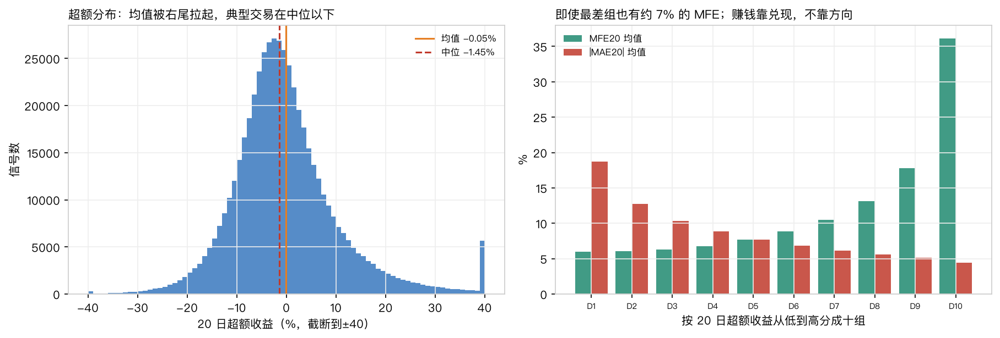

### 2.4 组合层：扣费后 -5.7%/年

把“金叉后持有 20 日”做成每日等权组合（持有所有过去 20 日内出信号且仍可交易的股票），对比全 A 等权：

| 组合 | 毛年化 | 毛 t | 净年化（0.15%/笔） | 净 t | 日均持仓 |
|---|---:|---:|---:|---:|---:|
| 金叉，持有 20 日 | -3.13% | -4.40 | **-5.66%** | -7.96 | 2,053 |
| 绿柱缩短，持有 20 日 | -2.45% | -4.22 | -6.46% | -11.21 | 2,449 |
| 金叉+零轴下，20 日 | -3.97% | -2.11 | -6.91% | -3.70 | 1,330 |
| 金叉+周线空头，20 日 | -1.78% | -1.14 | -4.53% | -2.92 | 1,188 |
| 金叉+ST，20 日 | +4.06% | 0.97 | +1.30% | 0.32 | 65 |

组合层是最终裁决：**即使毛 alpha 接近 0，0.15% 的往返成本也会把它打成负的。** 只有 ST 组合净正，但 t=0.32，不能当策略。

---

## 3. 年度：没有一年显著高于 50%

| 年份 | 信号数 | 平均分位 | 分位>50% | 平均超额 | 中位超额 | 日度平均超额 |
|---|---:|---:|---:|---:|---:|---:|
| 2010 | 15,141 | 49.67% | 47.5% | +0.01% | -1.42% | -0.83% |
| 2011 | 17,557 | 50.61% | 49.0% | +0.17% | -0.73% | -0.57% |
| 2012 | 21,340 | 49.98% | 48.6% | -0.01% | -0.97% | -0.55% |
| 2013 | 20,485 | 49.67% | 48.2% | +0.01% | -1.63% | -0.41% |
| 2014 | 21,935 | 49.69% | 47.5% | -0.18% | -1.47% | -0.87% |
| 2015 | 18,594 | 49.59% | 45.1% | -0.36% | -2.32% | -2.57% |
| 2016 | 22,048 | 49.94% | 48.0% | -0.10% | -1.30% | -1.18% |
| 2017 | 25,253 | 49.88% | 48.6% | -0.12% | -0.93% | -0.34% |
| 2018 | 29,058 | 49.18% | 47.8% | -0.18% | -1.00% | -1.21% |
| 2019 | 33,164 | 50.06% | 49.5% | +0.04% | -1.47% | -0.32% |
| 2020 | 35,409 | 50.39% | 50.3% | +0.23% | -1.72% | -0.24% |
| 2021 | 39,880 | 50.40% | 50.6% | +0.11% | -1.59% | -0.27% |
| 2022 | 41,365 | 50.22% | 50.5% | +0.08% | -1.32% | -0.77% |
| 2023 | 46,666 | 49.07% | 48.6% | -0.19% | -1.21% | -0.60% |
| 2024 | 47,443 | 49.55% | 49.0% | -0.22% | -1.60% | -0.52% |
| 2025 | 49,841 | 49.57% | 49.5% | -0.10% | -2.17% | -0.58% |
| 2026* | 33,932 | 49.42% | 44.3% | -0.08% | -2.05% | -0.89% |

\* 2026 为 1-10 月。

- 最高 2011 年 50.61%，最低 2023 年 49.07%；全距只有 1.5 个百分点，没有一年形成稳定 edge。
- 2020-2022 连续三年略高于 50%，2023-2026 连续四年低于 50%，像 regime 漂移，而不是稳定 alpha。
- 2015 年日度平均 -2.57%，是股灾年；金叉在暴跌里集中出现，随后继续跑输。这提示“金叉多 = 市场弱”，不是“金叉多 = 机会多”。

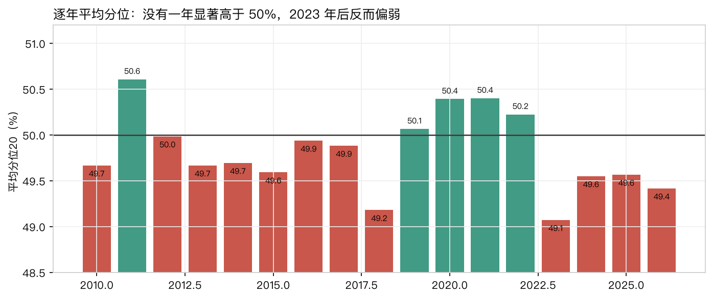

---

## 4. 条件：什么时候有效，什么时候无效

### 4.1 按分位排序的条件表（20 日）

| 维度 | 分组 | 信号数 | 平均分位 | 分位>50% | 平均超额 | 中位超额 | 日度平均超额 | 日度 t | 聚类 t | 2010-2017 分位 | 2018-2026 分位 |
|---|---|---|---:|---:|---:|---:|---:|---:|---:|---:|---:|
| is_st | ST | 14,806 | **53.19%** | 55.5% | +0.97% | -0.20% | **+0.41%** | **2.58** | 6.20 | 54.46% | 52.64% |
| 成交额 | 低额 | 171,050 | 52.50% | 53.7% | +0.56% | -0.72% | +0.01% | 0.07 | 9.05 | 51.85% | 52.87% |
| 波动 | 低波 | 172,095 | 52.01% | 53.0% | +0.14% | -0.98% | -0.30% | -3.97 | 2.14 | 51.61% | 52.19% |
| 量比 | <0.7 | 84,658 | 51.41% | 52.0% | +0.18% | -1.05% | -0.38% | -4.00 | 3.13 | 50.72% | 51.73% |
| 个股趋势 | 年线下 | 272,344 | 50.97% | 51.2% | +0.13% | -1.12% | -0.77% | -11.87 | 1.95 | 50.63% | 51.12% |
| 周线 | 周线空头 | 286,022 | 50.90% | 51.3% | +0.17% | -1.13% | -0.64% | -8.50 | 2.66 | 50.47% | 51.08% |
| zero_state | 双下 | 331,353 | 50.83% | 51.1% | +0.14% | -1.15% | -0.72% | -10.41 | 2.37 | 50.47% | 50.98% |
| 距250日高 | <-30% | 198,883 | 50.57% | 50.6% | +0.17% | -1.18% | -1.05% | -13.52 | 2.27 | 50.43% | 50.64% |
| 信号密度 | >100/日 | 410,618 | 50.49% | 50.7% | +0.14% | -1.28% | -0.01% | -0.24 | 2.74 | 51.15% | 50.25% |
| 宽度 | 30-50% | 162,904 | 50.46% | 50.8% | +0.20% | -1.15% | -0.28% | -3.59 | 2.36 | 51.12% | 50.23% |
| 波动 | 中波 | 176,485 | 50.38% | 50.3% | +0.21% | -1.30% | -0.45% | -6.62 | 3.67 | 50.10% | 50.52% |
| 成交额 | 中额 | 176,672 | 50.26% | 50.2% | +0.15% | -1.39% | -0.43% | -6.25 | 2.45 | 50.17% | 50.30% |
| 绿柱长度 | 21-60 | 103,644 | 50.24% | 50.5% | -0.03% | -1.29% | -0.95% | -9.34 | -0.32 | 49.43% | 50.63% |
| 市场趋势 | 强趋势 | 175,970 | 50.06% | 50.2% | +0.02% | -1.20% | -0.31% | -3.13 | 0.86 | 50.40% | 49.86% |
| board | 主板 | 385,704 | 49.82% | 49.8% | -0.16% | -1.50% | -0.82% | -9.50 | -2.74 | 49.87% | 49.79% |
| 个股趋势 | 年线上+年线升 | 194,977 | 48.40% | 48.2% | -0.26% | -1.66% | -0.90% | -7.34 | -6.19 | 49.17% | 48.01% |
| 周线 | 周线多头 | 179,183 | 48.30% | 47.9% | -0.34% | -1.71% | -0.93% | -6.48 | -6.19 | 49.14% | 48.00% |
| zero_state | 双上 | 177,894 | 47.96% | 47.6% | -0.40% | -1.79% | -1.20% | -9.99 | -6.79 | 48.97% | 47.42% |
| 成交额 | 高额 | 171,379 | 46.61% | 45.5% | -0.87% | -2.10% | -1.33% | -10.71 | -10.71 | 47.58% | 46.08% |
| 量比 | >2 | 91,692 | 46.60% | 45.1% | -0.67% | -2.10% | -1.07% | -11.06 | -11.06 | 47.64% | 46.04% |
| 波动 | 高波 | 170,531 | 46.94% | 46.1% | -0.52% | -2.08% | -1.47% | -12.09 | -12.09 | 48.14% | 46.28% |
| 上市 | <1 年 | 19,258 | 46.29% | 44.8% | -1.05% | -2.69% | -1.58% | -7.27 | -7.27 | 47.06% | 45.75% |
| DIF | >1.5% | 84,358 | 46.12% | 45.4% | -0.76% | -2.32% | -1.46% | -9.09 | -9.09 | 47.75% | 45.29% |

（完整 18 个维度见 `03_结果/最终_条件.csv`；分位是 20 日横截面平均分位。）

### 4.2 三条硬结论

**第一，正 pocket 几乎都是“信号聚集”的产物。**
低波动分位 52.01%，但日度平均超额 -0.30%（t=-3.97）；零轴下分位 50.83%，日度 -0.72%（t=-10.41）；周线空头 50.90%，日度 -0.64%（t=-8.50）；年线下 50.97%，日度 -0.77%（t=-11.87）。它们“每个信号平均”略好，但“平均一天”是亏的。原因是这些信号在市场急跌后集中出现，随后的反弹把信号加权均值拉高；在平静日子里，它们持续跑输。**日线金叉的单维条件里，只有 ST 同时通过了两道检验**：分位 53.19%，日度 +0.41%（t=2.58），2010-2017/2018-2026 都在 52.6% 以上。

**第二，教科书条件是最差条件。**
零轴双上 47.96%、周线多头 48.30%、年线上+年线升 48.40%、高波动 46.94%、高成交额 46.61%、量比>2 46.60%、上市<1 年 46.29%、DIF>1.5 46.12%。这些条件正是传统 MACD 教学里“最该买”的：趋势向上、零轴上、周线共振、放量确认。数据说：**在 A 股，这些条件之后，金叉股在横截面上排在后 45%–48%。** 这不是“MACD 没用”，而是“MACD 的用法用反了”：它是一个滞后突破信号，而 A 股在 1–3 个月尺度上是反转占优。

**第三，日线金叉的单维条件里，唯一稳健的正 pocket 是 ST，但它不是策略。**
ST 分位 53.19%，扣费组合 +1.3%/年，t=0.32。ST 有 5% 涨跌停、退市/重组博弈、流动性差、容量小；它的“正”很可能来自制度性反转（跌深反弹 + 壳价值），不是 MACD 本身。它可以作为多信号系统里的一个弱特征，不能单独用。

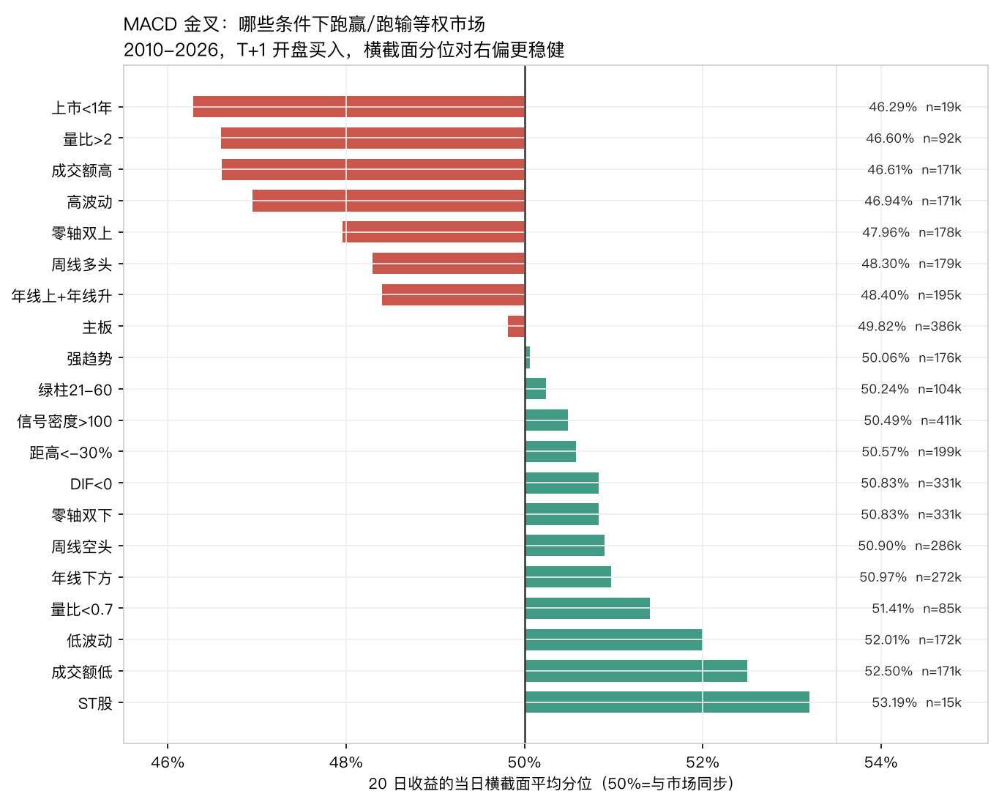

### 4.4 交互格：一个窄口袋（探索性，非预注册）

把 8 个维度（市场趋势 × 个股趋势 × 波动 × 成交额 × 零轴 × 周线 × 信号密度 × ST）交叉，得到 109 个 n≥1,000 的格子。绝大多数仍是负的；但有 4 个格子同时满足：平均超额 > +1.3%、日度超额 > 0（t>2.5）、2010-2017 与 2018-2026 都 > 0、BH q<0.01。

| 格子 | 信号数 | 每年 | 分位20 | 平均超额 | 中位超额 | 日度平均 | 日度t | 聚类t | 2010-17 | 2018-26 | 2023-26 | 日均成交额 | 前5笔占比 |
|---|---:|---:|---:|---:|---:|---:|---:|---:|---:|---:|---:|---:|---:|
| A 弱市·强股·中波·低额·双下·空头·洗盘 | 2,118 | 128 | 55.49% | **+1.66%** | +0.15% | +0.95% | 2.59 | 5.52 | +1.53% | +1.83% | +1.06% | 2,666 万 | 10.8% |
| B 强市·年线降·低波·低额·双上·多头·洗盘 | 1,060 | 69 | 56.50% | +1.54% | -0.20% | +1.21% | 3.18 | 3.90 | +1.56% | +1.52% | +1.86% | 2,741 万 | 20.9% |
| C 弱市·年线下·低波·低额·双上·近金叉·洗盘 | 1,062 | 66 | 55.95% | +1.43% | +0.24% | +1.52% | 3.32 | 3.33 | +0.59% | +1.67% | +0.93% | 2,307 万 | 31.9% |
| D 强市·年线升·低波·低额·双下·空头·洗盘 | 1,996 | 122 | 56.36% | +1.39% | -0.13% | +1.05% | 3.00 | 3.22 | +0.22% | +1.71% | +2.89% | 3,018 万 | 31.0% |

共同点：**低成交额 + 洗盘日（>100 个信号）+ 低/中波 + 一组特定的趋势/零轴/周线状态**。这不是“趋势跟随”，而是“强/弱股在弱市洗盘日的反转”：MACD 金叉只是触发器，edge 来自洗盘/反转条件。

**四盆冷水：**

1. **中位很薄。** B/D 的中位超额为负（-0.20%/-0.13%），A/C 只有 +0.15%/+0.24%，刚够 0.15% 成本；均值靠右尾。A 的扣费中位正好 0.00%。
2. **组合层不显著。** A 做成“持有 20 日、等权所有活跃信号”的组合：0.15% 成本下年化 +13.7%（t=1.61）；0.5% 成本 +5.2%（t=0.62）；1.0% 成本 -5.9%。B/C/D 在 0.15% 成本下只有 +1.4%/+3.6%/+2.9%（t<0.5）。**只有 A 有像样的毛 alpha，但 t 不到 2；成本一升就消失。**
3. **容量小。** 日均成交额 2,300–3,000 万元；单笔 100 万就占 3%–4% 日成交。0.15% 成本对这类低流动性股票明显偏低，0.5%–1% 更现实。
4. **多重选择。** 109 个格子是看完单维结果后扫出来的；虽然 BH q<0.01，但不是预注册，也没有独立 OOS。A 的年份分布其实不差（12/15 年为正；剔除 2015/2019 后均值仍 +1.64%），但这只能降低“靠两年”的担忧，不能替代 OOS。

**结论：A 是筛出的 4 个格子里唯一一个“两段都正、日度也正、组合毛 alpha 两位数”的个股口袋，值得作为预注册 OOS 的研究线索；但中位薄、容量小、成本敏感、无独立 OOS，不能直接实盘，也不改变“MACD 个股选股整体无效”的判断。**

### 4.5 条件层：把 MACD 特征当判断条件（不是选股）

第 4 节前面回答的是“金叉在什么条件下更好”；这里换一个单位：不选股，固定 MACD 的多/空判断（DIF>DEA 为多），看它在每种 MACD 特征状态下对不对。条件包括零轴四态、柱体四态、交叉年龄、柱体/DIF/斜率五分位、顶/底背离、周/月状态、6 项证据分数、市场状态，共 55 格。

两道门槛：绝对（多头 20 日超额 >0.15%、t>2、2010-17 与 2018-26 同为正）与增量（同一批交易日 MACD 多空差减 MA60 多空差 >0、t>2）。结果：**绝对 5 格、增量 7 格、交集 0 格。** 绝对为正的 5 格全是温和区（柱体 Q3/Q4、DIF Q2、斜率 Q3/Q4），同一批交易日多空差 -0.15% ~ +0.16%，减 MA60 后增量 t 绝对值只有 0.2–2.0，是价格趋势/低波效应；有增量的 7 格全是深弱区（柱体 Q1、z Q1、零轴双下、周线空+月线多/空、指数下行），多头绝对仍 -0.73% ~ +0.00%，只能做相对回避/减配。

强确认在 20/60 日都显著跑输：零轴双上 -0.899%/-1.382%、红柱放大 -0.686%/-1.068%、DIF Q5 -1.164%/-1.905%、周线多+月线空 -1.030%、证据≥5 -0.872%/-1.389%；“证据≥5”17/17 年为负。事件层 12 个经典过滤里 11 个净超额为负，零轴上金叉 -1.411%（方向性过滤最差；DIF 距离 Q5 -2.360% 更差），唯一微正的“证据≤1”+0.264%（t=1.4，后期 +0.074%）。**MACD 是卖出/回避刻度，不是买入开关。**

完整表、图、逐年和期限稳健性见 [报告_条件有效性.md](报告_条件有效性.md)；图见 [条件有效性_可视化.html](条件有效性_可视化.html)。

---

### 4.6 MACD×KDJ 配合：不是双确认，是位置过滤

把 KDJ(9,3,3) 加到 MACD 的判断上，问三个问题：KDJ 能不能让 MACD 的多/空更准？MACD 能不能让 KDJ 的金叉更准？两者同日/近日共振是否更好？答案是：**都不能相互确认；唯一有增量的是“KDJ 位置”——中间好、两端差。**

- **四态**：MACD多+KDJ多 -0.650%、MACD多+KDJ空 -0.422%、MACD空+KDJ多 -0.183%、MACD空+KDJ空 -0.309%；四态全负。MACD 多内部 KDJ多-空 -0.181pp（t=-2.94），DiD -0.176pp（t=-3.48）。**同向是拥挤，不是共振。**
- **KDJ 水平**：K 五分位 Q1 -0.299%、Q2 +0.070%、Q3 +0.141%、Q4 +0.007%、Q5 -0.520%（MACD 多）；Q3/Q4 相对补集 +0.296/+0.262pp（t=3.49/4.81），但绝对 t 只有 1.94/0.12，中位 -1.30%/-1.41%。控制先期收益、波动、成交额、MA60 后，Q2-Q4 vs Q1 +0.27~0.33pp（t 3.6-6.4），K<20 系数 -0.686%（t=-6.13），MACD多×K>D -0.316%（t=-4.01）。**位置有信息，方向是噪音。**
- **事件层**：519,111 个 MACD 金叉，全部净 -0.895%/20 日；KQ2/Q3 最好也只有 -0.50%/-0.48%，KQ5 -1.12%、K>70 -1.21%、同日双金叉 -1.25%、KDJ 顶背离 -1.35%；没有一种过滤能转正。KDJ 金叉 1,131,381 个，全部净 -0.814%；MACD 多里 -1.36% vs MACD 空里 -0.76%，差 -0.58pp（t=-4.17）；前 5 日 MACD 金叉 vs 无 -0.47pp（t=-5.41）。
- **K<20 解剖**：MACD 多 + K<20 的股票层均值 +0.58%、中位 **-0.99%**、5% 修剪 +0.18%；日度 ≥1 只均值 -0.86%，≥50 只/日才 +1.53%。这是市场级恐慌反弹的广度选择，不是个股买点；事件层 MACD 金叉当天 K<20 也只有 -0.41% 净、t=-0.72。
- **参数/周期**：15 组 KDJ 参数下，KQ5 惩罚 15/15 为负，KDJ 金叉在 MACD 多头更差 15/15 为负；5 组 MACD 参数下均为 5/5。同日双金叉在 KDJ 参数 12/15 负、MACD 参数 2/5 负——标准参数下很强，但不是所有参数都成立。周线 K<20 + 日线 MACD 金叉是唯一弱正口袋：+0.32%（t=1.54），增量 +0.69pp（t=2.05），5 组周线参数全正、约 11/15 年正，不能单独当策略。
- **最终判断**：MACD 多 + KDJ 多/双金叉/KQ5/K>70 = 不买/减仓；MACD 多 + KQ3/Q4 = 相对少亏，只用于排序；K<20 = 不能买；周线 K<20 + 日线金叉 = 只能观察。**43 个 KDJ 条件格，0 个“稳健有效”；KDJ 的加入没有把 MACD 变成买入开关，只是把“什么时候不该买”做得更细。**

完整表、图、逐年、参数网格、Fama-MacBeth 与 K<20 解剖见 [报告_MACD_KDJ配合.md](报告_MACD_KDJ配合.md)、[MACD_KDJ配合_可视化.html](MACD_KDJ配合_可视化.html)、[MACD_KDJ配合_数据表.xlsx](MACD_KDJ配合_数据表.xlsx)。

---

## 5. 参数：413 组，没有一组能救

### 5.1 网格设计

- fast ∈ {5,6,8,10,12,15,20,25}
- slow ∈ {15,20,26,30,35,40,50,60}
- signal ∈ {1,3,5,9,12,15,20}（signal=1 退化，DIF=DEA，无信号）
- 约束 fast<slow，共 413 组有效组合。
- 每组：全样本 20 日分位、平均超额、聚类 t、中位、胜率、2010-2017/2018-2026 分段。

### 5.2 结果

| 指标 | 数值 |
|---|---:|
| 参数组合数 | 413 |
| 平均分位 20 最小值 | 49.77% |
| 平均分位 20 中位数 | 49.92% |
| 平均分位 20 最大值 | **50.25%** |
| 分位>50.5% 的组合数 | **0** |
| 中位超额>0 的组合数 | **0** |
| 胜率>50% 的组合数 | **0** |
| 最小 FDR q 值 | **0.527** |
| q<0.10 的组合数 | **0** |
| 12/26/9 平均分位 | 49.79%（最差约 1%，413 组中排第 5 差） |

- **最好的组合是 fast=25, slow=40, signal=20**：平均分位 50.25%，平均超额 +0.115%/20 日，聚类 t=2.65，但 FDR q=0.53。也就是说，在 413 次尝试里，这个“2.65”完全不值得兴奋。
- **所有组合的毛超额都低于 0.15% 的往返成本**（最大 +0.115%）。即使不做 FDR，单看经济门槛，也没有一组能覆盖成本。
- **中位超额全为负**（-1.30% 到 -1.47%），**胜率全低于 50%**（42.6%–43.5%）。参数只改变右尾，不改变典型交易。
- 主效应很清晰：fast 越大、slow 越大、signal 越大，越“不坏”。这是“越慢越少交易、越接近买入持有”的机械结果，不是 MACD 的 alpha。
- **12/26/9 是全场最差约 1%（413 组中排第 5 差）**：分位 49.79%，平均超额 -0.054%，早期 -0.080%，晚期 -0.042%。默认参数不是“经典”，而是“经典地差”。
- 用 2010-2017 选前 10% 参数，2018-2026 平均超额只有 +0.04%；全样本平均是 0.00%。**参数选择没有可迁移的 OOS 增益。**

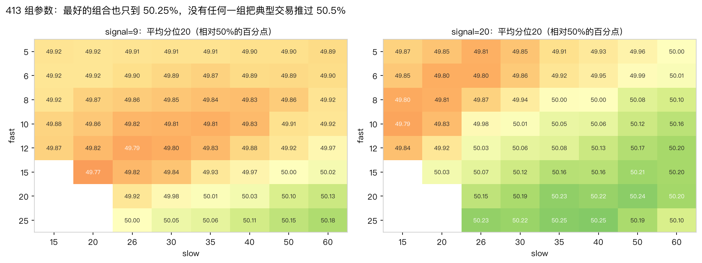

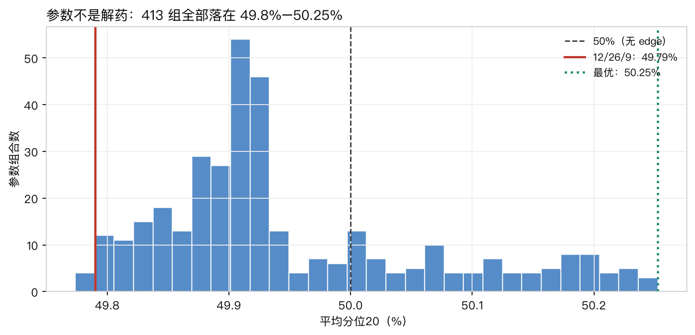

### 5.3 为什么参数救不了

MACD 是两条 EMA 的差再平滑。改变 fast/slow/signal 只改变“滞后多少”，不改变“金叉发生在上涨之后”这一事实。A 股的 1–3 个月反转效应把“上涨之后”变成“均值回归之前”。慢参数只是让它更少交易、更接近买入持有，所以“最不坏”；快参数交易更频繁，被成本和反转双重磨损，所以更差。**参数空间里没有“趋势市开关”，只有“交易频率开关”。**

---

## 6. 变体：零轴、绿柱、周线、背离

| 变体 | 信号数 | 平均分位 | 分位>50% | 平均超额 | 聚类 t | 2010-2017 分位 | 2018-2026 分位 | 扣费组合年化 |
|---|---:|---:|---:|---:|---:|---:|---:|---:|
| 金叉(12,26,9) | 519,111 | 49.79% | 49.8% | -0.054% | -1.24 | 49.88% | 49.75% | -5.7% |
| DIF 上穿 0 | 235,616 | 49.10% | 48.9% | -0.250% | -5.38 | 49.50% | 48.93% | — |
| DIF 下穿 0 | 237,093 | 49.99% | 49.5% | -0.175% | -3.75 | 49.71% | 50.12% | — |
| **绿柱缩短（未金叉）** | 997,145 | **50.62%** | 50.7% | **+0.134%** | **2.91** | **50.73%** | **50.56%** | **-6.5%** |
| 金叉+零轴下 | 331,353 | 50.83% | 51.1% | +0.141% | 2.37 | 50.47% | 50.98% | -6.9% |
| 金叉+零轴上 | 187,758 | 47.95% | 47.5% | -0.397% | -6.79 | 48.97% | 47.42% | — |
| 金叉+周线空头 | 294,765 | 50.86% | 51.2% | +0.161% | 2.53 | 50.50% | 51.02% | -4.5% |
| 金叉+周线多头 | 224,346 | 48.38% | 48.0% | -0.335% | -6.48 | 49.14% | 48.00% | — |
| 金叉+近 4 周周线金叉 | 53,906 | 48.88% | 48.6% | -0.305% | -3.96 | 49.57% | 48.59% | — |
| 金叉+底背离 | 93,997 | 49.95% | 49.7% | -0.079% | -1.01 | 49.89% | 49.98% | — |
| 金叉+非底背离 | 425,114 | 49.75% | 49.8% | -0.048% | -1.08 | 49.87% | 49.70% | — |
| 金叉+60 日首次 | 20,967 | 49.33% | 49.2% | -0.153% | -1.36 | 48.26% | 50.18% | — |
| 金叉+60 日第 2 次以上 | 498,144 | 49.81% | 49.8% | -0.049% | -1.14 | 49.97% | 49.74% | — |
| 周线金叉（完整周） | 122,888 | 49.19% | 49.1% | -0.184% | -2.36 | 49.50% | 49.05% | — |

三条结论：

1. **周线共振是负的。** 金叉+周线多头 48.38%，近 4 周周线金叉 48.88%，周线金叉本身 49.19%。传统“日线金叉 + 周线多头”的共振买法，在 A 股是负 edge。
2. **底背离没有 edge。** 49.95%，与非背离 49.75% 几乎一样。60/60 日双底代理没有选出更好的股票；背离更像“讲故事”的工具。
3. **绿柱缩短的原始分位略正，但严格增量约 0。** 50.62%，早期 50.73%，晚期 50.56%，t=2.91；但控制柱体水平、1/5/20/60 日涨幅、波动、换手、成交额后，状态系数 **-0.038%（t=-1.20，第 7.4 节）**。它的正分位来自“绿柱缩短时柱体水平通常更低、过去跌幅更大”的组成效应，不是独立信号。原始 0.134% 的毛 edge 也低于 0.15% 成本。**方向看似对，独立信息没有。**

---

## 7. 特征层：不是只有金叉

### 7.1 设计：把“事件”改成“状态”

前 6 节的主对象是**金叉事件**。这一节换对象：把 MACD 拆成每天可观测的连续状态与二元状态，问“它能不能给未来 20 天排序”，而不是“金叉之后涨不涨”。

- **12 个连续特征**：柱体水平（hist/价）、柱体 3 日变化、柱体加速度、20 日柱体均值、柱体 60 日 z、DIF 水平（DIF/价）、DIF-DEA 距离、DIF 5 日斜率、DEA 5 日斜率、DIF 60 日 z、交叉后天数（带方向）、20 日红柱占比。
- **8 个二元状态**：DIF>DEA、DIF>0、柱体>0、柱体上行、红柱放大、绿柱缩短、柱体上穿 0、DIF 上行。
- **7 个结构维度**：长期趋势（价在 MA200 上/下 + MA200 20 日斜率）、中期排列（价/MA20/MA60/MA120）、250 日位置（距 250 日高）、短期结构（20 日高高低低/低高低低）、波动（20 日收益标准差三分位）、换手（20 日换手三分位）、市场状态（沪深 300 在 MA200 上/下 + 斜率）。
- **背离**不是连续状态，已在第 6 节作为事件变体测试：金叉+底背离 49.95%，与非背离 49.75% 几乎一样；本节不重复。
- **口径**：2010-2026，全 A，剔除 ST、上市不足 120 日；T 日收盘确认，T+1 开盘买入，20 日收益减同日全市场 leave-one-out 等权收益；日度 Spearman IC、Q5-Q1 多空、Newey-West t；结构内 IC；Fama-MacBeth 控制 MACD 水平、1/5/20/60 日涨幅、20 日波动、换手、log 成交额；BH-FDR。

**关键区别：** 事件研究问“金叉后平均如何”；特征研究问“在同一个交易日、同一个结构里，MACD 高的股票是否比 MACD 低的股票更值得持有”。后者才是“选股/排序”意义上的有效性。

### 7.2 全样本：12 个特征，IC 全部为负

| 特征 | 平均 IC | IC t | Q5-Q1 | 多空 t | 2010-17 IC | 2018-26 IC | 多空>0 年份 |
|---|---:|---:|---:|---:|---:|---:|---:|
| 柱体水平 | -2.80% | -5.32 | -0.63% | -3.83 | -2.36% | -3.29% | 4/19 |
| 柱体 3 日变化 | -0.82% | -2.28 | -0.19% | -1.83 | -0.97% | -0.65% | 5/19 |
| 柱体加速度 | -0.06% | -0.55 | -0.02% | -0.43 | +0.09% | -0.23% | 10/19 |
| 20 日柱体均值 | -3.93% | -5.84 | -0.82% | -3.89 | -3.51% | -4.39% | 3/19 |
| DIF 水平 | **-7.16%** | **-8.42** | **-1.30%** | **-4.65** | -7.10% | -7.23% | 3/19 |
| DIF-DEA 距离 | -2.80% | -5.32 | -0.63% | -3.83 | -2.36% | -3.29% | 4/19 |
| DIF 5 日斜率 | -2.03% | -4.30 | -0.47% | -3.28 | -1.55% | -2.54% | 4/19 |
| 交叉后天数 | -2.22% | -4.26 | -0.45% | -2.83 | -1.94% | -2.52% | 4/19 |
| 20 日红柱占比 | -2.93% | -4.99 | -0.64% | -3.54 | -3.02% | -2.83% | 3/19 |
| 基准：20 日涨幅 | -6.73% | -9.12 | -1.31% | -5.28 | -6.70% | -6.76% | 1/19 |
| 基准：距 MA20 | -5.82% | -9.06 | -1.15% | -5.38 | -5.81% | -5.82% | 2/19 |

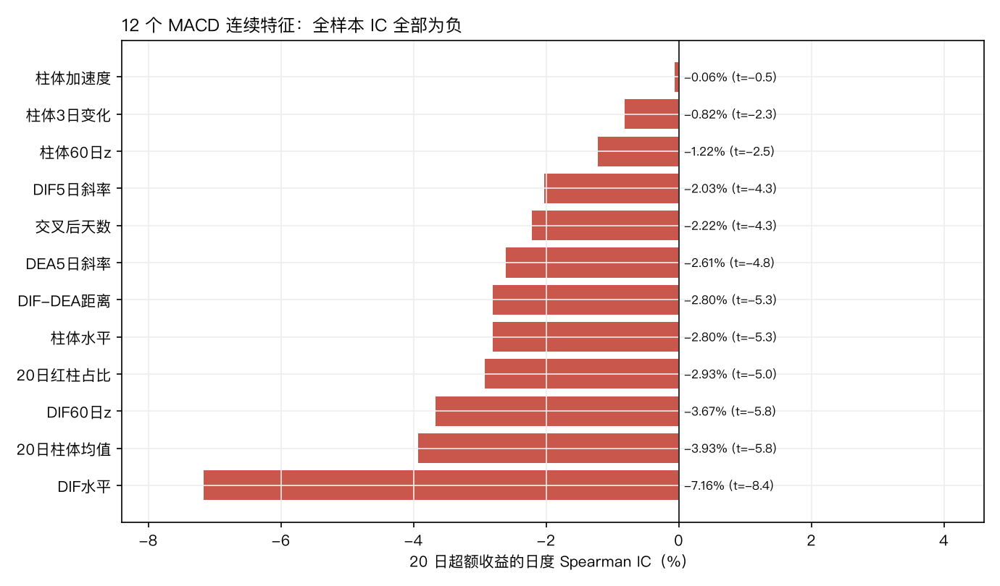

读法：

- **不是“无效”，是“方向反了”。** 柱体越高、DIF 越高、红柱占比越高，未来 20 天越差。DIF 水平的 IC 是 **-7.16%（t=-8.42）**，柱体水平 -2.80%，20 日柱体均值 -3.93%。Q5（最高 MACD）平均超额 -0.93%，Q1（最低 MACD）+0.37%；Q5-Q1 = **-1.30%/20 日**。
- **MACD 没有比价格本身多出方向信息。** 对照组 20 日涨幅 IC -6.73%，距 MA20 -5.82%，和 DIF 水平同一量级。MACD 只是把价格平滑后，仍然指向同一个短期反转。
- **柱体加速度是唯一接近中性的特征**（-0.06%，t=-0.55），但它也没有正信息；60 日 IC +0.20%（t=2.3），但 Q5-Q1 只有 +0.02%（t=0.55），五组不单调，不是可用的正信号。
- **柱体水平与 DIF-DEA 距离的 IC 完全相同**，因为 `hist = 2 × (DIF-DEA)`，排序不变；它们不是两个独立证据。

> IC 为负不等于“每只高 MACD 股票都跌”。它表示横截面排序反向：在同一交易日，MACD 更高的那一组，未来 20 天的相对收益更低。典型交易仍可能是正收益，只是跑输市场。

### 7.3 结构条件：只有中期空头排列弱正

| 结构维度 | 第 1 桶 | 第 2 桶 | 第 3 桶 |
|---|---:|---:|---:|
| 长期趋势 | 上行 -2.68% | 下行 -2.55% | 过渡 -3.36% |
| 中期排列 | 多头 -3.79% | **空头 +0.82%** | 混合 -2.08% |
| 250 日位置 | 高位 -4.51% | 中位 -1.56% | 深位 -2.90% |
| 短期结构 | 高高低低 -3.90% | 低高低低 -2.41% | 收敛 -3.25% |
| 波动 | 低波 -0.88% | 中波 -2.10% | 高波 -4.62% |
| 换手 | 低换手 -1.81% | 中换手 -3.21% | 高换手 -4.41% |
| 市场状态 | 指数上行 -2.39% | 指数下行 -2.91% | 过渡 -3.39% |

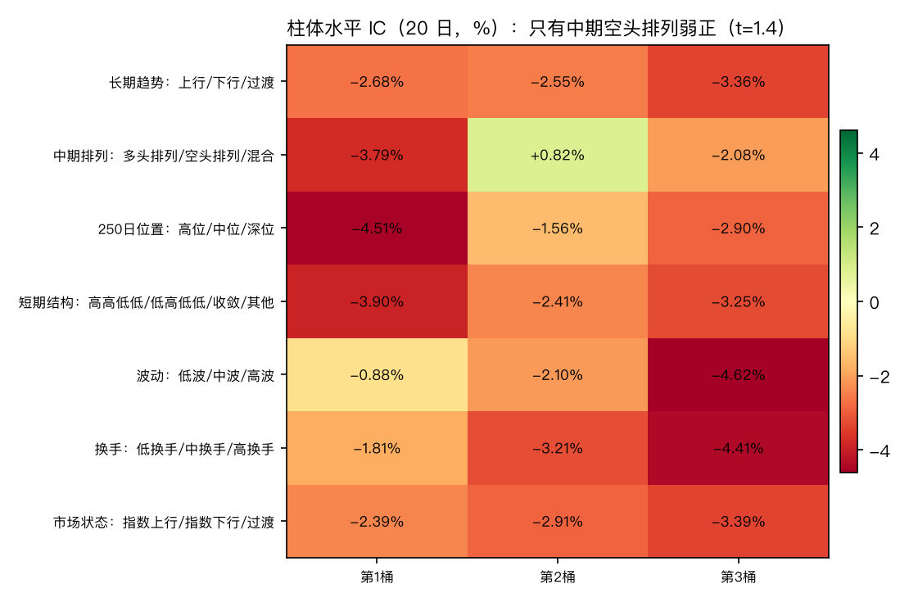

- **21 个结构桶里 20 个为负，唯一为正的是中期空头排列 +0.82%（t=1.39，q=0.16）。** q=0.16 不能拒绝 0；两段分别为 +0.97%/+0.71%，方向一致但强度不够。把 10 个特征 × 21 个桶全部算上，210 个格子里只有 6 个正 IC，全部在中期空头排列；没有一个 t>1.5。
- **长期趋势上行/下行都是负的**（-2.68%/-2.55%），说明不是简单的“牛熊开关”；真正的分水岭是中期排列。
- **最差的是多头排列 -3.79%（t=-8.09）、高波 -4.62%（t=-8.75）、高位 -4.51%（t=-7.17）、高换手 -4.41%（t=-8.30）。** 教科书里“均线多头、放量、创新高、波动大”的强势结构，正是 MACD 选股最差的地方。
- 低波 -0.88%（t=-1.50）也不正，只是更接近 0；它不是“有效”，只是“没那么差”。

### 7.4 状态的增量：唯一稳健的是“红柱放大 = 负”

每个交易日做横截面回归：

`20 日超额 ~ 1 + MACD 水平(中心化) + ret1 + ret5 + ret20 + ret60 + 波动 + 换手 + log成交额 + 状态 + 状态×水平`

状态系数 = 在“同等 MACD 水平、同等 1/5/20/60 日涨幅、同等波动/换手/成交额”下，状态 1 相对状态 0 的 20 日超额差；状态×水平 = 该差随 MACD 水平的变化。Newey-West lag=20。

| 状态 | 状态系数 | t | 状态×水平 | t | 2010-17 | 2018-26 | 正系数年份 |
|---|---:|---:|---:|---:|---:|---:|---:|
| 柱体上行（柱体方向） | **-0.152%** | **-5.08** | **-0.577%** | **-8.46** | -0.214% | -0.085% | 2/19 |
| 红柱放大 | **-0.179%** | **-5.89** | **-0.531%** | **-7.46** | -0.221% | -0.141% | 1/19 |
| DIF>DEA | **-0.226%** | **-2.98** | -0.412% | -2.21 | -0.272% | -0.177% | 3/19 |
| 绿柱缩短 | -0.038% | -1.20 | -0.067% | -0.96 | -0.107% | +0.017% | 6/19 |
| 柱体上穿 0 | +0.926% | +3.71 | -4.646% | -6.92 | +0.346% | +1.343% | 16/19 |

- **柱体上行/红柱放大是唯一稳健的独立增量，而且方向是负的。** 控制水平、动量、波动、换手、成交额后，红柱放大平均 **-0.179%/20 日（t=-5.89）**，1/19 年为正；水平越高越差，高水平红柱放大约 -0.45%/20 日。它不是“涨多了”的复写，因为 1/5/20/60 日涨幅都在模型里。
- **DIF>DEA 的严格增量是 -0.226%/20 日（t=-2.98），不是买入信号。** 注意这是“当前 DIF>DEA 的状态”，不是“金叉当天”；金叉事件本身的分位 49.79% 见第 2 节。它的表观正效应只出现在低 DIF 水平的交互项里；平均而言，金叉状态跑输。
- **绿柱缩短的严格增量约 0（-0.038%，t=-1.20）。** 原始 50.62% 的正分位是“绿柱缩短时柱体水平通常更低、过去跌幅更大”的组成效应；它不是独立信号。
- **柱体上穿 0 的平均正系数不可信。** 它随水平剧烈变化（交互 -4.65，t=-6.92）：只有从深度负值上穿时有一点反弹，水平越高越差；样本少、线性模型外推明显，不能当通用买点。

### 7.5 结构状态：红柱放大在哪里最差，在哪里翻正

| 结构 | 控制后差 | t | q | 状态 1 绝对 | 状态 0 绝对 | 市场绝对 |
|---|---:|---:|---:|---:|---:|---:|
| 高换手 | **-0.513%** | **-8.45** | 0.000 | -0.372% | +0.007% | +0.070% |
| 高波 | **-0.483%** | **-7.19** | 7e-12 | -0.345% | +0.031% | +0.078% |
| 高位 | **-0.411%** | **-6.27** | 1.6e-9 | +0.742% | +1.094% | +0.987% |
| 多头排列 | **-0.370%** | **-5.35** | 2.3e-7 | +0.246% | +0.581% | +0.522% |
| 长期上行 | -0.324% | -5.67 | 4.4e-8 | +0.359% | +0.572% | +0.596% |
| 低波 | -0.242% | -4.73 | 4.7e-6 | +0.893% | +1.008% | +1.076% |
| 空头排列 | **+0.132%** | +1.42 | 0.157 | +0.725% | +0.531% | +0.759% |

- **红柱放大在 20/21 个结构桶里都是负的；唯一翻正的是中期空头排列 +0.132%（t=1.42，q=0.16），不显著。**
- 高换手/高波/高位/多头排列最差；在这些结构里，红柱放大后的 20 日**绝对收益接近 0 或为负**（高波 -0.34%，高换手 -0.37%，市场 +0.08%），不是“少赚”，是“不赚”。
- 低波里也还有 -0.24%；所谓“低波安全”只是负得少一点。
- DIF>DEA 的结构表更弱：只有空头排列 +0.225%（t=2.71，q=0.14），其余 0 或负；**金叉状态没有结构上的稳定正效应。**

### 7.6 周期：周线更负，月线出现唯一强正结构

| 周期/持有期 | 柱体水平 IC | t | Q5-Q1 | DIF 水平 IC | t |
|---|---:|---:|---:|---:|---:|
| 周线 4 周 | -5.99% | -6.84 | -0.96% | -4.26% | -4.55 |
| 周线 12 周 | -5.65% | -4.80 | -1.54% | -4.28% | -3.19 |
| 月线 3 个月 | -1.58% | -1.14 | +0.41% | -6.25% | -3.57 |
| 月线 12 个月 | -1.32% | -0.79 | +0.66% | **-12.18%** | **-5.22** |

> 月线 t 值：结构拆分表用 lag=6；下面“月度下行稳健表”用 lag=12（更保守）。同一 IC 的 t 会略低。

- **周线没有任何翻正的结构。** 4/12 周柱体水平在长期上行/下行/过渡三个桶里全负（-4.1% ~ -6.6%），比日线更负。
- **月线全样本也不显著**：柱体水平 3 个月 -1.58%（t=-1.14），12 个月 -1.32%（t=-0.79）；DIF 水平 12 个月 -12.18%（t=-5.22），是强负。
- **但把月线按长期趋势拆开，出现强符号翻转**：12 个月柱体水平，上行 -7.63%（t=-4.80，lag=6），下行 **+11.76%（t=6.07，lag=6；lag=12 为 5.15）**，过渡 +5.43%（t=3.41）；3 个月同样，上行 -5.96%，下行 +7.73%，过渡 +4.60%。

| 样本（月线） | 3m IC (t) | 3m Q5-Q1 | 12m IC (t) | 12m Q5-Q1 |
|---|---:|---:|---:|---:|
| 下行·全 | +7.73% (4.93) | +2.70% | +11.76% (5.15) | +10.61% |
| 下行·非ST·高价·高流动 | +7.43% (4.18) | +2.38% | +12.68% (4.96) | +10.09% |
| 下行·非ST·高价·低流动 | +6.02% (4.79) | +2.05% | +7.85% (5.20) | +7.00% |
| 上行·非ST·高价·高流动 | -6.70% (-4.98) | -1.08% | -8.50% (-4.40) | -4.59% |

> 注：本表的 Q5/Q1 为各月等权平均（月均）；下面的分布表为股票-月加权。两者略有差异（如高流动 12m Q5 绝对：月均 +10.04%，股票-月 +10.46%），方向一致。Q5 相对宽基的超额见分布表。

换趋势定义也成立（高流动、非 ST、高价样本）：

| 月末趋势定义 | 3m IC | 12m IC |
|---|---:|---:|
| 价 < MA200 | +6.18% | +7.88% |
| MA200 20 日斜率 < 0 | +5.18% | +10.84% |
| 价 < MA200 且斜率 < 0 | +7.18% | +11.98% |
| 价 > MA200 | -3.65% | -5.97% |
| MA200 20 日斜率 > 0 | -5.93% | -5.66% |
| 价 > MA200 且斜率 > 0 | -6.64% | -8.32% |

三种“下行”定义全部为正，三种“上行”定义全部为负；不是某一种 MA200 定义的偶然。12 个月 t=3.4/4.9/4.6（三种下行）与 -3.1/-2.9/-4.4（三种上行）。

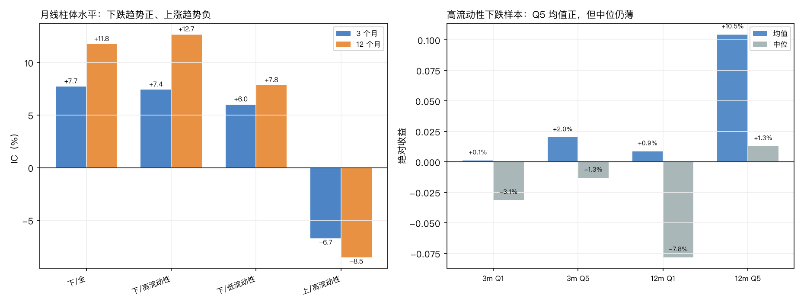

这是全研究**唯一一个“某种趋势/结构下 MACD 有效”的强证据**：月线、长期下跌趋势、柱体水平/金叉作为跌深反弹的相对选择。它的含义与日线相反：

- **在长期下跌趋势里，高月线柱体不是“追高”，而是“跌深反弹的强度”。** 柱体越高，未来 3/12 个月相对同组股票越强；IC +7.7%/+11.8%，t=4.9/5.2，2010-17 与 2018-26 都为正（+8.2%/+7.3%，+12.6%/+11.0%）。
- **在长期上涨趋势里，同样的高柱体是“过热”**，12 个月 IC -7.6%（t=-4.80，lag=6）。

但必须同时看绝对收益：

| 高流动下跌样本 | 3m 均值 | 3m 中位 | 3m 胜率 | 12m 均值 | 12m 中位 | 12m 胜率 |
|---|---:|---:|---:|---:|---:|---:|
| Q1（低柱体） | +0.13% | -3.11% | 43.8% | +0.87% | -7.81% | 41.1% |
| Q5（高柱体） | +2.03% | -1.29% | 46.2% | +10.46% | +1.30% | 51.8% |

- Q5 的 3 个月**中位是 -1.29%**、胜率 46.2%；12 个月中位 +1.30%、胜率 51.8%。**它是右偏的反弹彩票，不是“典型交易稳定赚钱”。**
- 更关键：Q5 的 12 个月绝对 +10.46%（股票-月加权），但同期宽基约 +11.9%，**Q5 超额 -1.41%（中位 -7.89%）**；整个下跌池本身跑输市场（样本 12m 绝对 +4.87%）。所以它是**相对/对冲信号**，不是 long-only alpha。
- 低流动子样本更强（3m/12m IC +6.0%/+7.8%，Q5 绝对 +3.48%/+17.29%），但那是小票/流动性效应，不能当成 MACD 的功劳。

Fama-MacBeth 控制 1/3/12 月动量、波动、换手、成交额后：

| 项 | 3 个月 | t | 12 个月 | t |
|---|---:|---:|---:|---:|
| 柱体水平（连续） | +2.47% | +2.44 | **+11.41%** | **+3.51** |
| DIF>DEA 状态 | +1.12% | +2.27 | +3.00% | +1.82 |

所以这个相对信号不是动量/波动/流动性的复写；它确实是“月线 MACD 在长期下跌结构里的反弹强度”。但它的绝对收益不够，且只在高流动/低流动两个子样本里方向一致、强度不同，不能直接当 long-only 策略。（表中“柱体水平连续”的系数是水平从最低到最高的额外差，不是每 1% 的斜率。）

事件层也一致：月线金叉在下跌结构里 51.94%（3 个月）、+1.11%，聚类 t=1.77，中位 -3.0%；方向对，但单一金叉事件的强度远不如连续柱体水平——后者把“反弹有多强”用上了。这也解释了 9.5.1 的月线金叉 49.05%（3 个月）/50.73%（12 个月）：池化把下行的正和上行的负抵消了；3 个月事件层下行 51.94%、上行 48.87%。

### 7.7 组合层：负信号不能变成 long-only 收益

把特征做成 20 日非重叠等权组合：每 20 个交易日按 T 日信号选股，T+1 开盘买入，持有 20 日，扣 0.15% 往返成本；回撤为 20 日采样，用于横向比较，不是精确日频 MDD。

| 策略 | 年化 | 回撤 | 夏普 | 平均持仓 |
|---|---:|---:|---:|---:|
| 全 A 等权 | 6.09% | -60.9% | 0.355 | 3,193 |
| 剔除红柱放大 | 6.08% | -61.5% | 0.353 | 2,239 |
| 剔除柱体上行 | 2.62% | -73.4% | 0.234 | 1,434 |
| 剔除 DIF>DEA | 2.90% | -66.5% | 0.244 | 1,555 |
| 只买 DIF 最低 20% | 9.38% | -50.8% | 0.445 | 639 |
| 只买 20 日涨幅最低 20% | 9.08% | -51.5% | 0.439 | 639 |
| 只买 60 日涨幅最低 20% | 8.36% | -50.6% | 0.416 | 639 |
| 只买低波 20% | 7.33% | -54.9% | 0.417 | 639 |
| 空头排列 + 绿柱缩短 | 2.58% | -56.3% | 0.226 | 324 |

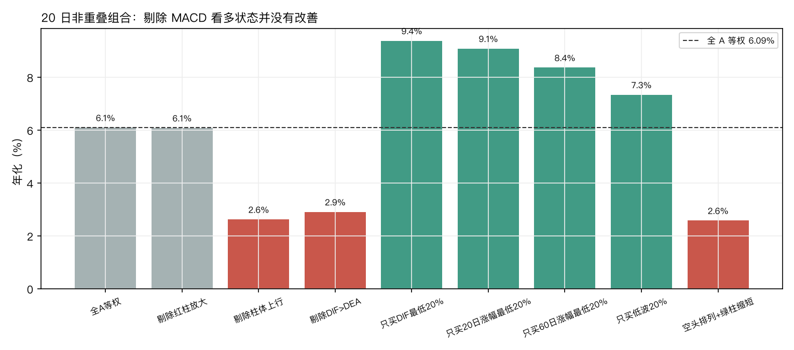

- **剔除红柱放大与全 A 持平（6.08% vs 6.09%）。** 横截面上的负 IC 没有变成 long-only 的收益增厚；剔除它们同时降低了组合在上行市的暴露——负 IC 是相对排序，不等于绝对亏损。
- **剔除柱体上行/DIF>DEA 反而大幅跑输（2.62%/2.90%）**：把“看多状态”全部剔掉，等于剔除了上行暴露最高的强势股，组合在上涨市里跟不上。
- **只买 DIF 最低 20% 的 9.38% 看似好，但只买 20 日涨幅最低 20% 是 9.08%，60 日最低 8.36%，低波 7.33%。** 这是短期反转/低波，不是 MACD 的独立 alpha；DIF 只比最简单的 20 日反转多 0.3%/年，在噪声范围内。
- 结论：**MACD 的负向信息是相对/横截面的，不是绝对收益。** long-only 不能用它做“卖出过滤器”来增厚收益；它最多用于减仓/风控的主观参考，或市场中性组合（A 股融券约束大）。

### 7.8 小结

| 问题 | 答案 |
|---|---|
| 日线 12 个连续特征有正 IC 吗？ | **0/12**；全部为负，DIF -7.16%、柱体 -2.80% |
| 哪种趋势/结构下日线 MACD 选股有效？ | 只有中期空头排列 **+0.82%（t=1.39，q=0.16）**，不显著；多头排列/高波/高位/高换手最差 |
| 哪个二元状态有独立增量？ | **柱体上行 -0.15%/20 日、红柱放大 -0.18%、DIF>DEA -0.23%**；绿柱缩短约 0 |
| 周线呢？ | 全负；4/12 周 IC -6.0%/-5.6%，无翻正结构 |
| 月线呢？ | 长期下跌 **+11.8%（12m）**，长期上涨 -7.6%；强符号翻转 |
| 能不能做 long-only？ | 日线不能；月线下跌池只能做相对/对冲，绝对跑输宽基 |
| 一句话 | **MACD 是“极值反转指标”，不是“趋势确认指标”；日线越像买入信号越差，月线只在长期下跌结构里做跌深反弹的相对选择。** |

---

## 8. 离场：死叉不是好出口

对 2010-2026 全部 531,884 个金叉，比较“下一个死叉次日开盘卖”和固定持有：

| 离场 | 交易数 | 平均收益 | 中位收益 | 胜率 | 平均持有天数 | 死叉覆盖率 |
|---|---:|---:|---:|---:|---:|---:|
| 死叉离场 | 531,884 | +1.00% | **-2.13%** | **35.1%** | 14.2 | 99.7% |
| 固定 5 日 | 531,178 | +0.32% | -0.14% | 48.0% | 5 | — |
| 固定 10 日 | 530,512 | +0.63% | 0.00% | 49.3% | 10 | — |
| 固定 20 日 | 528,537 | **+1.32%** | **0.00%** | **49.5%** | 20 | — |
| 固定 60 日 | 520,940 | +3.22% | -0.66% | 47.3% | 60 | — |

- 死叉离场平均持有 14.2 天，比固定 20 日短，但平均收益更低（1.00% vs 1.32%），中位差 2.13 个百分点，胜率低 14.4 个百分点。
- 死叉是**滞后确认**：等它出现，价格已经跌了一段，等于把亏损锁在反弹之前。它的作用是把“浮亏”变成“实亏”，不是风控。
- 这与 2026-10-20 的池 50/20 龙头结论一致：死叉平均亏 -2.9% 到 -5.5%，b3 追踪兑现右尾才是正贡献。**MACD 的出场不如入场，死叉尤其差。**

---

## 9. 指数择时：危机保险，不是收益发动机

### 9.1 全样本（2006-2026，T+1 开盘，单边 0.05%）

| 指数 | 规则 | 年化 | 最大回撤 | 夏普 | 仓位 | 换手 |
|---|---|---:|---:|---:|---:|---:|
| 沪深 300 | 买入持有 | 7.67% | -72.5% | 0.41 | 100% | 1 |
| 沪深 300 | DIF>DEA | 6.98% | **-47.4%** | 0.45 | 51% | 382 |
| 沪深 300 | DIF>0 | **12.43%** | -37.9% | 0.71 | 54% | 150 |
| 沪深 300 | DIF>DEA 且 DIF>0 | 10.80% | **-22.6%** | **0.77** | 33% | 272 |
| 中证 500 | 买入持有 | 10.67% | -72.3% | 0.48 | 100% | 1 |
| 中证 500 | DIF>DEA | **14.01%** | **-37.8%** | 0.72 | 52% | 396 |
| 中证 500 | DIF>0 | 11.19% | -58.2% | 0.58 | 56% | 162 |
| 中证 500 | DIF>DEA 且 DIF>0 | 10.82% | -39.8% | 0.68 | 35% | 302 |
| 中证 1000 | 买入持有 | 11.27% | -72.9% | 0.49 | 100% | 1 |
| 中证 1000 | DIF>DEA | **14.05%** | **-45.1%** | 0.70 | 54% | 388 |
| 中证 1000 | DIF>0 | 13.52% | -46.8% | 0.66 | 55% | 150 |
| 中证 1000 | DIF>DEA 且 DIF>0 | 11.97% | **-27.4%** | 0.72 | 35% | 286 |
| 创业板指 | 买入持有 | 6.31% | -70.3% | 0.35 | 100% | 1 |
| 创业板指 | DIF>DEA | 7.60% | -55.6% | 0.43 | 51% | 302 |
| 创业板指 | DIF>0 | 10.28% | -54.8% | 0.52 | 53% | 128 |
| 创业板指 | DIF>DEA 且 DIF>0 | 7.73% | -36.1% | 0.48 | 33% | 230 |
| 上证指数 | 买入持有 | 5.90% | -72.4% | 0.35 | 100% | 1 |
| 上证指数 | DIF>DEA 且 DIF>0 | 8.11% | **-24.5%** | 0.65 | 34% | 284 |

**回撤大降是全场最稳的结论。** 所有指数、所有规则的最大回撤都低于买入持有，幅度 10–50 个百分点。收益则分化：中证 500 的 DIF>DEA 全样本年化提升 3.3 个百分点、中证 1000 提升 2.8 个百分点；沪深 300 没有提升（6.98% vs 7.67%），但回撤从 -72.5% 降到 -47.4%。

### 9.2 2016 年后：收益增益消失

| 指数 | 规则 | 2016-2026 年化 | 最大回撤 | 夏普 |
|---|---|---:|---:|---:|
| 沪深 300 | 买入持有 | 0.88% | -46.7% | 0.14 |
| 沪深 300 | DIF>DEA | 0.10% | -39.4% | 0.08 |
| 沪深 300 | DIF>0 | 2.02% | -29.2% | 0.21 |
| 沪深 300 | DIF>DEA 且 DIF>0 | 2.67% | -22.6% | 0.29 |
| 中证 500 | 买入持有 | -1.41% | -42.9% | 0.06 |
| 中证 500 | DIF>DEA | 2.77% | -34.4% | 0.25 |
| 中证 500 | DIF>DEA 且 DIF>0 | 2.34% | -30.0% | 0.24 |
| 中证 1000 | 买入持有 | -4.61% | -57.1% | -0.04 |
| 中证 1000 | DIF>DEA | 1.18% | -40.1% | 0.15 |
| 中证 1000 | DIF>DEA 且 DIF>0 | 1.28% | -25.8% | 0.16 |
| 创业板指 | 买入持有 | -0.41% | -57.7% | 0.14 |
| 创业板指 | DIF>0 | 6.45% | -42.1% | 0.39 |
| 上证指数 | 买入持有 | 0.37% | -31.4% | 0.11 |
| 上证指数 | DIF>DEA 且 DIF>0 | -1.24% | -24.5% | -0.07 |

- **沪深 300 和中证 500/1000 的日线收益增益在 2016 年后大幅衰减**（月线口径见 9.5）：沪深 300 的 DIF>DEA 从 6.98% 降到 0.10%，中证 500 从 14.01% 降到 2.77%，中证 1000 从 14.05% 降到 1.18%。
- **唯一例外是创业板指 DIF>0**：6.45% vs -0.41%，但这是单一指数、单一规则，且 2016-2026 包含 2019-2020 成长牛，不能外推。
- **回撤多数更低**：沪深 300/中证 500/中证 1000/创业板指的主要规则都低于买入持有；但上证指数的 DIF>DEA 和 DIF>0 反而更深（-38.6%/-33.4% vs -31.4%），只有双条件更低（-24.5%）。**降回撤在主要宽基上稳定，但不是每条规则都成立；增收益更不稳定。**

### 9.3 等权指数：同样只降回撤

| 区间 | 规则 | 年化 | 最大回撤 | 夏普 |
|---|---|---:|---:|---:|
| 2010-2026 | 买入持有 | **11.67%** | -52.4% | 0.54 |
| 2010-2026 | DIF>DEA | 9.87% | **-38.6%** | 0.60 |
| 2010-2026 | DIF>DEA 且 DIF>0 | 7.30% | -27.2% | 0.55 |
| 2018-2026 | 买入持有 | **5.96%** | -37.9% | 0.36 |
| 2018-2026 | DIF>DEA | 4.34% | -33.6% | 0.35 |
| 2018-2026 | DIF>DEA 且 DIF>0 | 4.09% | **-20.6%** | 0.38 |

等权指数用 T+1 收盘成交（信号滞后 2 日），比指数开盘口径更保守。结论一样：**收益不增，回撤大降**。2018-2026 的 DIF>DEA 年化 4.34% vs 5.96%，但回撤 -33.6% vs -37.9%；“双条件”回撤只有 -20.6%。

### 9.4 什么时候有效：高波动、年线上行

以中证 500 为例，把 MACD 择时相对买入持有的日超额按事前状态分组：

| 状态 | 平均日超额 | t |
|---|---:|---:|
| 低波动 | -0.0085% | -0.47 |
| 中波动 | +0.0047% | 0.17 |
| 高波动 | **+0.0153%** | 0.28 |
| 年线下行 | +0.0066% | 0.11 |
| 年线走平 | -0.0000% | -0.02 |
| 年线上行 | **+0.0125%** | 0.23 |

- 方向符合直觉：**高波动、年线上行时，MACD 的趋势过滤有价值；低波动、震荡市里它被反复打脸。**
- 但日度 t 都不到 0.3，统计上不显著。它的收益来自少数几次大崩盘（2008、2015、2018、2022），不是稳定的日度 alpha。
- 这就是“危机保险”的准确含义：**平时付保费（牛市跑输、震荡磨损），危机时赔付（主要宽基回撤减半）。** 不是“每年稳定跑赢”。

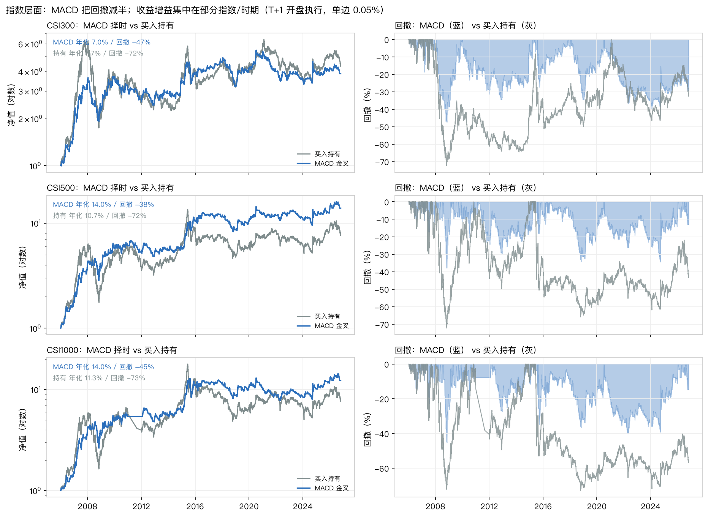

### 9.5 其他周期：周线最差，月线反而是指数择时的正确周期

> 本地库只有日线；周线/月线由日线按 W-FRI / 自然月合成，周五/月末收盘确认，下周一/下月首个交易日开盘执行。**本地没有 5/15/30/60 分钟数据，分钟级未做**；如需补，必须另接分钟数据源。

#### 9.5.1 个股：周线更弱，月线 12 个月只是弱正

| 周期 | 持有期 | 信号数 | 平均分位 | 平均超额 | 中位超额 | 聚类 t | 2010-17 分位 | 2018-26 分位 | 结论 |
|---|---:|---:|---:|---:|---:|---:|---:|---:|---|
| 日线 | 20 日 | 519,111 | 49.79% | -0.054% | -1.45% | -1.24 | 49.88% | 49.75% | 无效；扣费组合 -5.7%/年 |
| 周线 | 4 周 | 113,222 | 49.39% | -0.115% | -1.54% | -1.37 | 49.58% | 49.31% | 比日线更弱 |
| 周线 | 8 周 | 111,936 | 49.48% | -0.100% | -2.48% | -0.83 | 49.69% | 49.40% | 更弱 |
| 周线 | 12 周 | 109,645 | 49.45% | -0.132% | -3.28% | -1.06 | 50.02% | 49.21% | 更弱 |
| 周线 | 26 周 | 106,448 | 50.02% | +0.131% | -5.31% | 0.70 | 49.86% | 50.10% | 均值微正、中位 -5.3% |
| 月线 | 3 月 | 18,663 | 49.05% | -0.112% | -3.57% | -0.32 | 49.86% | 48.76% | 无效 |
| 月线 | 6 月 | 18,351 | 49.99% | +0.188% | -5.08% | 0.48 | 50.67% | 49.75% | 约 50%，无 edge |
| 月线 | 12 月 | 17,922 | **50.73%** | **+0.841%** | **-8.37%** | 1.27 | 50.77% | 50.72% | 弱正但不稳：长期彩票 |

- **周线比日线更弱**：4/8/12 周分位 49.4%–49.5%；26 周 50.02%，中位 -5.3%。
- **月线 3 个月 49.05%，6 个月 49.99%，12 个月 50.73%**：12 个月是唯一略高于 50% 的个股周期，但中位 -8.37%、t=1.27，均值靠右尾；这是“长期彩票”，不是稳定 alpha。
- 参数网格（354 组/周期）：周线 4 周最高 50.31%（5/15/3，t=1.47）；周线 26 周最高 50.47%（5/15/5，t=2.34，但中位 -4.93%）；月线 3 月最高 49.63%；月线 12 月最高 51.14%（10/60/12，t=1.57，中位 -8.75%，228 组 >50.5%，**中位>0 的 0 组**）。**没有任何周期给出“中位为正”的参数。**
- 结论：**周期不是个股 MACD 的解药**。日线/周线/月线 3 个月都无 edge；月线 12 个月只有弱正且不稳，不能单独用。

#### 9.5.2 指数：月线在沪深 300/中证 500 最好，周线最差

2016-2026，T+1 开盘执行，单边 0.05%：

| 指数 | 周期 | 年化 | 最大回撤 | 夏普 | 换手 |
|---|---|---:|---:|---:|---:|
| 沪深 300 | 日线 | 0.10% | -39.4% | 0.08 | 208 |
| 沪深 300 | 周线 | -1.93% | -26.8% | -0.06 | 44 |
| 沪深 300 | **月线** | **4.59%** | **-28.4%** | 0.37 | 6 |
| 沪深 300 | 持有 | 0.88% | -46.7% | 0.14 | 1 |
| 中证 500 | 日线 | 2.77% | -34.3% | 0.25 | 198 |
| 中证 500 | 周线 | -4.58% | -35.8% | -0.18 | 42 |
| 中证 500 | **月线** | **5.13%** | **-19.9%** | 0.41 | 4 |
| 中证 500 | 持有 | -1.41% | -42.9% | 0.06 | 1 |
| 中证 1000 | 日线 | 1.19% | -40.0% | 0.15 | 212 |
| 中证 1000 | 周线 | -7.83% | -52.3% | -0.33 | 46 |
| 中证 1000 | **月线** | **0.16%** | **-31.6%** | 0.10 | 6 |
| 中证 1000 | 持有 | -4.61% | -57.1% | -0.04 | 1 |

> 口径修正：月线/周线净值按**日频路径**计算（月末/周末信号映射到每日仓位），因此回撤是真实日频回撤，不是月末采样。此前“月线回撤 -18%”是月末采样，低估了月内回撤；本表已修正。

- **月线是三个周期里最好的**：沪深 300/中证 500 年化 4.6%/5.1%，回撤 -28.4%/-19.9%；中证 1000 只有 0.2%，但回撤从 -57.1% 降到 -31.6%。只有 4–6 次换手。
- **周线最差**：2016 后三个指数全负（-1.9%/-4.6%/-7.8%），换手 42–46 次；周线把日线的噪声放大，是最不该用的周期。
- **月线不是参数稳健的 alpha**：1296 组参数中 570 组（44%）2016+ 年化为正，中位 -0.2%，中位回撤 -34.0%；12/26/9 在沪深 300/中证 500/中证 1000 的 2016+ 年化分位为 97.5%/95.8%/82.9%，是参数里较好的，但平原不宽。**它是“慢速崩盘过滤器”，不是可优化的 alpha。**
- **月线会错过牛市初期**：2016 年 CSI1000 -30.6% vs 持有 -19.8%，2019 年 CSI500 +3.5% vs +27.1%，2024 年 -3.0% vs +5.3%；它避开 2018/2022，但不是每年跑赢。
- **等权指数月线无效**：2018-2026 年化 3.2% vs 持有 6.1%，回撤 -31.6% vs -30.3%；月线择时只对**市值加权宽基**有效，对等权/小盘均值回归市场无效。

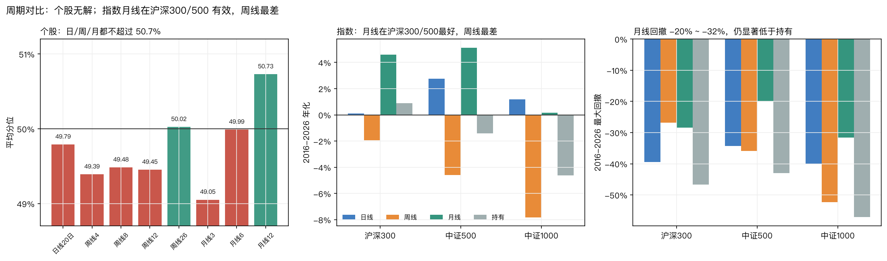

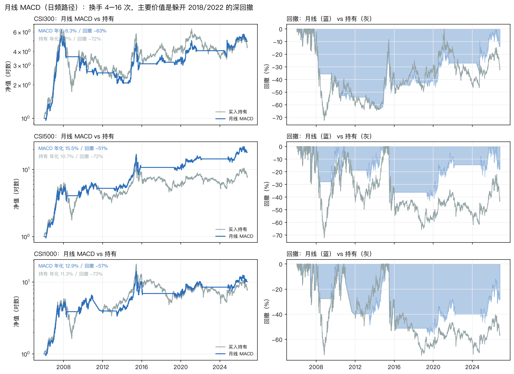

#### 9.5.3 多周期共振：三重多头是最差

| 组合 | 周期 | 信号数 | 平均分位 | 平均超额 | 聚类 t | 2010-17 分位 | 2018-26 分位 |
|---|---|---:|---:|---:|---:|---:|---:|
| 日线金叉（基准） | 20 日 | 532,219 | 49.79% | -0.054% | -1.24 | 49.88% | 49.75% |
| +周线多头 | 20 日 | 231,280 | 48.38% | -0.335% | -6.48 | 49.14% | 48.00% |
| +月线多头 | 20 日 | 288,129 | 49.60% | -0.017% | -0.35 | 49.69% | 49.56% |
| **+周线多头+月线多头** | 20 日 | 119,633 | **47.96%** | **-0.288%** | **-3.92** | 49.20% | 47.35% |
| +周线空头+月线空头 | 20 日 | 132,443 | 51.00% | +0.144% | 1.43 | 50.97% | 51.01% |
| +周线空头+月线多头 | 20 日 | 168,496 | 50.75% | +0.174% | 2.79 | 50.09% | 51.02% |
| 周线金叉（基准） | 4 周 | 113,222 | 49.39% | -0.115% | -1.37 | 49.58% | 49.31% |
| 周线+月线多头 | 4 周 | 52,680 | 50.03% | +0.305% | 2.73 | 50.54% | 49.84% |
| 周线+月线多头 | 12 周 | 51,740 | 49.83% | +0.466% | 2.48 | 50.84% | 49.45% |
| 月线金叉（基准） | 12 月 | 17,922 | 50.73% | +0.841% | 1.27 | 50.77% | 50.72% |
| 月线+周线多头 | 12 月 | 16,326 | 50.68% | +0.852% | 1.23 | 50.71% | 50.66% |

- **日线+周线多头+月线多头 47.96%，t=-3.92**：三重共振是最差条件，不是最好。
- 周线+月线多头 4 周 50.03%（早期 50.54%、晚期 49.84%），12 周 49.83%（早期 50.84%、晚期 49.45%）：**均值略正，但后期跌破 50%**，不稳健。
- 唯一像样的“共振”是反趋势的 **周线空头+月线多头（日线金叉）50.75%，t=2.79，后段 51.02%**；以及周线空头+月线空头 51.00%，t=1.43。它们仍是弱信号，且是“反趋势”而非“多周期确认”。
- **结论：多周期确认不改善，反而把最差条件叠加。** MACD 的“共振买法”在 A 股是负向的。

---

## 10. 统计与稳健性

### 10.1 信号加权 vs 日期加权

| 口径 | 20 日平均超额 | t | 回答的问题 |
|---|---:|---:|---|
| 信号加权 | -0.054% | -1.24（聚类） | 每个信号都做，平均如何 |
| 日期加权 | -0.745% | -14.6 | 随机选一天，平均如何 |
| 横截面分位 | 49.79% | — | 典型信号排第几 |
| 组合净额 | -5.66%/年 | -7.96 | 真的按这个做，扣费后如何 |

四个口径都指向“没有正 edge”，但强弱不同。只报“-0.745%/月，t=-14.6”会夸大；只报“-0.054%，t=-1.24”会掩盖成本和典型交易的劣势。**组合净额是最接近实盘的裁决：-5.7%/年。**

### 10.2 多重检验

- 413 组参数：最小 p=0.008，最小 FDR q=**0.527**；q<0.10 的组合 0 个。**没有任何参数组合在多重检验下显著。**
- 18 个条件维度、14 个变体：条件层是描述性分层，不声称每个格子都预注册；但正 pocket 同时要求“信号加权正 + 日期加权正 + 前后段都 >50”。只有 ST 满足。
- 参数网格的“最好”是样本内选择；用 2010-2017 选前 10%，2018-2026 只剩 +0.04%。**没有可迁移的参数 alpha。**

### 10.3 分段

| 对象 | 2010-2017 | 2018-2026 | 结论 |
|---|---:|---:|---|
| 金叉分位 | 49.88% | 49.75% | 两段都无 edge |
| 金叉平均超额 20 | -0.080% | -0.042% | 两段都负 |
| 零轴下分位 | 50.47% | 50.98% | 略好，但日度仍负 |
| 周线空头分位 | 50.47% | 51.08% | 略好，但日度仍负 |
| 低波分位 | 51.61% | 52.19% | 稳定 >50，日度仍负 |
| 低额分位 | 51.85% | 52.87% | 稳定 >50，日度 ~0 |
| ST 分位 | 54.46% | 52.64% | 两段 >50，日线金叉单维唯一稳健正 pocket |
| 信号密度>100 分位 | 51.15% | 50.25% | 衰减 |

### 10.4 数据与执行

- 10,113,287 行重叠，OHLC 仅 2 行差异；退市股 341 只；无生存偏差。
- T+1 开盘、剔除一字涨停、停牌不交易；指数 open-to-open；等权指数滞后 2 日。
- 收益 1%/99% 缩尾后，ex20 均值从 -0.054% 变为 -0.208%，仍然为负；分位指标不受影响。
- 未计盘中择时、ETF 跟踪误差、ST 容量限制；这些只会让结果更差，不会更好。

---

## 11. 最终判断：一张可执行的表

| 场景 | 判断 | 证据 | 建议 |
|---|---|---|---|
| 个股日线金叉，全样本 | **无效** | 分位 49.79%，扣费组合 -5.7%/年，t=-7.96 | 不要当买入信号 |
| 金叉 + 零轴上 / 周线多头 / 放量 / 高成交额 / 高波动 / 强趋势 | **明显有害** | 分位 46%–48%，平均超额 -0.3% ~ -0.9%/20 日 | 不要加这些确认；它们是最差条件 |
| 金叉 + 零轴下 / 周线空头 / 低波 / 低额 | **毛正、净不赚** | 分位 50.8%–52.5%，毛超额 0.14%–0.56%；零轴/周线/低波日度 t 为负，低额 t≈0 | 只能作为多信号里的弱特征 |
| 金叉 + ST | **日线金叉单维唯一稳健正 pocket** | 分位 53.19%，+0.97%/20 日，组合 +1.3%/年，t=0.32 | 容量/制度限制，不能当策略 |
| 绿柱缩短 | **原始略正，独立增量约 0** | 原始分位 50.62%、+0.134%/20 日（t=2.91）；控制水平/动量/波动/换手/成交额后 -0.038%（t=-1.20）；扣费 -6.5%/年 | 不要单独用 |
| 零轴穿越 / 周线金叉 / 底背离 | **无效或负** | 49.1% / 49.2% / 49.95% | 不要用 |
| 个股周线/月线金叉 | **周线更弱、月线 12 个月弱正** | 周线 4 周 49.39%；月线 12 个月 50.73%，中位 -8.4%，t=1.27 | 不能单独用 |
| **日线连续特征（柱体/DIF/斜率/面积）** | **全部负 IC，不是顺势指标** | 12/12 特征 20 日 IC<0；DIF -7.16%（t=-8.42），柱体 -2.80%；Q5-Q1 -1.30%（DIF） | 高值应反向理解，不要当买入确认 |
| **红柱放大 / 柱体上行** | **唯一稳健的独立增量，方向为负** | 严格 FM：-0.18%/-0.15%/20 日（t=-5.9/-5.1）；高波/高换手/高位 -0.3% ~ -0.5%；long-only 剔除后不增厚（6.08% vs 6.09%） | 可作卖出/回避/减仓参考；不能做多因子正向信号 |
| **DIF>DEA（金叉状态）** | **严格增量为负** | -0.226%/20 日（t=-2.98）；低 DIF 时交互为正，高 DIF 时为负 | 不是买入信号 |
| **月线 + 长期下跌趋势** | **唯一强正结构，但只是相对反弹** | 12m IC +11.8%（t=5.15），Q5-Q1 +10.1%；高流动 Q5 绝对 +10.0%（月均），仍跑输宽基（约 -1.4% ~ -2.5%）；3m Q5 中位 -1.3% | 只能做相对/对冲/研究线索，不能做 long-only |
| 日+周+月多头共振 | **最差** | 47.96%，t=-3.92；周线+月线多头 4 周 50.03%，后期 <50% | 不要用 |
| **MACD 强确认（零轴双上/红柱放大/证据≥5/周线多+月线空）** | **反向** | 20 日 -0.69% ~ -1.03%，t=-6 ~ -9；60 日 -1.07% ~ -1.39%；证据≥5 为 17/17 年负 | 不能买；只能减/避 |
| **MACD 温和区（柱体 Q3/Q4、DIF Q2、斜率 Q3/Q4）** | **仅价格趋势** | 绝对 +0.16% ~ +0.34%/20 日，但同一批交易日多空差 -0.15% ~ +0.16%，增量 t 绝对值=0.2–2.0 | 不要归功于 MACD |
| **MACD 深弱区（柱体 Q1、z Q1、零轴双下、周月空、指数下行）** | **仅相对有效** | 增量 +0.49% ~ +1.14%/20 日（t=2.1–4.3），但多头绝对 -0.73% ~ +0.00% | 只能相对回避/减配，不能做多 |
| **金叉 + 证据≤1** | **唯一微正，不显著** | 净 +0.26%/20 日，t=1.4，后期仅 +0.07% | 不能当策略 |
| 死叉离场 | **不如固定 20 日** | 均值 +1.0% vs +1.32%，中位 -2.13% vs 0.00%，胜率 35% vs 50% | 不要单独用；用追踪/分批兑现 |
| 个股金叉 + 弱市强股 + 低波/低额 + 洗盘日 | **探索性正口袋** | 20 日 +1.66%，两段 +1.53/+1.83，12/15 年正；中位 +0.15%，组合 t=1.61，日额 2,666 万 | 只能当研究线索 |
| 指数择时（宽基） | **日线/月线有效，周线最差** | 2016+ 月线 4.6/5.1/0.2%，回撤 -28/-20/-32 vs -47/-43/-57；1296 组 44% 正、中位 -0.2%；周线 2016+ 全负 | 日线用于 2016 前/高波动；2016 后月线；周线不要用 |

### 一句话

**在 A 股，MACD 不是“趋势确认指标”，而是“极值反转指标”：日线越像买入信号，未来 20 天越差；唯一稳健的独立增量是“红柱放大 = 卖/避”。月线在长期下跌结构里有强相对反弹信号（12m IC +11.8%，Q5-Q1 +10.1%），但下跌池本身跑输宽基，不能做 long-only；指数层面的月线择时仍是危机保险，不是收益发动机。按特征状态看更直接：强确认 = 卖/避，弱确认 = 少亏，中间 = 价格趋势；55 格里没有一格同时通过绝对与增量。**

---

## 12. 下一步（如果还要继续）

1. **不要把 MACD 当独立策略。** 如果要用，把它作为多因子/多信号系统里的一个弱特征，而不是入场规则。
2. **把研究重心从“入场”移到“兑现”。** MFE20 均值 12%、MAE20 -8.6%、中位超额 -1.45%，说明金叉后的路径管理比方向更重要。追踪止盈/分批兑现/波动率目标，比调 fast/slow 更有价值。
3. **指数层面做风险 overlay，而不是收益策略。** 用 MACD 降回撤，接受牛市跑输；如果目标是收益，需要叠加趋势/宏观/估值，而不是单独用 MACD。
4. **独立 OOS。** 本研究 2016-2026 是样本内分段；真正的 OOS 需要 2027 之后的数据，或至少用 2026 未参与调参的月份做一次盲测。
5. **A 口袋预注册 OOS。** 弱市强股+低波低额+洗盘日的 A 格（+1.66%/20 日，两段正，组合 t=1.61）是全研究最像样的个股线索；下一步应写死条件、在 2027+ 或未参与筛选的样本上盲测，并计入 0.5%–1% 的真实冲击成本。
6. **ST pocket 单独研究。** 它可能是制度性反转（5% 限制、壳价值、重组），需要把“ST 身份变化”的时点、退市风险、流动性单独建模；不要把它当成 MACD 的功劳。
7. **月度下跌结构的相对 OOS。** 把“月线、长期下跌、柱体水平/金叉”写成预注册规则，在 2027+ 或未参与筛选的样本上做 long-short（或行业中性）盲测；必须计入融券成本、停牌/退市和低流动性冲击，不能做 long-only。
8. **红柱放大作为减仓 overlay。** 在现有组合上测试“红柱放大 → 减仓/不追”的日频路径，而不是把它当独立多头策略；重点看它是否降低回撤、提高夏普，而不是提高年化。

---

## 13. 个股适配性：MACD 适合哪些股票？（追加）

> 完整报告：[报告_个股适配性.md](报告_个股适配性.md)；图表：[个股适配性_可视化.html](个股适配性_可视化.html)；数据表：[个股适配性_数据表.xlsx](个股适配性_数据表.xlsx)。

### 13.1 直接回答

- **事件选股：没有事前可识别的正子集。** 逐股金叉风格中性超额中位 -0.29%/20 日，只有 41.7% 为正；5,381 只可评估股票里 11.2% 的逐股 t<-2。看起来最好的是“低换手、低特质波动、低 60 日涨幅、非小市值、低波、低偏度”，但 Q5-Q1 最大只有 0.2%-0.4%/20 日，最好的 Q5 也在 0 附近，扣 0.15% 成本后为负。
- **状态择时：同期“趋势性”强，事前不持久。** VR20、ER60、AC1、MA60 择时边际的同期 Q5-Q1 早期 +45%/+37%/+17%/+14%，后期 +16%/+7%/+3%/+6%；但 VR20/ER60 的前后期稳定性只有 0.087/0.127，用前期 VR20 选后期，Q5-Q1 反而 -1.5%/年（t=-3.3），Q5 绝对 -2.5%/年。
- **逐股横截面差异不持久是主线。** 事件前期→后期 Pearson 0.016（Spearman 0.052），劈半信度 0.237；择时前期→后期 -0.044（Spearman 0.002），劈半信度前期 0.041、后期 -0.068。**“过去在这只股票上好用”几乎不预测未来**；前期整体为正、后期整体为负是 regime，不是个股属性。
- **唯一例外：科创板 2022-2026。** DIF>DEA 可成交净 12.1%/年 vs 同暴露 4.0%，alpha +8.0%，夏普 0.611 vs 0.312，回撤 -25.3% vs -26.1%，平移零假 p≈0.01；但 2019-2021 为 -6.7%，2023 年 -2.8%；MA60 同期只有 +0.2%，MA200 regime 过滤反而把 alpha 打到 -0.4%。这是 regime/行业口袋，不是“科创板股票都适合 MACD”。

### 13.2 逐股分布

| 口径 | 股票数 | 平均超额 | 中位超额 | 为正比例 | t<-2 比例 |
|---|---:|---:|---:|---:|---:|
| 金叉全期 | 5,381 | -0.17% | **-0.29%** | **41.7%** | 11.2% |
| 金叉前期 | 2,921 | -0.12% | -0.21% | 44.7% | 8.5% |
| 金叉后期 | 5,326 | -0.23% | **-0.37%** | 41.2% | 12.1% |
| 择时净超同暴露（全期） | 5,391 | — | **-1.46%/年** | **41.9%** | — |
| 择时毛超同暴露（全期） | 5,391 | — | 约 0.00%/年 | — | — |
| 择时净超同暴露（前期） | 2,960 | — | +1.49%/年 | **56.2%** | — |
| 择时净超同暴露（后期） | 5,361 | — | **-2.97%/年** | **36.5%** | — |

- 成本中位 1.48%/年、年换手约 20 次；**毛边际约 0 的股票扣费后必然为负**。
- 事件方差分解：观测标准差 2.03%、平均标准误 1.40%、隐含真实标准差 1.47%（真实方差占比约 52%，naive 偏乐观）；劈半信度只有 0.237，**逐股差异大部分是噪声**。

### 13.3 特征分层：哪些股票“看起来”适合？

**金叉事件（风格中性，Q5-Q1）：**

| 特征 | 前期 Q5-Q1 | 后期 Q5-Q1 | 稳定方向 |
|---|---:|---:|---|
| 换手20 | -0.97%（t=-7.46） | -0.76%（t=-7.37） | 高换手更差 |
| 特质波动250 | -0.54%（t=-5.40） | -0.35%（t=-3.36） | 高特质波更差 |
| 规模_log | +0.23%（t=+5.22） | +0.44%（t=+5.62） | 大市值略好 |
| 60日涨幅 | -0.55%（t=-1.64） | -0.73%（t=-3.20） | 高涨幅更差 |
| 波动20 | +0.05%（t=-1.61） | -0.23%（t=-4.35） | 不稳定 |
| ER60 | +0.65%（t=+3.82） | -0.02%（t=+1.33） | 不稳定 |
| VR20 | -0.32%（t=-1.82） | +0.11%（t=+2.15） | 不稳定 |
| PE/PB | 弱负 | 弱负 | 幅度很小 |

**状态择时（同期，Q5-Q1 毛超同暴露）：**

| 特征 | 前期 | 后期 | 说明 |
|---|---:|---:|---|
| VR20 | +45.1%（t=18.8） | +16.2%（t=34.5） | 同期最强，但不持久 |
| ER60 | +36.7%（t=13.2） | +6.7%（t=13.5） | 同期强，但不持久 |
| AC1_60 | +17.1%（t=8.8） | +3.4%（t=6.7） | 同上 |
| MA60择时250 | +14.4%（t=10.6） | +6.3%（t=11.8） | 同上 |
| 换手20 | +28.5%（t=11.4） | +1.4%（t=2.7） | 早期强、后期衰减 |
| 规模_log | -10.2%（t=-6.1） | -0.1%（t=-0.2） | 小盘早期强、后期无 |
| 60日涨幅 | -13.0%（t=-6.9） | -3.2%（t=-6.2） | 低 60 日更好 |
| 距250日高 | -27.9%（t=-16.2） | -5.0%（t=-10.5） | 深跌更好 |

- 这些是**同期**特征（用整段时期中位数分组），不是事前规则；高波/高换手的毛超同暴露还包含“二元暴露 + 高波动”的复利/波动拖累，不能直接当 alpha。
- FM 多元：事件层稳定负的是换手（-1.75%/-1.61%，t=-6.7/-7.5）、特质波动（-0.50%/-0.57%）、偏度（-0.59%/-0.58%）；规模、beta、动量的系数在前后期变号。择时层唯一跨期稳定且强的是 VR20（+0.374/+0.099，t=31.9/26.6），ER60、规模、特质波动、MA60 择时都变号。R² 事件 0.25/0.20、择时 0.42/0.19。

### 13.4 为什么不是“适合部分股”：事前不可识别

- 特征稳定性（前期→后期 Spearman）：年龄 0.994、规模 0.653、换手 0.596、波动 0.575、特质波动 0.456、AC1 0.255、ER60 0.127、VR20 0.087、MA60 择时 0.001。
- 稳定的是“规模、换手、波动、年龄”；不稳定的是“趋势性/路径性”（VR20、ER60、MA60 择时边际）。稳定的 traits 只给出“少亏”，不稳定的 traits 才是同期择时最强的——这就是“看起来有、事前选不出”。
- 前期特征→后期效果：事件 Q5-Q1 最大的是规模 +0.24%（t=2.37）、偏度 +0.20%（t=2.39）、距高 +0.07%（t=3.55），都 <0.25%/20 日；择时 Q5-Q1 对 VR20 -1.49%（t=-3.28）、ER60 -1.10%（t=-2.41）、换手 -1.94%（t=-4.49），**同期最强的特征在事前反向**。唯一正的是规模 +2.34%（t=5.33），但大市值后期 Q5 毛超仍 -0.62%/年。
- OOS 线性评分：事件 Q1→Q5 为 -0.32%→-0.01%（单调改善但全负，Q5 日 t=-3.29）；择时 Q4 +2.05%、Q5 -1.93%（非单调、无正尾部）。

### 13.5 配对对照：金叉是反转/低波子集的拖累

20 日 cohort、20 个相位平均、可成交口径、0.15% 成本：

| 对象 | 相位均值 | 相位最小 | 相位最大 |
|---|---:|---:|---:|
| 全A | **7.10%** | 5.72% | 8.76% |
| 全A金叉 | **-1.17%** | -4.01% | +2.07% |
| 低60全A | **11.01%** | 8.36% | 13.73% |
| 低60金叉 | **4.54%** | -2.40% | +13.89% |
| 低60全A+金叉 | **4.98%** | -6.86% | +17.89% |
| 低波全A | **7.59%** | 6.42% | 8.41% |
| 低波金叉 | **4.23%** | -3.93% | +10.82% |
| 低波全A+金叉 | **2.70%** | -6.65% | +10.45% |

- 全 A 金叉比全 A 低 8.3 个百分点/年；相位 0 配对差 -0.58%/20 日（t=-3.07）。
- 低 60 日全 A 11.01%，低 60 日+金叉 4.54%：金叉砍掉约 6.5 个百分点/年；相位 0 配对差 -0.40%/20 日（t=-1.61）。
- 低波全 A 7.59%，低波+金叉 4.23%：金叉砍掉约 3.4 个百分点/年；相位 0 配对差 -0.25%/20 日（t=-1.32）。
- 随机抽同样只数的低 60 日组合全期 9.81%/年、后期 5.41%/年，接近低 60 日全 A，远高于低 60 日金叉。**差异不是“持仓少/分散度低”，而是金叉本身选错了时点。**

### 13.6 组合层：降暴露，不是 alpha

全市场等权、DIF>DEA、T+1 开盘、0.075%/边、可成交：

| 区间 | 年化净 | 年化同暴露 | 净超同暴露 | 年化持有 | 夏普净 | 夏普同暴露 | 回撤净 | 回撤同暴露 |
|---|---:|---:|---:|---:|---:|---:|---:|---:|
| 2010-2026 | **6.3%** | 6.2% | **+0.1%** | 9.8% | 0.448 | 0.463 | -30.6% | -34.8% |
| 2010-2017 | **8.5%** | 7.5% | **+1.0%** | 11.4% | 0.525 | 0.487 | -30.6% | -32.7% |
| 2018-2026 | **4.4%** | 5.1% | **-0.7%** | 8.5% | 0.366 | 0.446 | -22.2% | -21.3% |

- 对买入持有：净 6.3% vs 9.8%，但回撤 -30.6% vs -62.3%；这是“降暴露/降回撤”，不是 alpha。
- 对同暴露：全期 +0.1%、前期 +1.0%、后期 -0.7%；回撤全期 -30.6% vs -34.8%（略好）、后期 -22.2% vs -21.3%（略差）；夏普全期 0.448 vs 0.463（略差）、前期 0.525 vs 0.487（略好）、后期 0.366 vs 0.446（明显差）。**动态择时没有跑赢“固定 52% 仓位”。**
- 循环平移零假：全期 +0.1%（p=0.099）、前期 +1.0%（p=0.228）、后期 -0.7%（p=0.168），都不显著。成本约 1.6%/年、年换手约 20 次。未剔除一字涨停的版本全期 +0.73%，可成交版本降到 +0.1%——**一字涨停入场贡献了大部分表面 alpha**。
- MA60 更差（全期 -3.2%、后期 -5.0%）；MACD 比 MA60 好，但仍不是 alpha。

### 13.7 结论与操作建议

1. **不要用 MACD 金叉选股。** 更不要在低 60 日/低波股票上等金叉：直接做低 60 日/低波反转，收益更高（11.0% vs 4.5%；7.6% vs 4.2%），成本更低。
2. **个股 MACD 择时只应作为降暴露/降回撤的风险 overlay。** 它把回撤从 -62% 降到 -30%，但扣费后对同暴露没有 alpha；直接持有 52% 仓位效果差不多。
3. **不要用“过去在这只股票上好用”来选股票。** 事件 0.016、择时 -0.044；劈半信度 0.24/0.04。过去好 = 噪声/regime。
4. **不要用同期特征（VR20/ER60/换手/小盘）做事前选股。** 同期强、跨期不持久；用前期值选后期，方向反转。
5. **唯一值得继续研究的是科创板 2022-2026 的择时口袋。** 需行业中性、regime 条件、2019-2021 失败解释、样本外确认；不能直接实盘。
6. **参数/特征/周期不要调。** 个股层没有稳定子集；调参只会把噪声拟合得更漂亮。

---

## 14. 文件索引

| 文件 | 内容 |
|---|---|
| `00_一页纸_结论.md` | 十二条结论 + 判断表 |
| `01_方法与口径.md` | 数据、信号、执行、统计、局限、复现 |
| `报告_个股适配性.md` | 个股适配性完整报告（第 13 节展开） |
| `个股适配性_可视化.html` | 个股适配性单文件图表报告 |
| `个股适配性_数据表.xlsx` | 个股适配性中文数据表 |
| `报告_条件有效性.md` | 条件有效性完整报告（第 4.5 节展开） |
| `条件有效性_可视化.html` | 条件有效性单文件图表报告 |
| `条件有效性_数据表.xlsx` | 条件有效性中文数据表 |
| `报告_MACD_KDJ配合.md` | MACD×KDJ 配合完整报告（第 4.6 节展开） |
| `MACD_KDJ配合_可视化.html` | MACD×KDJ 单文件图表报告（图26–34） |
| `MACD_KDJ配合_数据表.xlsx` | MACD×KDJ 中文数据表（17 个工作表） |
| `02_代码/01_构建面板.py` | baostock + DuckDB 面板与审计 |
| `02_代码/macd_core.py` | MACD/EMA/前瞻收益/市场状态/事件表引擎 |
| `02_代码/02_核心事件研究.py` | 全样本、年度、条件 |
| `02_代码/03_参数网格.py` | 413 组参数 |
| `02_代码/04_指数择时.py` | 指数规则与参数网格 |
| `02_代码/05_信号变体.py` | 零轴/绿柱/周线/背离 |
| `02_代码/06_汇总.py` | 最终中文表 |
| `02_代码/07_最终表.py` | 指数/变体/分布表 |
| `02_代码/08_图表.py` | 6 张图 |
| `02_代码/09_生成交付物.py` | HTML + Excel |
| `02_代码/10_交互格.py` | 8 维交叉窄口袋 |
| `02_代码/11_周期研究.py` | 周线/月线个股与参数 |
| `02_代码/12_多周期.py` | 日/周/月状态组合 |
| `02_代码/13b_周期指数_日频.py` | 日频路径重算周期指数 |
| `02_代码/14_周期汇总.py` | 周期中文表 |
| `02_代码/15_周期图表.py` | 图7/图8 |
| `02_代码/feature_core.py` | 连续特征与结构状态引擎 |
| `02_代码/16_特征扫描.py` | 12 个特征的全样本 IC/多空 |
| `02_代码/17_结构条件.py` | 7 维结构内 IC 与状态差 |
| `02_代码/18_方向增量.py` | 方向 vs 水平的分层 |
| `02_代码/19_双重控制.py` | 水平×过去涨幅双重控制 |
| `02_代码/20_FamaMacBeth.py` | 价格控制下的增量 |
| `02_代码/21_严格增量.py` | 加波动/换手/成交额的严格 FM |
| `02_代码/22_结构状态.py` | 红柱放大/DIF>DEA 的结构图 |
| `02_代码/24_组合检验.py` | 20 日非重叠组合 |
| `02_代码/26_周期特征.py` | 周线/月线连续特征 |
| `02_代码/27_月度下行.py` | 月线下跌结构深挖 |
| `02_代码/28_月度下行稳健.py` | ST/价格/流动性/市场状态稳健性 |
| `02_代码/29_最终特征表.py` | 特征层中文表 + 图9–12 |
| `02_代码/30_月度下行分布.py` | 月线下跌 Q1/Q5 分布 |
| `02_代码/31_趋势定义稳健.py` | 三种下行/上行趋势定义的稳健性 |
| `02_代码/32_个股层.py` | 逐股事件/择时/特征 |
| `02_代码/33_适配检验.py` | 逐股分期、持续性、FM、聚类 |
| `02_代码/35_组合检验.py` | 逐股择时组合、同暴露、零假 |
| `02_代码/36_事件组合.py` | 20 日 cohort 子集组合 |
| `02_代码/37_配对对照.py` | 20 相位配对对照 |
| `02_代码/38_聚类修正.py` | 去极值聚类 |
| `02_代码/40_最终数字.py` | 个股适配最终中文表 |
| `02_代码/41_科创板与行业.py` | 科创板与行业 |
| `02_代码/42_可成交组合.py` | 可成交口径组合 |
| `02_代码/43_图表.py` | 图13–图19 |
| `02_代码/44_生成个股交付物.py` | 个股 HTML + Excel |
| `02_代码/45_条件有效性.py` | 55 格条件层 + 事件层 + 逐年 |
| `02_代码/46_条件_期限.py` | 5/20/60 日期限稳健 |
| `02_代码/47_条件图表.py` | 图20–图25 |
| `02_代码/48_生成条件交付物.py` | 条件 HTML + Excel |
| `02_代码/kdj_core.py` | KDJ(9,3,3)/周期 KDJ/事件引擎 |
| `02_代码/49_KDJ诊断.py` ~ `55_K20解剖.py` | KDJ 诊断、条件、网格、控制、FM、事件、参数、周期、状态表、K<20 解剖 |
| `02_代码/57_KDJ图表.py` | 图26–图34 |
| `02_代码/58_生成KDJ交付物.py` | MACD×KDJ HTML + Excel |
| `03_结果/事件_金叉_12269.parquet` | 532,219 个逐笔事件（含特征、收益、MFE/MAE、条件） |
| `03_结果/最终_*.csv` | 总体/年度/条件/参数/指数/变体/离场/分布/交互格/周期/多周期 |
| `03_结果/特征_*.csv` | 特征全样本/结构/状态/严格增量/方向/双重控制 |
| `03_结果/月度下行_*.csv` | 月线下跌结构的 IC/FM/分布/稳健性/趋势定义 |
| `03_结果/最终_特征*.csv` | 特征层中文汇总表 |
| `03_结果/条件_*.csv` | 条件多头/空头/多空差/证据分数/事件/经典过滤/逐年/期限/族汇总/市场×零轴/零轴×分数 |
| `04_图表/图1–图8` | 条件分位、参数热图、参数分布、指数择时、年度、收益分布、周期、月线 |
| `04_图表/图9–图12` | 特征 IC、结构热图、月度下行、特征组合 |
| `04_图表/图13–图19` | 个股分布、持续性、稳定性、VR20、配对、组合、科创板 |
| `04_图表/图20–图25` | 证据分数、零轴柱体、绝对vs增量、交叉年龄、经典过滤、逐年 |
| `MACD有效性_可视化.html` | 单文件可视化报告（导航含“条件判断”） |
| `MACD有效性_数据表.xlsx` | 中文表数据汇总 |

---

### 附：与工作区既有研究的关系

- `analysis/macd/`（2026-10-14 至 10-15）：20 龙头/池 50 的组合与特征研究，结论偏“金叉可做、但要环境过滤”。本研究在**全 A、含退市、信号层分位**上复核，环境过滤的方向被推翻：零轴上/周线多头/放量不是“过滤”，而是“负过滤”。
- `2026-10-20_MACD金叉_时点500严格重跑`：原 20 池 12.48% 撤回，时点 500 为 -3.35%。本研究把“时点 500 的负”拆成“全样本分位 49.79%、扣费 -5.7%/年”，并给出“指数层择时才是正用法”的边界。
- `analysis/macd/MACD金叉缺陷实证.md`：已指出金叉的滞后/假突破问题；本研究用 53 万事件和 413 组参数把“缺陷”量化为“典型交易分位 49.8%、参数无法修复”。

这不是“MACD 完全没用”，而是“它的有效边界不在个股日线选股，而在宽基指数的风险开关”。把边界说清楚，比给一个漂亮的年化更有用。
