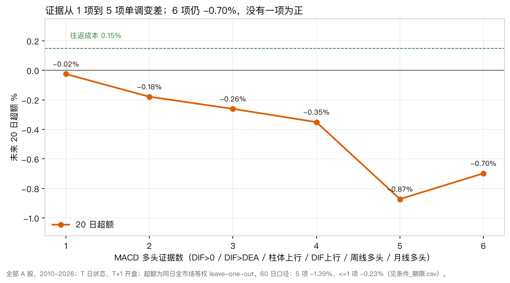
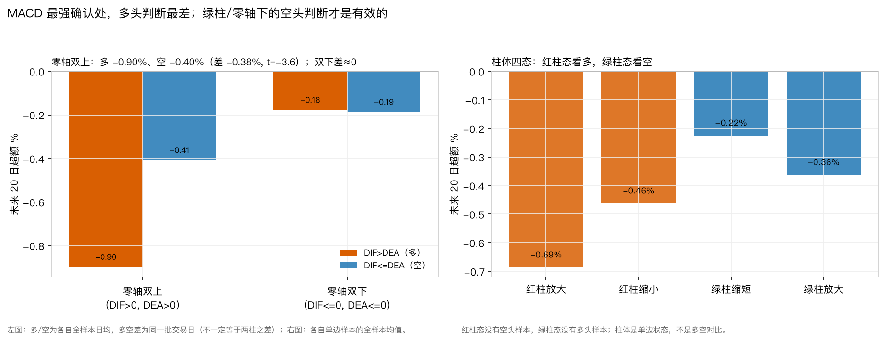
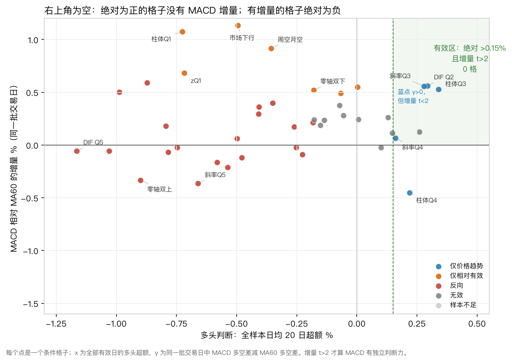
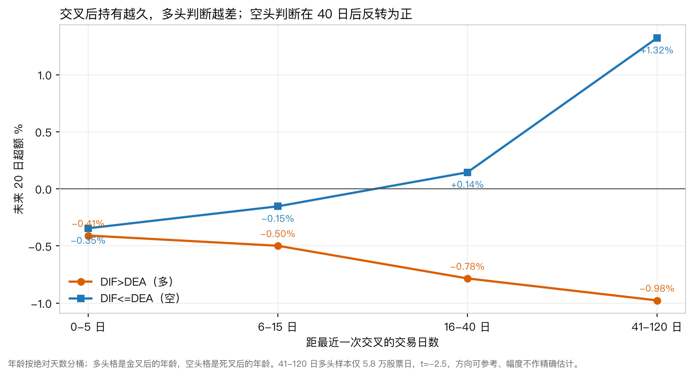
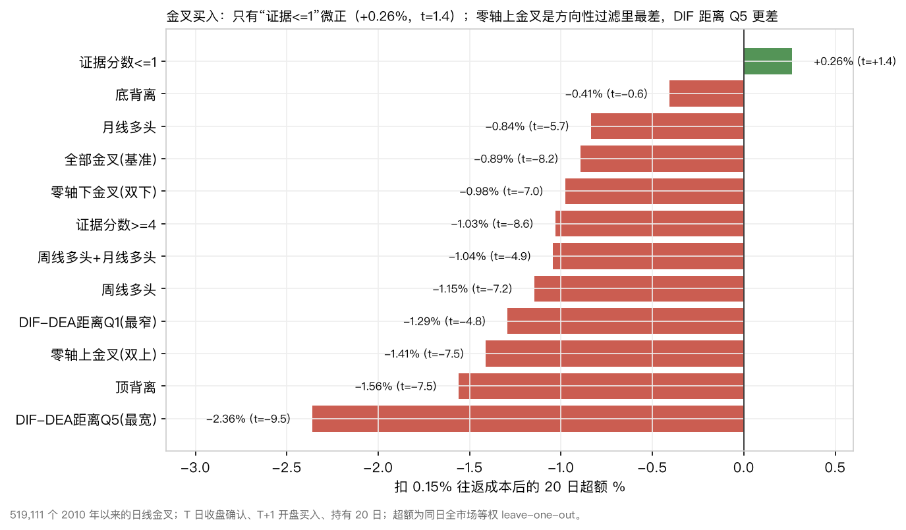
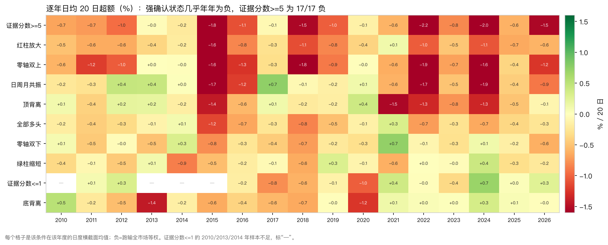

# 条件有效性：MACD 特征作为判断条件（2010–2026）

> 问题不是“用 MACD 选哪些股票”，而是：**给定今天的 MACD 特征状态，MACD 说多或说空，未来 20 日到底对不对？**
> 结论先行：**55 个条件格，0 格同时通过“扣费后绝对为正”和“减去 MA60 后仍有增量”。** 绝对为正的 5 格全是温和区，同一批交易日多空差≈0，是价格趋势/低波效应；有 MACD 增量的 7 格全是深弱区，多头绝对仍为负，只能做相对回避。强确认状态（零轴双上、红柱放大、DIF/柱体高位、斜率陡、周月共振、证据≥5）在 20/60 日都显著跑输，且逐年稳定。**MACD 是卖出/回避刻度，不是买入开关。**

## 0. 一页纸

1. **判断单位不是股票，是状态。** 每天每只股票，MACD 给一个二元判断：DIF>DEA 为多，否则为空。然后看未来 20 日超额（T+1 开盘、减同日全市场等权）。条件则是 MACD 自己的特征：零轴、柱体四态、交叉年龄、柱体/DIF/斜率位置、背离、周/月状态、6 项证据分数、市场状态。
2. **两道门槛，55 格全灭。** 绝对有效 = 多头 20 日超额 >0.15%（覆盖往返成本）、t>2、2010-17 与 2018-26 同为正；增量有效 = 同一批交易日里，MACD 多空差减 MA60 多空差 >0、t>2。结果：**绝对有效 5 格、增量有效 7 格，交集 0 格。**
3. **绝对为正的 5 格，全是“温和区”。** 柱体水平 Q3 +0.340%/20 日（t=5.9）、Q4 +0.219%（t=4.2）、DIF 水平 Q2 +0.294%（t=2.9）、DIF5 日斜率 Q3 +0.278%（t=4.8）、Q4 +0.161%（t=2.9）。但同一批交易日里，多空差分别是 -0.021%、-0.145%、+0.157%、-0.072%、-0.144%；减去 MA60 后的增量 t 只有 1.2、-2.0、1.7、1.6、0.2。**这不是 MACD 的判断力，是“温和柱体/低波”这个分段本身的表现。**
4. **有 MACD 增量的 7 格，全是“深弱区”。** 柱体 Q1、柱体 60 日 z 的 Q1、柱体 Q2、零轴双下、周线空+月线多、周线空+月线空、指数下行。它们减去 MA60 后的增量 +0.49% ~ +1.14%/20 日（t=2.1~4.3），但多头绝对超额仍是 -0.72% ~ +0.00%。**MACD 只在这些格子里比 MA60 更会分“谁更差”，不是更会挑“谁会涨”。**
5. **强确认是反向的。** 零轴双上 -0.899%（t=-6.4）、红柱放大 -0.686%（t=-9.7）、DIF 水平 Q5 -1.164%（t=-7.1）、柱体 Q5 -0.747%（t=-7.3）、斜率 Q5 -0.660%（t=-7.4）、周线多+月线空 -1.030%（t=-8.7）、证据 5 项 -0.872%（t=-6.8）。60 日更大：零轴双上 -1.382%、红柱放大 -1.068%、DIF Q5 -1.905%、证据≥5 -1.389%。
6. **逐年不是靠一两年。** “证据≥5” 17/17 年为负；“零轴双上” 16/17 年为负；“红柱放大” 16/17 年为负；“全部多头” 15/17 年为负。“证据≤1” 只有 6/13 年为正，均值 -0.105%，是“少亏”，不是“赚”。
7. **事件层同样没有正格。** 519,111 个金叉，扣 0.15% 后全部金叉 -0.895%/20 日（t=-8.2）；零轴上金叉 -1.411%（方向性过滤里最差；DIF 距离 Q5 -2.360% 更差），零轴下 -0.977%；周线+月线多头 -1.044%；证据≥4 -1.031%；顶背离 -1.560%。唯一微正的是“证据≤1” +0.264%（t=1.4，前期 +0.917%、后期 +0.074%，n=1.48 万），不显著、后期接近 0。
8. **持有越久越差，空头晚期反转。** 金叉后 0-5 日多头 -0.409%，6-15 日 -0.499%，16-40 日 -0.785%，41-120 日 -0.977%；死叉后 0-5 日空头 -0.346%，16-40 日 +0.144%，41-120 日 +1.321%。**MACD 是事件工具，不是状态工具；刚交叉时最不难看，拿久了就变成反向。**
9. **周月共振反向，弱市相对有效。** 周线多+月线多 -0.479%（t=-2.6），周线多+月线空 -1.030%（t=-8.7，最差）；周线空+月线多 -0.068%（最好，但不显著）。指数上行时多头 -0.252%，下行 -0.496%，震荡 -0.537%；MACD 增量在下行市最好（+1.135%，t=3.9），但绝对仍负。
10. **唯一接近“正”的角落是“指数下行+零轴双下”。** 多头 +0.175%/20 日（t=1.29，前期 +0.318%、后期 +0.025%），是深跌反弹，不显著、后期几乎归零；同期“指数下行+零轴双上”是 -1.595%（t=-7.2）。**不能把“跌深了”误当成“MACD 有效”。**

## 1. 口径：为什么这不是选股

第 13 节（个股适配性）问的是“哪类股票”，本节问的是“哪种状态”。两者不是同一个问题：

- 个股适配性：把一只股票的全部金叉/择时压成一个指标，再看股票特征（规模、换手、波动等）能否事前识别。结论是没有稳定子集。
- 条件有效性：不压缩到股票，保留每一天的 MACD 状态，直接检验“在这个状态下，MACD 的多/空判断对不对”。股票特征只是条件之一（本节只保留市场状态，个股特征已在第 13 节）。

判断的定义：

- **多**：T 日收盘 DIF>DEA；**空**：否则。
- **结果**：`fwd20 = close[T+20] / open[T+1] - 1`；`ex20 = fwd20 - 同日全市场等权同口径收益（leave-one-out）`。
- **样本**：2010-01-01 至 2026-10-28，全 A，剔除 ST、上市不足 120 日、T+1 不可成交、T+20 停牌。
- **t 值**：日度横截面均值序列，Newey-West lag=20（20 日重叠）；60 日口径 lag=60。
- **成本**：事件层扣 0.15% 往返；状态层不扣（状态层是“判断对不对”，不是每日换仓），但绝对门槛仍要求 >0.15%，以便和事件层可比。
- **两道门槛**：
  - 绝对有效：多头日均超额 > 0.15%，t>2，2010-17 与 2018-26 同为正。
  - 增量有效：同一批交易日里，`MACD 多空差 - MA60 多空差` > 0，t>2。
  - 只有两道都过，才叫“MACD 有效”；只过第一道叫“仅价格趋势”，只过第二道叫“仅相对有效”。

为什么用 MA60 做增量基准：MACD 的多空状态与“价格在 60 日均线上下”高度相关。如果 MACD 的多空差并不比 MA60 好，那它的信息就是价格趋势的复写，不能算 MACD 的独立判断。这是比“IC 是否显著”更严格的门槛。

## 2. 总图：55 格，0 格双门槛

55 个条件格（12 个条件族）的判定分布：

| 综合判定 | 格数 | 含义 |
|---|---:|---|
| 反向 | 26 | 绝对为负、t<-2、前后同负：MACD 说多反而更差 |
| 无效 | 12 | 绝对不显著，或前后不同号 |
| 仅相对有效 | 7 | 减 MA60 后有增量，但多头绝对仍为负/零 |
| 仅价格趋势 | 5 | 绝对为正，但减 MA60 后没有增量 |
| 样本不足 | 5 | 股票日或交易日不足 |
| **有效（双门槛）** | **0** | **没有一格同时过绝对与增量** |

分族汇总（每族的最优/最差多头格、最大增量格）：

| 条件族 | 最优多头条件 | 最优多头超额 | 最差多头条件 | 最差多头超额 | 最大增量条件 | 最大增量（t） |
|---|---|---:|---|---:|---|---:|
| 零轴四态 | 双下 | -0.180% | 双上 | -0.899% | 双下 | +0.522%（2.58） |
| 柱体四态 | 红柱缩小 | -0.462% | 红柱放大 | -0.686% | — | — |
| 交叉年龄 | 0-5 日 | -0.409% | 41-120 日 | -0.977% | 0-5 日 | +0.294%（1.22） |
| 柱体水平 | Q3 | +0.340% | Q5 | -0.747% | Q1 | +1.077%（2.90） |
| DIF 水平 | Q2 | +0.294% | Q5 | -1.164% | Q2 | +0.562%（1.72） |
| DIF5 日斜率 | Q3 | +0.278% | Q1 | -0.987% | Q3 | +0.558%（1.59） |
| 柱体 60 日 z | Q3 | +0.129% | Q1 | -0.718% | Q1 | +0.683%（2.60） |
| 20 日红柱占比 | Q2 | +0.006% | Q5 | -0.794% | Q1 | +0.377%（1.80） |
| 背离 | 底背离 | +0.425% | 顶背离 | -0.532% | 无背离 | +0.361%（1.84） |
| 周月状态 | 周空+月多 | -0.068% | 周多+月空 | -1.030% | 周空+月空 | +0.918%（4.31） |
| 证据分数 | 1 项 | -0.025% | 5 项 | -0.872% | 5 项 | +0.593%（1.14） |
| 市场状态 | 指数上行 | -0.252% | 指数震荡 | -0.537% | 指数下行 | +1.135%（3.87） |

这张表只说明“每族最好/最差在哪里”，不改变 0 格双门槛的结论。下面拆开看。

## 3. 证据分数：越确认越差

把 6 项多头证据相加：DIF>0、DIF>DEA、柱体上行、DIF 上行、周线多头、月线多头。分数 0-6；金叉当日至少 3 项，所以事件层的 0-2 项为空。

| 证据数 | 股票日 | 多头 20 日超额 | t | 前期 | 后期 | 60 日多头 |
|---:|---:|---:|---:|---:|---:|---:|
| 1 | 216,905 | -0.025% | -0.13 | +0.052% | -0.060% | -0.229% |
| 2 | 654,789 | -0.179% | -1.67 | -0.105% | -0.222% | — |
| 3 | 1,894,994 | -0.261% | -3.78 | -0.212% | -0.304% | — |
| 4 | 2,191,516 | -0.350% | -4.66 | -0.376% | -0.325% | — |
| 5 | 1,335,826 | **-0.872%** | **-6.78** | -0.734% | -0.998% | **-1.389%** |
| 6 | 701,969 | -0.698% | -3.28 | -0.400% | -0.911% | — |

从 1 项到 5 项单调变差，6 项略好于 5 项但仍 -0.70%。**没有一项为正。** 逐年看，“证据≥5” 17/17 年为负；“证据≤1” 只有 6/13 年为正，均值 -0.105%。这不是“某一年熊市”的产物，而是横截面动量反转的稳定结构。



## 4. 零轴与柱体：最强确认最差

| 状态 | 多头 20 日 | t | 空头 20 日 | 多空差 | 差 t |
|---|---:|---:|---:|---:|---:|
| 零轴双上（DIF>0, DEA>0） | **-0.899%** | -6.41 | -0.410% | **-0.383%** | -3.59 |
| 零轴双下（DIF<=0, DEA<=0） | -0.180% | -1.90 | -0.189% | +0.011% | 0.10 |
| 红柱放大 | **-0.686%** | -9.65 | — | — | — |
| 红柱缩小 | -0.462% | -6.06 | — | — | — |
| 绿柱缩短 | — | — | -0.225% | — | — |
| 绿柱放大 | — | — | **-0.362%** | — | — |

红柱态没有空头样本，绿柱态没有多头样本，所以柱体是“单边状态”，不能做多空对比。关键读数：

- **零轴之上是负的，而且比零轴之下更负。** 教科书说“只做零轴上的金叉”，这里正好相反：双上 -0.899%，双下 -0.180%。双上的多空差 -0.383%（t=-3.59），MACD 的方向判断是反的。
- **红柱放大是全部柱体态里最差的。** -0.686%/20 日，t=-9.65；红柱缩小 -0.462%。柱体越“强”，未来越差。
- **空头侧在绿柱放大时有效。** -0.362%/20 日，t=-5.04，前后两段同负。但这是“回避”有效，不是“做多”有效。



## 5. 绝对 vs 增量：两个不相交的“好看”

注：下表的“多头 20 日”是各自全样本日均；多空差、MA60 增量只用两边都有样本的同一批交易日，因此多空差不一定等于两个边际均值之差。这是配对检验的正确口径。

这是全文最重要的一张表。绝对为正的 5 格：

| 条件 | 多头 20 日 | t | 同一批交易日多空差 | 差 t | 减 MA60 增量 | 增量 t | 判定 |
|---|---:|---:|---:|---:|---:|---:|---|
| 柱体水平 Q3 | +0.340% | 5.91 | -0.021% | -0.51 | +0.529% | 1.20 | 仅价格趋势 |
| 柱体水平 Q4 | +0.219% | 4.17 | -0.145% | -2.38 | -0.451% | -1.96 | 仅价格趋势 |
| DIF 水平 Q2 | +0.294% | 2.88 | +0.157% | 1.40 | +0.562% | 1.72 | 仅价格趋势 |
| DIF5 日斜率 Q3 | +0.278% | 4.82 | -0.072% | -0.56 | +0.558% | 1.59 | 仅价格趋势 |
| DIF5 日斜率 Q4 | +0.161% | 2.94 | -0.144% | -1.02 | +0.067% | 0.23 | 仅价格趋势 |

5 格的绝对超额都 >0.15%、t>2、前后同号；但同一批交易日里，**多空差全部在 0 附近（-0.145% ~ +0.157%），没有一格 t>2；减 MA60 后的增量 t 绝对值只有 0.2-2.0，也没有一格 t>2。** 这说明正收益来自“温和柱体/低波”这个分段本身，而不是 MACD 的方向判断。Q4 更露馅：全样本 +0.219%，但同一批交易日里多头 -0.068%、空头 +0.077%，多空差 -0.145%（t=-2.38）——正收益来自空头样本稀少的日子，不是 MACD 选对了。

有 MACD 增量的 7 格：

| 条件 | 多头 20 日 | t | 多空差 | 差 t | 减 MA60 增量 | 增量 t | 判定 |
|---|---:|---:|---:|---:|---:|---:|---|
| 柱体水平 Q1 | -0.726% | -4.26 | +0.753% | 4.20 | +1.077% | 2.90 | 仅相对有效 |
| 柱体 60 日 z Q1 | -0.718% | -5.24 | +0.439% | 2.71 | +0.683% | 2.60 | 仅相对有效 |
| 柱体水平 Q2 | +0.003% | 0.03 | +0.120% | 2.23 | +0.552% | 2.14 | 仅相对有效 |
| 零轴双下 | -0.180% | -1.90 | +0.011% | 0.10 | +0.522% | 2.58 | 仅相对有效 |
| 周线空+月线多 | -0.068% | -0.58 | +0.126% | 0.98 | +0.492% | 2.80 | 仅相对有效 |
| 周线空+月线空 | -0.357% | -3.18 | -0.188% | -1.74 | +0.918% | 4.31 | 仅相对有效 |
| 指数下行 | -0.496% | -4.29 | -0.314% | -1.65 | +1.135% | 3.87 | 仅相对有效 |

7 格的增量都 >0 且 t>2，说明在这些“深弱”环境里，MACD 比 MA60 更会分“谁更差”；但**多头绝对超额仍是 -0.73% ~ +0.00%，做多依然不赚**。其中“周线空+月线空”和“指数下行”的多空差本身是负的（-0.188%、-0.314%，t≈-1.7），增量来自“MACD 的空头差比 MA60 的空头差小”，不是 MACD 的多头判断更好。这是相对/对冲语言，不是 long-only 语言。



## 6. 交叉年龄：事件工具，不是状态工具

| 距最近交叉 | 多头 20 日 | t | 空头 20 日 | t |
|---|---:|---:|---:|---:|
| 0-5 日 | -0.409% | -6.38 | -0.346% | -5.01 |
| 6-15 日 | -0.499% | -5.61 | -0.153% | -2.45 |
| 16-40 日 | -0.785% | -5.50 | +0.144% | 1.66 |
| 41-120 日 | -0.977% | -2.48 | **+1.321%** | 1.98 |

- 多头：拿得越久越差，0-5 日 -0.409% → 41-120 日 -0.977%。**“DIF>DEA 就持有”不是好规则；它只在刚交叉时最不难看。**
- 空头：刚死叉 -0.346%，16-40 日转正 +0.144%，41-120 日 +1.321%。**空头判断在晚期反转，继续空/回避会错过反弹。**
- 41-120 日多头只有 5.8 万股票日，t=-2.5，方向可参考，幅度不要精确外推。



## 7. 事件层：金叉买入，没有正格

519,111 个日线金叉，扣 0.15% 往返成本后的 20 日超额：

| 过滤 | 信号数 | 净超额 | t | 前期 | 后期 | 判定 |
|---|---:|---:|---:|---:|---:|---|
| 全部金叉（基准） | 519,111 | **-0.895%** | -8.24 | -0.912% | -0.592% | 反向 |
| 零轴上金叉（双上） | 173,041 | **-1.411%** | -7.47 | -1.112% | -1.395% | 反向 |
| 零轴下金叉（双下） | 321,641 | -0.977% | -6.96 | -1.108% | -0.585% | 反向 |
| 周线多头 | 224,346 | -1.146% | -7.16 | -0.907% | -1.076% | 反向 |
| 月线多头 | 281,727 | -0.836% | -5.71 | -0.877% | -0.514% | 反向 |
| 周线多头+月线多头 | 116,454 | -1.044% | -4.95 | -0.734% | -1.033% | 反向 |
| 证据分数≤1 | 14,806 | **+0.264%** | 1.40 | +0.917% | +0.074% | 无效 |
| 证据分数≥4 | 382,514 | -1.031% | -8.62 | -1.057% | -0.720% | 反向 |
| 顶背离 | 99,608 | **-1.560%** | -7.47 | -1.222% | -1.572% | 反向 |
| 底背离 | 974 | -0.406% | -0.57 | -0.822% | -0.073% | 样本不足 |
| DIF-DEA 距离 Q1（最窄） | 28,737 | -1.292% | -4.82 | -1.212% | -1.052% | 反向 |
| DIF-DEA 距离 Q5（最宽） | 70,286 | **-2.360%** | -9.48 | -2.253% | -2.179% | 反向 |

- **零轴上金叉是方向性过滤里最差的**（-1.411%），不是最好的；零轴下 -0.977%，反而少亏。但 DIF 距离 Q5（-2.360%）比它更差——那是“距离已经拉到极端”的拥挤状态，不是零轴方向本身。
- 周线/月线多头确认也没有救：周+月 -1.044%，比不确认 -0.895% 更差。
- 顶背离 -1.560%，是有效的“避”，不是“买”；底背离只有 974 个样本，不显著。
- “证据≤1”是唯一净正（+0.264%），但 t=1.4、后期仅 +0.074%，是“金叉时几乎没有确认”的稀有状态，不能当策略。



## 8. 周月与市场：共振反向，弱市相对有效

| 周/月状态 | 多头 20 日 | t | 多空差 | 差 t | 增量 | 增量 t |
|---|---:|---:|---:|---:|---:|---:|
| 周线多头+月线多头 | -0.479% | -2.63 | -0.221% | -1.63 | -0.120% | -0.63 |
| 周线多头+月线空头 | **-1.030%** | -8.70 | -0.499% | -4.39 | -0.057% | -0.38 |
| 周线空头+月线多头 | -0.068% | -0.58 | +0.126% | 0.98 | +0.492% | 2.80 |
| 周线空头+月线空头 | -0.357% | -3.18 | -0.188% | -1.74 | +0.918% | 4.31 |

注：多头/空头为各自全样本日均；多空差/增量为同一批交易日。

- **“周线多头+月线空头”是最差组合**（-1.030%，t=-8.7）：周线向上、月线向下的反弹，追进去最容易挨打。
- “周线空头+月线多头”最好（-0.068%），但只是不显著的不亏；它的增量 +0.492%（t=2.80）是相对有效的弱信号。
- 三重共振（日+周+月多头）在事件层 -1.044%，在状态层 -0.479%，都负；**共振不是加分项。**

市场状态：

| 指数状态 | 多头 20 日 | t | 多空差 | 差 t | 增量 | 增量 t |
|---|---:|---:|---:|---:|---:|---:|
| 指数在 MA200 上且上行 | -0.252% | -2.54 | -0.047% | -0.30 | -0.021% | -0.06 |
| 指数在 MA200 下且下行 | -0.496% | -4.29 | -0.314% | -1.65 | **+1.135%** | 3.87 |
| 指数震荡 | -0.537% | -4.06 | -0.355% | -1.56 | -0.213% | -0.71 |

- 三种市场状态的多头判断全负；指数上行时 -0.252%，下行 -0.496%，震荡 -0.537%。
- 下行市的 MACD 增量 +1.135%（t=3.87）最好，但绝对仍负；**弱市里 MACD 更会“分谁更差”，不是更会“挑谁涨”。**

市场 × 零轴：12 个组合（3 个 “DIF 下 DEA 上” 无多头样本）里唯一为正的是“指数下行 + 零轴双下” +0.175%/20 日（t=1.29，前期 +0.318%、后期 +0.025%），是深跌反弹，不显著、后期几乎归零；同格的“指数下行 + 零轴双上”是 -1.595%（t=-7.25）。**“跌深了”不等于“MACD 有效”。**

## 9. 逐年与期限：不是一年的事

逐年日均 20 日超额（%）：

| 条件 | 均值 | 为正年份 | 最差年 |
|---|---:|---:|---|
| 全部多头 | -0.384% | 2/17 | -1.16%（2015） |
| 零轴双上 | -0.895% | 1/17 | -1.92%（2022） |
| 零轴双下 | -0.214% | 4/17 | -0.80%（2015） |
| 红柱放大 | -0.658% | 1/17 | -1.64%（2015） |
| 绿柱缩短（空） | -0.215% | 4/17 | -0.86%（2014） |
| 证据≤1 | -0.105% | 6/13 | -1.04%（2020） |
| 证据≥5 | **-0.946%** | **0/17** | -2.19%（2022） |
| 日周月共振 | -0.465% | 5/17 | -1.90%（2024） |
| 顶背离 | -0.440% | 5/17 | -1.55%（2021） |
| 底背离 | -0.280% | 6/17 | -1.42%（2013） |

“证据≥5”没有一年为正；“零轴双上”“红柱放大”只各有一年不为负。**这不是靠 2015 或 2022 一年拉出来的。**

期限稳健性（多头日均超额，%）：

| 条件 | 5 日 | 20 日 | 60 日 |
|---|---:|---:|---:|
| 全部多头 | -0.100 | -0.407 | -0.700 |
| 零轴双上 | -0.211 | -0.899 | -1.382 |
| 红柱放大 | -0.347 | -0.686 | -1.068 |
| 柱体水平 Q3 | +0.129 | +0.340 | +0.484 |
| DIF 水平 Q2 | +0.130 | +0.294 | +0.438 |
| 证据≤1 | +0.144 | -0.025 | -0.229 |
| 证据≥5 | -0.385 | -0.955 | -1.389 |
| 顶背离 | -0.247 | -0.532 | -0.882 |
| 底背离 | -0.111 | +0.425 | +0.615 |

- 强确认在三个期限都负，且 60 日更负；这不是“短期噪声”。
- 温和区（Q3/Q2）在三个期限都正，但同一批交易日的多空差在 60 日也只有 -0.017%/-0.116%，**绝对正、判别零**的结论不随期限改变。
- “证据≤1” 5 日 +0.144%、20 日 -0.025%、60 日 -0.229%，随期限翻负；不能当买入信号。
- 底背离 20/60 日为正但 t 只有 1.45/1.17，5 日为负；不稳健。



## 10. 判断表

| 当前 MACD 状态 | 未来 20 日多头超额 | MACD 判断 | 怎么用 |
|---|---:|---|---|
| 零轴双上（DIF>0, DEA>0） | **-0.899%** | 反向，t=-6.4 | 不买；持仓考虑减 |
| 红柱放大 | **-0.686%** | 反向，t=-9.7 | 不追；止盈/减仓 |
| DIF 水平 Q5 / 柱体 Q5 / 斜率 Q5 | -1.164% / -0.747% / -0.660% | 反向，t=-7 ~ -7.4 | 不买；回避 |
| 周线多头+月线空头 | **-1.030%** | 反向，t=-8.7 | 最差共振，不追反弹 |
| 周线多头+月线多头 | -0.479% | 反向，t=-2.6 | 共振不加分 |
| 证据分数≥5 | -0.872% | 反向，t=-6.8 | 强确认=反向 |
| 顶背离 | -0.532% | 反向，t=-3.1 | 有效的是“避”，不是“买” |
| 柱体水平 Q3 / Q4 | +0.340% / +0.219% | 仅价格趋势；多空差≈0 | 不要归功于 MACD |
| DIF 水平 Q2 / 斜率 Q3 / Q4 | +0.294% / +0.278% / +0.161% | 仅价格趋势；增量 t<2 | 不要归功于 MACD |
| 零轴双下 | -0.180% | 仅相对有效；增量 t=2.58 | 不亏但不赚；只能减配/对冲 |
| 柱体 Q1 / 柱体 z Q1 | -0.726% / -0.718% | 仅相对有效；增量 t=2.6-2.9 | 多头仍亏；只能“相对少配” |
| 周线空+月线空 / 指数下行 | -0.357% / -0.496% | 仅相对有效；增量 t=3.9-4.3 | 弱市相对判断，不是买入 |
| 证据分数≤1 | -0.025% | 无效，t=-0.1 | 不要当买入信号 |
| 底背离 | +0.425% | 无效，t=1.45 | 不显著；别抄底 |
| 指数下行+零轴双下 | +0.175% | 无效，t=1.29；后期≈0 | 深跌反弹，不能当策略 |

## 11. 为什么是反向

三条机制，按证据强弱排序：

1. **A 股的 20-60 日动量以反转为主。** MACD 是“价格动量的二阶确认”：零轴上、红柱放大、DIF 高位、斜率陡，意味着过去 20-60 日已经涨过一段。全 A 的横截面在 20-60 日尺度上均值回归，确认越充分，未来超额越低。这与第 7 节“12 个特征 IC 全负”、第 13 节“低 60 日全 A 11.0% vs 加金叉 4.5%”是同一件事。
2. **强确认同时是高波动/高换手/高位。** 红柱放大、DIF Q5、斜率 Q5 的股票，波动和换手都更高；A 股的低波/低换手溢价在 20-60 日尺度上占主导。第 7.5 节已经看到：红柱放大在高波、高换手、高位时 -0.3% ~ -0.5%，在低波/低位才接近 0。条件层的“强确认最差”是这条的横截面版本。
3. **弱确认是超跌反弹，不是趋势起点。** 柱体 Q1、z Q1、零轴双下、周线空+月线空，都是“跌深了”的状态；MACD 在这些状态里比 MA60 更会分“谁更差”（增量 +0.5% ~ +1.1%），但反弹的绝对收益仍不足以覆盖成本。月线长期下跌结构的 +11.8% IC 也是同一类“相对反弹”，不是 long-only alpha。

换句话说：**MACD 的信息含量不在“金叉/多头”，而在“极值”。** 它最会说的是“这段涨得太顺了/这段跌得太久了”，而不是“要开始涨了”。这也解释了为什么“红柱放大 = 负”是第 7 节唯一稳健的独立增量，以及为什么“顶背离”在事件层 -1.56%。

## 11.5 与 MACD×KDJ 配合的关系（追加）

本报告只把 MACD 自己的特征当条件，没有引入第二个指标。把 KDJ(9,3,3) 加进来后（[报告_MACD_KDJ配合.md](报告_MACD_KDJ配合.md)），结论方向一致、而且更清楚：

- **两个指标同向是坏消息。** MACD多+KDJ多 -0.650%/20 日（t=-8.6，17 年 1 年正），比 MACD多+KDJ空（-0.422%）更差；同日双金叉净 -1.25%，17 年 0 年正。**“强确认 = 反向”在跨指标时仍然成立。**
- **KDJ 的增量在“位置”不在“方向”。** K 五分位 Q3/Q4 相对补集 +0.30/+0.26pp（t=3.49/4.81，q<0.01），但绝对只有 +0.14%/+0.01%，中位 -1.30%/-1.41%。这与本报告“柱体 Q3/Q4 只是价格趋势、不是 MACD”的判断同构：**中间区的相对好，不等于绝对买点。**
- **稀有格的广度问题在本报告里被放大了。** 本报告条件层用 ≥50 只/日的日度门槛，K<20 得到 +1.54%；拆开看，个股层均值 +0.58%、中位 -0.99%，全部有信号日 -0.86%，只有市场级恐慌日才 +1.53%。**不要把本报告稀有格的正均值当个股可执行信号。**
- **KDJ 金叉也不是 MACD 的确认。** KDJ 金叉在 MACD 多头里 -1.36%，在 MACD 空头里 -0.76%（差 -0.58pp，t=-4.17）；在 MACD 金叉后 5 日内 -1.21%，没有 MACD 金叉时 -0.78%（差 -0.47pp，t=-5.41）。**确认越晚，结果越差。**

一句话：**MACD 是卖出/回避刻度；KDJ 的加入没有把它变成买入开关，只是把“什么时候不该买”从“MACD 强确认”扩展到“MACD 强确认 + KDJ 同向/超买/刚金叉”。**

## 12. 边界与复现

**边界：**

- 日线、T+1 开盘、无盘中；0.15% 成本对低流动性股票可能偏低；状态层不扣每日成本，只把 0.15% 当绝对门槛。
- 20 日重叠窗口，t 值用 Newey-West lag=20；60 日 lag=60。重叠窗口的 t 仍偏乐观，结论主要看方向、前后段和逐年一致性。
- 条件格是看完单维结果后扫出来的，55 格没有做正式的 FDR 校正；但 0 格双门槛是“没有通过”，不是“筛选后显著”，多重检验只会让“有效”更少，不会更多。26 个“反向”格中，t 值极强（-6 ~ -9）的那些在 FDR 下仍会显著。
- 市场状态用沪深 300 的 MA200 与 20 日斜率；周/月状态用已收盘、滞后一期的周线/月线 MACD。月线状态映射到日线时，每月第一个交易日用的是上月末状态，无未来。
- 基准口径复核：把 leave-one-out 限制在同一 base（非 ST、上市≥120 日）内，全部多头日均 -0.388% vs 全 A 基准 -0.407%，差 0.009%；负值不是“基准包含 ST/次新股”造成的。
- 事件层的“证据≤1”只有 14,806 个信号、后期 +0.074%，不能因为它是唯一正数就当成策略；它是“金叉时几乎没有确认”的稀有状态。
- 状态层的“仅相对有效”是相对 MA60 的多空差，不是可实现的 long-only 收益；A 股做空受限，实际只能用于减配/回避。

**复现：**

```bash
cd 2026-10-28_MACD有效性_全维度
python 02_代码/45_条件有效性.py    # ~50s，55 格状态层 + 事件层 + 逐年 + 组合
python 02_代码/46_条件_期限.py      # ~40s，5/20/60 日期限稳健
python 02_代码/47_条件图表.py       # ~5s，图20-25
```

输出：

- `03_结果/条件_多头.csv`、`条件_空头.csv`、`条件_多空差.csv`
- `条件_证据分数.csv`、`条件_事件.csv`、`条件_经典过滤.csv`
- `条件_逐年.csv`、`条件_期限.csv`、`条件_市场状态.csv`、`条件_市场x零轴.csv`、`条件_零轴x分数.csv`、`条件_族汇总.csv`
- `04_图表/图20_证据分数.png` … `图25_逐年.png`

**一句话：** 如果你问“MACD 在什么情况下有效”，答案是：**作为卖出/回避判断，在 MACD 自己最强的时候有效；作为买入判断，没有一种状态是稳定有效的。** 强确认不是买入理由，是减仓理由；弱确认不是买入理由，只是“少亏”。中间地带的正收益属于价格趋势和低波，不属于 MACD。加上 KDJ 后结论不变：**双确认不是买点，KDJ 位置（中间 vs 两端）只是相对少亏，K<20 的正均值是市场恐慌反弹的广度假象。**
