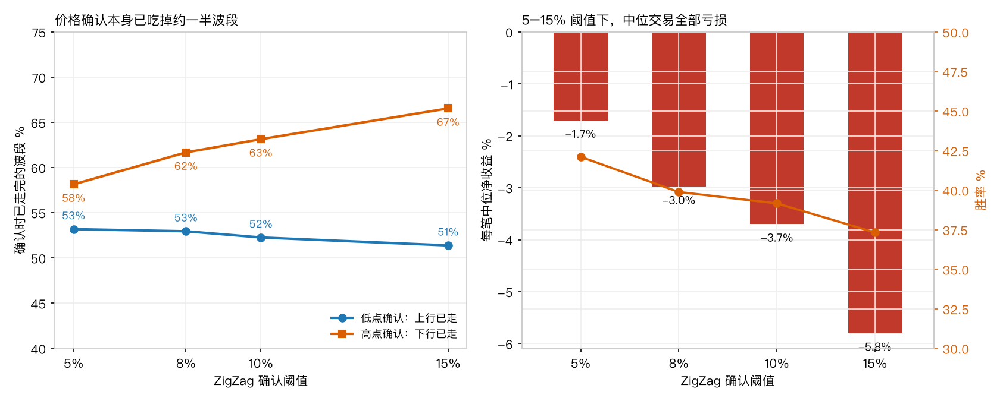
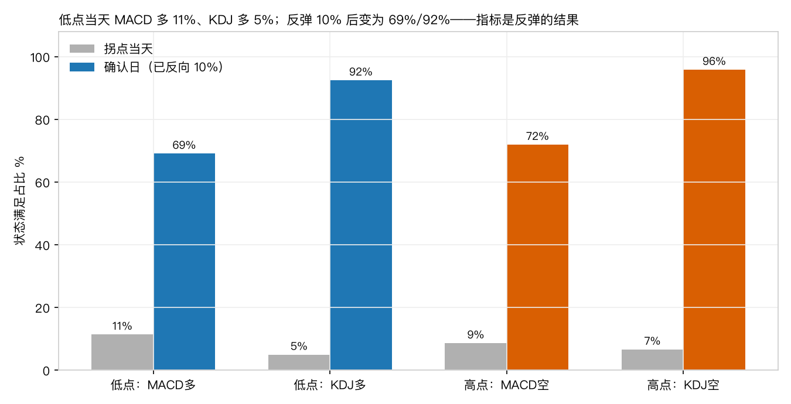
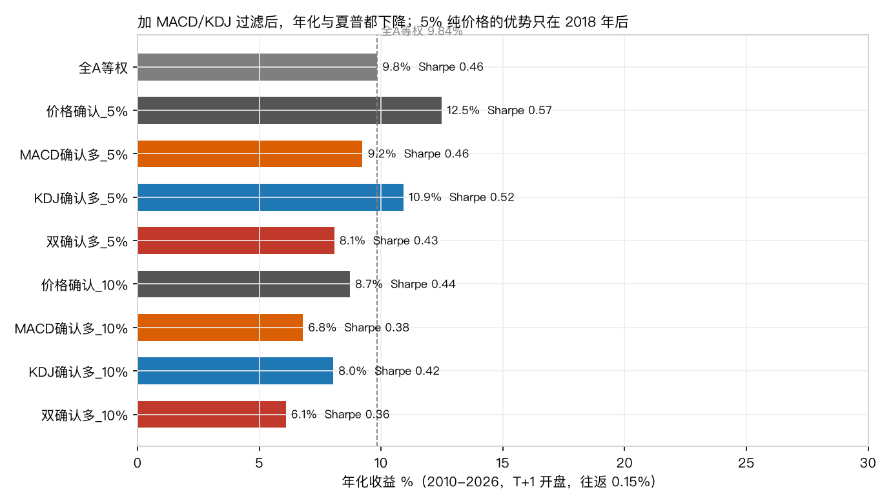
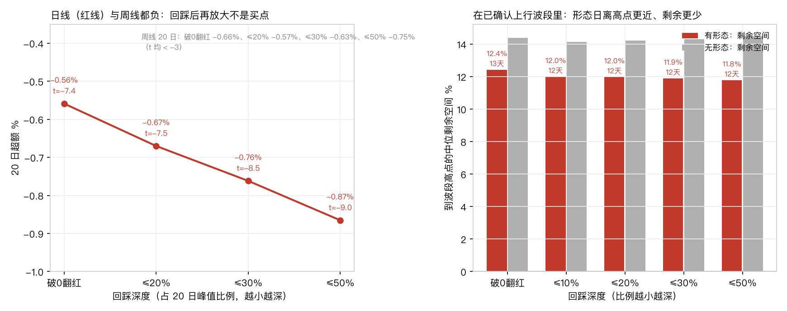

# MACD×KDJ 能不能确定波段？

> 结论先行：**不能“确定”，只能事后确认；两者叠加不会更好，只会更晚。**
> 拐点当天 MACD 多只占 11.3%、KDJ 多只占 4.9%；等价格已经反弹 10% 的确认日，才变成 69.0%/92.4%。它们和反弹同步，不是反弹的原因。
> 方向判断也不如最简单的价格趋势：MACD 多头与当前波段方向一致 66.1%，KDJ 53.9%，而价格>MA20 是 74.5%、20 日动量为正 74.3%。
> 交易层更直接：5%/8%/10%/15% 四档 ZigZag，纯价格确认的中位交易全部亏损（-1.7%/-3.0%/-3.7%/-5.8%）；加 MACD/KDJ 过滤后中位更差、均值更低。5% 纯价格的等权组合年化 12.5% 略高于全 A 等权 9.8%，但 2010–2017 只有 10.5% vs 11.4%，优势集中在 2018 年后，且中位交易亏钱——那是右尾和分散，不是“确定波段”的能力。

---

## 1. 口径

- 数据：本地 baostock 后复权日线，2010-01-01 至 2026-10-28；5,507 只股票，含退市股；上市满 250 日、非 ST、20 日成交额≥500 万。
- 波段：收盘价 ZigZag，反转阈值 5%/8%/10%/15%。只有从极值反转达到阈值，拐点才算“确认”；确认日之前不可知。
- 执行：确认日 T 收盘，T+1 开盘成交；一字涨停不买、一字跌停不卖；单边 0.075%（往返 0.15%）。
- 退市/长期停牌：没有下一个反向拐点的低点，持有到最后一个有效日，按最后有效开盘强制退出；报告“强制退出占比”。
- 指标：MACD(12,26,9)、KDJ(9,3,3)；状态定义 MACD 多 = DIF>DEA，KDJ 多 = K>D；参数稳健另测 6 组 KDJ、4 组 MACD。
- 样本：10% 阈值下 255,677 个低点、259,896 个高点；四档合计 259.7 万个拐点、约 124 万笔低点交易样本（含无下一高点的强制退出）。
- **基准率**：10% 阈值下，低点±5 日覆盖了 21.2% 的股票-交易日，高点±5 日覆盖 21.5%。所以“94.5% 的低点附近有 KDJ 金叉”不等于预测，必须和 21.2% 的随机基准比。

---

## 2. 波段结构：确认时已经走了一半



| 阈值 | 低点→高点中位幅度 | 高点→低点中位幅度 | 低点中位天数 | 高点中位天数 | 确认中位滞后 | 低点确认时已走 | 高点确认时已走 |
|---:|---:|---:|---:|---:|---:|---:|---:|
| 5% | 13.3% | 11.8% | 7 | 7 | 3 天 | **53.2%** | **58.1%** |
| 8% | 19.5% | 16.1% | 13 | 11 | 5 天 | **53.0%** | **61.7%** |
| 10% | 23.7% | 18.9% | 18 | 16 | 6 天 | **52.3%** | **63.1%** |
| 15% | 34.8% | 25.5% | 30 | 27 | 11 天 | **51.4%** | **66.5%** |

三件事：

1. **上行确认吃掉约一半**：51%–53%，四档几乎不变。
2. **下行确认吃掉的更多**：58%–67%，因为下跌波段更短、更快，同样 5–15% 的反转在下跌里占比更大。
3. **放大阈值不解决问题**：波段幅度随阈值同步放大，确认时已走比例仍在 51%–67%。把“波段”定义得更大，只是把两端让渡也放大。

### 中位交易的算术

10% 阈值，中位上行波段 23.7%：

- 低点上方 10% 买入，高点下方 10% 卖出；
- 毛收益 ≈ 1.237 × 0.9 / 1.1 − 1 = **+1.2%**（还没算跳空和费用）；
- 实际 T+1 开盘成交、扣 0.15% 后，**中位净收益 -3.70%**，胜率 39.2%。

15% 阈值，中位波段 34.8%：

- 毛收益 ≈ 1.348 × 0.85 / 1.15 − 1 = **-0.4%**；
- 实际中位净收益 **-5.80%**，胜率 37.3%。

---

## 3. 指标在拐点前后：它们是反弹的结果



10% 阈值，低点 255,677 个、高点 259,896 个：

| 状态 | 拐点当天满足 | 确认日满足 | 波段内未翻转 | 额外滞后（中位） | 额外让渡（中位） | 价格确认时已走 | 指标确认时已走 |
|---|---:|---:|---:|---:|---:|---:|---:|
| 低点：MACD 多 | **11.3%** | **69.0%** | 10.2% | 2 天 | +3.14% | 52.3% | **54.3%** |
| 低点：KDJ 多 | **4.9%** | **92.4%** | 4.4% | 1 天 | +2.32% | 52.3% | **52.7%** |
| 高点：MACD 空 | **8.6%** | **71.9%** | 12.5% | 2 天 | -2.80% | 63.1% | **64.4%** |
| 高点：KDJ 空 | **6.5%** | **95.8%** | 5.8% | 1 天 | -2.65% | 63.1% | **63.6%** |

读法：

- **拐点当天，指标绝大多数还是反向的**。低点当天 MACD 多只有 11.3%、KDJ 多只有 4.9%；高点当天 MACD 空 8.6%、KDJ 空 6.5%。
- **确认日，指标已经同向了**。反弹 10% 后 MACD 多 69.0%、KDJ 多 92.4%；回落 10% 后 MACD 空 71.9%、KDJ 空 95.8%。它们描述的是已经发生的反弹/回落，不是提前识别。
- 对确认时还没转向的少数（MACD 31%、KDJ 7.6%），等它转向的额外代价：MACD 再等 2 天、再让 3.14%；KDJ 再等 1 天、再让 2.32%。合计指标确认时已走上行波段的 54.3%/52.7%，比价格确认只多 2.0/0.4 个百分点。
- **10.2% 的低点，MACD 在整个波段内都没转多；4.4% 的 KDJ 同样**。等指标会错过整段。高点上 MACD 12.5%、KDJ 5.8% 在波段内从未转空。
- K<20 在低点当天有 55.1%，但确认日只剩 2.3%；若确认日还没 K<20，**92.6% 的低点在波段内再也不会出现 K<20**。K>80 在高点当天 37.2%，确认日 0.86%；若没出现，96.0% 的高点在波段内再也不会出现。它们是“领先的极值状态”，但不是可执行的入场/出场开关。

---

## 4. 精确率与方向：命中的多数是假信号

### 4.1 信号日落在拐点±5 日的比例

10% 阈值；低点基准 21.2%，高点基准 21.5%：

| 信号 | 落在低点±5 | 低点基准 | 低点提升 | 落在高点±5 | 高点基准 | 高点提升 |
|---|---:|---:|---:|---:|---:|---:|
| MACD 金叉 | 26.8% | 21.2% | 1.26 | 21.2% | 21.5% | 0.99 |
| MACD 死叉 | 21.3% | 21.2% | 1.01 | 29.5% | 21.5% | 1.37 |
| KDJ 金叉 | 26.6% | 21.2% | 1.25 | 17.6% | 21.5% | 0.82 |
| KDJ 死叉 | 15.9% | 21.2% | 0.75 | 28.5% | 21.5% | 1.33 |
| KDJ 低位金叉（K<30） | **43.0%** | 21.2% | **2.02** | 5.4% | 21.5% | 0.25 |
| KDJ 高位死叉（K>70） | 6.6% | 21.2% | 0.31 | **44.2%** | 21.5% | **2.06** |
| K 上穿 20 | **44.5%** | 21.2% | **2.10** | 7.4% | 21.5% | 0.34 |
| K 下穿 80 | 7.9% | 21.2% | 0.37 | **44.6%** | 21.5% | **2.08** |

- **KDJ 金叉的“94.5% 命中低点”是频率造成的**：KDJ 金叉占全部股票-交易日的 8.7%，平均每 11 天一次，1,132,189 次；只有 26.6% 的金叉日靠近低点，随机日是 21.2%。它命中率高，是因为它几乎一直在发生。
- 最好的信号也只有 **43%–45% 精确率**，意味着一半以上是假信号；而它们的数量远多于拐点：KDJ 低位金叉 37.4 万次 vs 低点 25.6 万次，K 下穿 80 31.5 万次 vs 高点 26.0 万次。
- MACD 金叉/死叉的精确率 21%–30%，相对基准的提升 1.0–1.4 倍，基本没有波段定位能力。
- **更敏感的 MACD 柱体特征也不救**：10% 低点当天，“绿柱缩短”只有 8.6%、“柱体上行”9.0%、“DIF 上行”1.5%；作为信号日，绿柱缩短有 34.3% 落在低点±5（基准 21.2%，1.62x），红柱缩短有 34.0% 落在高点±5（1.58x）。它们比 DIF>DEA 敏感，但仍是频繁、低精确率的事件——柱体方向几乎就是价格方向的同步变换，不是提前量。

### 4.2 方向一致率

10% 波段，确认后的当前方向：

| 指标 | 与当前波段方向一致 | 逆势看多 | 逆势看空 |
|---|---:|---:|---:|
| 价格 > MA20 | **74.5%** | 12.3% | 13.2% |
| 20 日动量为正 | **74.3%** | 12.5% | 13.2% |
| MACD 多头 | 66.1% | 17.7% | 16.2% |
| KDJ 多头 | 53.9% | 22.6% | 23.5% |
| 双指标同向 | 41.8% | — | — |

KDJ 只比抛硬币好 4 个百分点；MACD 也不如最简单的 MA20/20 日动量；把两者叠在一起，一致率反而降到 41.8%。

### 4.3 参数稳健

6 组 KDJ、4 组 MACD，10% 波段：

| 参数族 | 最优精确率 | 最优方向一致率 | 结论 |
|---|---|---|---|
| KDJ | 低位金叉 45.5%（9,5,3）；高位死叉 47.6%（19,3,3） | 57.5%（19,3,3） | 放慢改善方向，但精确率仍在 45% 左右；方向仍远低于 MA20 |
| MACD | 金叉 29.5%（8,17,9）；死叉 32.9%（8,17,9） | 70.9%（20,40,9） | 加快提精确率但方向降到 61.2%；放慢提方向但金叉精确率降到 21.7%（仅与基准 21.2% 持平） |

没有一组同时做到“高精确率 + 高方向一致率”。这不是参数没调对，而是滞后指标的结构：**想更早，就更多假信号；想更稳，就更晚。**

---

## 5. 交易层：中位交易全部亏损

### 5.1 纯价格确认，四档阈值

| 阈值 | 中位波段幅度 | 中位净收益 | 胜率 | 平均净收益 | 中位捕获 | 捕获为正 |
|---:|---:|---:|---:|---:|---:|---:|
| 5% | 13.3% | **-1.70%** | 42.1% | +3.76% | -11.5% | 42.4% |
| 8% | 19.5% | **-2.98%** | 39.9% | +2.27% | -14.5% | 40.2% |
| 10% | 23.7% | **-3.70%** | 39.2% | +2.16% | -15.0% | 39.5% |
| 15% | 34.8% | **-5.80%** | 37.3% | +2.43% | -16.4% | 37.6% |

- **中位交易在四档全部亏损，且阈值越大亏得越多**；平均收益为正，来自右尾的大波段，不是典型交易。
- 5% 中位持有 10 天，10% 中位持有 19 天；平均持有被少数长尾/强制退出拉长（5% 平均 130 天、10% 平均 56 天），不要用平均持有理解典型交易。
- 加 MACD/KDJ 过滤：10% 阈值中位净收益从 -3.70% 变为 MACD -3.91%、KDJ -3.76%；5% 从 -1.70% 变为 -1.97%/-1.95%。均值也下降。
- 10% 阈值按入场月份比较“选中 - 未选中”：MACD 确认多 **-1.06%（t=-2.11）**、KDJ 确认多 -1.07%（t=-1.57）、价格>MA20 -1.72%（t=-2.08）。**用 MACD 多头过滤，选中的是更差的交易**，不是更好的。

### 5.2 组合层：等权、全信号、T+1、往返 0.15%



| 方案 | 年化 | 最大回撤 | 夏普 | 2010–2017 | 2018–2026 |
|---|---:|---:|---:|---:|---:|
| 全 A 等权 | **9.84%** | -62.3% | 0.46 | 11.36% | 8.47% |
| 纯价格 5% | **12.48%** | -61.0% | 0.57 | 10.51% | 14.31% |
| 5% + MACD 确认多 | 9.24% | -61.0% | 0.46 | 9.70% | 8.82% |
| 5% + KDJ 确认多 | 10.92% | -60.9% | 0.52 | 9.80% | 11.94% |
| 5% + 双确认多 | 8.07% | -61.6% | 0.43 | 8.48% | 7.71% |
| 纯价格 10% | **8.72%** | -59.0% | 0.44 | 10.58% | 7.05% |
| 10% + MACD 确认多 | 6.79% | -58.3% | 0.38 | 10.25% | 3.74% |
| 10% + KDJ 确认多 | 8.03% | -60.3% | 0.42 | 9.93% | 6.34% |
| 10% + 双确认多 | 6.08% | -59.7% | 0.36 | 9.67% | 2.92% |
| MACD 金叉买/死叉卖 | **1.00%** | -67.9% | 0.17 | 5.56% | -2.97% |
| KDJ 金叉买/死叉卖 | **-4.78%** | -77.6% | -0.06 | -2.49% | -6.81% |

- **加过滤后，年化和夏普全部下降**；10% 阈值最明显：8.72% → 6.79%/8.03%/6.08%，2018 年后 7.05% → 3.74%/6.34%/2.92%。
- **经典交叉是最差的“波段方法”**：MACD 金叉/死叉年化 1.0%，KDJ 交叉 -4.8%，都远低于买入持有。
- 等指标转向再买卖（MACD/KDJ 择时）也没有改善：5% 阈值 8.04%/7.59%，10% 阈值 8.57%/8.22%，都低于或仅等于纯价格。
- **5% 纯价格的 12.48% 不是“确定波段”的证据**：早期 10.51% 跑输基准 11.36%，后期 14.31% 才跑赢；2024 年 16.7% vs 基准 6.2% 是主要贡献之一。中位交易仍亏 1.7%。这是右尾 + 分散 + regime，不是稳定的择时 alpha。日度超额（策略−全 A 等权，Newey-West lag 20）：5% 纯价格约 +1.5%/年、**t=1.19**；10% 纯价格约 -1.9%/年、t=-1.42。都不显著；5% 的 2.6pp CAGR 差大于日度算术超额 1.5%/年，差额来自复利/波动路径差异，不是稳定超额。
- 组合平均同时持有 2,406 只（5%）/2,063 只（10%），是信号层等权检验，不是可操作的实盘组合；容量、冲击、个股权重都没建模。

**日度超额（策略−全A等权，Newey-West lag 20）**

| 方案 | 年化算术超额 | t 值 | 读法 |
|---|---:|---:|---|
| 纯价格 5% | +1.48% | 1.19 | 不显著 |
| 5% + MACD | -1.51% | -1.17 | 负增量 |
| 5% + KDJ | +0.04% | 0.03 | 基本为零 |
| 5% + 双 | -2.63% | -1.92 | 负增量 |
| 纯价格 10% | -1.91% | -1.42 | 负 |
| 10% + MACD | -4.02% | -2.40 | 显著负 |
| 10% + KDJ | -2.64% | -1.81 | 负 |
| 10% + 双 | -4.79% | -2.64 | 显著负 |
| MACD 交叉 | -9.65% | -4.84 | 显著负 |
| KDJ 交叉 | -15.47% | -8.70 | 显著负 |

5% 纯价格的超额 t 只有 1.19；KDJ 过滤后 t=0.03，等于没有增量；MACD/双过滤和所有经典交叉都是显著负。**这不是“过滤后略差”，而是过滤把正超额做没了或做负了。**

### 5.3 成本敏感

| 方案 | 往返 0.15% | 往返 0.30% | 往返 0.50% |
|---|---:|---:|---:|
| 纯价格 5% | 12.48% | 10.39% | 7.66% |
| 纯价格 10% | 8.72% | 7.47% | 5.83% |
| 5% + MACD | 9.24% | 7.97% | 6.31% |
| 5% + KDJ | 10.92% | 9.11% | 6.75% |
| MACD 交叉 | 1.00% | -2.12% | -6.13% |
| KDJ 交叉 | -4.78% | -10.77% | -18.18% |

全 A 等权基准 9.84%（未扣调仓成本）。5% 纯价格在 0.30% 往返时只剩 10.39%，与基准的差距进入噪声区；0.50% 时 7.66%，已经跑输。**所谓“5% 波段优势”对成本非常敏感。**

---

## 6. 唯一的例外：K<20 的深度超卖口袋，不是波段信号

10% 阈值、确认日 K<20 的 5,647 笔：

| 指标 | 数值 |
|---|---:|
| 平均净收益 | +7.95% |
| 中位净收益 | +1.31% |
| 胜率 | 53.2% |
| 盈亏比 | 2.09 |
| 中位持有 | 12 天 |
| 平均持有 | 365 天（长尾/强制退出 17.0%） |
| 组合年化 | 12.91% |
| 最大回撤 | -53.8% |
| 2010–2017 / 2018–2026 | 16.71% / 9.56% |

但：

- 5% 阈值下 K<20 组合只有 10.03%，低于纯价格 5% 的 12.48%，没有超额；15% 阈值下中位收益 -0.59%。**只在 10% 阈值成立，不是稳健参数。**
- 平均持有 365 天，是因为一部分交易没有下一个高点、持有到退市/样本末；这是“深度超卖后长期持有”的口袋，不是波段交易。
- 它仍然没有“确定波段”：确认日 K<20 只占 2.3% 的低点，且需要价格先反弹 10%；它选到的是极端超卖后的长尾反弹。

因此，这个口袋可以作为一个**观察/研究线索**，不能当作“MACD+KDJ 确定波段”的证据，也不适合直接实盘。

---

## 7. 结论表

| 问题 | 答案 | 关键证据 |
|---|---|---|
| 能否提前识别波段低点？ | **不能** | 低点当天 MACD 多 11.3%、KDJ 多 4.9%；反弹 10% 后 69.0%/92.4% |
| 能否确认波段方向？ | **不能优于价格** | MACD 66.1%、KDJ 53.9%，MA20 74.5%、20 日动量 74.3% |
| 两者配合能否改善？ | **不能** | 双确认过滤年化 8.07%（5%）/6.08%（10%），低于纯价格 12.48%/8.72%；方向一致率 41.8% |
| 能否作为买卖开关？ | **不能** | MACD 交叉年化 1.0%、KDJ 交叉 -4.8%；加过滤后中位交易更差、均值更低 |
| 有没有例外？ | K<20 深度超卖口袋，不稳 | 仅 10% 阈值正超额；5% 无、15% 中位负；平均持有 365 天 |
| 那什么能用？ | 价格结构 + 风控，不是指标开关 | ZigZag/ATR 跟踪/N 日高低点定义波段；指标只做风险描述、仓位和回避 |

---

## 8. 边界与限制

1. 波段用**收盘价** ZigZag；用日内高低点、ATR 阈值、N 日高低点会改变拐点数量和幅度，但“确认时已走一半”的结构不会消失。
2. 只测日线；周线/月线 KDJ 此前已测：周线确认同样为负，只有“周线 K<20 + 日线 MACD 金叉”是弱正口袋（+0.32%/20 日，t=1.54），不是通用方案。
3. 组合是等权、全信号、每日再平衡；没有容量、冲击、涨跌停排队、ST 变更、退市整理期的完整建模。一字板才剔除，非一字涨停开盘按可成交处理，可能偏乐观；组合 CAGR 是每日再平衡的复利结果，含波动拖累，不能把单笔均值直接年化。退市/无下一高点的交易已按最后有效开盘强制退出，但仍可能有残余偏差。
4. 成本基线 0.15% 往返；0.30%/0.50% 的敏感性已给出，5% 纯价格的优势会消失。
5. 多重检验：4 档阈值 × 多个信号 × 多组参数，未做 BH-FDR；本报告的定位是“结构性判断”，不是挑选最优参数。K<20 口袋按探索性结果处理。
6. 没有加入估值、宽度、资金流、情绪等可能领先价格的变量；要“抓拐点”，需要比价格本身更早的信息，而不是两个价格变换。

---

## 9. 复现

| 文件 | 内容 |
|---|---|
| `02_代码/59_波段.py` | ZigZag 拐点、确认滞后、信号命中/精确率、方向一致率、状态翻转 |
| `02_代码/60_波段捕获.py` | 波段配对、T+1 成交、过滤器、择时、经典交叉、等权组合 |
| `02_代码/61_波段参数.py` | 6 组 KDJ × 4 组 MACD 的精确率/方向稳健性 |
| `02_代码/61b_波段_MACD柱体.py` | 柱体上行/绿柱缩短/红柱缩短/DIF 上下穿的拐点精确率 |
| `02_代码/63_波段审计.py` | 择时组合、日度超额 t、成本敏感 |
| `02_代码/62_波段图表.py` | 图35–图37 |
| `03_结果/59_波段_拐点概览.csv` | 各阈值波段数量/幅度/天数/确认滞后/确认时已走 |
| `03_结果/59_波段_翻转.csv` | 拐点当天 vs 确认日状态、额外滞后/让渡、波段内未翻转 |
| `03_结果/59_波段_精确率.csv` | 信号落在拐点±5 日的比例、随机基准、提升 |
| `03_结果/59_波段_方向.csv` | MACD/KDJ/MA20/20 日动量与波段方向一致率 |
| `03_结果/60_波段_捕获.csv` | 四档阈值 × 各方案的交易数/收益/胜率/捕获/持有 |
| `03_结果/60_波段_组合.csv` | 各方案等权组合年化/回撤/夏普 |
| `03_结果/60_经典交叉.csv` | MACD/KDJ 金叉死叉交易统计 |
| `03_结果/61_波段_参数.csv` | 参数稳健表 |
| `03_结果/61_波段_MACD柱体.csv` | MACD 柱体/斜率特征精确率 |
| `03_结果/63_波段_择时与超额.csv` | 各方案年化/回撤/夏普/早期/后期/日度超额 t |
| `03_结果/63_波段_成本.csv` | 各方案在 0.15%/0.30%/0.50% 往返成本下的年化 |
| `04_图表/图35_波段确认滞后.png` | 确认时已走比例 + 中位净收益 |
| `04_图表/图36_波段策略.png` | 各方案年化/夏普 vs 基准 |
| `04_图表/图37_拐点与确认日状态.png` | 拐点当天 vs 确认日指标状态 |

运行：

```bash
cd 02_代码
python 59_波段.py
python 60_波段捕获.py
python 61_波段参数.py
python 61b_波段_MACD柱体.py
python 62_波段图表.py
python 63_波段审计.py
```

---

## 10. 一句话

**MACD 和 KDJ 能描述波段，不能确定波段；它们确认的是已经发生的反弹/回落。两者叠加不会把滞后变成领先，只会把“晚”变得更晚。**

---

## 附：MACD 柱体回踩 0 轴后再放大，有影响吗？

> 按“MACD 柱体回踩 0 轴（红柱缩短到 0 附近，或破 0 再翻红）后再次放大”理解；日线、周线都测了。结论：**有影响，但方向和直觉相反——它不是“空中加油”，更像波段后半段的再确认/诱多。**

### A. 定义

- 柱体 `h = 2×(DIF−DEA) / 收盘价 × 100`，按价格归一。
- 回踩深度：近 5 日柱体低点 `trough5` 相对 20 日峰值 `peak20` 的比例。**比例越小=回踩越深**：≤10% 是深回踩，≤50% 是浅回踩。分“红柱回踩不破 0（trough5>0）”和“回踩破 0 再翻红（trough5≤0）”。
- 放大：当日 `h > 前一日 h` 且 `h > 0`。
- 信号 T 日收盘，T+1 开盘；5/20/60 日超额 = 个股收益 − 同日全市场等权（leave-one-out）。周线用周收盘确认，映射到该周最后一个交易日。



### B. 日线：5/20/60 日超额全负

| 形态 | 5 日 | 20 日 | 60 日 | 20 日 t | 20 日正年 |
|---|---:|---:|---:|---:|---:|
| 回踩破 0 再翻红 | -0.32% | **-0.56%** | -0.93% | -7.4 | 0/18 |
| 红柱回踩 ≤10% 峰值 | -0.18% | **-0.45%** | -0.62% | -5.3 | 3/18 |
| 红柱回踩 ≤20% 峰值 | -0.26% | **-0.67%** | -0.91% | -7.5 | 2/18 |
| 红柱回踩 ≤30% 峰值 | -0.31% | **-0.76%** | -1.07% | -8.5 | 2/18 |
| 红柱回踩 ≤50% 峰值 | -0.36% | **-0.87%** | -1.21% | -9.0 | 1/18 |

- **回踩越浅（比例越大）、再放大，20/60 日超额越负**：深回踩 ≤10% 是 -0.45%/20 日，浅回踩 ≤50% 是 -0.87%/20 日。不是“洗盘后继续涨”，而是“反弹末端再确认”；浅回踩说明前面的上涨还没怎么消化，再放大更像最后一冲。
- 在 MACD 多头内部做增量：红柱回踩 ≤30% 的 20 日增量 **-0.52%（t=-10.9）**、60 日 -0.69%（t=-9.6）；≤50% 的 20 日增量 -0.63%（t=-12.2）。**它不是“MACD 多头”的代理，而是在多头内部也更差。**
- 回踩破 0 再翻红的 20 日增量只有 -0.03%（t=-0.32），绝对值负但增量不显著；也就是说，“破 0 翻红”的负收益大部分已经被“MACD 多头”解释，红柱回踩不破 0 的形态才有额外负增量。

### C. 周线：同样为负

| 形态 | 20 日 | 60 日 | 120 日 | 20 日 t | 20 日正年 |
|---|---:|---:|---:|---:|---:|
| 周线回踩破 0 再翻红 | -0.66% | -0.81% | -1.11% | -4.2 | 0/18 |
| 周线红柱回踩 ≤20% | -0.57% | -1.00% | -0.82% | -3.3 | 1/18 |
| 周线红柱回踩 ≤30% | -0.63% | -1.22% | -1.12% | -3.7 | 2/18 |
| 周线红柱回踩 ≤50% | -0.75% | -1.42% | -1.34% | -4.2 | 2/18 |

周线没有更好；回踩越深，60 日负得越多。**“周线回踩 0 轴+柱子放大”不是更大级别的启动信号。**

### D. 在已确认上行波段里：它出现得更晚

10% ZigZag 已确认低点之后、下一个高点之前，比较“形态日”和“非形态日”到波段高点的剩余空间：

| 形态 | 形态中位剩余 | 基准中位剩余 | 形态中位天数 | 基准中位天数 | 日度差 | t |
|---|---:|---:|---:|---:|---:|---:|
| 回踩破 0 再翻红 | 12.4% | 14.4% | 13 | 16 | -4.68% | -15.1 |
| 红柱回踩 ≤20% | 12.0% | 14.2% | 12 | 16 | -4.29% | -15.7 |
| 红柱回踩 ≤30% | 11.9% | 14.3% | 12 | 16 | -4.54% | -16.5 |
| 红柱回踩 ≤50% | 11.8% | 14.5% | 12 | 16 | -5.00% | -17.4 |
| ≤30%，且 DIF/DEA 在 0 轴上 | 11.3% | 14.3% | 11 | 16 | -4.79% | -15.0 |

- 形态日的剩余空间少 2–2.7 个百分点，离高点中位少 3–5 天；**它更像波段后半段的确认，不是启动/加仓点。**
- “DIF/DEA 在 0 轴上”也没有更好；零轴上方的回踩再放大反而剩余更少（11.3% vs 14.3%）。

### E. 当“减仓/止盈”信号呢？中位更好，均值/组合更差

对 10% 波段的 250,542 笔配对，找到入场后、波段高点前的第一个形态，按形态次日开盘卖出；没有形态则拿到高点确认：

| 形态 | 有形态占比 | 差中位 | 差为正 | 差均值 | 月度差 t | 基线年化 | 形态离场年化 |
|---|---:|---:|---:|---:|---:|---:|---:|
| 回踩破 0 再翻红 | 58.6% | +1.84% | 55.5% | -4.45% | -3.72 | 8.72% | **-16.87%** |
| 红柱回踩 ≤20% | 41.7% | +2.60% | 57.6% | -3.88% | -3.20 | 8.72% | **-0.67%** |
| 红柱回踩 ≤30% | 51.8% | +2.57% | 57.6% | -3.72% | -2.98 | 8.72% | **-4.75%** |
| 红柱回踩 ≤50% | 62.3% | +2.46% | 57.4% | -3.69% | -2.92 | 8.72% | **-13.08%** |

- 中位交易确实更好（+1.8% ~ +2.6%），约 56% 的交易卖得更早、更好，平均提前 21 天。
- 但均值差为负（-3.7% ~ -4.5%），月度差 t=-3 ~ -3.7；组合年化从 8.72% 掉到 -0.7% ~ -16.9%。**它砍掉的是右尾的大赢家**：典型交易改善，整体复利变差。
- 所以它不适合做机械止盈/减仓规则；最多作为“不要在这个位置加仓/收紧跟踪”的提醒。

### F. 如果你说的是 DIF/DEA 回踩 0 轴（不是柱体）

上面测的是“柱体回踩 0 轴”。如果“回踩 0 轴”指的是 **DIF/DEA 两条线回到 0 轴附近**，结果不同，但也没有变成稳定买点：

| 定义（|DIF|、|DEA| ≤ 阈值×价格） | 形态 | 20 日超额 | t | 60 日超额 | t | 20 日正年 |
|---|---:|---:|---:|---:|---:|---:|
| 0.2% | 零轴附近 + 柱体放大 | +0.11% | 0.72 | -0.19% | -0.68 | 12/18 |
| 0.2% | 零轴附近金叉 | +0.20% | 1.32 | +0.37% | 1.46 | 11/18 |
| 0.5% | 零轴附近 + 柱体放大 | -0.41% | -3.13 | -0.71% | -3.08 | 4/18 |
| 0.5% | 零轴附近金叉 | -0.24% | -1.98 | -0.58% | -2.51 | 5/18 |
| 1.0% | 零轴附近 + 柱体放大 | -0.64% | -4.78 | -0.97% | -4.21 | 3/18 |
| 1.0% | 零轴附近金叉 | -0.46% | -4.14 | -0.97% | -4.72 | 2/18 |
| 2.0% | 零轴附近 + 柱体放大 | -0.77% | -6.19 | -1.07% | -5.04 | 1/18 |
| 2.0% | 零轴附近金叉 | -0.64% | -6.40 | -1.03% | -5.57 | 2/18 |

- **只有极窄的 0.2% 零轴附近是平的/微正**：20 日 +0.11% ~ +0.20%，t=0.72~1.32，60 日 -0.19% ~ +0.37%，都不显著；11–12/18 年正。
- **一放宽到 0.5% 就转负，1%–2% 显著负**。也就是说，如果你看到的是“差不多回到 0 轴”而不是“精确贴着 0 轴”，它更可能是负增量。
- 这和前面“柱体回踩 0 轴”的负结论并不矛盾：柱体回踩 0 轴可以发生在 DIF/DEA 离 0 很远的时候（两者靠得很近），那类形态更差；真正贴着 0 轴的极窄 subset 只是没有负增量，也没有可证的正式超额。

### G. 一句话

**“回踩 0 轴+柱子变大”在 A 股不是空中加油，而是波段后半段的再确认：远期超额为负、离高点更近、剩余空间更少；当买入/加仓信号是负的，当机械止盈又会砍掉右尾。它可以做风险提醒，不能做波段开关。** 唯一例外是“DIF/DEA 极窄贴着 0 轴（±0.2%）+ 柱体放大/金叉”，但只有 +0.1%~+0.2%/20 日、t<1.5，不显著；一放宽就转负。

> 复现：`02_代码/64_零轴回踩.py`、`65_零轴回踩_波段.py`、`66_零轴回踩_周线.py`、`67_零轴回踩_离场.py`、`68_零轴回踩图表.py`、`69_零轴回踩_DIF.py`；结果 `03_结果/64_零轴回踩_日线.csv`、`65_零轴回踩_波段.csv`、`66_零轴回踩_周线.csv`、`67_零轴回踩_离场.csv`、`69_零轴回踩_DIF.csv`；图 `04_图表/图38_零轴回踩.png`。
