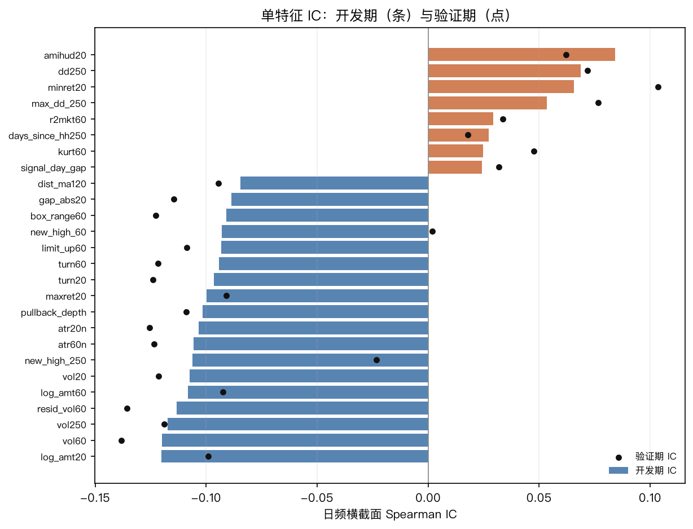
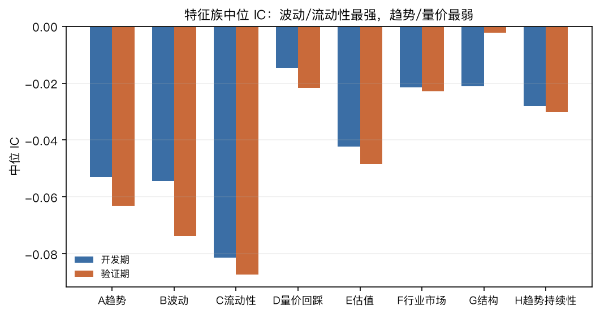
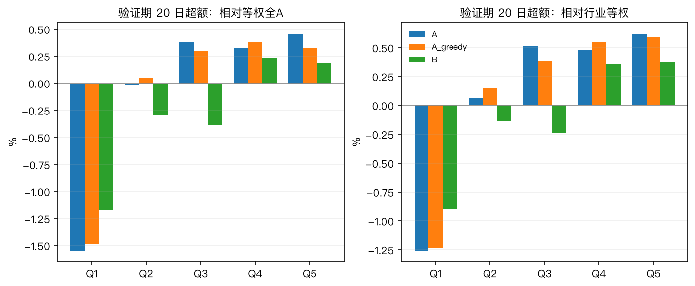
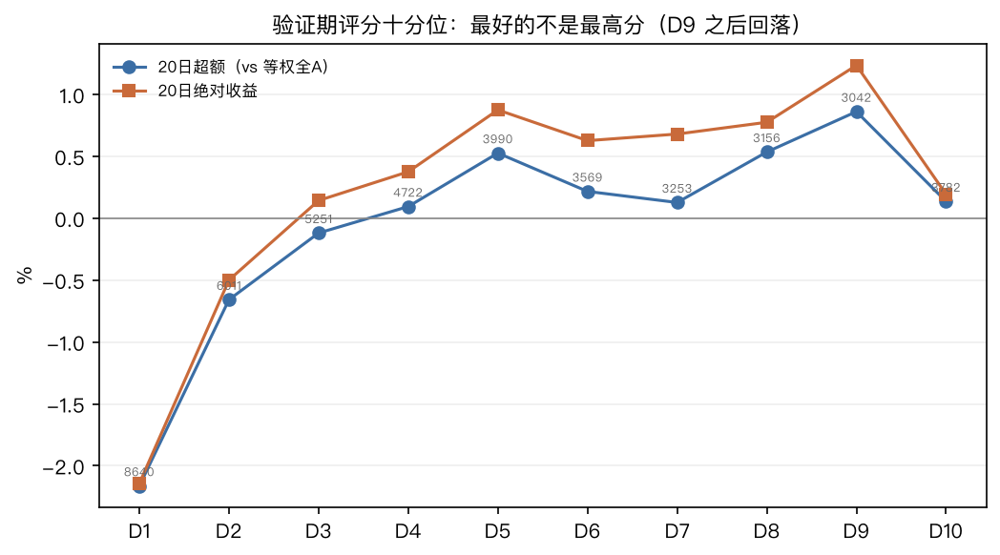
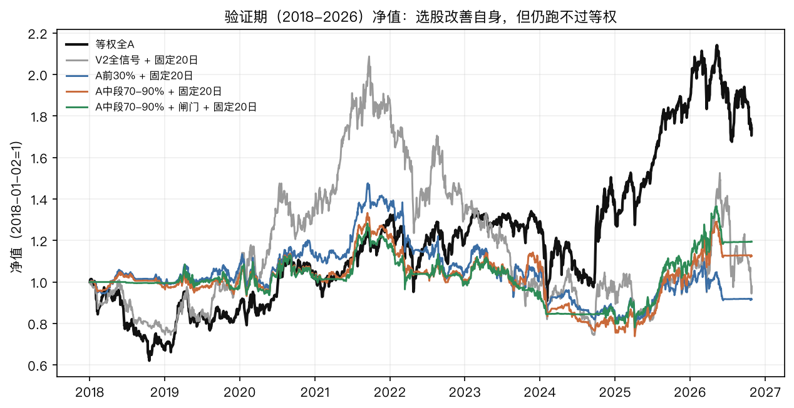
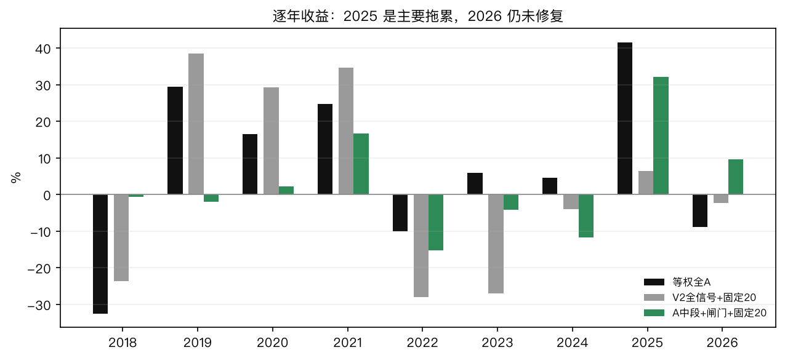
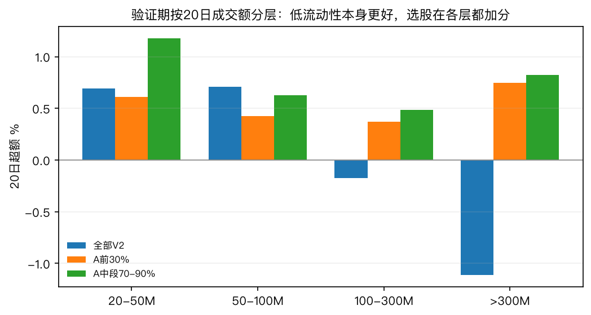

# 看长做短·选股层：哪些股票适合这套买点

> 独立检验，2012-01-01 至 2026-10-28。
> 买点固定为上一轮的 V2 机械代理，不再改买点；本轮只加“信号日可观测的股票特征”。
> 开发期 2012-2017 定方向、定阈值；验证期 2018-2026 只检验。
> 数据：baostock 原始行情 + frozen 时点市值/估值/板块 + 申万一级时点行业。没有引用项目里已有回测的收益或因子结论。

## 结论先行

1. **“适合这套买点”的股票画像很明确：安静、低波动、低换手、低关注、浅回踩、不延展、估值不贵、跑输行业。**  
   不是图上说的“越强越好”。在 V2 已经筛过强趋势之后，趋势更陡、均线更漂亮、回踩缩量更明显的股票，后续 20 日并没有更好；反而更差或没有区别。

2. **评分排序在验证期很强，但绝对收益很弱。**  
   主评分 A 的日频横截面 IC：开发期 0.123（t 11.1），验证期 0.131（t 16.4）；行业中性后 0.133（t 17.5）。  
   验证期 Q5-Q1 的 20 日超额：+2.00 个百分点（t 5.64）；行业中性后 +1.88 个百分点。  
   但 Q5 本身的 20 日超额只有 +0.46%，中位仍是 -1.03%，胜率 44.1%，按日聚类的 t 只有 1.80。

3. **前 30% 的绝对超额没有达到预注册的 t≥2。**  
   验证期前 30% 的 20 日超额 +0.48%，t 1.52；行业中性 +0.65%。  
   四条信号层判据过了三条（均值>0、比全信号高>0.5pp、行业中性>0），**t≥2 这一条没过**，所以只能写“证据不足/探索性”，不能写“通过预注册验证”。

4. **组合层：主口径相对改善，但绝对仍亏；最好的探索性口径也跑不过等权。**  
   - 预注册主口径（A 前30% + 原规则卖出 + 不加闸门）：验证期 CAGR **-5.66%**，最大回撤 -55.1%；同期 V2 全信号原规则 **-15.46%**、回撤 -82.4%。相对改善很大，但绝对仍亏。  
   - 探索性口径（A 中段 70-90% + 市场闸门 + 固定持有 20 日）：验证期 CAGR **+2.12%**，最大回撤 -39.1%；同期等权全 A **+6.74%**、回撤 -38.8%。收益低 4.6 个百分点，回撤差不多。  
   - 换句话说：**选股层能把原策略从“大亏”拉到“小亏/小赚”，但没有创造跑赢等权的 alpha。**

5. **最高分不是最好的，最好的是 70-90% 中段。**  
   验证期评分十分位：D9 的 20 日超额 +0.86%，D10 只有 +0.14%；D1 为 -2.16%。  
   10 槽组合只吃到前 30% 信号的约 4.6%，且按分数从高到低填槽，正好优先填进 D10 尾部。这是“信号层有效、组合层不赚钱”的主要原因之一。

6. **图上几句核心话，数据只支持一半。**  
   - 支持：回踩要浅、波动要低、不要追高、市场不好要等待。  
   - 不支持：均线越多头越好、趋势越强越好、上涨放量/下跌缩量、行业越强越好。  
   - 数据里真正稳定的是“低波动 + 低换手/低成交额 + 浅回踩 + 不延展 + 估值不贵 + 相对行业跑输”。

**一句话：**  
选股层可以作为这套买点的**风险控制/排序层**，不能作为**跑赢等权的选股系统**。如果目标是 alpha，应该换买点，而不是继续在选股上雕花。

---

## 1. 数据与样本

| 项目 | 结果 |
|---|---:|
| baostock 日线（后复权 + 不复权） | 14,977,563 行，5,505 只 |
| frozen 时点表（市值/估值/板块/涨跌停） | 5,549 只，2012 年后 1,359 万行 |
| 申万一级时点行业 | 11,174 条，5,561 只，32 个行业组 |
| 候选信号行（V2 条件前的日线候选） | 403,546 行 |
| V2 信号（可交易 + 20 日去重） | 67,582 条 |
| 开发期 2012-2017 | 22,166 条 |
| 验证期 2018-2026 | 45,416 条 |
| 特征数 | 118 个（8 族） |
| 行业缺失 | 3.2% |
| 行业 20 日远期收益缺失 | 4.0%（主要是最后 20 个交易日和行业缺口） |
| 市值/估值/板块缺失 | 约 0.05%，集中在 2026-10-27（frozen 只到 10-26） |

**审计说明**

- 所有价格特征用后复权；涨跌停、2 元过滤、成交额用不复权。
- 估值、市值、板块来自 frozen 时点表；行业分类来自申万时点表。
- 行业收益用**同一时点行业成员等权**计算，不拼接行业指数版本。
- 2026-10-27 的最新信号：frozen 市值/估值/板块只到 10-26，当前名单里这三项用 10-26 最近值回填，仅用于展示；评分中的估值项在 10-27 缺失，按开发期均值（0）处理，**当前评分是暂定值**。
- ST 用当日 `is_st`，不用当前名称回填；退市股保留到最后交易日；停牌/涨跌停按规则处理。

---

## 2. 全特征分析：什么有用，什么没用

### 2.1 单特征 IC 前 22 名（开发期排序）

单位：IC 为相关系数×100；q5q1 为最高组减最低组的 20 日超额，百分点。**所有 IC 都是 V2 信号内部的横截面排序，不是在全 A 上选股。**

| 特征 | 族 | 开发 IC | 开发 t | 方向稳定年 | 验证 IC | 验证 t | 验证行业中性 IC | 开发 q5q1 | 验证 q5q1 | 验证行业中性 q5q1 |
|---|---|---:|---:|---:|---:|---:|---:|---:|---:|---:|
| log_amt20 | C流动性 | -12.00 | -10.7 | 6/6 | -9.91 | -13.1 | -8.86 | -3.70 | -1.82 | -1.63 |
| vol60 | B波动 | -12.00 | -10.7 | 6/6 | -13.82 | -16.7 | -14.63 | -3.38 | -1.75 | -1.78 |
| vol250 | B波动 | -11.72 | -10.8 | 6/6 | -11.89 | -14.5 | -13.28 | -2.46 | -1.06 | -1.34 |
| resid_vol60 | B波动 | -11.34 | -10.3 | 6/6 | -13.56 | -16.8 | -14.17 | -3.08 | -1.80 | -1.82 |
| log_amt60 | C流动性 | -10.83 | -9.6 | 5/6 | -9.25 | -12.1 | -8.38 | -3.49 | -1.83 | -1.72 |
| vol20 | B波动 | -10.74 | -9.8 | 6/6 | -12.14 | -15.1 | -12.64 | -2.77 | -1.91 | -1.83 |
| new_high_250 | A趋势 | -10.62 | -2.3 | 2/6 | -2.32 | -0.6 | -4.01 | — | — | — |
| atr60n | B波动 | -10.56 | -9.6 | 6/6 | -12.35 | -15.2 | -13.28 | -2.92 | -1.67 | -1.60 |
| atr20n | B波动 | -10.33 | -9.3 | 6/6 | -12.55 | -15.3 | -12.74 | -2.47 | -1.99 | -1.76 |
| pullback_depth | D量价回踩 | -10.17 | -9.3 | 6/6 | -10.90 | -14.4 | -10.85 | -2.62 | -1.81 | -1.57 |
| maxret20 | B波动 | -9.98 | -9.5 | 6/6 | -9.10 | -12.0 | -9.86 | -2.61 | -1.54 | -1.55 |
| turn20 | C流动性 | -9.65 | -8.6 | 6/6 | -12.40 | -15.3 | -13.12 | -2.64 | -2.08 | -1.93 |
| turn60 | C流动性 | -9.41 | -8.5 | 6/6 | -12.17 | -15.0 | -13.37 | -2.48 | -2.07 | -2.03 |
| limit_up60 | B波动 | -9.31 | -8.4 | 6/6 | -10.86 | -14.5 | -11.17 | -1.93 | -2.56 | -2.30 |
| new_high_60 | A趋势 | -9.29 | -1.8 | 3/6 | +0.19 | +0.1 | +0.38 | — | — | — |
| box_range60 | A趋势 | -9.08 | -8.2 | 6/6 | -12.27 | -15.9 | -12.56 | -2.40 | -2.06 | -1.90 |
| gap_abs20 | B波动 | -8.86 | -8.2 | 6/6 | -11.45 | -14.5 | -11.28 | -2.63 | -1.56 | -1.52 |
| dist_ma120 | A趋势 | -8.46 | -7.9 | 6/6 | -9.46 | -12.0 | -9.39 | -2.06 | -1.54 | -1.55 |
| amt_pct250 | C流动性 | -8.44 | -7.7 | 6/6 | -10.05 | -12.8 | -9.80 | -2.31 | -2.45 | -1.98 |
| amihud20 | C流动性 | +8.42 | +7.4 | 5/6 | +6.20 | +8.2 | +4.75 | +2.95 | +1.82 | +1.49 |
| dist_ma250 | A趋势 | -8.27 | -7.7 | 6/6 | -9.26 | -11.7 | -9.54 | -2.39 | -1.57 | -1.65 |
| turn_pct250 | C流动性 | -8.13 | -7.6 | 5/6 | -8.64 | -11.1 | -8.26 | -1.76 | -2.19 | -1.69 |

> 注：`new_high_250`、`new_high_60` 是 0/1 变量，q5q1 不适用；“开发 t”小是因为按日聚类的 IC 波动大，不是样本少。



### 2.2 特征族汇总

| 族 | 特征数 | FDR 通过 | 开发期中位 IC | 验证期中位 IC | 最强特征 | 最强 IC |
|---|---:|---:|---:|---:|---|---:|
| A 趋势 | 34 | 28 | -5.31 | -6.32 | new_high_250 | -10.62 |
| B 波动 | 23 | 22 | -5.44 | -7.37 | vol60 | -12.00 |
| C 流动性 | 11 | 10 | -8.13 | -8.72 | log_amt20 | -12.00 |
| D 量价回踩 | 20 | 10 | -1.47 | -2.16 | pullback_depth | -10.17 |
| E 估值 | 5 | 4 | -4.24 | -4.84 | pb_med_ratio250 | -6.55 |
| F 行业市场 | 16 | 5 | -2.15 | -2.29 | stock_ind_ex60 | -6.44 |
| G 结构 | 4 | 2 | -2.10 | -0.23 | board_gem | +2.15 |
| H 趋势持续性 | 5 | 3 | -2.81 | -3.03 | hurst5 | -4.00 |



### 2.3 逐族解读

**A. 趋势：不是“越强越好”，而是“别太延展”**

- 有效且稳定：`dist_ma120`（-8.46/-9.46）、`dist_ma250`（-8.27/-9.26）、`ret120`（-7.94/-7.88）、`prior_runup60`（-7.50/-10.26）、`ma60_slope20`（-7.31/-7.66）、`ma120_slope20`（-7.19/-8.05）、`box_range60`（-9.08/-12.27）。
- 含义：在 V2 已经满足“收盘>MA20>MA60、MA60上升”之后，**离 MA120/MA250 越远、过去 60 日涨得越多、均线斜率越陡、60 日箱体越宽，后续 20 日越差**。买回踩也要避开“已经涨透”的。
- `trend_r2_120` 开发 -4.89、验证 -1.56；`price_efficiency60` 开发 -3.02、验证 -4.63；`ma_alignment` 开发 -1.64、验证 -1.54（不显著）。**趋势平滑度、均线多头排列没有加分，反而略减分。**
- `new_high_250` 开发 -10.62 但只有 2/6 年方向稳定，验证 -2.32；`new_high_60` 验证直接翻正。**“创新高”不是稳定特征，不能用。**
- `up_ratio20/60` 接近 0；上涨日占比没有信息。

**B. 波动与尾部：低波动、低 beta、少涨停、少跳空，稳定加分**

- `vol60`（-12.00/-13.82）、`vol20`（-10.74/-12.14）、`vol250`（-11.72/-11.89）、`resid_vol60`（-11.34/-13.56）、`atr20n`（-10.33/-12.55）、`atr60n`（-10.56/-12.35）全部稳定为负。
- `beta60`（-4.50/-6.15）、`beta250`（-6.22/-6.54）：低 beta 更好。
- `maxret20`（-9.98/-9.10）：过去 20 日最大单日涨幅越大，后续越差（彩票效应）。
- `minret20`（+6.57/+10.37）：最差单日跌幅越小（越不惨）越好；与低波动同向。
- `limit_up20/60`（-7.92/-8.19、-9.31/-10.86）、`gap_abs20`（-8.86/-11.45）：涨停/跳空越多越差。
- `max_dd_250`（+5.36/+7.65）、`dd250`（+6.88/+7.17）：250 日回撤越小（越接近高点）越好；与“别太延展”是两回事，前者是风险，后者是位置。
- `skew60`、`kurt60`、`vol_of_vol60`、`ulcer250` 较弱或不稳定。

**C. 流动性/规模：不是小市值，是低换手/低成交/低关注**

- `log_amt20`（-12.00/-9.91）、`log_amt60`（-10.83/-9.25）、`turn20`（-9.65/-12.40）、`turn60`（-9.41/-12.17）、`turn_pct250`（-8.13/-8.64）、`amt_pct250`（-8.44/-10.05）、`vol_pct250`（-7.76/-8.72）稳定为负。
- `amihud20`（+8.42/+6.20）稳定为正：越不流动（单位成交额的价格冲击越大）越好。
- **`log_mcap` 只有 -0.90/+0.16，t -0.79/+0.20，完全不显著。** 所以这不是“小市值因子”，而是**换手/成交额/关注度**因子。流通市值本身不预测。
- 这对执行很重要：有效的是“成交不拥挤”，不是“市值小”。但成交额低也意味着容量有限（见第 5 节）。

**D. 量价与回踩：浅回踩有效，缩量回踩无效**

- `pullback_depth`（-10.17/-10.90）、`box_range60`（-9.08/-12.27）、`pullback_depth_atr`（-3.79/-3.78）：回踩越浅、箱体越窄越好。
- `hh20_ratio`（-7.35/-8.17）：离 20 日高点越近越好。
- `body`（-4.96/-8.05）、`signal_day_ret`（-4.02/-6.32）、`lower_shadow`（-4.00/-4.31）、`close_loc`（-2.31/-0.33）：信号日阳线实体越小、当日涨幅越小、下影线越长，后续反而略好或更差；这不是“越强势越好”。
- **`pullback_vol_ratio`（-0.55/-1.68，不显著）、`vol_ratio5_20`（+0.12/-0.42）、`vol_ratio20_60`（-2.63/-2.70）、`updown_vol20`（-0.12/-1.22）、`updown_vol60`（-2.69/-3.30）、`obv_slope20`（+0.21/-1.51）全部很弱。** 图上说的“上涨放量、下跌缩量”在这批信号里没有稳定预测力。
- `ma20_touch_count10`（+1.14/+0.87）、`vwap20_dev`（-1.62/-0.55）也不显著。

**E. 估值：相对自己的历史便宜，比绝对 PE 更有效**

- `pb_med_ratio250`（-6.55/-9.32）、`pe_med_ratio250`（-4.24/-4.77）：当前 PB/PE 相对过去 250 日中位数越低，后续越好。
- `log_pb`（-4.83/-5.38）、`log_pe`（-3.65/-2.39）同向但更弱。
- `pe_neg` 开发 -0.51、验证 -4.84，不稳定；亏损股不是稳定加分项。

**F. 行业与市场：行业动量弱，个股相对行业“跑输”反而好**

- `stock_ind_ex60`（-6.44/-7.02）、`stock_ind_ex20`（-2.87/-2.29）：过去 60/20 日相对行业越弱，后续越好。这是**行业内 reversal**，不是“买行业龙头”。
- `ind_ret120`（-4.05/-3.18）、`ind_vol20`（-3.68/-4.49）：行业过去 120 日越强、行业波动越大，反而略差。
- `ind_ret20`、`ind_mom_rank`、`ind_ex_ew20` 开发 +1.72、验证 -1.42，方向翻转，不能用。
- `ind_breadth20` 接近 0。
- 市场层：`mkt_gate`（等权全 A>MA200）对组合回撤有用，但它是**仓位开关**，不是选股特征；作为特征时没有横截面变化，无法计算 IC。

**G. 结构：板块和年龄基本没用**

- `board_main` 开发 -2.15、验证 +2.62；`board_gem` 开发 +2.15、验证 -2.66；方向翻转。
- `age_years` 开发 -2.10、验证 -0.37，t -0.50。
- 科创板样本少（2019 年后），不单独下结论。

**H. 趋势持续性：这只股“爱不爱走趋势”没有帮助**

- `vr5`/`hurst5` 开发 -4.00、验证 -3.03；`vr20`/`hurst20` 开发 -1.39、验证 -2.53；`autocorr60` 开发 -2.81、验证 -4.17。
- 方向都是“趋势延续性越强，后续略差”，与“买趋势股”的直觉相反。幅度不大，但稳定为负。

### 2.4 图上说法与数据对照

| 图上说法 | 数据结论 | 证据 |
|---|---|---|
| 月线/周线/日线三层趋势 | 过滤加 beta，不加 alpha（上一轮结论） | V2 相对全 A 的 20 日超额仍为负；三层全开没有改善 |
| 上涨放量、下跌缩量 | **不支持** | 缩量回踩 `pullback_vol_ratio` IC -0.55/-1.68，t 不显著；量比、OBV 也很弱 |
| 均线多头排列 | **不支持** | `ma_alignment` IC -1.64/-1.54，不显著；越完整略差 |
| 趋势越强/越陡越好 | **反向** | `ret120` -7.94/-7.88、`dist_ma120` -8.46/-9.46、`ma120_slope20` -7.19/-8.05 |
| 回踩要浅 | **支持** | `pullback_depth` -10.17/-10.90；`pullback_depth_atr` -3.79/-3.78 |
| 波动要低 | **支持** | `vol60` -12.00/-13.82；ATR、beta 同向 |
| 换手/成交要低 | **支持** | `turn20` -9.65/-12.40；`log_amt20` -12.00/-9.91 |
| 估值要便宜 | **支持（相对自身历史）** | `pb_med_ratio250` -6.55/-9.32 |
| 行业要强 | **反向/不稳定** | `stock_ind_ex60` -6.44/-7.02；`ind_ret20` 开发正、验证负 |
| 市场不好要等待 | **支持（回撤控制）** | 闸门把组合回撤从 -64% 降到 -39%；但不创造 alpha |

---

## 3. 选股评分

### 3.1 主评分 A（预注册 family-balanced，去冗余后 5 条）

开发期每个特征族取 |IC| 最大的一条，要求 |IC_dev|≥0.05、BH q<0.10、方向稳定≥4/6 年；跨族相关性≥0.70 的只留 |IC| 高者。最终 5 条：

| 特征 | 族 | 方向 | 开发 IC | 验证 IC | 解释 |
|---|---|---:|---:|---:|---|
| log_amt20 | C流动性 | − | -12.00 | -9.91 | 20 日成交额越低越好 |
| vol60 | B波动 | − | -12.00 | -13.82 | 60 日波动越低越好 |
| pullback_depth | D量价回踩 | − | -10.17 | -10.90 | 20 日回踩越浅越好 |
| pb_med_ratio250 | E估值 | − | -6.55 | -9.32 | 相对自身 250 日 PB 越便宜越好 |
| stock_ind_ex60 | F行业市场 | − | -6.44 | -7.02 | 过去 60 日相对行业越弱越好 |

评分：

```
z_i = (clip(x_i, dev 1%/99%) - dev_mean_i) / dev_std_i
score_A = mean( -z(log_amt20), -z(vol60), -z(pullback_depth),
                -z(pb_med_ratio250), -z(stock_ind_ex60) )
```

分数越高 = 成交越低、波动越低、回踩越浅、估值相对越便宜、相对行业越弱。

> `dist_ma120`、`box_range60`、`turn20` 等也很强，但与已选特征相关性≥0.70，被去冗余规则挡掉；这是为了避免同一因子重复加权。

### 3.2 敏感性评分

- **A-greedy（8 条）**：log_amt20、vol60、vol250、pullback_depth、turn20、dist_ma120、ex_ew120、stock_ind_ex60，全部负向。验证期前 30% 超额 +0.35%，t 1.30；Q5-Q1 +1.81pp，t 5.72。
- **B（理论 8 条）**：trend_r2_120 +、ma_alignment +、vol60 −、pullback_depth_atr −、pullback_vol_ratio −、ind_ex_ew20 +、log_amt20 +、dist_ma60 −。验证期前 30% 超额 +0.32%，按日聚类 t 为负（日间不稳定）；Q5-Q1 +1.36pp，t 4.50。  
  B 失败的原因是三条理论方向与数据相反：低成交额、低趋势平滑度、行业强势都不加分，缩量回踩几乎为 0。这反过来说明：**图上作者的“强趋势+缩量回踩”审美，不是这批信号里有效的选股方向。**

### 3.3 评分验证

**IC**

> 以下 IC 同样是 V2 信号内部的横截面排序；它回答“同一批买点里谁更好”，不回答“全市场谁更好”。

| 评分 | 开发 IC | 开发 t | 验证 IC | 验证 t | 验证行业中性 IC | 验证行业中性 t |
|---|---:|---:|---:|---:|---:|---:|
| A | 0.12297 | 11.07 | 0.13073 | 16.42 | 0.13287 | 17.53 |
| A-greedy | 0.12923 | 11.64 | 0.13961 | 17.10 | 0.14413 | 18.77 |
| B | 0.01454 | 1.37 | 0.05040 | 6.65 | 0.06612 | 9.20 |

**验证期五分组（20 日，%）**

| 组 | n | 相对等权 | 中位 | 胜率 | t | 相对行业 | 绝对收益 | MAE | MFE |
|---|---:|---:|---:|---:|---:|---:|---:|---:|---:|
| Q1 | 14,651 | -1.545 | -5.195 | 35.98% | -7.30 | -1.256 | -1.468 | -13.70 | 16.21 |
| Q2 | 9,973 | -0.018 | -2.777 | 40.43% | -2.02 | +0.063 | +0.254 | -10.41 | 13.55 |
| Q3 | 7,559 | +0.381 | -2.059 | 41.97% | +0.42 | +0.511 | +0.759 | -9.03 | 12.22 |
| Q4 | 6,409 | +0.329 | -1.583 | 42.87% | -0.34 | +0.484 | +0.728 | -7.97 | 10.66 |
| Q5 | 6,824 | +0.459 | -1.033 | 44.12% | +1.80 | +0.621 | +0.658 | -7.23 | 9.47 |
| **Q5-Q1** | 1,199 天 | **+2.004** | — | — | **5.64** | **+1.878** | — | — | — |



**前 30%/10%（验证期）**

| 组 | n | 相对等权 | 中位 | 胜率 | t | 相对行业 | 绝对收益 | MAE | MFE |
|---|---:|---:|---:|---:|---:|---:|---:|---:|---:|
| 前50% | 16,802 | +0.358 | -1.452 | 42.96% | -0.47 | +0.526 | +0.678 | -7.86 | 10.42 |
| 前30% | 9,980 | +0.483 | -1.139 | 44.04% | **1.52** | +0.652 | +0.695 | -7.42 | 9.74 |
| 前10% | 3,782 | +0.136 | -1.212 | 42.31% | 1.67 | +0.413 | +0.194 | -7.21 | 8.84 |

**十分位（验证期，%）**

| D1 | D2 | D3 | D4 | D5 | D6 | D7 | D8 | D9 | D10 |
|---:|---:|---:|---:|---:|---:|---:|---:|---:|---:|
| -2.16 | -0.66 | -0.12 | +0.09 | +0.53 | +0.22 | +0.13 | +0.54 | **+0.86** | +0.14 |



> 最高分 D10 反而回落。D9 的绝对收益 +1.24%，D10 只有 +0.19%。这不是随机噪声：D10 的平均成交额更低、估值更极端，容量和拥挤度都更差。

**逐年（前 30% 相对等权，%）**

| 年 | 全信号 | 前30% | 中段70-90% | 前30%胜率 |
|---|---:|---:|---:|---:|
| 2012 | -0.01 | +1.23 | +1.69 | 49.1% |
| 2013 | +0.53 | +1.58 | +1.52 | 50.2% |
| 2014 | -0.78 | +0.50 | +0.21 | 44.5% |
| 2015 | -1.56 | -1.00 | -1.09 | 39.4% |
| 2016 | -0.75 | +1.28 | +0.79 | 49.7% |
| 2017 | +1.20 | +2.17 | +2.11 | 55.4% |
| 2018 | -0.50 | +2.92 | +3.17 | 65.1% |
| 2019 | +0.24 | +1.12 | +0.78 | 48.9% |
| 2020 | +0.75 | +1.26 | +0.96 | 44.2% |
| 2021 | -0.95 | +0.67 | +1.47 | 44.3% |
| 2022 | -1.29 | +0.46 | -0.21 | 45.1% |
| 2023 | -0.83 | +0.95 | +0.40 | 49.0% |
| 2024 | -0.62 | +2.10 | +2.82 | 57.7% |
| 2025 | -0.44 | -0.42 | +0.19 | 37.3% |
| 2026 | +0.32 | +0.12 | +0.41 | 40.4% |

- 前30% 在 15 年里 13 年正超额，只有 2015、2025 为负。
- 中段 70-90% 也 13 年正，2015、2022 为负。
- 2025 是主要失效年：小盘/题材行情，低波动安静股跑输；2026 也没有明显修复。

---

## 4. 组合验证

### 4.1 口径

- 10 槽等权，单票 10%，不加杠杆；现金收益 0。
- 次日开盘买；跌停/停牌顺延；退市按最后收盘价退出；往返成本 0.20%。
- 选股在 20 日去重之前作用；去重在选股后的集合内做。
- 主口径：A 前30% + 原规则卖出（收盘<MA20 / -8% / 20 日）+ 不加闸门。
- 次口径：固定持有 20 日；A 中段 70-90%；市场闸门（等权全 A>MA200）。

### 4.2 验证期（2018-2026）

| 配置 | CAGR | 最大回撤 | Sharpe | 交易数 | 胜率 | 平均每笔 | 相对等权 |
|---|---:|---:|---:|---:|---:|---:|---:|
| 等权全 A | +6.74% | -38.80% | 0.39 | — | — | — | — |
| V2 全信号 + 原规则 | -15.46% | -82.39% | -0.56 | 2,034 | 22.6% | -0.67% | -22.20 |
| V2 全信号 + 固定20 | -0.24% | -64.32% | 0.13 | 843 | 43.9% | +0.51% | -6.98 |
| **A 前30% + 原规则（主口径）** | **-5.66%** | **-55.12%** | **-0.42** | 944 | 22.7% | -0.53% | -12.40 |
| A 前30% + 固定20 | -1.03% | -47.78% | 0.02 | 558 | 46.8% | -0.08% | -7.77 |
| A 前30% + 闸门 + 固定20 | +0.18% | -42.07% | 0.09 | 454 | 47.1% | +0.09% | -6.56 |
| A 中段70-90% + 固定20 | +1.40% | -44.61% | 0.17 | 526 | 46.0% | +0.31% | -5.34 |
| **A 中段70-90% + 闸门 + 固定20** | **+2.12%** | **-39.10%** | **0.22** | 427 | 45.4% | +0.44% | **-4.62** |
| A-greedy 前30% + 固定20 | +1.14% | -43.26% | 0.15 | 541 | 47.0% | +0.37% | -5.60 |
| B 前30% + 固定20 | -6.85% | -74.14% | -0.18 | 717 | 42.4% | -0.56% | -13.59 |
| A 排序（不过滤，分数优先填槽） + 固定20 | -0.97% | -61.14% | 0.09 | 846 | 43.6% | +0.30% | -7.71 |



**预注册判据核对**

- 信号层：
  1. 前30% 验证期 `ex20` >0：**过**（+0.483%）。
  2. 比全信号高≥0.50pp：**过**（+0.483 - (-0.323) = +0.806pp）。
  3. 按日聚类 t≥2：**不过**（1.52）。
  4. 行业中性 `ex_ind20` >0：**过**（+0.652%）。
  → 3/4，**信号层不通过**。

- 组合层（主口径 A 前30% + 原规则）：
  1. 验证期 CAGR 比全信号同卖点高≥3pp：**过**（-5.66% vs -15.46%，+9.80pp）。
  2. 最大回撤不差超过5pp：**过**（-55.12% vs -82.39%）。
  3. 评分五分组 Q5-Q1>0 且单调性至少3/4段：**过**（Q5-Q1 +2.00pp，t 5.64；Q1<Q2<Q3、Q4<Q5）。
  → 3/3，但**组合绝对收益仍为负**。

**总判据：信号层未过，组合层主口径过但绝对为负；整体不能写“通过预注册验证”。**

### 4.3 开发期与全期（解释为什么全期好看）

| 配置 | 开发期 CAGR | 开发期回撤 | 验证期 CAGR | 验证期回撤 | 全期 CAGR | 全期回撤 |
|---|---:|---:|---:|---:|---:|---:|
| 等权全 A | +23.4% | — | +6.74% | -38.80% | +13.27% | -62.73% |
| V2 全信号 + 固定20 | -4.44% | -69.78% | -0.24% | -64.32% | -1.92% | -76.97% |
| A 前30% + 固定20 | +21.62% | -20.75% | -1.03% | -47.78% | +7.63% | -47.78% |
| A 中段+闸门 + 固定20 | +17.10% | -21.59% | +2.12% | -39.10% | +7.94% | -39.10% |
| A-greedy 前30% + 固定20 | +21.05% | -21.62% | +1.14% | -43.26% | +8.80% | -43.26% |



- 全期 +7~9% 的选股组合，主要来自 2012-2017 的 +17~22%；验证期只有 -1~+2%。
- 开发期 A 前30% 的 +21.6% 也没有跑赢等权 +23.4%；它只是“在牛市里跟得上、回撤小”。
- 所以：**选股层的全期收益是开发期贡献的，不能当作可复现的预期。**

### 4.4 为什么“信号层有效、组合层不赚钱”

以 A 前30% + 固定20 为例：

- 全期 20,175 条前30%信号，只成交 898 笔，成交率 **4.45%**；验证期 11,951 条去重信号，成交 554 笔，约 **4.6%**。
- 注意两个样本口径不同：信号层的 9,980 条是“先全体去重、再取前30%”；组合层的 11,951 条是“先取前30%、再去重”。后者会纳入“波段第一个信号不在前30%、但后续信号在前30%”的样本，质量更杂：这 11,951 条的 20 日超额是 +0.416%（t 1.04），低于 9,980 条的 +0.483%（t 1.52）。这是组合层衰减的一部分。
- 成交的 554 笔，验证期平均 `r20` +0.226%；而前30%信号整体的平均 `r20` 是 +0.695%。**不是成交价问题，是“被吃到的这批信号本身更差”。**
- 成交的股票分数中位数在开发期分布的第 **82.3** 百分位；31% 落在 90 百分位以上（D10）。10 槽组合按分数从高到低填槽，优先填进了 D10 尾部。
- D9 的 20 日绝对收益 +1.24%，D10 只有 +0.19%；填槽规则把最差的高分尾部放大了。
- 成交股票的中位成交额 0.51 亿元、中位流通市值 29 亿元、中位 60 日波动 34.9%；不是极端微盘，但容量有限。

**结论：**  
不是“分数没用”，是“分数有用 + 10 槽容量太小 + 填槽规则偏向最高分尾部”。三者叠加，把信号层的 +0.48% 超额磨成了组合层的 -1%。

### 4.5 流动性分层

验证期按 20 日成交额分层（20 日超额，%）：

| 成交额 | 全部 V2 | A 前30% | A 中段70-90% |
|---|---:|---:|---:|
| 20-50M | +0.69 | +0.61 | **+1.18** |
| 50-100M | +0.71 | +0.42 | +0.63 |
| 100-300M | -0.18 | +0.37 | +0.49 |
| >300M | -1.11 | +0.75 | +0.82 |



- 低流动性本身就跑赢；高流动性里，选股能把负超额拉正。
- 选股在各层都加分，但**低流动性层的 baseline 已经很好**，选股增量最大的是高流动性层。
- 对容量来说，50-100M 是更现实的起点；20-50M 只适合小资金。

### 4.6 行业、板块、市场状态（验证期描述）

**行业（全部 V2，20 日超额，%）**

| 靠前 | 超额 | n | 靠后 | 超额 | n |
|---|---:|---:|---|---:|---:|
| 采掘 | +2.62 | 185 | 非银金融 | -2.32 | 714 |
| 有色金属 | +1.30 | 1,500 | 传媒 | -2.31 | 1,130 |
| 电子 | +0.80 | 4,341 | 房地产 | -1.88 | 738 |
| 建筑材料 | +0.56 | 707 | 农林牧渔 | -1.72 | 850 |
| 电力设备 | +0.48 | 3,029 | 计算机 | -1.56 | 2,763 |

行业差异存在，但行业动量本身 IC 很弱且验证期翻向；不建议做行业轮动，只作为描述。

**板块（验证期，%）**

| 板块 | 全部 | 前30% | 中段70-90% | n |
|---|---:|---:|---:|---:|
| 主板 | -0.43 | +0.45 | +0.57 | 30,630 |
| 创业板 | -0.31 | +0.46 | +0.97 | 11,447 |
| 科创板 | +0.61 | +1.05 | +1.52 | 3,334 |

**市场状态（验证期，%）**

| 状态 | 全部 | 前30% | 中段70-90% | n |
|---|---:|---:|---:|---:|
| 闸门开（EW>MA200） | -0.06 | +0.50 | +0.63 | 38,458 |
| 闸门关 | -1.78 | +0.36 | +1.03 | 6,958 |

闸门关时，全部 V2 明显更差，但选股中段反而更好；这说明“弱市里选安静股”有防守价值，但不改变绝对收益为负的事实。

---

## 5. 选股策略（可执行规则与证据等级）

### 5.1 硬门槛（先筛掉不能碰的）

1. 必须是 V2 买点：月线/周线/日线三层条件 + 回踩 + 收复 MA5。
2. 信号日 `is_st=0`；上市满 250 个交易日；不复权收盘≥2 元。
3. 20 日成交额 ≥ **5,000 万元**（基础口径 2,000 万；5,000 万是容量下限，不是收益优化）。
4. 次日开盘涨停/停牌/开盘高于信号收盘 5% 的不买。
5. 组合最多 10 只，单票 10%，不加杠杆；现金不做收益。

### 5.2 评分与选择

```
score_A = mean(
  -z(log_amt20),
  -z(vol60),
  -z(pullback_depth),
  -z(pb_med_ratio250),
  -z(stock_ind_ex60)
)
```

- 只用开发期 2012-2017 的均值/标准差/1%-99% 缩尾；验证期不重算。
- 选择 **70-90 百分位中段**：`q70 ≤ score_A < q90`。
- 不选后 50%（Q1-Q2 明显负超额），也不选前 10%（D10 回落、容量差）。
- 同日信号多于空槽时，按分数从高到低填；但只填中段，不填 D10。
- 没有中段信号就空仓等待，不降格买 Q3/Q4。

### 5.3 卖点与仓位

- **固定持有 20 个交易日**（次日开盘卖），不用“收盘<MA20”主卖点；后者在上一轮和本轮都把收益磨掉。
- 市场闸门：等权全 A 收盘 > MA200 才开新仓；关闭时只平不开。
- 单票 10%，最多 10 只；中段信号不足时保留现金。
- 成本按往返 0.20%；低成交额股票实际冲击可能更高，建议按 0.30% 做压力测试。

### 5.4 预期与证据等级

- 验证期（2018-2026）：
  - A 中段 + 闸门 + 固定20：CAGR **+2.12%**，最大回撤 **-39.1%**，Sharpe 0.22。
  - 等权全 A：CAGR **+6.74%**，最大回撤 **-38.8%**，Sharpe 0.39。
  - 原策略全信号 + 固定20：CAGR -0.24%，最大回撤 -64.3%。
- **证据等级：探索性，未通过预注册主检验。**  
  信号层 t=1.52<2；组合层主口径绝对收益为负；中段/闸门/固定20是看结果后补充的口径，不能当作已验证。
- 适用目标：**在必须做这套买点时，用它把亏损和回撤压小**；不适用于“跑赢等权”的目标。
- 容量：成交中位成交额 0.5-0.6 亿元、流通市值 30 亿元；按 0.5% 日成交额参与，单票约 25-30 万元，10 只组合约 250-300 万元；再往上要降容量或提高成交额门槛。
- 监控：每月看一次评分 IC、Q5-Q1、D10 是否继续回落；如果 D10 反转消失，中段规则要重检。

### 5.5 当前观察名单（2026-10-27，非买入建议）

- 最新 V2 信号 12 只，全部主板；市场闸门 **关闭**（等权全 A 与沪深 300 都在 MA200 下方）。
- 估值字段 frozen 只到 2026-10-26；10-27 的 `pb_med_ratio250` 用 10-26 最近值回填后，按同一开发期口径重算分数。
- 回填后落在 70-90% 中段的有 4 只：**华能水电、江苏金租、苏州银行、成都银行**。
- **长沙银行**原始分 0.560（缺失估值按 0）在回填后升到 0.756，进入前 10%，按中段规则**不选**；这正好说明估值项对当前分数很敏感。
- 当前规则动作：**空仓等待**（市场闸门关闭）；名单只用于观察，不是买入建议。

| 代码 | 名称 | 行业 | 分数 | 分位 | 中段 | 20日成交额(亿) | 流通市值(亿) | 60日波动 | 回踩深度 |
|---|---|---|---:|---|---:|---:|---:|---:|---:|
| sh.601577 | 长沙银行 | 银行 | 0.756 | 前10% | 否 | 2.18 | 393 | 20.3% | 4.7% |
| sh.600025 | 华能水电 | 公用事业 | 0.573 | 70-90% | 是 | 3.61 | 1,924 | 18.5% | 4.4% |
| sh.600901 | 江苏金租 | 非银金融 | 0.556 | 70-90% | 是 | 2.36 | 393 | 21.8% | 4.3% |
| sz.002966 | 苏州银行 | 银行 | 0.551 | 70-90% | 是 | 3.43 | 411 | 21.4% | 4.0% |
| sh.601838 | 成都银行 | 银行 | 0.465 | 70-90% | 是 | 4.74 | 826 | 18.6% | 7.2% |
| sh.600919 | 江苏银行 | 银行 | 0.407 | 50-70% | 否 | 12.22 | 2,296 | 18.8% | 4.0% |
| sz.000001 | 平安银行 | 银行 | 0.398 | 50-70% | 否 | 12.81 | 2,261 | 16.8% | 5.5% |
| sh.601998 | 中信银行 | 银行 | 0.382 | 50-70% | 否 | 4.52 | 3,775 | 20.7% | 5.6% |
| sz.001872 | 招商港口 | 交通运输 | 0.359 | 50-70% | 否 | 0.92 | 557 | 29.3% | 10.3% |
| sh.600886 | 国投电力 | 公用事业 | 0.352 | 50-70% | 否 | 4.61 | 1,297 | 19.8% | 3.8% |
| sh.601919 | 中远海控 | 交通运输 | 0.295 | 50-70% | 否 | 11.65 | 2,054 | 24.2% | 4.1% |
| sh.601225 | 陕西煤业 | 煤炭 | 0.123 | 后50% | 否 | 9.84 | 2,579 | 25.3% | 8.4% |

> 当前分数是“10-26 估值回填 + 10-27 行情”的暂定值；不是实盘信号。市场闸门关闭，按规则不新开仓。

---

## 6. 失败解剖：为什么“选股”救不了这套买点

1. **买点本身是负 alpha。**  
   上一轮 V2 全信号 20 日超额 -0.38%，验证期 -0.32%；本轮无论怎么选，前 30% 的 20 日超额只有 +0.48%，t 1.52。选股只能把负的分布往右推一点，不能把买点变成正 alpha。

2. **评分是横截面排序，不是绝对收益预测。**  
   IC 0.131 很强，但 Q5 的中位超额仍是 -1.03%，胜率 44%。IC 高只说明“相对谁更好”，不说明“买了能赚”。

3. **10 槽容量把信号层磨平。**  
   前 30% 有 2 万条信号，组合 15 年只成交 898 笔；验证期成交率约 4.6%。被吃到的样本还偏向 D10 尾部，平均收益反而更低。

4. **固定 20 日比 MA20 卖点好，但仍然不够。**  
   验证期 A 前30% 原规则 -5.66%，固定20 -1.03%；卖点改善 4.6pp，但没有改变“绝对收益接近 0”的事实。上一轮已经证明 MA20 卖点与买点冲突：买点就在 MA20 附近，跌破就卖等于反复止损。

5. **2025 是结构性失效年。**  
   低波动安静股在 2025 小盘/题材行情里跑输；前30% 2025 超额 -0.42%，中段 +0.19%。2026 也没有明显修复。一个只在 2012-2017 有效的选股层，不能当作全天候。

6. **“强趋势+缩量回踩”不是这批信号里的有效方向。**  
   均线排列、趋势 R²、缩量回踩的 IC 都接近 0 或为负；真正有效的是低波动、低换手、浅回踩、不延展。图上作者的审美与数据相反，这是本轮最重要的发现之一。

---

## 7. 限制

- 图上没有通道/趋势线/箱体的唯一画法，本研究仍是机械代理，不代表作者本人的主观画线。
- 行业分类是外部时点元数据，个别变更可能滞后；行业收益用成员等权，不用行业指数。
- 估值/市值/板块来自 frozen，最新一天有滞后；当前名单的估值项是暂定值。
- 成交按次日开盘、0.20% 往返成本；没有逐笔模拟冲击、整手、最低佣金、税费。低成交额股票实际成本更高。
- 退市股保留到最后交易日，但退市/长期停牌的成交价可能不可实现；这会高估收益，不会低估。
- 118 个特征 + 20 多个组合变体，存在多重检验；本轮用开发/验证分段和 BH-FDR 控制，但中段/闸门/固定20是看结果后补充的，不能当作预注册结论。
- 所有结果只适用于这套机械代理，不构成投资建议。

---

## 8. 文件

- 预注册：[00_预注册_选股层.md](00_预注册_选股层.md)
- 单特征汇总：[03_结果/特征_单变量.csv](03_结果/特征_单变量.csv)
- 单特征 IC：[03_结果/特征_IC.csv](03_结果/特征_IC.csv)
- 评分定义：[03_结果/评分_定义.csv](03_结果/评分_定义.csv)
- 评分分位：[03_结果/评分_分位.csv](03_结果/评分_分位.csv)
- 评分 TOP：[03_结果/评分_TOP.csv](03_结果/评分_TOP.csv)
- 组合汇总：[03_结果/组合_选股_汇总.csv](03_结果/组合_选股_汇总.csv)
- 分期指标：[03_结果/组合_选股_分期.csv](03_结果/组合_选股_分期.csv)
- 当前名单：[03_结果/当前观察名单.csv](03_结果/当前观察名单.csv)
- 图表目录：[04_图表](04_图表)

---

### 最终回答

**哪些股票适合这套“看长做短”？**

不是“最强、最陡、均线最漂亮”的股票，而是：

> **处在上升趋势里，但成交不拥挤、波动低、换手低、回踩浅、离长期均线不远、估值相对自己历史不贵、过去 60 日跑输行业的“安静股”。**

**选股规则：**

> 在 V2 买点里，要求 20 日成交额≥5,000 万；计算 5 因子评分 A；只买评分 70-90 百分位中段；固定持有 20 日；等权全 A 在 MA200 上方才开新仓；最多 10 只、单票 10%。

**但要记住：**

> 这条规则在 2018-2026 验证期只有 +2.12% 年化、-39.1% 回撤，跑输等权全 A 的 +6.74%；它没有通过预注册的显著性检验。它的价值是“把原策略的亏损和回撤压小”，不是“帮你跑赢市场”。如果目标是 alpha，应该换买点，而不是继续选股。
