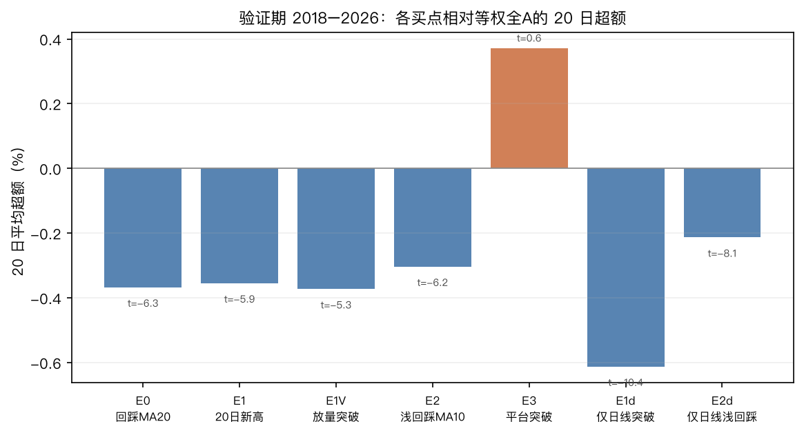
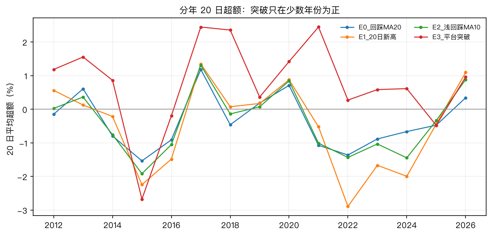
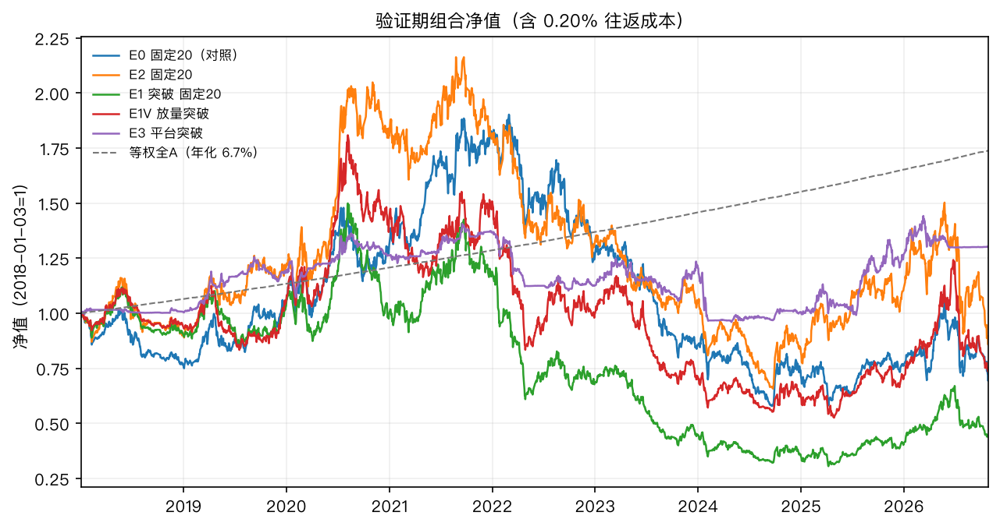
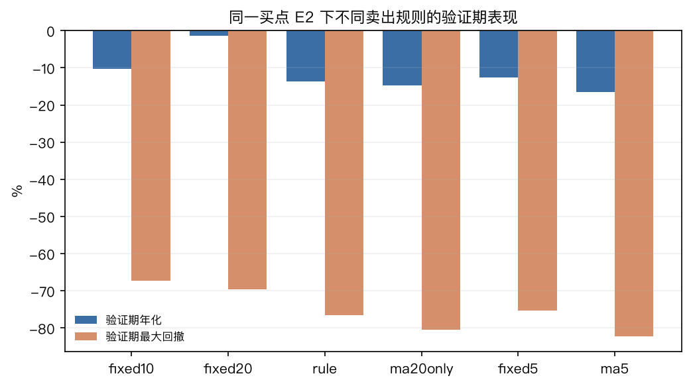
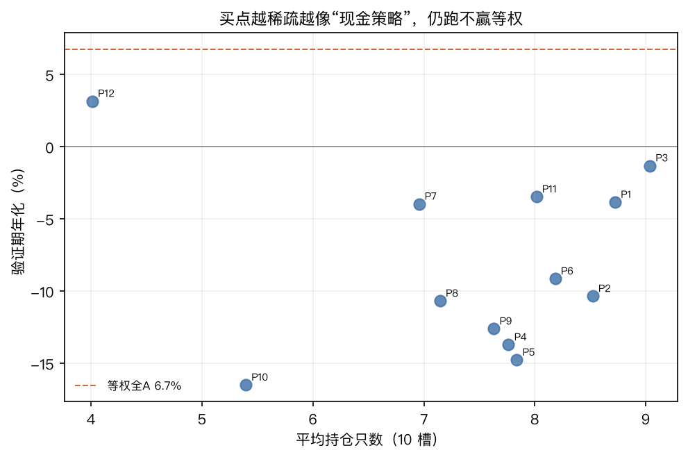

# 只换买点：突破、浅回踩与“跌破5日线就走”的预注册验证

> 冻结时间：2026-10-30，先于本目录任何回测结果。
> 数据：baostock 原始日线（后复权算信号与收益、不复权算涨跌停与 2 元过滤）+ 申万一级时点行业。
> 本轮只改买点与卖出，月线/周线/日线趋势过滤、股票池、执行、成本、10 槽组合全部沿用 V2。
> 规则与判据见 [00_预注册_入场变体.md](00_预注册_入场变体.md)。

## 结论先行

**换买点没有解决问题。**

- 主检验 E2（浅回踩 MA10、收复 MA5）验证期 20 日超额 **-0.30%**，t -6.19；E1（20 日新高突破）**-0.35%**，t -5.86。两条主判据全部为负，开发期也为负。
- 12 条预注册组合里，只有探索性的 **E3 平台突破 + 固定 20 日** 全期年化 **+6.42%**、验证期 **+3.16%**，但仍低于等权全A 的 13.27%/6.74%；夏普 0.56/0.31，也低于等权的 0.59/0.39。
- 缩短持有期（5/10 日）和“跌破 5 日线就走”更差：E2 固定 5 日验证期 -12.6%，MA5 出场 -16.5%，成本把仅有的毛利吃光。
- 20 日去重后，E2 有 **85.1%** 的信号落在 E0 的 20 个交易日内，E1 有 **81.2%**；所谓“换买点”，在 20 日持有尺度上大多只是换了下单的那一天。
- 唯一正超额的 E3 不是在“同一批股票上买得更好”，而是换了一批股票：波动 29.8% vs E0 的 48.3%、beta 0.77 vs 0.99、60 日涨幅 16.4% vs 28.9%。它的低回撤来自低波，不是来自买点。

一句话：**图上“月线定方向、周线看结构、日线找买点”的问题不在最后那一下买点；至少在这套机械代理里，换突破、换浅回踩、换持有期都救不回来。**

## 一、这轮到底改了什么

| 项目 | 处理 |
|---|---|
| 月线 | `close_M > MA12_M` 且 `MA12_M` 较上月上升（只用已完成月线） |
| 周线 | `close_W > MA20_W`、`MA20_W > MA60_W`、`MA60_W` 高于 4 周前（只用已完成周线） |
| 日线趋势 | `close > MA20 > MA60`，且 MA60 高于 20 日前 |
| 买点 | **本轮唯一变量**：E0 回踩 MA20 / E1 20 日新高 / E1V 放量突破 / E2 浅回踩 MA10 / E3 40 日平台突破 |
| 股票池 | 上市满 250 日、信号日非 ST、AMT20≥2000 万、不复权价≥2 元、当日未涨停 |
| 执行 | 次日开盘买；停牌、开盘涨停、高开>5% 放弃 |
| 去重 | 同股 20 个交易日内只取首个信号 |
| 组合 | 10 槽等权、不加杠杆、现金 0 收益、往返成本 0.20%、逐日盯市 |
| 卖出 | fixed5 / fixed10 / fixed20 / rule（MA20 或 -8% 或 20 日）/ ma20only（只破 MA20，最长 120 日）/ ma5（破 MA5 或 -8% 或 20 日） |

买点定义（全部为信号日收盘后可观测）：

```
E0： (HH20-low)/HH20 ≥ 3%  且 low ≤ MA20×1.01  且 close>MA5 且 close>open
E1： close > 前20日最高价  且 close>open
E1V：E1 且 volume ≥ 1.2×前20日均量
E2： 最近3日最低价 ≤ MA10×1.01  且 close>MA5  且 close>open
E3： 前40日箱体振幅 ≤20%  且 close > 前40日最高价  且 close>open
```

## 二、构建审计（这一节比结果更重要）

### 2.1 第一次构建是错的，已作废

第一版把 V2 的 `candidates` 表当作买点候选池。但那张表本身只保存“日线趋势 + 回踩 MA20 + 收复 MA5”的日子，于是 E1/E2/E3 全都成了 E0 的子集，“换买点”根本没换。重叠诊断显示 E1 有 100% 落在 E0 的 20 日内，才暴露出问题。

最终版改为：**从全量日线重建所有“日线趋势成立”的交易日（2,818,104 行）**，再用 ASOF 把严格已完成的月线、周线挂上去，得到 2,400,793 个可交易候选日。买点之间不再有包含关系。

### 2.2 重建口径与旧表的核对

| 核对项 | 结果 |
|---|---|
| 与 V2 候选表重叠的 403,546 行，`base_ok` 一致 | 100% |
| `pullback` / `reclaim` 一致 | 100% |
| 周线条件 `wok` 一致 | 99.78%（875 行不一致，周界日差异） |
| 月线条件 `mok` 一致 | 100% |

### 2.3 对照组的复现与组合层的脆弱性

同一套组合引擎，喂旧的 V2 信号池（67,582 条），复现前一轮的 **-1.92% / 最大回撤 -76.97%**，说明引擎没有变。
换成重建后的 E0（68,697 条，多 1,115 条、少 962 条）后，同一配置变成 **-3.70% / -82.03%**。

> 1.6% 的信号差异让 14 年 CAGR 变了 1.8 个百分点。10 槽组合的结果对“哪一天先占住仓位”非常敏感，**任何单条组合曲线都不能当作稳定预期**。这也是后文只用“相对等权”和“分期一致性”判断、不拿单条曲线说事的原因。

## 三、信号层：五类买点的 20 日超额

去重后样本：E0 68,697；E1 49,449；E1V 45,379；E2 96,298；E3 10,186。E3 全部是 E1 的子集。

### 3.1 验证期 2018–2026（20 日）

| 买点 | n | 平均收益 | 中位收益 | 平均超额 | 中位超额 | 超额胜率 | 聚类 t | 行业超额 |
|---|---:|---:|---:|---:|---:|---:|---:|---:|
| E0 回踩MA20 | 46,185 | -0.13% | -2.10% | -0.37% | -2.68% | 40.0% | -6.27 | -0.18% |
| E1 20日新高 | 30,875 | +0.10% | -2.14% | -0.35% | -2.88% | 40.2% | -5.86 | -0.31% |
| E1V 放量突破 | 28,151 | +0.11% | -2.17% | -0.37% | -3.00% | 39.9% | -5.34 | -0.32% |
| E2 浅回踩MA10 | 63,389 | +0.04% | -1.96% | -0.30% | -2.66% | 40.2% | -6.19 | -0.17% |
| **E3 平台突破** | 6,455 | **+1.33%** | -0.36% | **+0.37%** | -1.55% | 42.2% | 0.62 | +0.36% |
| E1d 仅日线突破 | 61,319 | -0.01% | -1.93% | -0.61% | -2.83% | 39.1% | -10.37 | -0.58% |
| E2d 仅日线浅回踩 | 126,351 | +0.31% | -1.52% | -0.21% | -2.27% | 40.4% | -8.10 | -0.16% |

开发期 2012–2017 的同口径平均超额：E0 -0.51%、E1 -0.84%、E1V -0.75%、E2 -0.73%、**E3 +0.68%**、E1d -0.88%、E2d -0.64%。

去掉月线/周线后，突破更差（E1d -0.61% vs E1 -0.35%），浅回踩略好（E2d -0.21% vs E2 -0.30%）。三层过滤对突破是加分、对浅回踩是轻微减分，但两者都没有转正。

两条主检验 E1、E2 在开发期和验证期都为负，**预注册的四条信号判据全部不成立**。



### 3.2 5 日与 10 日：短持有并不更好

验证期平均超额：

| 买点 | 5 日 | 10 日 | 20 日 |
|---|---:|---:|---:|
| E0 | -0.06% | -0.11% | -0.37% |
| E1 | -0.05% | -0.11% | -0.35% |
| E2 | +0.02% | -0.00% | -0.30% |
| E3 | +0.26% | +0.34% | +0.37% |

E2 的 5 日超额看起来是 +0.02%，但这是扣成本前；固定 5 日组合扣掉 0.20% 往返成本后验证期年化 -12.6%。**短持有的毛利覆盖不了交易成本**。

### 3.3 分年：E0/E1/E2 在 15 年里只有 5–7 年为正

20 日平均超额（%）：

| 年份 | E0 | E1 | E2 | E3 |
|---|---:|---:|---:|---:|
| 2012 | -0.15 | +0.56 | +0.03 | +1.18 |
| 2013 | +0.61 | +0.13 | +0.37 | +1.56 |
| 2014 | -0.79 | -0.21 | -0.75 | +0.86 |
| 2015 | -1.53 | -2.24 | -1.91 | -2.67 |
| 2016 | -0.91 | -1.48 | -1.05 | -0.19 |
| 2017 | +1.18 | +1.35 | +1.31 | +2.45 |
| 2018 | -0.46 | +0.08 | -0.14 | +2.36 |
| 2019 | +0.18 | +0.17 | +0.08 | +0.37 |
| 2020 | +0.71 | +0.88 | +0.84 | +1.42 |
| 2021 | -1.07 | -0.52 | -1.01 | +2.45 |
| 2022 | -1.36 | -2.89 | -1.43 | +0.27 |
| 2023 | -0.88 | -1.67 | -1.03 | +0.59 |
| 2024 | -0.66 | -1.99 | -1.44 | +0.62 |
| 2025 | -0.47 | -0.44 | -0.34 | -0.48 |
| 2026 | +0.34 | +1.10 | +0.88 | +0.96 |

E0/E1/E2 在 2015、2022、2023、2024 都是大幅负超额；E3 只有 2015、2016、2025 三年为负。



## 四、组合层：12 条预注册配置

10 槽、等权、往返 0.20%、逐日盯市。基准为同股票池等权全A。

| # | 买点 | 卖出 | 全期年化 | 全期回撤 | 验证期年化 | 验证期回撤 | 验证期夏普 | 平均持仓 |
|---|---|---|---:|---:|---:|---:|---:|---:|
| P1 | E0 | 固定20 | -3.70% | -82.0% | -3.84% | -69.6% | -0.01 | 8.7 |
| P2 | E2 | 固定10 | -6.98% | -87.4% | -10.35% | -67.3% | -0.25 | 8.5 |
| P3 | E2 | 固定20 | -2.23% | -80.1% | -1.31% | -69.6% | 0.09 | 9.0 |
| P4 | E2 | 规则出场 | -8.48% | -89.8% | -13.71% | -76.6% | -0.43 | 7.8 |
| P5 | E2 | 只破MA20 | -8.26% | -92.1% | -14.76% | -80.5% | -0.45 | 7.8 |
| P6 | E1 | 固定20 | -7.15% | -89.4% | -9.14% | -79.6% | -0.21 | 8.2 |
| P7 | E1 | 规则出场 | -3.53% | -81.1% | -3.96% | -74.0% | -0.01 | 7.0 |
| P8 | E1 | 只破MA20 | -6.55% | -89.7% | -10.68% | -79.3% | -0.28 | 7.1 |
| P9 | E2 | 固定5 | -6.96% | -89.6% | -12.61% | -75.4% | -0.38 | 7.6 |
| P10 | E2 | 破MA5 | -14.35% | -93.3% | -16.50% | -82.3% | -0.57 | 5.4 |
| P11 | E1V | 固定20 | -1.14% | -78.2% | -3.46% | -70.9% | 0.01 | 8.0 |
| P12 | E3 | 固定20 | **+6.42%** | **-31.8%** | **+3.16%** | **-31.8%** | 0.31 | 4.0 |
| 基准 | 等权全A | — | **+13.27%** | -62.7% | **+6.74%** | -38.8% | 0.39 | 10 |

- 三条主组合 P2/P3/P6 全部跑输等权，**组合层判据 0/3**。
- “让利润跑”的 P5/P8（只破 MA20 才走）没有更好，反而更差；问题不是“卖太早”，而是买进去之后本来就没有超额。
- “跌破 5 日线就走”（P10）是全表最差。图上这句话作为**入场条件**（不上 5 日线不买）和作为**出场条件**（破了就走），在同一批股票上都不成立。
- E3 是唯一的正收益组合，但夏普仍低于等权，且验证期年化只有等权的一半。



同一买点 E2 下换卖出规则：



### 4.1 成本敏感性

全期 / 验证期年化：

| 配置 | 0.10% 往返 | 0.20% 往返 | 0.30% 往返 |
|---|---:|---:|---:|
| P1 E0 固定20 | -2.88% / -2.98% | -3.70% / -3.84% | -4.51% / -4.69% |
| P3 E2 固定20 | -1.18% / -0.13% | -2.23% / -1.31% | -3.27% / -2.48% |
| P6 E1 固定20 | -6.56% / -8.60% | -7.15% / -9.14% | -7.70% / -9.64% |
| P11 E1V 固定20 | -0.24% / -2.46% | -1.14% / -3.46% | -1.96% / -4.33% |
| P12 E3 固定20 | +6.83% / +3.57% | +6.42% / +3.16% | +6.02% / +2.74% |

没有任何一档成本能改变结论：E0/E1/E2 无论成本高低都跑输等权。

## 五、为什么换买点没用

### 5.1 20 日去重后，买点高度重叠

| A 买点 | 与 B 买点在 ±20 个交易日内重合 | 比例 |
|---|---|---:|
| E2 浅回踩 | E0 回踩 MA20 | 85.1% |
| E1 突破 | E0 回踩 MA20 | 81.2% |
| E1 突破 | E2 浅回踩 | 99.6% |
| E3 平台突破 | E1 突破 | 100%（E3 是 E1 子集） |

在 20 日持有、同股 20 日只取一次的设定下，**买点选择主要决定“这 20 天从哪天开始算”，而不是“要不要持有这只股票”**。同一段上涨里，回踩买、突破买、浅回踩买，最后拿到的是同一波。

### 5.2 买的还是同一类股票

验证期信号日特征中位数：

| 买点 | 60日波动 | beta60 | 市值 | 成交额 | 前60日涨幅 | 60日箱体 | 偏离MA20 | PB分位 | 上市年数 |
|---|---:|---:|---:|---:|---:|---:|---:|---:|---:|
| E0 | 48.3% | 0.99 | 66亿 | 2.16亿 | 28.9% | 33.3% | 2.3% | 0.23 | 9.4 |
| E1 | 47.4% | 0.98 | 78亿 | 2.11亿 | 29.5% | 31.6% | 10.6% | 0.31 | 9.1 |
| E2 | 48.2% | 0.99 | 69亿 | 2.17亿 | 28.7% | 33.1% | 4.4% | 0.25 | 9.4 |
| **E3** | **29.8%** | **0.77** | 77亿 | 1.14亿 | **16.4%** | **19.3%** | 6.4% | **0.14** | **12.2** |

E0/E1/E2 几乎完全相同：高波动、高 beta、已经涨了 30% 的股票。等权全A 在同一窗口里包含大量低位、低波股票，所以这三类买点持续跑输。**换买点没有换掉风险暴露。**

### 5.3 E3 不是“买得更好”，是“买了另一类股票”

E3 的低回撤来自低波、低 beta、长箱体、老公司，而不是来自“平台突破”这个形态本身：

- E3 信号中位波动 29.8%，E0 是 48.3%；
- E3 的 MFE/MAE 是 11.1% / -7.5%，E0 是 13.2% / -10.5%——右尾更短，左尾也更短；
- 组合平均持仓只有 4.0 只，现金占 66%，回撤自然小。

它更像“低波股票池 + 突破择时”的混合体，而不是原策略的改良买点。



## 六、E3 平台突破：唯一非负，为什么仍不能算验证

E3 是唯一在开发期和验证期都为正超额的买点，值得单独说清楚，但它**没有通过预注册**：

| 判据 | 要求 | E3 实际 | 结果 |
|---|---|---|---|
| 验证期平均超额 > 0 | 是 | +0.37% | 通过 |
| 验证期聚类 t ≥ 2 | 是 | **0.62** | 不通过 |
| 开发期同向 > 0 | 是 | +0.68% | 通过 |
| 验证期中位超额 > 0 | 是 | **-1.55%** | 不通过 |

补充两种 t 口径：

- 按“每日等权平均超额”的时间序列 t：验证期 0.63、开发期 1.32；
- 按“信号日聚类稳健”的 t：验证期 **1.95**、开发期 3.14。

即使采用更宽松的聚类稳健口径，验证期仍然差一点到 2；而中位超额为负，说明**多数信号是亏的，正超额靠少数右尾**。分年看 E3 有 12/15 年为正，但 2015（-2.67%）、2022（组合 -17.8%）、2024（组合 -17.5%）的尾部很重。

分层看（验证期 20 日超额）：

| 分层 | 平均超额 | t |
|---|---:|---:|
| 市场闸门开 | +0.52% | 1.56 |
| 市场闸门关 | +0.28% | -0.03 |
| 主板 | +0.40% | 0.69 |
| 创业板 | +0.76% | 1.99 |
| 科创板 | +1.44% | -0.44 |
| 成交额 20–50M | +0.67% | 1.84 |
| 成交额 >300M | +1.06% | 3.61 |

E3 不依赖市场闸门（关了也为正），这是它比 E0/E1 好的地方；但每个子样本的 t 都不足 2，样本也小（验证期 6,455 条）。

**结论：E3 是一个值得单独预注册再验的线索，不是本轮已验证的策略。** 不能因为它回撤小就把它当“稳健版看长做短”。

## 七、对图上这套做法的判断

这轮能说的和不能说的要分开。

**能说的：**

1. 在这套机械代理下，“回踩买、突破买、浅回踩买”三种买点在 2012–2026 的 A 股都没有产生相对等权的正超额；主检验两条都为负，且开发期、验证期一致。
2. 缩短持有期、破 5 日线走、只破 MA20 走，都没有改善；成本之后更差。
3. 买点不是这套图的主要问题。换买点后，E0/E1/E2 的信号画像几乎不变，超额也几乎不变。
4. 唯一有正超额的是“40 日平台突破”，但它同时把股票池换成了低波低 beta 老股，且显著性不足。这说明**真正有信息的可能是“选什么状态的股票”，而不是“哪一天买”**。

**不能说的：**

1. 不能据此说作者本人的主观画线、趋势线、夹角、收网无效——这些没有唯一数学定义，本轮检验的是机械代理。
2. 不能据此说“这套策略永远赚不到钱”。本轮只测了 20 日/10 日/5 日多头、10 槽等权、无杠杆、无市场择时。加杠杆、做空、行业轮动、股指对冲、作者本人的盘中判断，都不在检验范围内。
3. 不能把 E3 的 +6.42% 当作可交易收益。它有一半时间空仓，夏普低于等权，且没有通过显著性。

## 八、现在的可执行结论

- **不建议**按 E0/E1/E2 的任何一种机械买点实盘执行；三轮独立验证（V2、选股层、买点层）都没有给出通过判据的正超额。
- **不建议**把“跌破 5 日线就走”当作短线出场规则；它是全表最差的一组。
- 如果还要继续研究，唯一值得单独预注册的方向是 **E3 平台突破 + 低波股票池**，并且必须：
  - 用新的时间切分或新的市场（例如 2010–2012 或港股）做外部验证；
  - 先固定“低波”定义，再检验突破是否有增量，不能把低波和突破混在一起；
  - 把“平均持仓 4 只、66% 现金”的暴露问题单独处理，否则 CAGR 永远比不过满仓等权。
- 本轮不提供实盘观察名单。E3 未通过判据，给出名单等于把探索性结果当信号。

## 九、限制

1. 图上的“趋势线”“通道”“夹角”“收网”没有唯一画法，本轮只检验买点与持有期的机械代理。
2. 20 日去重让不同买点在时间上高度重叠，这既是设计，也是本轮结论的一部分；换成更短去重窗口，买点差异会变大，但同一波段重复计入的问题会回来。
3. 信号层的前向收益按“该股票之后第 5/10/20 根 K 线”计算，停牌股会跳过停牌日；组合层按日历日盯市与撮合，两者口径略有差异。
4. 涨停/跌停按板块与日期规则近似，ST 统一按 5%，未逐笔模拟整手、最低佣金与冲击成本。
5. 10 槽组合路径依赖很强（见 2.3），单条净值曲线不作为稳定预期。
6. E3 的样本量在验证期只有 6,455 条，分层后更小；所有 E3 结论都应视为探索性。

## 十、文件与复现

| 文件 | 内容 |
|---|---|
| `00_预注册_入场变体.md` | 结果前冻结的买点、卖出、判据 |
| `02_代码/20_build_entries.py` | 全量 trend 日重建、月/周线 ASOF、买点与基准 |
| `02_代码/21_signal_study.py` | 信号层 5/10/20 日超额、分年、分层 |
| `02_代码/22_portfolio_entry.py` | 12 条组合回测、分期指标、成本敏感性 |
| `02_代码/23_diagnostics_charts.py` | 重叠、分年、图表 |
| `02_代码/25_signal_profile.py` | 买点信号日特征画像 |
| `03_结果/入场_构建审计.csv` | 月/周线重建核对 |
| `03_结果/入场_信号层.csv` | 全部买点×期限×分期 |
| `03_结果/入场_信号_分年.csv` | 分年超额 |
| `03_结果/入场_信号_分层.csv` | 闸门/板块/流动性分层 |
| `03_结果/买点重叠.csv` | 20 日内重合比例 |
| `03_结果/买点信号画像.csv` | 验证期各买点的波动/beta/市值/估值 |
| `03_结果/组合_入场_汇总.csv` | 12 条组合分期指标 |
| `03_结果/组合_入场_汇总_成本10bp.csv` / `_成本30bp.csv` | 成本敏感性 |
| `03_结果/组合_入场_分年.csv` | 组合分年收益 |
| `03_结果/组合_*_权益.csv` / `_逐笔.csv` | 每条组合的净值与逐笔 |
