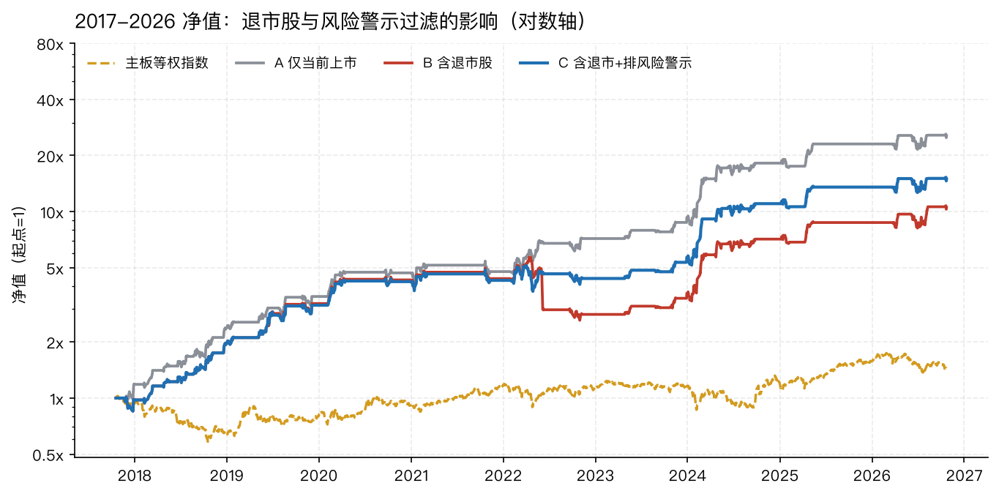
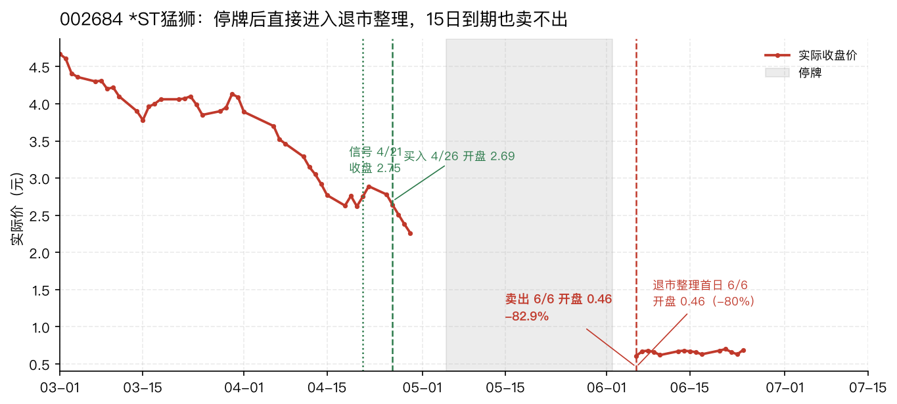
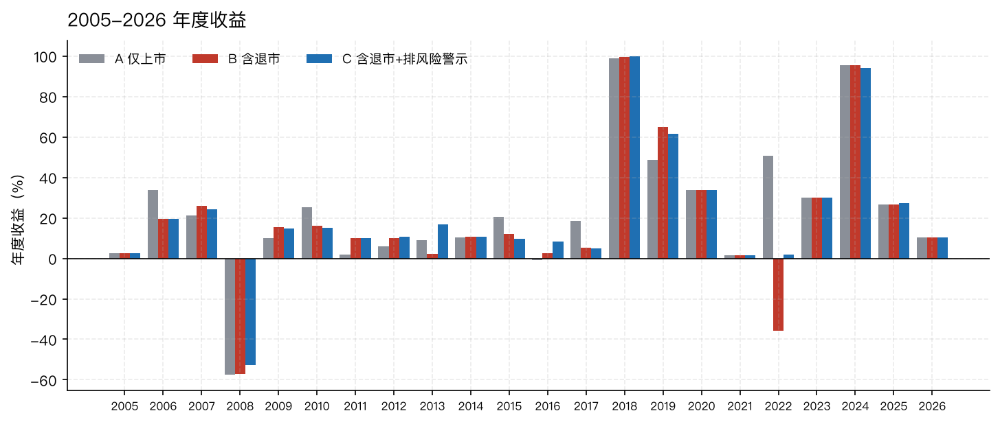
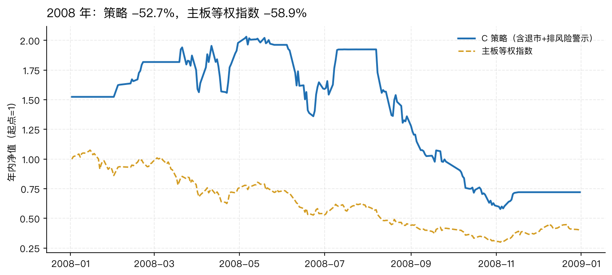
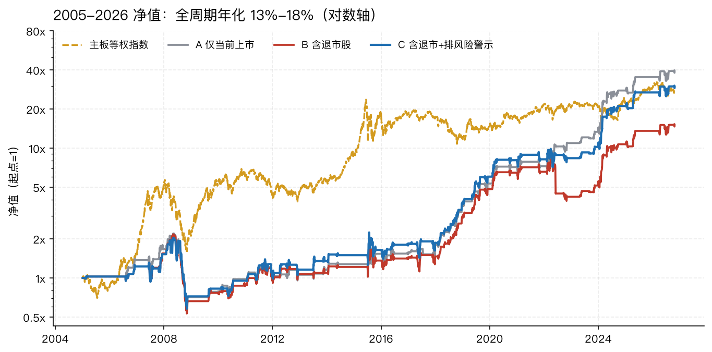
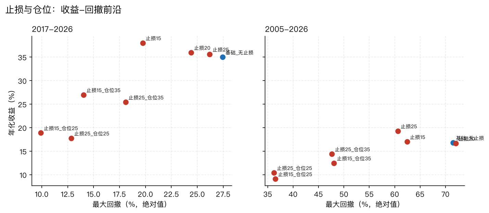

# 完整报告：baostock 退市股补充与指标优化

研究日期 2026-10-27；baostock 数据截至 2026-10-26；冻结信号截至 2026-10-23。  
所有代码、结果、证据都在 `baostock数据补充回测优化/` 下；本报告中的每个数字都能从 `03_结果/` 和 `05_证据/` 追溯。

---

## 0. 结论速览

1. **baostock 可以作为同花顺 DuckDB 的补充，但不能无条件替代。** 不复权价逐日一致，后复权日收益一致；baostock 多了 295 只主板退市股（280 只有完整日线）、历史风险警示标记、换手率和估值。代价是 16 行“仅复权因子跳变”的重定基错误，已修复；2007-2009 年少量重组复牌的超大单日收益保留未改，但它们不会成为本策略的信号。
2. **补进退市股后，2017-2026 从 43.2% / -15.8% 变成 29.8% / -54.3%，交易只多 1 笔。** 主要原因是 002684 *ST猛狮：信号日已是风险警示，停牌后直接进入退市整理，15 日到期卖不出，最终 -82.9%，一笔亏掉当时约 40% 的权益。旧数据没有这只股，所以 2022 年回测是 +50%；补全后是 -35.8%。
3. **排除历史风险警示股后，2017-2026 回到 35.0% / -27.4%，全周期 2005-2026 为 16.8% / -71.5%。** 这是“尾部风险过滤器”，不是 alpha：风险警示信号的平均 15 日收益在 2005-2016 反而更高（7.2% 对 2.8%）；过滤的价值在于避免 -83% 的退市尾部。
4. **2016 年前是真正的样本外，结果是 4.9% 年化 / -71.5% 回撤。** 2008 年 -52.7%，2015 年 +9.8%，2016 年 +8.2%。同期主板等权指数 2005-2016 是 27.4% / -72.1%，2017-2026 是 4.1% / -43.2%。策略是“震荡市均值回归”策略，不是全天候复利机器；**40% 是 2017-2026 的顺风期结果，不能外推到二十年。**
5. **换手率、市净率、低价、波动率、250 日涨幅、成交额、市场跌幅下限都没有通过两个样本期的稳健性检验。** 高换手、高波动、高 250 日涨幅在方向上更好，但切成阈值后在另一个样本期明显变差；市场跌幅 -18% 下限全周期 21.6% / -57.2%，但 -19% 立刻掉到 18.8% / -61.7%，是参数悬崖。
6. **唯一在两个样本期都同时改善收益和回撤的叠加是止损。** 止损 15%：2017-2026 38.0% / -19.8%，2005-2026 17.0% / -62.4%；止损 25%：35.6% / -26.2% 和 19.3% / -60.6%。它不是 alpha，是把单笔左尾截断。
7. **如果还要实盘，最低配置是：完整退市股池 + 信号日排除风险警示 + 15%-25% 硬止损 + 最多 2×35% 仓位。** 对应 2017-2026 25.4% / -18.1%，2005-2026 14.4% / -47.6%。计划时按 10%-15% 长期年化、-45%~-50% 压力回撤，不要按 40% 做预算。

---

## 1. 研究问题与口径

本次要回答三个问题：

1. 把 baostock 的退市股补进原策略，结果会怎样变？
2. baostock 的历史风险警示、换手率、估值、2016 年前数据，能否进一步优化策略？
3. 原策略的 40% 年化，在更完整的样本里还成立吗？

### 1.1 冻结规则

信号、排序、执行都沿用 2026-10-24 项目的冻结规则，不因本次数据补充而调整：

| 项目 | 定义 |
|---|---|
| 股票池 | 主板前缀 600/601/603/605/000/001/002/003；上市满 250 个交易日；20 日平均成交额 ≥ 1000 万元 |
| 市场闸门 | 主板等权指数 20 日收益 < -5% |
| 个股条件 | 250 日收益 > 0；250 日回撤 < -45%；RSI14 < 35；收盘位置 > 0.45 |
| 排序 | 250 日回撤最深优先（升序），同值按代码；每日取前二 |
| 买入 | 信号日 T 收盘后确认，T+3 个市场交易日开盘买入；开盘涨停/停牌拒买，不递补 |
| 止盈 | 买入后（不含买入日）后复权最高价触及买入后复权开盘价 ×1.20；开盘已超则按开盘，否则按触发价 |
| 时间退出 | 买入日算第 1 个交易日，第 15 个交易日收盘卖出；收盘跌停或停牌则顺延到下一个可成交开盘 |
| 止损 | 本文新增的可选叠加：后复权最低价触及买入价 ×(1-止损比例)，逻辑同止盈；跌停顺延 |
| 仓位 | 2 个仓位，每仓默认 50% 上日权益；现金不计息；同日卖出款不用于同日买入 |
| 成本 | 滑点 0.1%/边；佣金 0.025%（最低 5 元）；过户费 0.002%（2022-04-29 起 0.001%）；卖出印花税 0.1%（2023-08-28 起 0.05%） |

“信号日 T”是条件全部满足的收盘日；“买入日”是 T+3 个市场交易日，不是 T+3 个自然日；“15 日”是 15 个市场交易日，买入日算第 1 天。“前二”只取排序前二，第三名不递补。

### 1.2 价格与收益口径

- **信号与收益**：baostock 后复权（`adjustflag=1`），包含分红再投资；后复权日收益与同花顺逐日一致。
- **成交与涨跌停**：不复权实际价 + 交易所前收盘价 `preclose`。涨跌停价按四舍五入到 0.01 元；风险警示股 5%，其余 10%。
- **股数**：按实际开盘价和滑点后价格取 100 股整手；买入费用和滑点进入成本，卖出费用和印花税从 proceeds 扣除。
- **逐笔收益率**：`(卖出净收入 - 买入总成本) / 买入总成本`，是含费用的净收益；同时报告后复权收益、实际价涨跌幅和复权因子，避免把送转当成亏损。
- **组合收益**：每日权益 = 现金 + 持仓按后复权收盘估值；CAGR 从 100,000 元初始资金、2017-10-19 或 2005-01-04 起算；最大回撤是日权益的峰谷回撤。
- **基准**：主板等权总收益指数，与市场闸门同一个指数；它包含分红、包含当日交易的所有主板股票、不可投资，只用来回答“同期买入一篮子主板股票是什么结果”。

### 1.3 数据血缘

| 项目 | 内容 |
|---|---|
| 原始库 | `/Users/admin/WorkSpace/baostock_data/data/baostock.db`（SQLite，约 9.6 GB） |
| 股票基础 | `stock_basic`，type=1 股票；主板前缀 3,489 只，其中退市 295 只 |
| 日线 | `stock_kline_d`，`adjustflag=1`（后复权）与 `adjustflag=3`（不复权） |
| 研究窗口 | 原始 2004-01-01 至 2026-10-26；信号 2005-01-04 至 2026-10-23 |
| 面板 | `01_数据/panel.parquet`，12,394,196 行、3,473 只、5,538 个交易日（仅正常交易日） |
| 原始日线 | `01_数据/bars.parquet`，含停牌日，用于成交/涨跌停/退市判断 |
| 同花顺校验 | 仅用于一致性校验，不进入结果；旧面板与旧 99 笔逐笔用于复现对照 |

---

## 2. 数据：baostock 能否补充 DuckDB

### 2.1 覆盖

- 主板 3,489 只，其中 **295 只退市**；280 只有完整日线，缺失 15 只全部在 2004 年前退市（PT水仙、ST国嘉等），不影响 2005-2026 样本。
- 2004 年后每个退市年份都有覆盖：2022 年 35 只、2023 年 34 只、2024 年 46 只、2025 年 24 只、2026 年 17 只（截至 10 月）。
- 退市股最后一根日线与 `out_date` 的中位差为 0 天，说明退市整理期和最后交易日是完整的。
- 历史风险警示 `is_st` 逐日可查；2026-10-23 有 194 只风险警示股。
- 换手率 `turn`、市净率、市盈率从 2000 年前后就有覆盖；停牌日 `turn` 为空、OHLC=前收、成交量 0。

### 2.2 不复权价与同花顺一致

以 2026-10-23 为截面，3,191 只重叠股票：

| 字段 | 最大绝对差 | 结论 |
|---|---:|---|
| 收盘价 | 0.000000 | 逐只一致 |
| 开盘价 | 0.000000 | 逐只一致 |
| 20 日平均成交额 | 9.5e-7 | 一致 |

后复权日收益以 603778 为例，2025-06-03 至 2026-10-26 的最大差异 **4.44e-16**，是浮点误差级别。

### 2.3 特征与信号一致

以 2026-10-23 与旧 `research_panel.parquet` 对比：

| 特征 | 中位差 | p99 差 | 最大差 |
|---|---:|---:|---:|
| 250 日回撤 | 2.2e-8 | 0.0012 | 0.0046 |
| 250 日收益 | 6.8e-8 | 0.0018 | 0.0128 |
| RSI14 | 3.7e-8 | 0.0635 | 0.284 |
| 20 日成交额 | 0 | 2.4e-7 | 9.5e-7 |

RSI 的 p99 差 0.0635，来自停牌日是否占窗口：同花顺不把停牌日作为一行，baostock 原始有停牌行，本文在特征计算前剔除了停牌行；少数股票仍有窗口边界差异。实际影响很小：**2026-10-23 的 123 只信号名单逐只一致，前二仍是 603778、605376**。

### 2.4 与旧官方逐笔的复现对照

旧官方实际价逐笔 99 笔 vs 本文“仅当前上市”100 笔：

- **94 笔同日同码复现**（94/99）。
- 其中 **89 笔收益差 < 0.15pp**，中位差 0.055pp。
- 最大差 6.0pp，来自 000595 的跌停顺延：旧引擎按 5.27 近似，本文按 2025-02-05 开盘 4.91 成交，更严格。
- 5 笔旧有新无、6 笔新有旧无，主要原因是“上市满 250 个交易日”的口径：旧面板从 2016-10-13 起算，本文按真实上市交易日算。例如 000615 在旧面板里不足 250 行，本文有资格。

这说明本文引擎不是重新发明策略，而是在同一规则下换了更完整的数据和更严格的成交处理。

### 2.5 复权因子重定基：16 行/14 只

baostock 的后复权在少数日期出现“前收盘没变、复权因子却跳变”的情况，例如 2020-11-25 有 600654、600655、600681、600633 等同时跳变，000001 在 2020-12-31 跳变 -16.8%。这些不是分红送转，是数据源重定基。

处理规则：

- 若 `|preclose/prev_close-1| < 0.2%` 且 `|factor/prev_factor-1| > 2%`，判定为仅因子跳变；
- 应有跳变 = `prev_close/preclose`；把累计乘数补回，使当日和后复权收益等于实际前收盘收益；
- 共修复 16 行、14 只；修复清单在 `05_证据/复权修复事件.csv`。

修复后，2020-11-25 这些股票的当日后复权收益不再出现 -10% 的假跌；这对 2020 年底之后的信号和收益是必要的清理。

### 2.6 2007-2009 的重组复牌没有强行修

2007-2009 年有一批重组/借壳复牌，单日实际涨幅超过 50% 甚至 10 倍（如 000631 2009-06-05 +1255%）。这些不是复权错误，而是真实的复牌重估；强行“修复”会把真实收益抹掉。它们不会被本策略买入，因为：

- 复牌前长期停牌，策略无法在停牌期间买入；
- 复牌后 250 日回撤通常不深，`drawdown250 < -45%` 不满足；
- 即使进入候选，`amount20` 和上市满 250 日也会限制。

因此保留原样，但在数据说明中标注。

### 2.7 退市整理期首日无涨跌幅

002684 在 2022-06-06 进入退市整理期，首日无涨跌幅限制，开盘 0.46，而前收是 2.26。原逻辑把“开盘价低于跌停价”误判为跌停，顺延到 6/7 开盘 0.59，亏损 -78%。修正为：**只有开盘价正好等于跌停价时才顺延；低于跌停价说明当日无涨跌幅限制，应按开盘价成交。** 修正后 002684 为 6/6 开盘 0.46、-82.9%。

---

## 3. 退市股补充：结果变化

### 3.1 三套口径

- **A 仅当前上市**：与旧研究相同的幸存者口径，排除所有后来退市的股票。
- **B 含退市股**：完整主板池，含后来退市的股票；信号日不排除风险警示。
- **C 含退市股 + 排除风险警示**：完整池，但信号日 `is_st=1` 不买。

| 2017-2026 | A 仅当前上市 | B 含退市股 | C 含退市+排除风险警示 |
|---|---:|---:|---:|
| 年化收益 | 43.2% | 29.8% | 35.0% |
| 最大回撤 | -15.8% | -54.3% | -27.4% |
| 卡玛 | 2.73 | 0.55 | 1.27 |
| 交易笔数 | 100 | 101 | 101 |
| 胜率 | 74.0% | 71.3% | 71.3% |
| 期末净值 | 25.47x | 10.52x | 14.93x |

| 2005-2026 | A 仅当前上市 | B 含退市股 | C 含退市+排除风险警示 |
|---|---:|---:|---:|
| 年化收益 | 18.3% | 13.2% | 16.8% |
| 最大回撤 | -74.1% | -75.5% | -71.5% |
| 卡玛 | 0.25 | 0.18 | 0.24 |
| 交易笔数 | 212 | 219 | 219 |
| 胜率 | 66.0% | 65.8% | 66.7% |
| 期末净值 | 38.84x | 14.96x | 29.58x |



### 3.2 002684 个案

| 项目 | 内容 |
|---|---|
| 代码/名称 | 002684.SZ，*ST猛狮（现名猛狮退） |
| 信号日 | 2022-04-21 |
| 信号日特征 | 250 日回撤 -61.4%，250 日收益 +10.4%，RSI14 27.8，收盘位置 1.00，20 日成交额 3,071 万元，`is_st=1` |
| 买入 | 2022-04-26 开盘 2.69 |
| 停牌 | 2022-05-05 至 2022-06-02 |
| 退市整理首日 | 2022-06-06，开盘 0.46，前收 2.26 |
| 卖出 | 2022-06-06 开盘 0.46（15 日到期时仍在停牌，复牌首日卖出） |
| 单笔收益 | **-82.9%** |
| 单笔盈亏 | **-218,485 元**，约当时权益的 40% |



这只股票在信号日已经是风险警示，且 2022 年的市场闸门满足（20 日 -8.3%）。旧数据没有它，所以旧回测的 2022 年是 +50%；完整池里它是 -35.8%；排除风险警示后回到 +2.3%。这不是策略参数问题，是样本缺失。

### 3.3 直接退市股交易

| 口径 | 后来退市的交易 | 平均收益 | 净盈亏 |
|---|---:|---:|---:|
| B 含退市，不排风险警示 | 7 笔 | -8.81% | **-203,476 元** |
| C 含退市，排风险警示 | 5 笔 | +5.64% | **+28,138 元** |

B 的 7 笔里，002684 -218,485 元、600767 -16,981 元，两只风险警示股贡献了绝大部分亏损；其余 000732、000022、000622、002750、600077 合计是正贡献。C 排除了 002684 和 600767，剩下的 5 只后来退市股平均 +5.64%。**结论：退市股风险主要集中在风险警示股，而不是“所有后来退市的股票”。**

### 3.4 不只是多了几笔交易：前二名单会变

含退市股后，候选池变大，排序前二会发生变化：

| 对比 | 2017-2026 前二交集 | Jaccard | 2005-2026 前二交集 | Jaccard |
|---|---:|---:|---:|---:|
| A vs B | 439/485 | 0.862 | 1,118/1,333 | 0.753 |
| A vs C | 417/472 | 0.805 | 1,008/1,276 | 0.656 |
| B vs C | 449/472 | 0.884 | 1,146/1,276 | 0.783 |

2017-2026 有约 14%-20% 的前二配对不同。典型例子：

- 2022-04-06：A 买 002592（+20.7%，风险警示），C 买 603260（-27.9%）；C 排除了风险警示，反而吃了这个亏损。
- 2022-10-19：A 买 600706（+19.7%），C 买 600077（-4.1%，后来退市）；600077 挤掉了 600706。
- 2017-11-20：A 买 601116+603716，B/C 买 000615+601116；000615 在旧面板里不足 250 个交易日，本文有资格。

所以“补退市股”不是简单地在旧结果上加几笔亏损，而是换了一个更完整的候选池，前二名单和复利路径都会变。

### 3.5 口径分解：风险警示过滤 vs 完整池

为了区分两件事，加跑“仅当前上市 + 排除风险警示”（A_仅上市+排风险警示）：

| 2017-2026 | 年化 | 最大回撤 | 交易 |
|---|---:|---:|---:|
| A 仅当前上市，不排风险警示 | 43.2% | -15.8% | 100 |
| A_仅上市+排风险警示 | 38.4% | -27.6% | 99 |
| C 含退市，排风险警示 | 35.0% | -27.4% | 101 |

| 2005-2026 | 年化 | 最大回撤 | 交易 |
|---|---:|---:|---:|
| A 仅当前上市，不排风险警示 | 18.3% | -74.1% | 212 |
| A_仅上市+排风险警示 | 19.1% | -73.8% | 211 |
| C 含退市，排风险警示 | 16.8% | -71.5% | 219 |

这张表说明：

- 在旧的幸存者池里，排除风险警示并不会提高收益，2017-2026 反而从 43.2% 降到 38.4%，回撤从 -15.8% 扩大到 -27.6%。原因是风险警示股里有 002592、000752、603007、002759 等赢家，它们在 2022 年垫高了收益。
- 只有在完整池里，风险警示过滤才体现出价值：B → C 从 29.8% / -54.3% 回到 35.0% / -27.4%。
- 完整池本身（C vs A_仅上市+排风险警示）在 2017-2026 是 -3.5pp 年化、回撤持平；在全周期是 -2.3pp 年化、回撤略好。这是“更真实的池子”成本，不是过滤器的错。

**所以不要把“排除风险警示”包装成 alpha。它是防止 -83% 尾部的保险，保险费就是放弃一些风险警示股赢家。**

---

## 4. 历史风险警示：尾部过滤器

### 4.1 风险警示信号的平均收益并不差

事件研究：所有满足冻结条件的信号（不只前二），T+3 开盘至 T+17 收盘，15 个交易日：

| 期间 | 分组 | 样本 | 胜率 | 平均收益 | 中位收益 | 平均最大浮亏 |
|---|---|---:|---:|---:|---:|---:|
| 2005-2016 | 风险警示 | 1,005 | 65.6% | **7.20%** | 5.53% | -10.3% |
| 2005-2016 | 非风险警示 | 12,135 | 53.0% | 2.76% | 0.84% | -11.7% |
| 2017-2026 | 风险警示 | 121 | 58.7% | 2.73% | 4.12% | -12.2% |
| 2017-2026 | 非风险警示 | 4,488 | 66.5% | 6.07% | 5.54% | -11.7% |

风险警示股在 2005-2016 的平均反弹更高，在 2017-2026 更低。两个方向都不支持“风险警示股平均更差”。它的问题是尾部：退市、长期停牌、退市整理首日 -80%。**平均收益看不出来的东西，最大回撤能看出来。**

### 4.2 为什么 C 仍比 A 差

C 35.0% / -27.4% 仍低于 A 43.2% / -15.8%，原因不是风险警示过滤本身，而是：

1. 旧 A 池是幸存者池，本身被高估；
2. C 的完整池前二名单不同，2022 年 603260 -27.9%、600077 -4.1% 等替代了 A 的赢家；
3. 风险警示赢家（002592、000752、603007、002759）被排除，2022 年的缓冲垫变薄。

所以正确的比较是 **C 35.0% 是完整池的诚实数字，A 43.2% 不是**。C 的 -27.4% 回撤仍比 A 的 -15.8% 大，因为完整池的路径不同；这不是过滤器失效。

---

## 5. 2016 年前：真正的样本外

### 5.1 结果

| 2005-2016 | C 含退市+排除风险警示 |
|---|---:|
| 年化收益 | **4.9%** |
| 最大回撤 | **-71.5%** |
| 卡玛 | 0.07 |
| 交易笔数 | 110 |
| 胜率 | 62.7% |
| 期末净值 | 1.78x |

12 年只有 1.78x，最大回撤 -71.5%。这不是“温和的 15%-25%”，而是“大部分时间不赚钱 + 2008 年腰斩”。

### 5.2 年度收益

| 年份 | A 仅上市 | B 含退市 | C 含退市+排风险警示 |
|---:|---:|---:|---:|
| 2005 | 2.5% | 2.5% | 2.5% |
| 2006 | 33.8% | 19.6% | 19.6% |
| 2007 | 21.4% | 25.9% | 24.3% |
| **2008** | **-57.3%** | **-57.1%** | **-52.7%** |
| 2009 | 10.0% | 15.5% | 14.7% |
| 2010 | 25.3% | 16.0% | 15.1% |
| 2011 | 2.0% | 10.0% | 9.9% |
| 2012 | 6.0% | 9.9% | 10.7% |
| 2013 | 9.1% | 2.2% | 16.7% |
| 2014 | 10.4% | 10.7% | 10.8% |
| 2015 | 20.4% | 12.1% | 9.8% |
| 2016 | -0.8% | 2.6% | 8.2% |
| 2017 | 18.6% | 5.2% | 5.0% |
| 2018 | 98.7% | 99.4% | 99.8% |
| 2019 | 48.6% | 65.0% | 61.4% |
| 2020 | 33.9% | 33.8% | 33.9% |
| 2021 | 1.6% | 1.6% | 1.6% |
| **2022** | **50.6%** | **-35.8%** | **2.0%** |
| 2023 | 29.9% | 29.9% | 29.9% |
| 2024 | 95.5% | 95.4% | 94.1% |
| 2025 | 26.7% | 26.7% | 27.2% |
| 2026（至 10/23） | 10.4% | 10.3% | 10.3% |



> 本表是 2005-2026 连续复利路径的年度收益；2017-2026 单独跑的年度值可能相差零点几个百分点（持仓/现金结转），关键结论不变。例如 2022 年 C 在全区间路径是 +2.0%，2017-2026 单独跑是 +2.3%。

利润高度集中：2018、2024 两年各约 +95%-100%，2022 年 A 是 +50.6% 但 B 是 -35.8%。去掉 2018 和 2024，长期图景会平淡得多。

### 5.3 2008 年：策略与等权指数同步下跌

- 2008 年 C -52.7%，主板等权指数 -58.9%。
- 2008 年 C 最大回撤 -71.5%（2008-05-06 至 2008-11-04），指数最大回撤 -72.1%。
- 2008 年 22 笔交易，平均 -4.5%，胜率 50%；最差 000723 -40.0%、000505 -34.3%、600655 -29.5%。

策略在 2008 年没有比市场更差，但它是一个 2×50% 的多头策略，市场跌 59% 时它跌 53% 是合理的。问题不是“策略失效”，而是“没有对冲、没有仓位控制、没有止损”。



### 5.4 2015 年：连续跌停的真实尾部

600485 信威集团 2015-08-27 开盘 33.61 买入；9/10 至 9/15 连续一字跌停，15 日到期时卖不出，最终 9/18 收盘 17.13，**-49.2%**。这不是复权错误，是真实的流动性风险：跌停时没有买盘，止损失效。类似情况在 2008 年也有。

这解释了为什么“止损 15%”能改善回撤，但不能消灭尾部：止损在连续跌停里只能顺延到下一个可成交开盘，成交价可能远低于止损价。

### 5.5 同期基准：策略是震荡市策略

| 期间 | 主板等权指数 | C 策略 | 结论 |
|---|---:|---:|---|
| 2005-2016 | 27.4% / -72.1% | 4.9% / -71.5% | 趋势市大幅跑输，回撤相同 |
| 2017-2026 | 4.1% / -43.2% | 35.0% / -27.4% | 震荡市大幅跑赢 |
| 2005-2026 | 16.2% / -72.1% | 16.8% / -71.5% | 全周期打平，没有超额 |



这张表是本次研究最重要的背景：**策略的 alpha 来自“震荡市里的急跌反弹”，不是全天候。** 2005-2007、2009、2014-2015 是大趋势市，策略的 15 日持有和 +20% 止盈抓不到主升浪；2008 是系统性下跌，策略跟着跌。2017-2026 的 A 股是宽幅震荡，急跌后有 V 型反弹，策略如鱼得水。

---

## 6. 其他指标：逐项检验

### 6.1 事件研究方法

- 样本：所有满足冻结条件的信号（不只前二），2005-2026 共 17,749 个完整 15 日窗口，160 个截断（停牌/退市）。
- 收益：T+3 开盘至 T+17 收盘，后复权；`MFE/MAE` 是窗口内最大浮盈/浮亏。
- 分期间：2005-2016（13,140 个）与 2017-2026（4,609 个）。
- 注意：信号日在同一天高度聚集（一次恐慌几十只），不是独立样本；以下只做描述性比较，不做显著性检验。

### 6.2 单指标结果

**换手率：高换手更好，不是更低。**

| 20 日换手率 | 2005-2016 平均 | 2017-2026 平均 | 方向 |
|---|---:|---:|---|
| <1% | 0.98% | 5.53% | 低 |
| 1-2% | 0.65% | 5.33% | 低 |
| 2-4% | 2.49% | 5.17% | 中 |
| 4-7% | 6.37% | 6.80% | 高 |
| 7-10% | 8.56% | 8.50% | 高 |
| >10% | 6.42% | 11.99% | 高 |

**市净率（PB）：负市净率平均反弹高，但尾部肥，且与风险警示高度重叠。**

| 市净率 | 2005-2016 平均 | 2017-2026 平均 |
|---|---:|---:|
| 负 | 10.32% | 5.98% |
| 0-1 | 0.08% | 4.55% |
| 1-3 | 1.86% | 6.34% |
| 3-10 | 3.42% | 5.83% |
| >10 | 3.92% | 5.45% |

**波动率：高波动更好，低波动最差。**

| 20 日波动率 | 2005-2016 平均 | 2017-2026 平均 |
|---|---:|---:|
| <30% | 3.23%（59 个） | -1.54% |
| 30-45% | 0.12% | 2.28% |
| 45-60% | 1.07% | 7.10% |
| 60-80% | 1.39% | 10.11% |
| >80% | 5.76% | 13.26% |

**250 日涨幅：越高越好，但阈值化后 2017-2026 变差。**

| 250 日涨幅 | 2005-2016 平均 | 2017-2026 平均 |
|---|---:|---:|
| 0-20% | 1.93% | 5.75% |
| 20-50% | 2.56% | 5.68% |
| 50-100% | 3.63% | 7.06% |
| >100% | 5.65% | 6.58% |

**250 日回撤：最深的一档不是最好。**

| 250 日回撤 | 2005-2016 平均 | 2017-2026 平均 |
|---|---:|---:|
| -55~-45% | 2.92% | 4.76% |
| -65~-55% | 2.78% | 7.81% |
| -75~-65% | 5.37% | 13.38% |
| <-75% | 0.54%（154 个） | 10.47%（8 个） |

**市场恐慌深度：-15%~-10% 是甜点，深水区不稳定。**

| 市场 20 日 | 2005-2016 平均 | 2017-2026 平均 |
|---|---:|---:|
| -7~-5% | **-6.12%** | 5.45% |
| -10~-7% | 0.17% | 1.64% |
| -15~-10% | 8.64% | 8.80% |
| <-15% | 3.08% | 18.32%（424 个） |

**成交额：没有单调关系。**

| 20 日成交额 | 2005-2016 平均 | 2017-2026 平均 |
|---|---:|---:|
| 1000-2000 万 | 3.62% | 7.16% |
| 2000-5000 万 | 4.09% | 4.98% |
| 0.5-1 亿 | 3.75% | 6.19% |
| 1-3 亿 | 2.61% | 5.18% |
| >3 亿 | 2.71% | 7.08% |

### 6.3 组合测试

把候选过滤加到冻结规则上，跑 2017-2026 和 2005-2026：

| 方案 | 2017-2026 年化/回撤 | 2005-2026 年化/回撤 | 结论 |
|---|---:|---:|---|
| C 基础（排风险警示） | 35.0% / -27.4% | 16.8% / -71.5% | 基准 |
| + 市净率>0 | 35.0% / -27.4% | 16.8% / -71.5% | 无影响 |
| + 股价≥2 | 35.0% / -27.4% | 16.8% / -71.5% | 无影响 |
| + 换手率≤10% | 37.7% / -23.5% | 17.8% / -74.9% | 近期好，全周期回撤更差 |
| + 成交额≥2000 万 | 34.4% / -27.8% | 20.4% / -63.9% | 全周期好，近期略差 |
| + 250 日涨幅>20% | 29.9% / -21.8% | 15.4% / -70.5% | 降收益 |
| + 250 日涨幅>50% | 23.1% / -27.5% | 16.5% / -57.5% | 近期差 |
| + 波动率>45% | 24.7% / -27.6% | 15.3% / -71.6% | 近期差 |
| + 波动率>60% | 13.3% / -41.8% | 13.9% / -71.7% | 明显差 |
| + 回撤不超 -75% | 31.5% / -27.5% | 17.5% / -66.4% | 小幅改善，非质变 |
| + 市场跌幅<-10% 才买 | 10.8% / -18.4% | 11.8% / -48.9% | 近期交易太少 |
| + 市场跌幅<-10% + 涨幅>20% | 14.0% / -16.1% | 13.7% / -48.6% | 低回撤、低收益 |

### 6.4 市场跌幅下限：参数悬崖

| 20 日跌幅下限 | 2005-2016 年化/回撤 | 2005-2026 年化/回撤 |
|---|---:|---:|
| > -14% | 4.5% / -66.1% | 15.6% / -66.1% |
| > -16% | 12.7% / -65.7% | 20.8% / -65.7% |
| > -17% | 13.2% / -65.8% | 21.6% / -65.8% |
| **> -18%** | **13.2% / -57.2%** | **21.6% / -57.2%** |
| > -19% | 8.1% / -61.7% | 18.8% / -61.7% |
| > -20% | 5.7% / -61.6% | 17.1% / -61.6% |
| > -22% | 11.1% / -56.5% | 20.4% / -56.5% |

-18% 这一格的 -57.2% 回撤是路径偶然（避开了某几笔 2008 交易），相邻的 -19%、-20% 立刻回到 -61% 到 -62%。这不是稳健的 regime 过滤器，不推荐。

### 6.5 结论

**没有一项横截面指标能在两个样本期同时改善收益和回撤。** 高换手、高波动、高 250 日涨幅是“方向性提示”，不是“可切的阈值”；市净率、低价、成交额、市场深度都是单期有效或路径依赖。原因不复杂：这是一个只有 100-220 笔交易、收益高度集中的策略，任何过滤器都在改变“哪几笔大赢家/大输家被选中”，而不是稳定地提高胜率。

---

## 7. 止损与仓位：唯一稳健的叠加

### 7.1 止损

在 C 基础上加硬止损（后复权最低价触及买入价 ×(1-比例)，开盘跳空按开盘，跌停顺延）：

| 2017-2026 | 年化 | 最大回撤 | 卡玛 | 交易 |
|---|---:|---:|---:|---:|
| 无止损 | 35.0% | -27.4% | 1.27 | 101 |
| 止损 15% | **38.0%** | **-19.8%** | **1.92** | 104 |
| 止损 20% | 36.0% | -24.4% | 1.47 | 102 |
| 止损 25% | 35.6% | -26.2% | 1.36 | 101 |

| 2005-2026 | 年化 | 最大回撤 | 卡玛 | 交易 |
|---|---:|---:|---:|---:|
| 无止损 | 16.8% | -71.5% | 0.24 | 219 |
| 止损 15% | 17.0% | -62.4% | 0.27 | 243 |
| 止损 20% | 16.7% | -72.0% | 0.23 | 231 |
| 止损 25% | **19.3%** | **-60.6%** | **0.32** | 222 |

- 止损 15% 和 25% 在两个样本期都同时改善收益和回撤；20% 在全周期没有改善，说明有路径依赖。
- 止损 15% 的 2017-2026 卡玛最高（1.92），但换手更多、胜率从 71.3% 降到 67.3%，更容易被洗。
- 止损 25% 的全周期收益更好（19.3%），交易只多 3 笔，更适合“不想频繁被扫”的人。
- 2008 年：止损 25% 把年度亏损从 -52.7% 降到约 -35%（无仓位缩放）；这是它最大的价值。



### 7.2 仓位缩放

| 2017-2026 | 2×50% | 2×35% | 2×25% |
|---|---:|---:|---:|
| 无止损 年化/回撤 | 35.0% / -27.4% | 25.3% / -19.8% | 17.8% / -13.4% |
| 止损 15% 年化/回撤 | 38.0% / -19.8% | 27.0% / -14.0% | 18.9% / -9.9% |
| 止损 25% 年化/回撤 | 35.6% / -26.2% | 25.4% / -18.1% | 17.8% / -12.8% |

| 2005-2026 | 2×50% | 2×35% | 2×25% |
|---|---:|---:|---:|
| 无止损 年化/回撤 | 16.8% / -71.5% | 13.1% / -55.6% | 9.7% / -42.5% |
| 止损 15% 年化/回撤 | 17.0% / -62.4% | 12.5% / -48.0% | 9.1% / -36.5% |
| 止损 25% 年化/回撤 | 19.3% / -60.6% | 14.4% / -47.6% | 10.4% / -36.2% |

仓位缩放不改善卡玛：全周期卡玛基本在 0.23-0.32 之间，缩放只是按比例降低收益和回撤。它是风险偏好选择，不是优化。

### 7.3 推荐配置

如果还要继续研究/实盘，建议的最低配置：

- 股票池：完整主板（含退市），不是当前上市池；
- 信号日：`is_st=1` 不买；
- 止损：15%-25% 硬止损（25% 更稳，15% 更控回撤）；
- 仓位：最多 2×35%，不要 2×50%；
- 预期：长期 10%-15% 年化、-45%~-50% 压力回撤；2017-2026 的 25%-35% 是顺风期，不作为长期假设。

对应数字：

| 配置 | 2017-2026 | 2005-2026 |
|---|---:|---:|
| 2×35% + 止损 25% | 25.4% / -18.1% | 14.4% / -47.6% |
| 2×35% + 止损 15% | 27.0% / -14.0% | 12.5% / -48.0% |

**这不是“优化到 40%”，而是“把尾部从 -83% 单笔、-54% 组合回撤压到可承受范围，并接受长期收益中枢下移”。**

### 7.4 止损的局限

- 盘中止损按触发价成交；真实市场在快速下跌时可能滑点更大。
- 连续一字跌停时，止损只能顺延到下一个可成交开盘，成交价可能远低于止损价（600485 2015 就是例子）。
- 止损会增加交易笔数（15% 版本 219→243），换手和成本上升。
- 止损不是 alpha，它不改变“策略在震荡市才有效”的结论。

---

## 8. 当前信号与执行

### 8.1 2026-10-23 冻结名单不变

- 2026-10-23 严格条件信号 123 只，前二 **603778、605376**，计划 2026-10-28 开盘。
- 两者都不是风险警示（`is_st=0`）、市净率（PB）为正、股价≥2，新的风险警示/市净率/低价过滤不影响它们。
- **但按 2×50% 仓位，10/23 组合已持有 600783（10/19 买入）和 603778（10/20 买入），npos=2；15 个交易日到期约 11/6 和 11/9，10/28 没有空位。因此 10/28 不会新买 603778（已在手），也买不进 605376；除非手动腾仓或实盘持仓与回测不同。**
- 002969 仍是第 3，不递补。

### 8.2 2026-10-26 是新信号日，不是补丁

- 2026-10-26 满足条件 26 只，603778 仍是第 1（收盘 7.29，收盘位置 0.4545，回撤 -78.73%），第 2 为 002240；605376 已不在前二。
- 按执行冻结规则：10/23 的名单在 10/28 之前不重排、不换股；10/26 是新信号，若 10/28 已成交 603778，10/29 不再加。
- 把市场闸门收窄到“20 日跌幅 < -10%”会跳过 10/23（当天 -5.21%）；该变体不推荐，所以不据此改 10/23 的名单（但按仓位规则，10/28 本来就没有空位）。

### 8.3 数据更新

- baostock 数据已到 2026-10-26；10/26 的 603778 收盘 7.29、回撤 -78.73%、RSI 31.8、收盘位置 0.4545，和旧研究记忆中的 7.29 / 0.4545 一致。
- 本报告不生成新的交易建议；10/26 的信号只作为数据一致性检查。

---

## 9. 结论与建议

1. **原 40% 年化不是可交易的真实收益。** 仅当前上市池 2017-2026 43.2%，含退市股 29.8%，排除风险警示 35.0%；全周期 2005-2026 只有 16.8% / -71.5%，2016 年前样本外 4.9% / -71.5%。
2. **退市股必须补，风险警示必须排。** 002684 一笔 -82.9% 是旧数据完全看不到的尾部；排除风险警示不是 alpha，是防止账户被打穿的保险。
3. **不要用横截面指标做“优化”。** 换手率、市净率、低价、波动率、250 日涨幅、成交额、市场深度都没有通过双样本稳健性；高换手/高波动/高涨幅只是方向性提示。
4. **止损是唯一值得加的叠加。** 15%-25% 硬止损在两个样本期都改善收益和回撤；配合 2×35% 仓位，长期预期 10%-15% 年化、-45%~-50% 压力回撤。
5. **策略是震荡市均值回归，不是全天候。** 2005-2016 趋势市 4.9% 年化、-71.5% 回撤；2017-2026 震荡市 35.0% 年化、-27.4% 回撤。要用它，先判断市场是不是“急跌后有 V 型反弹”的环境。
6. **下一步值得研究的方向**：市场 regime 分类（趋势/震荡/波动）而不是个股指标；组合级风险预算/波动率目标；行业分散；股指期货或期权对冲；盘中流动性与排队建模。这些都比继续切市净率/换手率阈值更有价值。

---

## 10. 局限与未解决问题

- **2024-2026 不是纯净留出**：旧研究已经用它做网格和选择；本次只新增了数据源和指标，没有新的未触碰样本。
- **2005-2016 是真正的样本外，但市场结构不同**：股权分置改革、退市制度、涨跌幅和停牌规则都与现在不同；4.9% 不能简单外推为“未来二十年”。
- **盘中成交是近似**：止盈/止损按触价成交，未建模排队、盘口深度、滑点扩大；大资金容量有限。
- **退市股覆盖**：280/295 有完整日线，缺失 15 只均在 2004 年前；2004 年后的退市覆盖完整，但不能保证 baostock 的 `stock_basic` 没有遗漏。
- **风险警示标记**：逐日 `is_st` 可用，但退市整理期可能变为 0（002684 在 6/6 后 `is_st=0`）；过滤在信号日仍然有效。
- **2007-2009 重组复牌**：单日 >50% 的收益保留未改，可能污染个别股票的 250 日涨幅/回撤特征；它们不会成为本策略信号，但会影响事件研究的极端值。
- **无行业、无指数期货、无盘中数据**：行业联动、对冲、盘中路径都没有真正检验。
- **等权指数不可投资**：它包含所有当日交易的主板股票、含分红、等权再平衡，只作为机会集基准，不是可交易产品。
- **收益高度集中**：2018、2024 两年贡献了大部分利润；去掉这两年，长期图景会明显变差。不要用 2017-2026 的 35% 做未来预算。

---

## 11. 复现

```bash
cd "/Users/admin/WorkSpace/trading/trading_flash/baostock数据补充回测优化"

# 1) 从 baostock SQLite 抽取、修复复权、构建面板（首次约 1.5 分钟）
python3 -B 02_代码/build_panel.py

# 2) 基准：仅上市 / 含退市 / 含退市+排风险警示
python3 -B 02_代码/run_baseline.py
python3 -B 02_代码/run_baseline.py --start 2005-01-01 --end 2026-10-23 --tag 2005_2026

# 3) 指标组合与事件研究
python3 -B 02_代码/run_variants.py
python3 -B 02_代码/run_variants.py --start 2005-01-01 --end 2026-10-23 --tag 2005_2026
python3 -B 02_代码/run_optimization.py
python3 -B 02_代码/event_study.py --start 2005-01-01 --end 2016-12-31 --tag 2005_2016
python3 -B 02_代码/event_study.py --start 2017-01-01 --end 2026-10-23 --tag 2017_2026
python3 -B 02_代码/event_study.py --start 2005-01-01 --end 2026-10-23 --tag 2005_2026

# 4) 止损/仓位与退市股分解
python3 -B 02_代码/run_risk.py
python3 -B 02_代码/analyze_delisted.py

# 5) 汇总、图表、Excel、校验
python3 -B 02_代码/make_summary.py
python3 -B 02_代码/make_charts.py
python3 -B 02_代码/make_excel.py
python3 -B 02_代码/verify.py
```

关键输出：

- `01_数据/panel.parquet`、`bars.parquet`：研究面板与原始日线（本地大文件，不入 git）。
- `03_结果/核心结论.csv`：A/B/C 三套口径汇总。
- `03_结果/指标优化/指标优化汇总.csv`：M1-M9 三期间。
- `03_结果/风险叠加汇总.csv`：止损/仓位网格。
- `03_结果/事件研究_*.csv`：单指标事件研究。
- `03_结果/Top2重叠.csv`、`退市股交易_*.csv`：前二变化与退市股逐笔。
- `03_结果/交易记录/`：中文逐笔（基准C、含退市B、推荐配置）。
- `05_证据/校验报告.md`：107 项独立校验，全部通过。
- `baostock补充研究_数据表.xlsx`：中文数据表（14 个 sheet）。
- `策略补充研究.html`：可视化一页。

历史回测不代表未来，不构成投资建议。
