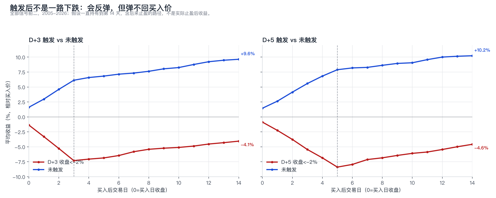
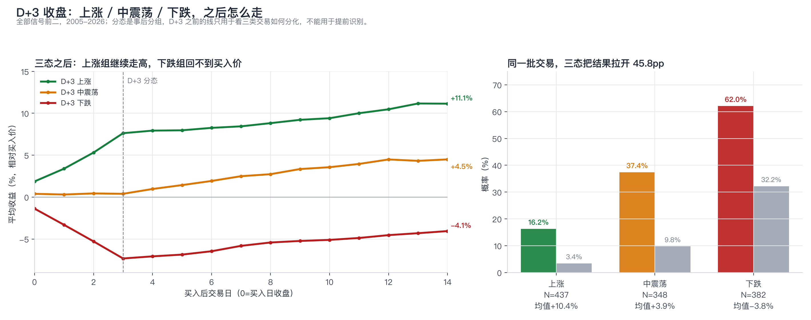
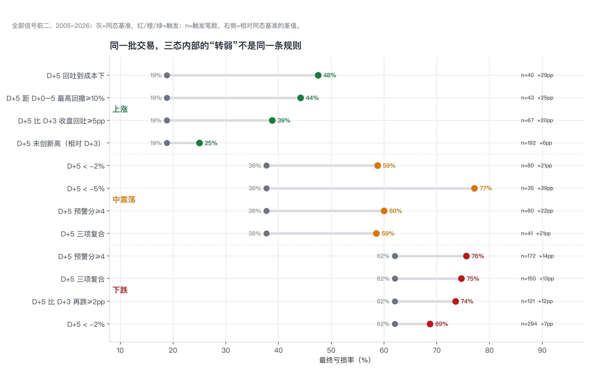
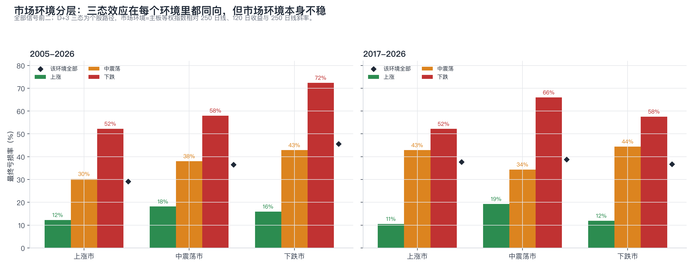

# 买入后哪天没达标，就该警惕了？

> 2026-10-28｜baostock 主板日线｜全部信号前二 1,256 笔 / 实际成交 219 笔｜2005-2026
>
> 研究问题：买入日之后，哪一天没有达到某个预期，或出现某个特征，能说明“大概率要跌”？
>
> **短答：D+3 收盘是第一道可靠证伪线，D+5 是确认线；D+10 只是事后确认。它预测“最终会亏”和“深尾”，但不预测“明天跌”；机械早退平均更差。**

## 0. 一句话结论与关键边界

1. **D+3 收盘 < -2% → 最终亏损 62.0%**；D+5 < -2% → 65.1%；D+5 三项复合 → 71.4%。
2. **“未达+3%”只是弱警告（D+5 54.5%），“已跌2%”才是强警告（65.1%）。** 真正有用的是损失预算，不是盈利目标。
3. **能预测最终亏损，不能预测次日。** D+5 触发后次日下跌概率 42.4%，基准 44.3%；剩余 10 天平均还有 +4.5%。
4. **早退平均更差。** D+5 触发后 D+6 开盘早退，平均少 4.3pp；它压深尾，但不是免费午餐。
5. **D+3 三态差异极大。** 上涨（≥+3%）最终亏损 16.2%，中震荡（-2%~+3%）37.4%，下跌（≤-2%）62.0%；两期稳定。上涨组只有“回吐到成本下/回撤≥10%”才明显转弱（47.5%/44.2%），“没创新高”只有 25.0%。
6. **不是独立样本。** 1,256 笔按信号段只有 925 段；实际成交 2017-2026 只有 107 笔。

## 1. 样本与口径

| 项目 | 定义 |
|---|---|
| 股票池 | 沪深主板；信号日排除风险警示（is_st=0）；含退市股 |
| 信号 | 250 日收益>0；自 250 日高点回撤<-45%；RSI14<35；收盘位置>0.45；20 日均额≥1000 万；上市≥250 日；主板等权 20 日<-5% |
| 排序 | 按 250 日回撤最深取前二 |
| 买入 | 信号日 T 收盘后，T+3 开盘；一字涨停/停牌不买 |
| 持有 | 15 个交易日；+20% 盘中止盈从买入次日（D+1）起算；跌停/停牌顺延 |
| 第 d 天 | d=0 为买入日收盘；d=1 为买入后第 1 个交易日；所有特征只用 d 日收盘及之前数据 |
| 与旧报告换算 | 旧《持仓天数与涨跌路径》第1天=买入当日收盘；本文 D+0=买入当日，D+3=旧第4天，D+5=旧第6天 |
| 最终亏损 | 按实际规则（+20% 止盈或 15 日到期）的最终收益<0 |
| 深度亏损 | 最终收益≤-10% |
| 早退 | d 日收盘触发，d+1 开盘卖出；不建模跌停卖不出 |
| 预警分 | 0-5 分：低于买入价、未创新高、跌破买入日最低、低于5日线、连续两日低点下移 |
| 三项复合 | 低于买入价 + 未创新高 + 低于5日线 |
| 聚类 | 同一代码信号日间隔≤3 个交易日合并为信号段；置信区间按信号段聚类稳健标准误 |
| 价格 | 路径/信号用后复权；实际成交用不复权价定股数、后复权算收益 |

### 样本

| 样本 | 期间 | 笔数 | 信号日 | 信号段 | 胜率 | 最终亏损率 | 均值 | 中位 | 止盈率 | 平均最大浮亏 |
|---|---|---:|---:|---:|---:|---:|---:|---:|---:|---:|
| 全部信号前二 | 2005-2016 | 729 | 402 | 505 | 65.6% | 34.2% | 5.1% | 5.5% | 30.7% | -6.9% |
| 全部信号前二 | 2017-2026 | 522 | 287 | 420 | 63.8% | 36.2% | 4.6% | 4.4% | 26.2% | -5.7% |
| 全部信号前二 | 全期 | 1,251 | 689 | 925 | 64.8% | 35.0% | 4.9% | 4.9% | 28.9% | -6.4% |
| 实际成交 | 2005-2016 | 110 | 76 | 109 | 62.7% | 37.3% | 2.2% | 4.0% | 24.5% | -8.6% |
| 实际成交 | 2017-2026 | 107 | 75 | 109 | 71.0% | 29.0% | 6.1% | 7.0% | 29.9% | -4.9% |
| 实际成交 | 全期 | 217 | 151 | 218 | 66.8% | 33.2% | 4.1% | 4.7% | 27.2% | -6.8% |

> 全部信号前二 = 每个信号日的前二，不限制总仓位；实际成交 = 2 仓组合真实成交的 219 笔。全部信号前二包含实际成交，二者不是独立样本。
>
> 全部信号前二 1,256 笔中，5 笔在数据截止日未满 15 日且未止盈，最终结果用 1,251 笔；实际成交 219 笔中，2 笔仍持仓，最终结果用 217 笔。
>
> 2017-2026 实际成交胜率 71.0%，高于全部信号前二的 63.8%；因为 2 仓约束跳过了部分重复的亏损信号。

## 2. 基准路径：先看“本来会发生什么”

全样本平均路径是向上的：D+5 平均 +2.7%，D+10 平均 +4.2%。但这是“含已止盈”的平均——到 D+10，28.9% 的交易最终触及 +20% 止盈离场。**如果只看还没止盈的持仓，平均路径走平甚至转负**（D+5 +0.1%，D+10 -1.0%）。后面所有条件概率，分母都是“当天还没止盈的持仓”，不是全部交易。

| 天数 | 全样本均值 | 全样本高于买入价 | 持仓中均值 | 持仓中高于买入价 | 持仓中最终亏损率 | 剩余收益均值 |
|---:|---:|---:|---:|---:|---:|---:|
| D+0 | 0.7% | 57.4% | 0.7% | 57.2% | 35.0% | 4.2% |
| D+1 | 1.1% | 56.3% | 0.8% | 55.8% | 35.4% | 3.9% |
| D+2 | 1.6% | 57.4% | 0.8% | 55.9% | 36.3% | 3.5% |
| D+3 | 2.0% | 57.3% | 0.6% | 54.4% | 37.5% | 3.3% |
| D+5 | 2.7% | 57.8% | 0.1% | 52.5% | 39.7% | 2.9% |
| D+10 | 4.2% | 61.3% | -1.0% | 51.0% | 45.3% | 1.6% |

> “持仓中”= 当天尚未止盈。D+10 持仓中最终亏损率 45.3%，高于基准 35.0%，是因为赢家已经止盈离场，剩下的是相对弱的样本——不是所有人都在变差。

## 3. “预期没达到” vs “已经跌了”

这是全文最反直觉的一张表。同样在 D+5：

- 如果预期是“应该涨 3%”，没达到的 688 笔，最终亏损 **54.5%**。
- 如果预期是“别亏超过 2%”，已经跌破的 401 笔，最终亏损 **65.1%**。

**“没涨够”是弱警告，“已经跌穿”才是强警告。** 市场不惩罚“没涨够”，它惩罚“已经破位”。

| 检查点 | 收益<-2% | 收益<0 | 未达+3% | 未达+5% |
|---|---:|---:|---:|---:|
| D+1 | 55.0%（342） | 50.1%（541） | 42.9%（849） | 40.9%（994） |
| D+2 | 60.2%（357） | 54.1%（521） | 46.8%（788） | 43.3%（926） |
| D+3 | 62.0%（382） | 55.0%（524） | 50.3%（730） | 45.7%（868） |
| D+5 | 65.1%（401） | 61.0%（518） | 54.5%（688） | 50.1%（793） |
| D+10 | 82.8%（408） | 76.9%（471） | 66.6%（602） | 60.3%（690） |

> 括号内为触发笔数。全部信号前二，2005-2026；风险集=当天尚未止盈。D+3 的“未达+3%”只有 50.3%，而“已跌2%”有 62.0%。

## 4. 哪天：D+3 是第一道可靠线

用最简单的规则“D 日收盘相对买入价 < -2%”逐日看：

| 检查点 | 触发笔数 | 最终亏损率 | 95%CI | 最终≤-10% | 次日仍下跌 | 未达+3% | 三项复合 |
|---|---:|---:|---|---:|---:|---:|---:|
| D+1 | 342 | **55.0%** | 49.3–60.7% | 26.6% | 43.6% | 42.9% | 51.7% |
| D+2 | 357 | **60.2%** | 54.6–65.9% | 30.8% | 44.5% | 46.8% | 59.5% |
| D+3 | 382 | **62.0%** | 56.5–67.6% | 32.2% | 42.9% | 50.3% | 63.3% |
| D+5 | 401 | **65.1%** | 59.7–70.5% | 32.4% | 42.4% | 54.5% | 71.4% |
| D+10 | 408 | **82.8%** | 78.8–86.9% | 39.7% | 45.1% | 66.6% | 91.8% |

- **D+1：55.0%，还不够。** 第一天红绿很随机。
- **D+2：60.2%，黄色预警。** 2005-2016 只有 58.4%，略低于 60。
- **D+3：62.0%，第一道可靠线。** 两个样本期分别 62.1% / 62.0%，最稳。
- **D+5：65.1%，确认线。** 适合做“不追加/降仓”的依据。
- **D+10：82.8%，太晚。** 只剩 4 个交易日，只能解释，不能预防。

## 5. 哪条特征：未创新高最稳，但都跳不出“已经跌了”

| 检查点 | 未创买入后新高 | 收盘跌破买入日最低 | 收盘低于5日线 | 预警分=4 | 预警分=5 | 三项复合 |
|---|---:|---:|---:|---:|---:|---:|
| D+1 | 46.5%（654） | 54.3%（278） | 46.9%（552） | 54.7%（247） | —（0） | 51.7%（387） |
| D+2 | 54.0%（491） | 53.4%（414） | 51.6%（545） | 61.3%（119） | 64.1%（156） | 59.5%（341） |
| D+3 | 58.8%（400） | 54.7%（506） | 51.9%（543） | 58.1%（198） | 72.7%（110） | 63.3%（289） |
| D+5 | 64.8%（307） | 55.5%（602） | 53.7%（533） | 68.3%（186） | 71.9%（64） | 71.4%（192） |
| D+10 | 82.2%（214） | 59.0%（675） | 62.1%（462） | 89.4%（160） | 85.7%（42） | 91.8%（122） |

**要点：**

- **未创买入后新高**是最稳的单特征：D+3 58.8%，D+5 64.8%。
- **收盘跌破买入日最低**：D+3 54.7%，D+5 55.5%，不如 -2%。
- **收盘低于5日线**：D+3 51.9%，D+5 53.7%，更弱。
- **三项复合**：D+3 63.3%，D+5 71.4%，是最强的特征组合。
- **右尾也被砍掉**：D+3 < -2% 后未来触及 +20% 的概率 9.4%（基准 23.7%）；D+5 < -2% 后 8.5%（基准 19.4%）；三项复合 4.7%。
- **跑输等权市场**：单独看 D+3 44.1%、D+5 48.7%，并不强；但在已经低于买入价的样本里，跑输组 D+3 57.8%、D+5 63.9%，跑赢组 48.8%/53.5%，分别高 9.0/10.4pp（2017-26 高 18.3/16.0pp）。相对强弱是“在已经弱的基础上再加一层”，不是独立的第一层。
- **量价特征也测了，但没有一条比 -2% 更稳**：放量下跌 D+3/D+5 为 51.9%/56.5%（仅 27/23 笔）；涨缩量/跌放量 29.7%/21.8%（方向反而更好）；高开低走 31.9%/44.6%；长上影 38.8%/38.1%；收盘在振幅下半部 48.0%/44.9%。样本小、方向不稳，未进主表。
- **但 AUC 显示**：D+3 收益本身 0.744，预警分 0.718，三项复合只有 0.636。特征大多是“已经跌了”的另一种说法。

### 预警分 0–5

| 预警分 | D+3 笔数 | D+3 最终亏损 | D+3 最终≤-10% | D+5 笔数 | D+5 最终亏损 | D+5 最终≤-10% |
|---:|---:|---:|---:|---:|---:|---:|
| 0 | 436 | 18.3% | 3.9% | 300 | 13.0% | 2.3% |
| 1 | 173 | 31.2% | 8.1% | 228 | 28.9% | 5.7% |
| 2 | 106 | 41.5% | 10.4% | 131 | 38.2% | 13.0% |
| 3 | 144 | 45.1% | 20.8% | 195 | 56.4% | 19.0% |
| 4 | 198 | 58.1% | 28.3% | 186 | 68.3% | 35.5% |
| 5 | 110 | 72.7% | 40.0% | 64 | 71.9% | 50.0% |

> 分数越高，亏损率越高；但五个特征高度相关，分数不是独立信息的相加。它的价值是直观、可手工打勾，不是更强的统计模型。

## 6. 最关键的反转：能预测“会亏”，不能预测“明天跌”

D+5 收盘 < -2% 的 401 笔，**次日仍下跌的概率只有 42.4%**；全样本基准是 44.3%。它不告诉你“明天要跌”，它告诉你“这笔交易大概率最终是亏的”。真正剩下的 10 天，平均还有 **+4.5%** 的收益（因为反弹），所以 D+6 开盘早退平均比持有少 4.3 个百分点。



> 触发组不是一路下跌：D+5 触发组从 -8.4% 反弹到 -4.6%，未触发组从 +7.9% 到 +10.2%。反弹存在，但补不回买入价。两组从买入日起就有差异，不能把差距全归因于触发。

| D+5 规则 | 笔数 | 持有均值 | 早退均值 | 早退-持有 | 持有≤-10% | 早退≤-10% | 持有≤-15% | 早退≤-15% |
|---|---:|---:|---:|---:|---:|---:|---:|---:|
| 收益<-2% | 401 | -4.3% | -8.6% | -4.3pp | 32.4% | 32.7% | 20.0% | 13.5% |
| 未达+3% | 688 | -1.5% | -4.9% | -3.4pp | 23.1% | 19.0% | 13.4% | 7.8% |
| 未创买入后新高 | 307 | -4.3% | -7.6% | -3.3pp | 32.6% | 31.6% | 20.8% | 14.7% |
| 预警分≥4 | 250 | -6.2% | -9.7% | -3.5pp | 39.2% | 41.2% | 26.0% | 20.0% |
| 三项复合 | 192 | -6.9% | -10.2% | -3.3pp | 42.2% | 44.3% | 29.2% | 23.4% |

**唯一像“保险”的用法：** 不是等到 D+5 已经亏了再卖，而是更早用“D+2/D+3 没涨到 +3%”做尾部保险。D+2 未达+3% 就早退，最终≤-15% 的概率从 11.4% 降到 3.0%，但平均少赚 4.1 个百分点；D+5 三项复合再早退，≤-15% 只从 29.2% 降到 23.4%，因为亏损已经发生了。

## 7. 分期稳定性 + 实际成交复核

| 检查点 | 规则 | 2005-2016 | 2017-2026 | 差 |
|---|---|---:|---:|---:|
| D+3 | 收益<-2% | 62.1%（232） | 62.0%（150） | -0.1pp |
| D+3 | 未达+3% | 51.0%（404） | 49.4%（326） | -1.6pp |
| D+3 | 未创买入后新高 | 59.2%（228） | 58.1%（172） | -1.1pp |
| D+3 | 预警分≥4 | 63.1%（179） | 63.6%（129） | +0.4pp |
| D+3 | 三项复合 | 64.0%（164） | 62.4%（125） | -1.6pp |
| D+5 | 收益<-2% | 64.3%（241） | 66.2%（160） | +1.9pp |
| D+5 | 未达+3% | 55.6%（383） | 53.1%（305） | -2.5pp |
| D+5 | 未创买入后新高 | 63.5%（178） | 66.7%（129） | +3.2pp |
| D+5 | 预警分≥4 | 70.9%（148） | 66.7%（102） | -4.3pp |
| D+5 | 三项复合 | 73.5%（113） | 68.4%（79） | -5.1pp |

实际成交 2017-2026 只有 107 笔，方向一致但区间很宽：

| 检查点 | 规则 | N | 最终亏损 | 95%CI | 未触发组 |
|---|---|---:|---:|---|---:|
| D+3 | 收益<-2% | 21 | 52.4% | 31.0–73.7% | 25.3% |
| D+3 | 未创买入后新高 | 27 | 63.0% | 44.7–81.2% | 19.2% |
| D+3 | 三项复合 | 19 | 68.4% | 47.5–89.3% | 22.2% |
| D+5 | 收益<-2% | 28 | 53.6% | 35.1–72.0% | 23.5% |
| D+5 | 未创买入后新高 | 20 | 75.0% | 56.0–94.0% | 21.1% |
| D+5 | 三项复合 | 11 | 81.8% | 59.0–100.0% | 25.9% |

> 实际成交的 D+5 “收益<-2%” 只有 53.6%（N=28），低于全部信号前二的 66.2%（N=160）；差异主要来自样本量和 2 仓约束，不是规则失效。95%CI 35.1–72.0%，包含 66.2%。

## 8. 预测力 AUC

| 检查点 | 笔数 | D 日收益 | 预警分 | 三项复合 |
|---:|---:|---:|---:|---:|
| D+1 | 1,237 | 0.695 | 0.672 | 0.611 |
| D+2 | 1,205 | 0.727 | 0.704 | 0.642 |
| D+3 | 1,167 | 0.744 | 0.718 | 0.636 |
| D+5 | 1,104 | 0.779 | 0.753 | 0.615 |
| D+10 | 966 | 0.883 | 0.850 | 0.618 |

> AUC 越接近 0.5 越接近随机。收益本身在 D+3 就有 0.744，D+5 0.779；预警分略低，三项复合更低。**不要用复杂特征替代“当前收益”这个最简单、最强的变量。**

## 9. 信号日候选数量：宽恐慌 vs 窄信号

候选数 = 信号日收盘同时满足五条条件的股票数，是信号日收盘就知道的“市场宽度”，不是买入后的特征。分桶：1-2、3-9、10-19、20-49、50-99、100+。

### 基准

| 候选级别 | 信号日 | 交易 | 最终亏损 | 均值 | 止盈率 |
|---|---:|---:|---:|---:|---:|
| 1-2 | 185 | 259 | 36.7% | 3.7% | 23.6% |
| 3-9 | 227 | 451 | 35.3% | 4.7% | 27.3% |
| 10-19 | 116 | 230 | 37.4% | 4.3% | 29.1% |
| 20-49 | 86 | 171 | 26.9% | 7.3% | 32.2% |
| 50-99 | 42 | 82 | 42.7% | 5.0% | 39.0% |
| 100+ | 30 | 58 | 29.3% | 7.6% | 39.7% |

**不是单调关系。** 20-49 的基准最好（亏损 26.9%、均值 +7.3%）；50-99 最差（42.7%、+5.0%）；100+ 基准 29.3%、均值 +7.6%，但 2017-26 只有 6 笔，主要是 2007/2008/2015/2016 的极端恐慌反弹。1-2/3-9/10-19 的基准亏损都在 35–37%，比较接近。

### D+5 收盘 < -2% 的预警效果

| 候选级别 | 笔数 | 触发 | 触发率 | 最终亏损 | 同桶基准 | 差值 | 最终≤-10% | 之后止盈 | 早退-持有 |
|---|---:|---:|---:|---:|---:|---:|---:|---:|---:|
| 1-2 | 231 | 91 | 39.4% | 67.0% | 41.1% | +25.9pp | 30.8% | 3.3% | -3.0pp |
| 3-9 | 396 | 111 | 28.0% | 70.3% | 40.2% | +30.1pp | 38.7% | 8.1% | -2.6pp |
| 10-19 | 208 | 95 | 45.7% | 62.1% | 41.3% | +20.8pp | 31.6% | 12.6% | -3.8pp |
| 20-49 | 148 | 55 | 37.2% | 52.7% | 31.1% | +21.6pp | 23.6% | 7.3% | -8.7pp |
| 50-99 | 71 | 32 | 45.1% | 78.1% | 49.3% | +28.8pp | 37.5% | 9.4% | -4.6pp |
| 100+ | 50 | 17 | 34.0% | 52.9% | 34.0% | +18.9pp | 23.5% | 17.6% | -10.2pp |

- **1-2 / 3-9：** 触发后 67.0% / 70.3%，早退只差 -3.0 / -2.6pp。窄信号一旦失败，更像“真失败”。
- **20-49：** 触发后 52.7%，同桶基准 31.1%，早退差 -8.7pp；反弹强。
- **50-99：** 触发后 78.1%，同桶基准 49.3%，早退 -4.6pp；但触发只有 32 笔，且 2017-26 的 12 笔集中在 2026，样本小。
- **100+：** 触发后 52.9%，同桶基准 34.0%，早退 -10.2pp；宽恐慌反弹最强，但 2017-26 只有 6 笔，不能外推。
- **当前 2026-10-23 的 123 只候选属于 100+。** 历史上这个桶的近期样本极少，不能因为“宽恐慌”就放松预警。

### 分期

| 候选级别 | 2005-2016（触发N） | 2017-2026（触发N） |
|---|---|---:|
| 1-2 | 64.9%（57） | 70.6%（34） |
| 3-9 | 73.3%（60） | 66.7%（51） |
| 10-19 | 63.0%（46） | 61.2%（49） |
| 20-49 | 51.2%（41） | 57.1%（14） |
| 50-99 | 75.0%（20） | 83.3%（12） |
| 100+ | 52.9%（17） | — |

> 候选数与年份/市场阶段高度相关：100+ 主要是 2007/2008/2015/2016；50-99 的 2017-26 结果由 2026 年驱动；2017-26 的 100+ 没有 D+5 触发样本。分桶是描述性，不是独立规则。2017-26 的 50-99 触发组早退甚至略好（+0.8pp），但只有 12 笔，不能当规律。

## 10. 买入后 D+3 三态：上涨 / 中震荡 / 下跌

前面的条件概率都在回答“已经跌了怎么办”。这一节换一个切面：D+3 收盘且尚未止盈时，交易处在哪种路径？

| 状态 | 定义 |
|---|---|
| 上涨 | D+3 收盘 ≥ +3% |
| 中震荡 | -2% < D+3 收盘 < +3% |
| 下跌 | D+3 收盘 ≤ -2% |

三态是事后分组，不是入场信号。D+3 前已止盈 84 笔、未满 15 日 5 笔不进入三态；可评估 1,167 笔。

### 10.1 基准：三态把结果拉开 45.8pp

| 期间 | 状态 | 笔数 | 最终亏损 | 95%CI | 最终≤-10% | 均值 | 止盈率 | D+3均值 | D+5均值 |
|---|---|---:|---:|---|---:|---:|---:|---:|---:|
| 2005-2016 | 上涨 | 267 | **16.1%** | 11.6–20.7% | 2.6% | 10.5% | 40.8% | 8.0% | 8.3% |
| 2005-2016 | 中震荡 | 172 | **36.0%** | 28.4–43.7% | 8.1% | 4.5% | 20.3% | 0.4% | 1.3% |
| 2005-2016 | 下跌 | 232 | **62.1%** | 54.8–69.3% | 32.8% | -4.2% | 9.5% | -7.9% | -7.5% |
| 2017-2026 | 上涨 | 170 | **16.5%** | 10.9–22.0% | 4.7% | 10.4% | 38.2% | 7.0% | 7.4% |
| 2017-2026 | 中震荡 | 176 | **38.6%** | 31.3–46.0% | 11.4% | 3.4% | 18.2% | 0.4% | 1.5% |
| 2017-2026 | 下跌 | 150 | **62.0%** | 53.4–70.6% | 31.3% | -3.2% | 9.3% | -6.5% | -5.9% |
| 全期 | 上涨 | 437 | **16.2%** | 12.7–19.8% | 3.4% | 10.4% | 39.8% | 7.6% | 8.0% |
| 全期 | 中震荡 | 348 | **37.4%** | 32.1–42.7% | 9.8% | 3.9% | 19.3% | 0.4% | 1.4% |
| 全期 | 下跌 | 382 | **62.0%** | 56.5–67.6% | 32.2% | -3.8% | 9.4% | -7.3% | -6.9% |

> 分期几乎一样：上涨 16.1% / 16.5%，中震荡 36.0% / 38.6%，下跌 62.1% / 62.0%（2005-2016 / 2017-2026）。实际成交 2017-2026 为 8.1% / 40.5% / 52.4%（N=37/42/21），方向一致但样本小。



> 左图 D+3 之前的线是事后分组，不能用于提前识别；它的用处是看清三类交易在买入后前三天如何分化。右图三态的最终亏损/深尾差异远大于任何单一盘中特征。

| 状态 | 峰值日（收盘）中位 | D+5 前见顶 | D+10 前见顶 | 峰值到期末平均回吐 |
|---|---:|---:|---:|---:|
| 上涨 | 9 | 30.2% | 58.4% | -5.5% |
| 中震荡 | 10 | 25.6% | 57.5% | -5.5% |
| 下跌 | 9 | 31.2% | 60.7% | -6.7% |

> 峰值中位在 D+9/D+10，D+5 前见顶只有 26–31%；15 日持有窗口本身截断了右尾。**不要用“第几天见顶”做规则**，它只是描述。

### 10.2 上涨组：没创新高不够，回吐到成本才是

上涨组 437 笔，最终亏损 16.2%，均值 +10.4%，止盈 39.8%。但 D+5 风险集的基准亏损是 18.8%（因为到 D+5 前又止盈了一批赢家）。在这个基准上：

- **D+5 回吐到成本下**：47.5%（N=40），比基准高 28.7pp；最终≤-15% 7.5%，早退可压到 2.5%，但早退平均少 5.2pp。
- **D+5 收盘距 D+0–5 最高回撤≥10%**：44.2%（N=43），高 25.4pp；早退平均少 5.5pp。
- **D+5 比 D+3 收盘回吐≥5pp**：38.8%（N=67），高 20.0pp；早退平均少 5.4pp。
- **D+5 未创新高（相对 D+3）**：25.0%（N=192），只高 6.2pp；早退平均少 3.6pp。**“没创新高”在上涨组几乎不够。**



| 状态 | D+5 规则 | 触发N | 触发率 | 最终亏损 | 同态基准 | 差值 | 最终≤-10% | 剩余收益 | 早退-持有 | 持有≤-15% | 早退≤-15% |
|---|---|---:|---:|---:|---:|---:|---:|---:|---:|---:|---:|
| 上涨 | D+5 回吐到成本下 | 40 | 10.6% | **47.5%** | 18.8% | +28.7pp | 17.5% | 4.6% | -5.2pp | 7.5% | 2.5% |
| 上涨 | D+5 距 D+0–5 最高回撤≥10% | 43 | 11.4% | **44.2%** | 18.8% | +25.4pp | 20.9% | 4.5% | -5.5pp | 9.3% | 2.3% |
| 上涨 | D+5 比 D+3 收盘回吐≥5pp | 67 | 17.8% | **38.8%** | 18.8% | +20.0pp | 13.4% | 4.5% | -5.4pp | 6.0% | 1.5% |
| 上涨 | D+5 未创新高（相对 D+3） | 192 | 50.9% | **25.0%** | 18.8% | +6.2pp | 6.2% | 3.1% | -3.6pp | 2.6% | 0.5% |
| 中震荡 | D+5 < -2% | 80 | 23.2% | **58.8%** | 37.7% | +21.1pp | 18.8% | 4.9% | -5.0pp | 7.5% | 2.5% |
| 中震荡 | D+5 < -5% | 35 | 10.1% | **77.1%** | 37.7% | +39.5pp | 25.7% | 4.3% | -4.4pp | 11.4% | 5.7% |
| 中震荡 | D+5 预警分≥4 | 60 | 17.4% | **60.0%** | 37.7% | +22.3pp | 21.7% | 3.1% | -3.2pp | 10.0% | 3.3% |
| 中震荡 | D+5 三项复合 | 41 | 11.9% | **58.5%** | 37.7% | +20.9pp | 24.4% | 2.3% | -2.5pp | 9.8% | 0.0% |
| 下跌 | D+5 预警分≥4 | 172 | 45.0% | **75.6%** | 62.0% | +13.5pp | 47.1% | 3.6% | -3.4pp | 33.1% | 27.9% |
| 下跌 | D+5 三项复合 | 150 | 39.3% | **74.7%** | 62.0% | +12.6pp | 47.3% | 3.8% | -3.5pp | 34.7% | 30.0% |
| 下跌 | D+5 比 D+3 再跌≥2pp | 121 | 31.7% | **73.6%** | 62.0% | +11.5pp | 54.5% | 3.9% | -3.8pp | 38.0% | 33.9% |
| 下跌 | D+5 < -2% | 294 | 77.0% | **68.7%** | 62.0% | +6.7pp | 37.8% | 4.1% | -3.8pp | 24.5% | 17.3% |

> 上涨组的转弱规则样本最小：D+5 回吐只有 40 笔、回撤≥10% 只有 43 笔；实际成交 2017-26 只有 4 笔触发且 0 亏损，方向没有验证。它们适合做“降仓/收紧”的提示，不适合做机械清仓。

### 10.3 中震荡组 / 下跌组：同一张表的不同读法

**中震荡组** 348 笔，D+5 风险集基准 37.7%。D+5 < -2% 升到 58.8%（N=80），< -5% 升到 77.1%（N=35）；后者最终≤-15% 从 11.4% 压到 5.7%，代价是早退平均少 4.4pp。D+5 预警分≥4 为 60.0%，三项复合 58.5%——都比“没跌破”高，但早退平均少 2.5–3.2pp。

**下跌组** 382 笔，基准已经是 62.0%。D+5 预警分≥4 升到 75.6%（N=172），最终≤-15% 从 33.7% 压到 27.9%，但早退平均少 3.4pp；三项复合 74.7%，早退少 3.5pp。**D+3 已经是失败，D+5 只是确认，不是新的出口。** 如果一定要动作，应该用 D+3 的失败或更早的硬止损，而不是等 D+5 再卖。

> 实际成交 2017-2026 复核：中震荡 D+5 < -2% 为 60.0%（N=10，基准 40.5%），下跌 D+5 预警分≥4 为 83.3%（N=6，基准 52.4%），方向一致；但样本只有十笔上下，不能当精确值。

### 10.4 市场环境交叉验证

把信号日的市场环境分成上涨市/中震荡市/下跌市：三态效应在每个环境里都同向（上涨组最低、下跌组最高）。但市场环境本身的基线不稳：2005-2026 是 29.1%/36.5%/45.6%，2017-2026 变成 37.7%/38.8%/36.7%。

| 期间 | 市场环境 | 全部 | 上涨组 | 中震荡组 | 下跌组 | 全部N |
|---|---|---:|---:|---:|---:|---:|
| 全期 | 上涨市 | 29.1% | 12.2% | 30.2% | 52.2% | 251 |
| 全期 | 中震荡市 | 36.5% | 18.1% | 38.0% | 58.0% | 578 |
| 全期 | 下跌市 | 45.6% | 15.9% | 42.9% | 72.4% | 338 |
| 2017-2026 | 上涨市 | 37.7% | 10.5% | 42.9% | 52.2% | 77 |
| 2017-2026 | 中震荡市 | 38.8% | 19.3% | 34.4% | 66.0% | 299 |
| 2017-2026 | 下跌市 | 36.7% | 11.9% | 44.4% | 57.6% | 120 |



> 市场环境定义：主板等权指数相对 250 日线 >+2%、120 日收益 >+3%、250 日线 20 日斜率 >0 = 上涨市；三项反向 = 下跌市；其余 = 中震荡市。信号日收盘可知。它是描述性分层，不是择时模型。

### 10.5 阈值敏感性

| 切点 | 上涨组 | 中震荡组 | 下跌组 |
|---|---|---:|---:|---:|
| 上涨 ≥2% | 17.8%（488） | 38.4%（297） | 62.0%（382） |
| 上涨 ≥3% | 16.2%（437） | 37.4%（348） | 62.0%（382） |
| 上涨 ≥5% | 13.7%（299） | 32.9%（486） | 62.0%（382） |
| 上涨 ≥8% | 9.0%（166） | 30.0%（619） | 62.0%（382） |
| 下跌 ≤0% | 16.2%（437） | 38.9%（198） | 54.5%（532） |
| 下跌 ≤-1% | 16.2%（437） | 37.4%（281） | 58.4%（449） |
| 下跌 ≤-2% | 16.2%（437） | 37.4%（348） | 62.0%（382） |
| 下跌 ≤-3% | 16.2%（437） | 39.3%（417） | 64.9%（313） |

> 上涨线从 +2% 调到 +8%，上涨组亏损率 18.0% → 9.0%；下跌线从 0 调到 -3%，下跌组 54.5% → 64.9%。单调，没有阈值悬崖；但 +3%/-2% 本身是事后选择，换切点仍会改变分组大小，不能把点估计当精确值。

## 怎么用

1. **D+3 收盘做第一次证伪。** 收盘 < -2% 记为“未通过”；若同时未创新高、跌破买入日最低、低于5日线，预警分≥4。此时不要追加，也不要把“跌了”解释成“更便宜了”。
2. **D+5 收盘做确认。** 仍 < -2% 时，最终亏损概率约 2/3；三项复合约 71%，最终≤-10% 约 42%。如果仓位或回撤预算紧张，这时应降仓，而不是等 D+10。
3. **如果目标是尾部保险，用更早、更宽的“没涨到 +3%”规则，或直接设硬止损。** 它把 ≤-15% 的深尾从约 11% 压到约 3%，代价是平均少赚约 4pp；这是保险，不是 alpha。
4. **先看 D+3 三态，再谈证伪。** 上涨组（≥+3%）只有回吐到成本/回撤≥10%才明显转弱；中震荡组（-2%~+3%）要等 D+5 < -2%；下跌组（≤-2%）在 D+3 已经是失败，D+5 只是确认。三态是事后分层，不是入场信号。
5. **不要把它当次日择时。** 触发后次日下跌概率 40–45%，并不高于基准；短期反而容易反弹。
6. **不要因为 D+5 触发就机械清仓。** 触发后持有到最终的均值仍高于 D+6 开盘早退 2–5pp；策略的 edge 本来就是“急跌后的反弹”。


## 11. 结论

1. **D+3 收盘是第一道可靠证伪线。** 收盘 < -2% → 最终亏损 62.0%，两个样本期一致；D+1 太早，D+2 略早，D+5 是确认，D+10 太晚。
2. **“没达到预期”要定义成损失预算，不是盈利目标。** “未达+3%”只有 54.5%；“已跌2%”有 65.1%。真正有区分度的是已经发生的弱势。
3. **D+3 三态比单一阈值更有层次。** 上涨 16.2% / 中震荡 37.4% / 下跌 62.0%，两期稳定；上涨组只有“回吐到成本下/回撤≥10%”才明显转弱（47.5%/44.2%），“没创新高”只有 25.0%。
4. **特征是收益的另一种说法。** 未创新高、低于5日线、跌破买入日最低都有信息，但 AUC 不如 D 日收益本身；三项复合/预警分适合做仪表盘，不适合当独立模型。
5. **它预测最终亏损和深尾，不预测次日。** 触发后次日下跌概率 40–45%，并不高于基准；剩余 10 天平均仍有 +4.5%。
6. **早退不是免费的。** D+5 触发后早退平均少 4.3pp；三态内部同样是 3–6pp。要保险就早一点、宽一点（D+2/D+3 未达+3%），或者直接设硬止损。
7. **最实用的动作是“不追加/降仓”，不是“机械清仓”。** 如果一定要清，先用 D+3/D+5 的确认，再接受少赚的代价。

## 限制

- **不是 1,256 个独立机会。** 按信号段聚类只有 925 段；同一股票连续信号高度重叠。置信区间按信号段聚类稳健标准误，仍不能消除重叠。
- **实际成交样本小。** 2017-2026 只有 107 笔，D+5 触发组 28 笔；95%CI 很宽。点估计只作方向参考。
- **口径混合。** 全部信号前二用模拟规则（+20% 止盈/15日）；实际成交 219 笔用逐笔净收益（含跳空止盈、跌停顺延、退市）。两者在基准上差 0.2–1.3pp。
- **早退是近似。** 按 d+1 开盘成交，不建模跌停卖不出、排队和滑点扩大；实际成交口径扣 0.2% 卖出费用，全部信号口径为毛收益。
- **只用了日线 OHLC。** 没有盘中路径、封单、盘口；+20% 止盈按盘中触价近似。
- **多重检验。** 本文看了约 20 条规则 × 5 个检查点，只保留两期方向一致、样本量足够的几条；没有做 Bonferroni/FDR 校正，仍存在数据挖掘风险。
- **三态是事后分层。** D+3 三态用 D+3 收盘分组，不是提前预测；上涨组 D+5 回吐规则只有 40/43 笔，实际成交 2017-26 只有 4 笔触发且 0 亏损，方向没有验证。市场环境分层也是描述性，且 2017-26 的“上涨市/下跌市”基线排序已经翻转。
- **描述性统计，不是因果。** “触发后亏损率更高”不等于“触发导致亏损”；它主要是“已经弱”的同义词。历史不代表未来，不构成投资建议。


## 12. 复现与文件

```bash
cd "/Users/admin/WorkSpace/trading/trading_flash/baostock数据补充回测优化/12_买入后证伪_哪天没达标"
# 面板由上级目录 02_代码/build_panel.py 构建；本专题只读 01_数据/panel.parquet 与 bars.parquet
python3 -B 02_代码/build_path_data.py
python3 -B 02_代码/analyze_post_entry.py
python3 -B 02_代码/analyze_path_states.py
python3 -B 02_代码/make_charts.py
python3 -B 02_代码/make_excel.py
python3 -B 02_代码/make_html.py
python3 -B 02_代码/make_docs.py
python3 -B 02_代码/verify.py
```

| 文件 | 内容 |
|---|---|
| `买入后证伪.html` | 可视化一页，建议先打开 |
| `00_一页纸_买入后证伪.md` | 一页纸结论 |
| `01_完整报告_买入后证伪.md` | 本文件 |
| `买入后证伪_数据表.xlsx` | 18 个中文表 |
| `03_结果/基准_逐日.csv` | 全样本/实际成交的逐日路径 |
| `03_结果/收益阈值.csv` | 收益阈值网格 |
| `03_结果/结构特征.csv` | 结构/量价特征 |
| `03_结果/预警评分.csv` | 0–5 分分层 |
| `03_结果/组合规则.csv` | 关键规则汇总 |
| `03_结果/早退反事实.csv` | 早退 vs 持有 |
| `03_结果/预测力_AUC.csv` | AUC |
| `03_结果/逐笔摘要.csv` | 每笔 D1/D3/D5/D10 与最终结果 |
| `03_结果/路径三态_基准.csv` | D+3 上涨/中震荡/下跌的基准 |
| `03_结果/路径三态_转弱.csv` | 三态内部的 D+5 转弱规则 |
| `03_结果/路径三态_市场环境.csv` | 市场环境 × 三态 |
| `03_结果/路径三态_阈值.csv` | 三态阈值敏感性 |
| `03_结果/路径三态_逐日.csv` / `路径三态_峰值.csv` | 三态逐日路径 / 峰值描述 |
| `03_结果/买入后逐日路径.parquet` | 逐日中间数据（D0–D14 全部特征）；可由 `build_path_data.py` 重建，本地大文件 |

历史回测不代表未来，不构成投资建议。
