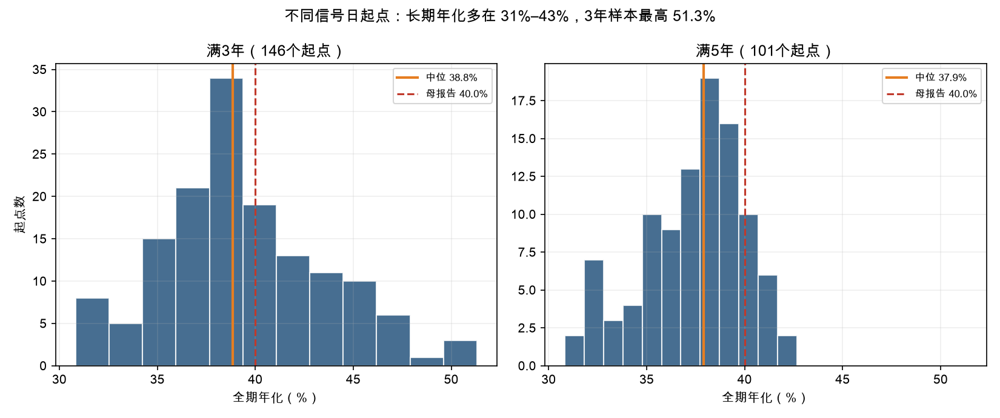
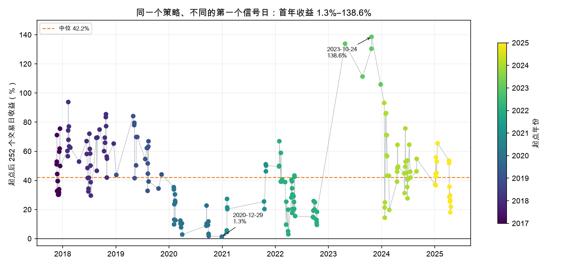
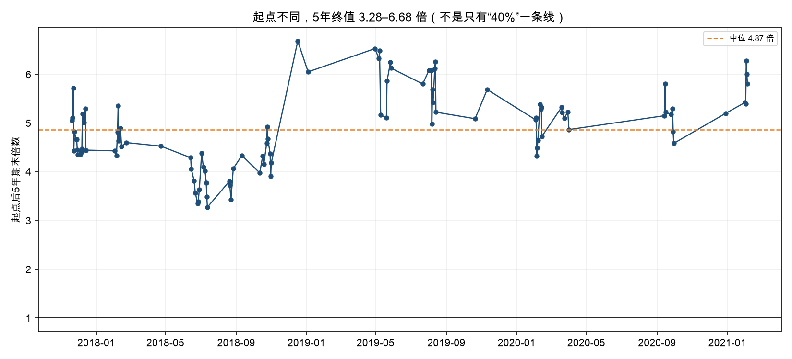
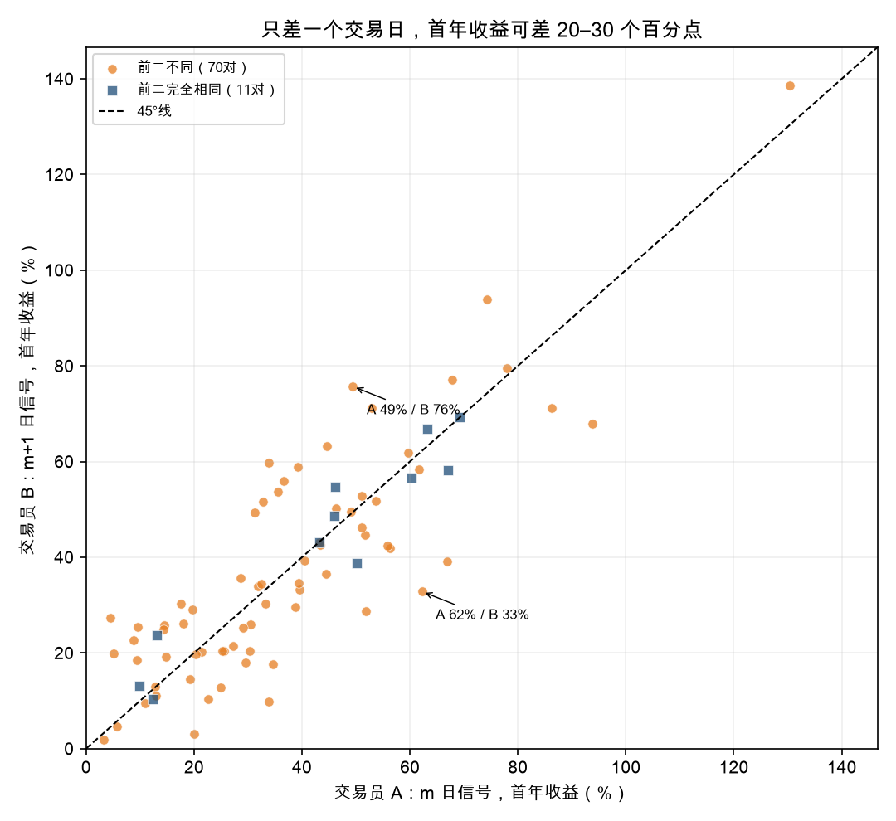
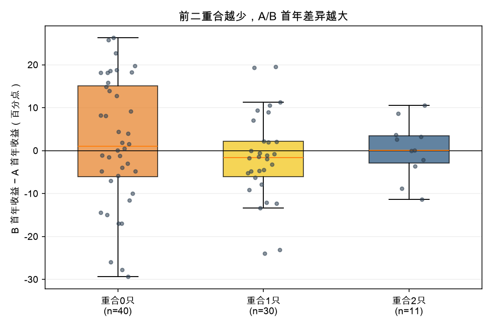

# 完整报告：不同信号日起点（A 在 m 日、B 在 m+1 日）

> 2026-10-25｜同花顺本地 DuckDB｜2017-10-19 至 2026-10-23｜沪深主板｜10 万本金｜2 仓｜15 日持有｜+20% 止盈｜0.175%/边｜不构成投资建议

## 0. 先给结论

1. **251 个信号日全部逐一跑了**：每个信号日一行，含首笔、全期、1/3/5 年、完整逐笔。不是抽样，也不是只跑“两天都有两只”的子集。
2. **长期看，40% 不是某个起点的偶然**：满 3 年的 146 个起点，全期年化 30.8%–51.3%（中位 38.8%）；满 5 年的 101 个，30.8%–42.7%（中位 37.9%）。
3. **短期看，起点非常影响你看到什么**：202 个满 1 年的起点，首年收益 1.3%–138.6%（中位 42.2%）。2020 年 12 月开始的起点首年只有 1.3%；2023 年 10 月开始的起点首年 106%–139%。
4. **相邻两天起点，差一天可以差很多**：114 对“次日且两日都 ≥2 只”，前二零重合 63 对、完全相同只有 13 对；首年差（B−A）中位 -0.6 个百分点，5%–95% 分位 -23.1 到 +19.5；5 年差中位 -9.1 个百分点，5%–95% 分位 -73.6 到 +70.8。
5. **但后面大多会重新汇合**：次日配对的全期交易集合重合度中位 89.7%。第一笔不同，后面的交易大多一样；差距主要通过第一笔的盈亏、2 仓占位和复利留在终值里。
6. **40% 这个点**：最早起点 2017-11-20 跑出 99 笔、20.75 倍、年化 40.47%；母报告从 2017-10-19 起算是 40.0%。同一批 99 笔、同一终值，只是分母多了约一个月。
7. **当前 2026-10-22 与 10-23 是两批不同的信号**：10-22 只有 605117.SH，计划 10-27 开盘；10-23 有 123 只，前二 603778.SH、605376.SH，计划 10-28 开盘。不要互相替换。

## 1. 问题与口径

### 1.1 这次到底在比较什么

交易员 A 在 m 日收盘看到信号，按规则在 m+3 开盘买入当天前二；交易员 B 在 m+1 日收盘看到新信号，在 m+4 开盘买入 m+1 的前二。两人之后都用同一套规则继续跑。

- **固定**：信号条件、排序、2 仓、15 日持有、+20% 止盈、0.175%/边、一字涨停/停牌不买、不递补。
- **改变**：第一个信号日。不是改变“信号后第 N 天买”；N 固定为 3。
- **不是**：在 m+3 或 m+4 重新扫描条件。信号在各自信号日收盘就冻结。

### 1.2 和上一份报告的区别

上一份 [不同入场时点](../00_一页纸_不同入场时点.md) 固定信号日 T，只改变入场延迟 N（第 1 日、第 2 日、第 3 日……），回答“同一个信号，早买晚买差多少”。

本报告固定 N=3，改变第一个信号日，回答“A 从 m 日开始、B 从 m+1 日开始，各买各的前二，后面各赚多少”。

### 1.3 信号与交易规则

```text
250日收益 > 0
250日回撤 < -45%
RSI14 < 35
收盘位置 > 0.45
主板等权20日 < -5%
```

- 同日按 250 日回撤升序取前 2；2 仓各 50% 当前权益；无信号空仓。
- 信号后第 3 个交易日开盘入场；一字涨停/停牌不买，被跳过不递补。
- +20% 止盈（T+1 起，盘中触价；开盘跳空高于止盈按开盘）；持有 15 个交易日收盘卖；无普通止损。
- 成本 0.175%/边；收益用后复权；涨跌停/停牌判断用不复权实际价。

### 1.4 “所有情况”覆盖到什么

- **251 个信号日**：每个有信号的交易日都是一个起点，全部有结果。
- **1 只信号的日子**：只买 1 只、半仓，剩下一半现金；不会为了凑两只去买不合格的股票。
- **没有信号的日子**：如果从这种日子开始，第一天不会买；第一笔与“从下一个信号日开始”完全一样，只是多空仓几天。因此不同的首笔路径就是这 251 个信号日，不需要把 2,187 个交易日各跑一遍。
- **数据末端**：2026-10-14/15/16 已入场但持有未满；2026-10-22/23 尚未入场，只给计划入场日，不给收益。

## 2. 数据与样本

| 项目 | 内容 |
|---|---|
| 数据 | 同花顺本地 DuckDB 派生的 `research_panel.parquet`；2017-10-19 至 2026-10-23 |
| 股票池 | 沪深主板 600/601/603/605/000/001/002/003；3,162 只有行情 |
| 信号 | 4,195 条；251 个信号日；1,246 只标的 |
| 信号日 ≥2 只 | 208 天；1 只 43 天 |
| 相邻信号日 | 250 对；其中“次日”158 对；“次日且两日都 ≥2 只”114 对（113 对各买满 2 只） |
| 有交易起点 | 249 个（2026-10-22/23 尚未入场） |
| 完整首笔批次 | 246 个（另有 3 个持有未满、2 个尚未入场） |

### 2.1 信号日在年份上的分布

| 起点年份 | 2017 | 2018 | 2019 | 2020 | 2021 | 2022 | 2023 | 2024 | 2025 | 2026 |
|---|---:|---:|---:|---:|---:|---:|---:|---:|---:|---:|
| 信号日数 | 17 | 37 | 20 | 22 | 10 | 38 | 5 | 36 | 17 | 49 |

- 2017 从 10-19 开始，2026 到 10-23，都是部分年度。
- 信号日高度聚集：2018-02、2020-02、2022-04、2024-02、2026-10 都是成片出现；连续两天都有信号时，第二天的前二常常是另一批。见 [信号日聚集](04_图表/06_信号日聚集.png)。

## 3. 方法

### 3.1 起点组合

对每个信号日 s0：

1. 以 10 万本金、空仓开始；
2. 在 s0+3 开盘买 s0 的前二（最多 2 只，每只 50%）；
3. 之后每天按同一规则：有信号且有空仓就买当天前二；持仓到 +20% 止盈或 15 日到期；
4. 一直跑到 2026-10-23；未平仓按最后收盘价计。

这等价于“一个交易员从 s0 日开始，严格按母策略执行”。

### 3.2 首笔批次

对每个信号日，单独算当天前二的“第一笔”：

- 两只各 50%；只有 1 只就半仓；一只都买不到就空仓；
- 持有 15 日或 +20% 止盈；扣 0.175%/边；
- 不受后续仓位影响，用来剥离“第一笔之后”的路径。

### 3.3 固定持有期

- 1 年 = 起点后 252 个交易日收盘市值；
- 3 年 = 756 个交易日；
- 5 年 = 1,260 个交易日；
- **未强制平仓**，按当日收盘市值计；所以是“如果那天看账户”的收益，不是“那天全部卖掉”的收益。
- 5 年期末倍数 = 1 + 5 年总收益；例如 5 年总收益 386.9% = 4.87 倍。

### 3.4 相邻信号日配对

对每一对相邻信号日 A、B：

- 前二重合只数、重合度（交集/并集）、是否完全相同；
- A/B 首笔收益差、首年收益差、3 年差、5 年差；
- 全期交易集合重合度（交集/并集）。

差值统一用“B−A，百分点”。正数表示 B 更好，负数表示 A 更好。

### 3.5 与母策略对齐

最早起点 2017-11-20 的组合与母策略完全一致：

- 99 笔，信号日/代码/入场日/退出日全一致；
- 单笔收益最大差异 < 1e-7；
- 期末 20.745834 倍；从 2017-11-20 起算年化 40.47%，从 2017-10-19 起算 40.01%。

这不是另一套策略，只是把“什么时候开始”作为一个变量。

## 4. 每个信号日的第一笔：246 个完整批次

### 4.1 分布

| 指标 | 数值 |
|---|---:|
| 完整批次 | 246 |
| 中位 | **+5.0%** |
| 均值 | +4.8% |
| 5% 分位 | -10.9% |
| 95% 分位 | +19.6% |
| 最小 | -25.1% |
| 最大 | +23.0% |
| 负收益占比 | **32.1%** |

- 第一笔不是“稳赚”：约三分之一为负；但中位 +5.0%，且 +20% 止盈把右尾拉长。
- 只有 1 只信号的日子，组合收益按半仓算；所以同样一只股票涨 10%，组合只记 +5%。逐只收益看 [逐只首笔](03_结果/逐日首笔_逐只.csv)。
- 完整批次收益见 [逐日首笔](03_结果/逐日首笔.csv)；未完整的 3 天有 `首笔浮动收益`，但不进入上面的分布。

### 4.2 相邻两天，前二到底有多像

114 对“次日且两日都 ≥2 只”：

| 前二重合 | 对数 | 占比 |
|---|---:|---:|
| 0 只 | 63 | 55.3% |
| 1 只 | 38 | 33.3% |
| 2 只（完全相同） | 13 | 11.4% |

**一半以上是零重合**。所以“m 日有两只、m+1 日又出现两只新的”不是小概率，而是这个策略在恐慌密集期的常态。

### 4.3 三个第一笔例子

| A 信号日 | A 前二 | A 首笔 | B 信号日 | B 前二 | B 首笔 | 首笔差 |
|---|---|---|---:|---|---|---:|---:|
| 2019-08-06 | 002565.SZ、601519.SH | +19.58% | 2019-08-07 | 000550.SZ、002679.SZ | -2.08% | -21.66pp |
| 2024-06-11 | 002786.SZ、002855.SZ | -9.18% | 2024-06-12 | 002535.SZ、600186.SH | +6.79% | +15.96pp |
| 2018-06-14 | 002497.SZ、601011.SH | +3.32% | 2018-06-15 | 002497.SZ、601011.SH | -0.18% | -3.50pp |

第三行是“前二完全相同”的例子：同样两只股票，晚一天买，第一笔仍差 3.5 个百分点。

## 5. 从某天开始一直跑：251 个起点的全期结果

### 5.1 全部与分样本

| 样本 | 起点数 | 全期年化中位 | 全期年化范围 | 首年收益中位 | 首年收益范围 |
|---|---:|---:|---:|---:|---:|
| 全部有交易 | 249 | 38.3% | -57.4%–294.4%* | 42.2% | 1.3%–138.6% |
| 满 1 年 | 202 | 38.3% | 17.3%–57.8% | 42.2% | 1.3%–138.6% |
| 满 3 年 | 146 | **38.8%** | **30.8%–51.3%** | 39.4% | 1.3%–133.8% |
| 满 5 年 | 101 | **37.9%** | **30.8%–42.7%** | 44.6% | 1.3%–93.8% |

\* 全部有交易里的年化只对 246 个可算起点统计；首年只对 202 个满 1 年起点；5 年只对 101 个满 5 年起点。2026-10-14/15/16 只有 8–10 个交易日，年化不计算；2026-10-22/23 尚未入场。极端负值 -57.4% 来自 2026-06-04 的 4 个月短样本，不是长期年化。

- 只要样本满 3 年，**没有负年化**；最差 30.8%，最好 51.3%。
- 满 5 年，年化收敛到 30.8%–42.7%，中位 37.9%。
- 但 5 年期末倍数仍有 **3.28–6.68 倍**（中位 4.87 倍）的差距；年化只差 12 个百分点，复利到终值就是两倍。



### 5.2 首年：起点年份决定你看到什么

| 起点年份 | 起点数 | 首年中位 | 首年最小 | 首年最大 | 3 年中位 | 5 年中位 |
|---|---:|---:|---:|---:|---:|---:|
| 2017 | 17 | 39.6% | 30.2% | 75.5% | 207.4% | 366.5% |
| 2018 | 37 | 61.6% | 29.6% | 93.8% | 149.9% | 318.5% |
| 2019 | 20 | 58.4% | 32.8% | 84.1% | 124.8% | 496.0% |
| 2020 | 22 | **11.2%** | **1.3%** | 35.3% | 68.3% | 416.6% |
| 2021 | 10 | 23.5% | 4.6% | 51.0% | 242.0% | 481.4% |
| 2022 | 38 | 25.1% | 3.0% | 66.9% | 278.5% | — |
| 2023 | 5 | **130.4%** | **105.9%** | **138.6%** | 265.3%* | — |
| 2024 | 36 | 46.1% | 14.4% | 93.2% | — | — |
| 2025 | 17 | 37.3% | 18.0% | 65.5% | — | — |
| 2026 | 49 | — | — | — | — | — |

\* 2023 只有 2 个起点满 3 年；5 个起点满 1 年。样本很小，不要外推。

- **2020 年 12 月 29 日**开始：首年只有 +1.3%，随后 2021–2022 年熊市；但满 3 年仍有 +47.9%（总收益），满 5 年 +227.5%。
- **2023 年 10 月 24 日**开始：首年 +138.6%，主要是 2024 年反弹；这不是“策略突然变强”，是起点撞上了大反弹。
- 2024 年起点首年中位 46.1%，但全期样本只有约 2.3 年，不能和满 3/5 年的年化直接比。



### 5.3 5 年终值

101 个满 5 年的起点：

- 5 年总收益 227.5%–568.4%；
- 期末 3.28–6.68 倍，中位 4.87 倍；
- 这不是“40% 一条线”，而是 3 倍到 6.7 倍的分布。



### 5.4 最早起点与 40%

最早起点 2017-11-20：

- 99 笔，期末 20.75 倍，年化 40.47%，最大回撤 -16.0%，胜率 71.7%，平均单笔 6.68%；
- 与母策略逐笔一致；
- 首年 +51.0%，3 年 +233.1%，5 年 +404.9%。

所以 40% 是“2017-10-19 起算”的这个点，不是“每个起点都 40%”。但满 3/5 年的起点大多在 31%–43%，说明它也不是唯一某一天的运气。

### 5.5 最好/最差的起点（只用于看分布）

| 分组 | 起点 | 全期年化 | 首年 | 3 年 | 5 年 |
|---|---|---:|---:|---:|---:|
| 满 3 年最低年化 | 2020-04-01 | 30.8% | 2.8% | 47.9% | 386.9% |
| 满 3 年最高年化 | 2023-08-23 | 51.3% | 111.3% | 275.1% | — |
| 满 1 年最低首年 | 2020-12-29 | 37.0% | 1.3% | 118.9% | 420.1% |
| 满 1 年最高首年 | 2023-10-24 | 57.8% | 138.6% | — | — |

- “5 年”列是总收益，不是年化；“—”表示起点后不足 5 年。
- 2023-08-23 是满 3 年样本里年化最高的；2023-10-23/24 虽然全期年化更高，但只有约 3 年，`3年收益` 差几个交易日、无法计入满 3 年样本。

这些是**事后**统计。用它们挑起点就是过拟合；看分布可以，不要据此说“以后等到 2023 年那种时候再开始”。

## 6. 相邻信号日：A 在 m、B 在 m+1

### 6.1 总量

- 250 对相邻信号日；
- 158 对是“次日”（间隔 1 个交易日）；
- 114 对“次日且两日都 ≥2 只”，其中 113 对各买满 2 只；
- 114 对里，前二零重合 63 对、重合 1 只 38 对、完全相同 13 对。

### 6.2 差多少

| 样本 | 对数 | 首笔差中位 | 首年差中位 | 首年差 5%–95% | 5 年差中位 | 5 年差 5%–95% | 交易重合度中位 |
|---|---:|---:|---:|---:|---:|---:|---:|
| 全部相邻 | 250 | -0.1pp | -0.6pp | -25.9 到 +22.9 | -3.8pp | — | 92.2% |
| 次日 | 158 | -0.5pp | -0.8pp | -25.9 到 +19.3 | -8.2pp | — | 90.9% |
| 次日且两日 ≥2 只 | 114 | 0.0pp | -0.6pp | -23.1 到 +19.5 | -9.1pp | -73.6 到 +70.8 | 89.7% |
| 次日且各买满 2 只 | 113 | -0.3pp | -0.3pp | -23.2 到 +19.5 | -9.1pp | -73.6 到 +70.8 | 90.0% |

- **中位差很小**：差一天，平均而言谁都不占优；B 略差，但中位只有 -0.6pp。
- **尾部很大**：首年 5%–95% 分位 -23.1 到 +19.5；最大负差 -29.4，最大正差 +26.3。
- **5 年差更大**：中位 -9.1pp，5%–95% 分位 -73.6 到 +70.8；绝对值中位 22.2pp。
- **交易重合度很高**：中位 89.7%；即使第一笔不同，后面的交易大多会汇合。



### 6.3 前二相同 vs 不同

| 前二关系 | 1 年可算对数 | 首年差中位 | 首年差范围 |
|---|---:|---:|---:|
| 完全相同 | 11 | +0.02pp | -11.4 到 +10.6 |
| 不同 | 70 | -0.95pp | -29.4 到 +26.3 |

- 前二完全相同时，差异主要来自“晚一天入场价 + 15 日窗口平移”，中位几乎为 0，但仍可差 ±11pp。
- 前二不同时，差异来自“选股 + 入场价 + 路径”，尾部明显更宽。



### 6.4 两个极端例子

**2019-08-06（A）vs 2019-08-07（B）**

- A：002565.SZ、601519.SH；两只都在 08-23 +20% 止盈；首笔 +19.58%。
- B：000550.SZ、002679.SZ；08-30 到期，一正一负；首笔 -2.08%。
- 首年：A +62.2%，B +32.8%，**A 领先 29.4pp**。
- 但全期交易集合重合度 94.8%：后面绝大多数交易一样，差距主要来自第一笔和占位。

**2024-06-11（A）vs 2024-06-12（B）**

- A：002786.SZ、002855.SZ；两只都到期小亏；首笔 -9.18%。
- B：600186.SH、002535.SZ；一只 -6.0%，一只 +19.58% 止盈；首笔 +6.79%。
- 首年：A +49.4%，B +75.7%，**B 反超 26.3pp**。
- 全期交易重合度 84.0%。

### 6.5 为什么“差一天”会放大

1. **信号替换**：m+1 的新信号会把 m 的前二挤掉。114 对里 63 对零重合。
2. **价格与窗口**：即使前二相同，晚一天入场价不同，15 日窗口整体后移。
3. **2 仓占位**：第一笔的退出日决定哪一天有空仓接新信号；早一天/晚一天会让后面某一笔错位。
4. **汇合**：后续交易大多重合（中位 89.7%），所以长期年化会收敛；但第一笔的差距通过复利留在终值里。

## 7. 当前案例：2026-10-22 与 10-23

### 7.1 两批信号

| 信号日 | 当日信号数 | 前二 | 计划入场 | 状态 |
|---|---:|---|---|---|
| 2026-10-22 | 1 | 605117.SH | 2026-10-27 开盘 | 尚未入场 |
| 2026-10-23 | 123 | 603778.SH、605376.SH | 2026-10-28 开盘 | 尚未入场 |

- 10-22 只有 1 只，按规则只能买半仓；10-23 有 123 只，前二各 50%。
- 两批的入场日差 1 天（10-27 vs 10-28），但选股完全不同。
- **不要在 10-27 或 10-28 重新扫描**：信号在各自信号日收盘已经冻结；10-28 的新候选不属于 10-22 的计划。

### 7.2 已入场但未满 15 日

| 信号日 | 前二 | 入场日 | 截至 10-23 首笔浮动 | 截至 10-23 账户市值 | 状态 |
|---|---|---|---:|---:|---|
| 2026-10-14 | 600783.SH | 10-19 | +0.13% | -1.01% | 10-15 又用空仓买了 603778.SH，2 笔未平 |
| 2026-10-15 | 603778.SH、603986.SH | 10-20 | +1.22% | +1.40% | 2 笔未平 |
| 2026-10-16 | 000426.SZ、600879.SH | 10-21 | -1.83% | -1.66% | 2 笔未平 |

- `首笔浮动` 用单笔口径、扣双边成本；`账户市值` 只扣买入成本、未扣未平仓卖出成本，所以 10-15/16 的账户市值比首笔浮动高约 0.17%。
- 10-14 只有 1 只信号，10-15 又出现新信号，空的一半仓位买入了 603778.SH；所以账户多了一笔 later trade。这就是 2 仓占位的实际效果。
- 这些都不是最终收益；15 日到期或 +20% 止盈后才结算。

## 8. 稳健性与限制

### 8.1 覆盖了什么

- 251 个信号日逐一跑；每个起点有首笔、全期、1/3/5 年、完整逐笔。
- 250 对相邻信号日；158 对次日；114 对两日都 ≥2 只；前二重合、首笔差、首年差、5 年差、交易重合度。
- 459 只首笔明细；完整批次 246 个。
- 与母策略 99 笔逐笔对齐；最早起点终值 20.745834 倍。

### 8.1.1 逐笔审计

`全部起点逐笔.csv` 有 12,090 行，等于 249 个有交易起点的 `笔数` 之和；按 `起点信号日` 筛选，可看该日起的每一笔。Excel 的 `全部起点逐笔` 表同样可按起点筛选。

**每个信号日单独一份交易记录**：`03_结果/每信号日交易记录/YYYY-MM-DD.csv`，共 251 份；有交易的 249 份，2026-10-22/23 是“尚未入场”状态文件。`00_索引.csv` 列出 251 天的笔数、期末倍数、年化、1/3/5 年和文件名；同目录有 zip。

- `分配额(初始本金%)` 是该笔投入 / 10 万；复利后可能超过 100%（后期仓位是当前权益的 50%，不是初始本金的 50%）。
- `仓位占当时权益(%)` 才是不超过 50% 的当前权益比例。
- `单笔收益/盈亏贡献` 按双边成本；期末未平仓的账户市值只扣买入成本、未扣卖出成本，所以未平仓部分的贡献之和会比账户总收益低约 0.17%。

### 8.2 没覆盖什么

- **起点高度重叠**：251 个起点不是 251 次独立实验；后一个起点常常包含前一个起点的大部分交易。分布描述的是这一段历史，不是置信区间。
- **后复权**：与母策略一致；实际价整手只对母策略基准做过（修正版 40.6% / -15.9%），没有对 251 个起点逐一复核。绝对收益可能变，起点间相对差异的方向不变，幅度会变。
- **退市股**：本地库不含退市股；策略专挑“年内仍强、短期暴跌”的股票，退市/长期停牌会被系统性漏掉。
- **盘中时点**：没有分时数据；只能用开盘/收盘/最高/最低近似。10:00、14:00 等真实时点没测。
- **卖出可行性**：15 日到期按收盘卖，未检查跌停/停牌卖不出；+20% 止盈按触价，未建模排队和滑点。
- **期末未平**：1/3/5 年和全期都按最后收盘市值计，未强制平仓；若强制卖出，扣 0.175% 卖出成本。
- **2024 异常年**：2023 年 10 月起点首年 106%–139% 主要来自 2024 年反弹；不要把 2024 当常态。
- **短样本**：2026-06/07 的起点只有 4–9 笔，年化 -57% 到 +294% 都是短样本噪声，不能当长期年化。
- **参数选择**：信号条件、N=3、2 仓、15 日、+20% 都是同一段历史里定下来的；本报告没有再调参，但也没有做真正的样本外。
- **事后挑起点**：看最好/最差起点可以理解分布，不能据此设计“等到某年再开始”的规则。
- **母策略实际价逐笔表的送转 bug**：母策略 `实际价_逐笔.csv` 旧版有送转/成本 bug（002365：2,500→3,868.95 股、-24,533 假亏损；002607 漏分红）。**旧版实际价 42.6% 已作废；修正版 40.6%**，见 `../2026-10-24_主板恐慌反转_年化30/03_结果/实际价_修正说明.md`。本报告全部用后复权，不受影响。

### 8.3 与母报告的数字差异

- 母报告 40.0% 从 2017-10-19 起算；本报告最早起点从 2017-11-20 起算，同一批 99 笔、同一终值 20.745834 倍，年化 40.47%。差 0.47pp 来自分母少了约一个月。
- 母报告参数表里的“延迟 0/1/2/3/4”与上一份报告的 N=1..5 对应；本报告不重复那条轴。
- 本报告统一 0.175%/边；上一份报告已说明母报告部分数字用 0.15%/边复跑，差 0.3–0.4pp。

## 9. 结论

1. **251 个信号日全部有结果**：不是抽样，也不是只跑“两天都有两只”的子集；任意信号日都可以在 `起点汇总` 和 `全部起点逐笔` 里查。
2. **40% 不是某个起点的偶然**：满 3 年 146 个起点全部 30.8%–51.3%，满 5 年 101 个全部 30.8%–42.7%。长期看，这个策略在不同起点上都能做出 30%+。
3. **但起点决定你前几年看到什么**：首年 1.3%–138.6%；2020 年 12 月 vs 2023 年 10 月是两个极端。
4. **相邻两天起点，中位差不大、尾部很大**：首年差中位 -0.6pp，5%–95% 分位 -23.1 到 +19.5；5 年差中位 -9.1pp，5%–95% 分位 -73.6 到 +70.8。
5. **前二重合越少，差异越大**：114 对次日里 63 对零重合；完全相同只有 13 对，且相同也可能差 ±11pp。
6. **后面大多会汇合**：交易重合度中位 89.7%；所以长期年化收敛，但第一笔的差距通过 2 仓占位和复利留在终值里。
7. **怎么用**：按 31%–43% 规划长期年化，不要按 40% 线性外推；接受首年可能只有个位数、也可能 100%+；不要事后挑起点；当前 10-22/10-23 按各自的计划执行，不替换、不重扫。

## 10. 文件

- [一页纸](00_一页纸_不同信号日起点.md)
- [数据与复现](03_数据与复现.md)
- [Excel 数据表](不同信号日起点回测.xlsx)
- 结果 CSV：
  - [起点汇总](03_结果/起点汇总.csv)
  - [起点分布](03_结果/起点分布.csv)
  - [起点年度](03_结果/起点年度.csv)
  - [相邻信号日](03_结果/相邻信号日.csv)
  - [相邻信号日汇总](03_结果/相邻信号日_汇总.csv)
  - [逐日首笔](03_结果/逐日首笔.csv)
  - [逐只首笔](03_结果/逐日首笔_逐只.csv)
  - [全部起点逐笔](03_结果/全部起点_逐笔.csv)
  - [每信号日交易记录说明](03_结果/每信号日交易记录/README_每信号日交易记录.md)
  - [每信号日索引](03_结果/每信号日交易记录/00_索引.csv)
  - [每信号日交易记录 zip](03_结果/每信号日交易记录.zip)
  - [最近信号日案例](03_结果/最近信号日案例.csv)
  - [指标](03_结果/指标.json)
- 图表：
  - [起点年化分布](04_图表/01_起点年化_分布.png)
  - [首年收益按起点](04_图表/02_首年收益_按起点.png)
  - [五年期末倍数](04_图表/03_五年期末倍数_按起点.png)
  - [相邻信号日首年对比](04_图表/04_相邻信号日_首年对比.png)
  - [首笔批次收益](04_图表/05_首笔批次收益_分布.png)
  - [信号日聚集](04_图表/06_信号日聚集.png)
  - [前二重合与首年差](04_图表/07_前二重合_首年差.png)
- [交付校验](05_证据/交付校验.txt)

> 历史回测不代表未来；不构成投资建议。
