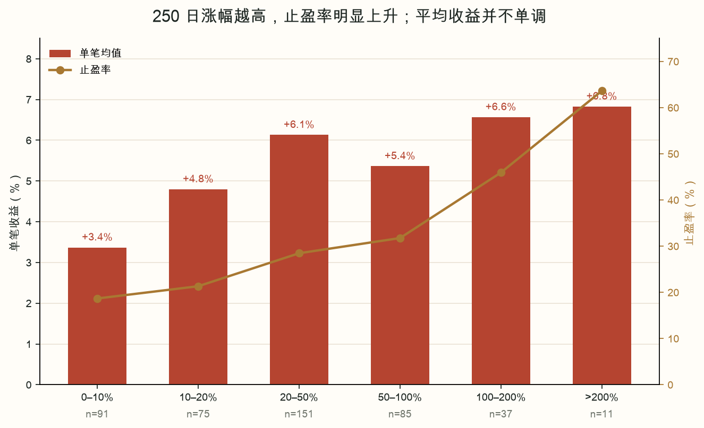
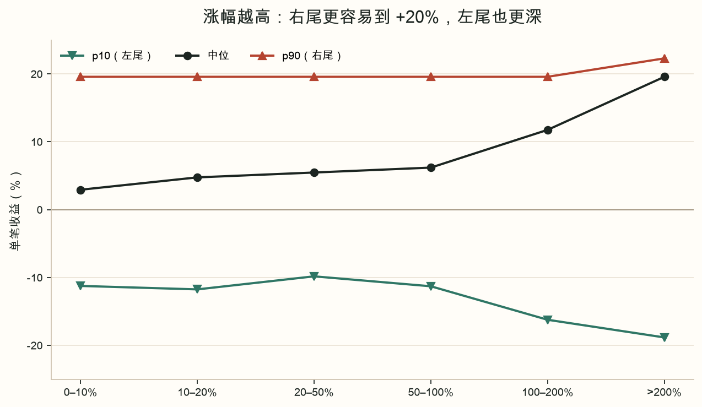
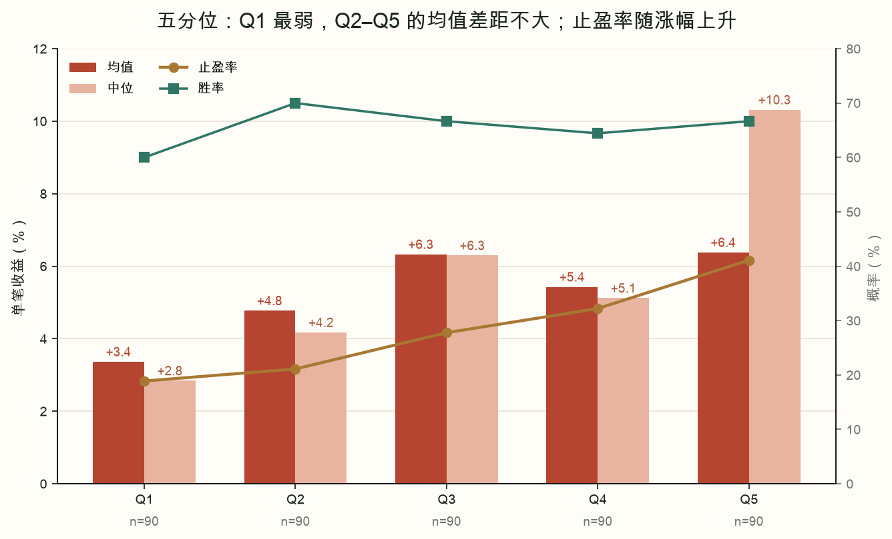
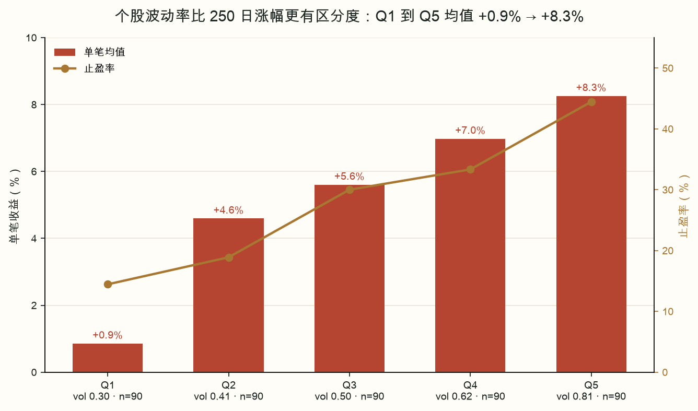
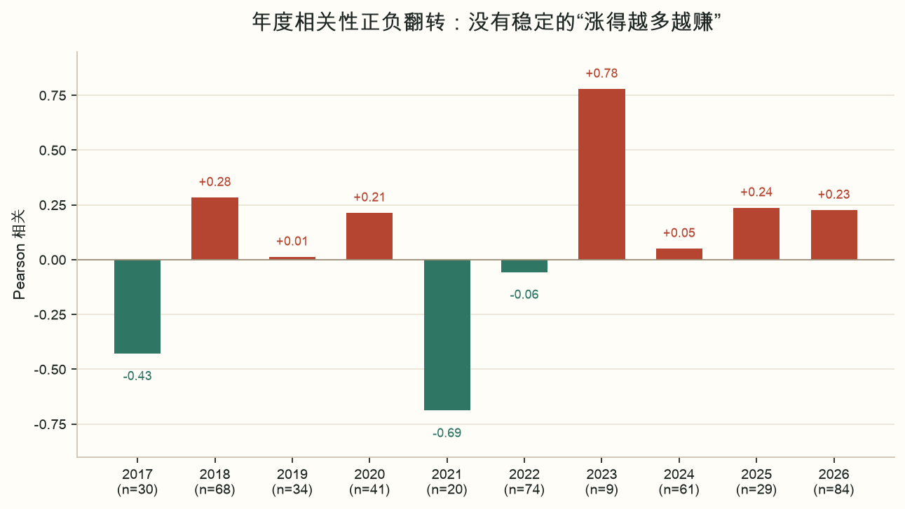

# 250 日涨幅与单笔收益：完整报告

**日期**：2026-10-25  
**问题**：历史记录里的股票盈利情况，跟“信号日当天往前一年”的涨幅有关系吗？  
**结论先行**：**有“止盈概率”上的弱关系，没有稳定的“平均收益”关系。** 高涨幅股票更容易摸到 +20%，但左尾也更深；不能把“最近一年涨得多”当成更强的买入理由，更不能替代 250 日回撤深度的排序。

---

## 1. 口径：这里的“最近一年”是什么？

- 定义：`r250 = hfq_close(T) / hfq_close(T-250) - 1`。
- 是 **250 个交易日**，约 12 个月，不是 365 个自然日。
- 后复权，避免分红/送转干扰。
- 本文用 `research_panel.parquet` 的 `return_250d`；与逐笔重算的最大差为 **0.0**（见校验）。
- 策略本身要求 `r250 > 0`；本文只看“已经通过 >0 门槛”的股票，不研究负涨幅股票。
- 样本：
  - 前二 450 笔完整交易（2017-11-20 至 2026-07-31）；
  - 母路径 99 笔（含 10/23 两笔持仓按市值计，不是 99 笔全部已退出）；
  - 全部信号 4,019 笔（不只前二）。
- 收益：T+3 开盘买入，+20% 盘中止盈，15 个交易日到期，无普通止损，成本 0.175%/边。

> 前二 450 笔和母路径 99 笔不是同一样本。前二是“每个信号日取前二”的横截面；母路径是 10 万本金、2 仓连续滚动的实际路径。

## 2. 分布：通过 >0 门槛后，r250 仍然很分散

前二 450 笔的 r250：

| 分位 | 数值 |
|---|---:|
| 最小 | +0.04% |
| 10% | +4.9% |
| 25% | +12.5% |
| 中位 | +27.4% |
| 75% | +56.5% |
| 90% | +102.1% |
| 最大 | +693.2% |

- 中位 +27.4%，说明“通过 >0 门槛”的典型股票并不是刚翻红，而是过去一年已经涨了近三成。
- 但分布很宽：从刚过 0 到 +693% 都有；这也是为什么“r250 高低”值得单独看。
- 2026 年 r250 中位 **43.1%**，高于历史 27.4%；2026 并不是“涨幅不够”的一年，反而更高。

## 3. 总体关系：弱正相关，均值不显著

### 3.1 相关

| 样本 | 笔数 | Pearson | p | Spearman | p |
|---|---:|---:|---:|---:|---:|
| 前二全部 | 450 | **0.058** | 0.218 | **0.090** | 0.057 |
| 前二·剔除 2026 | 366 | **-0.002** | 0.977 | 0.048 | 0.358 |
| 前二·2026 | 84 | **0.227** | 0.038 | 0.221 | 0.043 |
| 母路径 99 笔 | 99 | 0.154 | 0.128 | 0.082 | 0.420 |
| 母路径·剔除 2026 | 88 | 0.046 | 0.671 | 0.003 | 0.978 |
| 全部信号 4,019 笔 | 4019 | 0.011 | 0.504 | 0.020 | 0.197 |
| 全部信号·剔除 2026 | 2374 | -0.005 | 0.799 | 0.003 | 0.898 |
| 全部信号·2026 | 1645 | 0.064 | 0.010 | 0.049 | 0.045 |

读法：

- 前二全部：Pearson 0.058，几乎不解释收益；Spearman 0.090，p=0.057，勉强擦边，但方向很弱。
- **剔除 2026 后，均值相关归零**（-0.002，p=0.977）。这是最重要的稳健性检查。
- 2026 年正相关 0.227（p=0.038），但 2026 只有 84 笔，且 6 月/7 月不稳定（见 §8）。
- 全部信号 4,019 笔几乎为零（0.011，p=0.504），说明不是“前二选择”造成的假象，而是整体就没有强关系。
- 母路径 99 笔 0.154（p=0.128），不显著。

### 3.2 回归

**均值模型**：`单笔收益 ~ r250 + 年度固定效应`；括号为按交易 bootstrap 的 95%CI。

| 模型 | 每 +100pp r250 的收益 | 95%CI | 拟合 |
|---|---:|---:|---:|
| 前二·全部，年度 FE | **+1.69pp** | -0.57 ~ +3.49 | R²=0.055 |
| 前二·全部，年度 FE + 控制 | **+1.09pp** | -1.72 ~ +2.86 | R²=0.165 |
| 前二·剔除 2026，年度 FE | **-0.47pp** | -3.88 ~ +3.31 | R²=0.036 |
| 前二·2026 | **+2.78pp** | +0.32 ~ +4.78 | R²=0.051 |
| 母路径 99 笔，年度 FE | +3.18pp | -0.99 ~ +9.01 | R²=0.096 |
| 全部信号 4,019 笔，年度 FE | +0.78pp | -0.23 ~ +1.64 | R²=0.065 |

控制变量：250 日回撤、个股 20 日波动率、log 成交额、RSI14、收盘位置、市场 20 日波动率。

- “每 +100pp”就是 r250 从 0% 到 100% 的差别；不是每涨 1 个百分点。
- 前二全部 +1.69pp 的区间跨 0；控制后 +1.09pp，区间更跨 0。
- 剔除 2026 后变成 -0.47pp；**说明总体那点正斜率主要是 2026 年贡献的，不是历史稳定规律。**
- 2026 的 +2.78pp 区间刚好不跨 0，但只有 84 笔、单年，不能外推。
- 母路径、全部信号的区间都跨 0（母路径很宽，因 n=99）。

**止盈模型**：`是否 +20% 止盈 ~ r250 + 年度固定效应`，Logistic OR。

| 模型 | 每 +100pp 的止盈 OR | 95%CI | AUC |
|---|---:|---:|---:|
| 前二·全部，年度 FE | **1.84** | 1.31 ~ 2.98 | 0.657 |
| 前二·全部，年度 FE + 控制 | **1.69** | 1.19 ~ 3.14 | 0.730 |
| 前二·剔除 2026，年度 FE | **1.77** | 1.09 ~ 3.22 | 0.650 |
| 前二·2026 | **1.90** | 1.32 ~ 5.95 | 0.722 |
| 母路径 99 笔，年度 FE | 2.18 | 0.94 ~ 9.98 | 0.718 |
| 全部信号 4,019 笔，年度 FE | **1.61** | 1.43 ~ 1.84 | 0.625 |

- 止盈 OR 在**前二、剔除 2026、2026、全部信号**里都 >1，且大部分区间不跨 1；这是比均值更稳定的关系。
- 母路径 OR 2.18 但区间很宽（0.94~9.98），n=99，不能单独当证据。
- 注意：OR 1.84 不是“收益多 84%”，而是“每 +100pp r250，止盈几率约多 84%”；绝对概率仍从 18.7% 到 45.9%（0–10% 到 100–200%）。

## 4. 六档成绩：均值不单调，止盈率单调上升

### 4.1 前二 450 笔

| 250日涨幅 | 笔数 | 单笔均值 | 中位 | 胜率 | 止盈率 | p10 | p90 | 最差 | 最好 | 平均回撤 |
|---|---:|---:|---:|---:|---:|---:|---:|---:|---:|---:|
| 0–10% | 91 | **+3.4%** | +2.9% | 60.4% | 18.7% | -11.2% | +19.6% | -19.5% | +31.2% | -57.1% |
| 10–20% | 75 | +4.8% | +4.8% | 70.7% | 21.3% | -11.7% | +19.6% | -23.9% | +25.1% | -58.6% |
| 20–50% | 151 | +6.1% | +5.5% | 67.5% | 28.5% | -9.8% | +19.6% | -19.9% | +25.3% | -59.3% |
| 50–100% | 85 | +5.4% | +6.2% | 63.5% | 31.8% | -11.3% | +19.6% | -33.0% | +25.2% | -62.0% |
| 100–200% | 37 | **+6.6%** | **+11.8%** | 64.9% | **45.9%** | -16.2% | +19.6% | -30.2% | +22.3% | -60.6% |
| >200% | 11 | +6.8% | **+19.6%** | 63.6% | **63.6%** | -18.8% | +22.3% | -18.8% | +22.6% | -60.6% |

读法：

- **均值**：3.4 → 4.8 → 6.1 → 5.4 → 6.6 → 6.8，不是单调；50–100% 档反而比 20–50% 低。
- **中位**：2.9 → 4.8 → 5.5 → 6.2 → 11.8 → 19.6，单调上升，因为高涨幅股票更容易“直接摸 +20%”。
- **胜率**：60.4 → 70.7 → 67.5 → 63.5 → 64.9 → 63.6，基本平；高涨幅并没有减少亏损概率。
- **止盈率**：18.7 → 21.3 → 28.5 → 31.8 → 45.9 → 63.6，单调上升。
- **左尾**：p10 从 -11.2 走到 -18.8；100–200% 档最差 -30.2%，>200% 档最差 -18.8%（n 小）。
- 平均回撤在 -57% 到 -62% 之间，说明各档深度接近；r250 不是深度的代理。

### 4.2 剔除 2026 / 2026

| 250日涨幅 | 剔除2026 均值/胜率/止盈率 | 2026 均值/胜率/止盈率 |
|---|---:|---:|
| 0–10% | +5.1% / 69.9% / 20.5% | **-3.7% / 22.2% / 11.1%** |
| 10–20% | +6.1% / 73.8% / 23.1% | -3.5% / 50.0% / 10.0% |
| 20–50% | +6.3% / 68.7% / 26.7% | +5.3% / 60.0% / 40.0% |
| 50–100% | +7.3% / 69.4% / 32.3% | +0.2% / 47.8% / 30.4% |
| 100–200% | +5.7% / 62.5% / 43.8% | **+12.3% / 80.0% / 60.0%** |
| >200% | +7.7% / 66.7% / 66.7%（n=3） | +6.5% / 62.5% / 62.5%（n=8） |

关键：

- **0–10% 档的弱，主要是 2026 年**：2026 年 -3.7% / 22.2%，但剔除 2026 后 +5.1% / 69.9%。
- 2026 年 0–20% 两档都亏，20% 以上才转正；这是 2026 年的结构，不是“0–10% 永远不能买”。
- 2026 年 100–200% 档 +12.3% / 80%，>200% 档 +6.5%；高涨幅在 2026 年确实更好，但 2026 只有一年，且 6/7 月不稳定。
- 剔除 2026 后，均值仍不单调（5.1/6.1/6.3/7.3/5.7/7.7），止盈率仍大致上升（20.5→43.8，>200% n=3）。

### 4.3 图

## 5. 五分位：Q1 最弱，Q2–Q5 均值差距不大

| 五分位 | r250 范围 | 笔数 | 均值 | 中位 | 胜率 | 止盈率 |
|---|---|---:|---:|---:|---:|---:|
| Q1 | 0.04%–9.8% | 90 | **+3.4%** | +2.8% | 60.0% | 18.9% |
| Q2 | 9.9%–21.5% | 90 | +4.8% | +4.2% | 70.0% | 21.1% |
| Q3 | 21.5%–37.7% | 90 | +6.3% | +6.3% | 66.7% | 27.8% |
| Q4 | 37.9%–64.7% | 90 | +5.4% | +5.1% | 64.4% | 32.2% |
| Q5 | 65.1%–693.2% | 90 | +6.4% | **+10.3%** | 66.7% | **41.1%** |

- Q1 均值比其余低约 2.4pp（3.4% vs 5.7%），t 检验 p=0.084；止盈率 18.9% vs 30.6%，卡方 p=0.039。
- 这是“擦边”的差异，且 Q1 的弱主要是 2026 年；不要把它当成硬过滤。
- Q2–Q5 均值 4.8%–6.4%，没有“越高越赚”；Q5 的中位/止盈率更高，但均值只比 Q3 高 0.1pp。

## 6. 为什么均值不涨：止盈概率 vs 左尾

高 r250 股票的组合特征更像“高波动、彩票型”：

- 止盈率上升：18.7% → 63.6%；
- 中位上升：2.9% → 19.6%；
- 胜率基本不变：60–71%；
- 左尾变深：p10 -11.2% → -18.8%；
- 均值只从 +3.4% 到 +6.8%，且中间档回落。

这四件事同时出现，说明 r250 主要改变的是**收益分布形状**，不是“期望值”。高涨幅股票更容易一次性摸到 +20%，但没摸到时也可能跌得更多；两者抵消。

## 7. 机制：个股波动率比 r250 更有区分度

r250 与个股 20 日波动率的 Pearson 为 **0.219**（Spearman 0.187），高涨幅股票往往更高波动。

| 个股波动五分位 | 平均波动 | r250 均值 | 笔数 | 单笔均值 | 中位 | 胜率 | 止盈率 |
|---|---:|---:|---:|---:|---:|---:|---:|
| Q1 | 0.296 | +34.2% | 90 | **+0.9%** | -0.8% | 47.8% | 14.4% |
| Q2 | 0.408 | +32.0% | 90 | +4.6% | +4.4% | 64.4% | 18.9% |
| Q3 | 0.504 | +42.9% | 90 | +5.6% | +4.5% | 72.2% | 30.0% |
| Q4 | 0.623 | +53.5% | 90 | +7.0% | +8.3% | 68.9% | 33.3% |
| Q5 | 0.810 | +72.9% | 90 | **+8.3%** | +11.0% | 74.4% | 44.4% |

- 波动率 Q1→Q5 的均值差 **+7.4pp**，比 r250 的 Q1→Q5（+3.0pp）更大；胜率/止盈率也更单调。
- 回归里控制个股波动后，r250 的均值斜率从 +1.69pp 降到 +1.09pp，区间跨 0；止盈 OR 仍 1.69（1.19–3.14）。说明 r250 的一部分作用是通过“高波动”实现的，止盈概率上还有一点独立关系。
- 但高波动同样会放大左尾；这不是“只赚不亏”的开关。

## 8. 稳定性：年度、阶段、深度、2026

### 8.1 年度相关正负翻转

| 年份 | 笔数 | r250 中位 | 单笔均值 | 止盈率 | Pearson | p |
|---|---:|---:|---:|---:|---:|---:|
| 2017 | 30 | +30.8% | +3.6% | 23.3% | **-0.428** | 0.018 |
| 2018 | 68 | +17.9% | +4.3% | 17.6% | +0.284 | 0.019 |
| 2019 | 34 | +32.4% | +8.9% | 35.3% | +0.013 | 0.940 |
| 2020 | 41 | +24.0% | +4.2% | 17.1% | +0.214 | 0.178 |
| 2021 | 20 | +30.8% | +3.3% | 20.0% | **-0.688** | 0.001 |
| 2022 | 74 | +30.6% | +7.0% | 32.4% | -0.056 | 0.634 |
| 2023 | 9 | +25.9% | +9.4% | 11.1% | **+0.780** | 0.013 |
| 2024 | 61 | +28.6% | +6.5% | 39.3% | +0.051 | 0.695 |
| 2025 | 29 | +30.9% | +10.5% | 34.5% | +0.238 | 0.214 |
| 2026 | 84 | **+43.1%** | +1.5% | 31.0% | +0.227 | 0.038 |

- 2017、2021 显著负；2023 显著正但只有 9 笔；2026 正但并不稳定。**没有跨年稳定的符号**。
- 2026 年 r250 中位最高（43.1%），但单笔均值只有 +1.5%；这是“高涨幅不等于高收益”的直观反例。

### 8.2 阶段 × r250 高低

r250 高低按总体中位 27.4% 分。

| 阶段 | 高 r250 笔数 | 高 r250 均值 | 低 r250 均值 | 高 r250 止盈率 | 低 r250 止盈率 |
|---|---:|---:|---:|---:|---:|
| A 牛市上升段急跌 | 69 | +2.9% | +3.2% | 21.7% | 17.5% |
| B 高位转弱/跌破年线 | 59 | +6.7% | +6.1% | 47.5% | 31.4% |
| C 熊市反弹 | 14 | +7.8% | +13.4% | 28.6% | 50.0% |
| D 熊市下跌 | 83 | +7.1% | +4.7% | 36.1% | 20.2% |

- D/B 里高 r250 略好，A/C 里反而更差；C 只有 22 笔。**没有跨阶段一致方向。**
- 这与“不能加一个全局 r250 过滤”一致；r250 的作用依赖环境。

### 8.3 深度 × r250 高低

| 回撤档 | r250 | 笔数 | 单笔均值 | 中位 | 胜率 | 止盈率 |
|---|---|---:|---:|---:|---:|---:|
| ≤-65% | 高 | 68 | **+9.7%** | +17.7% | **77.9%** | **50.0%** |
| ≤-65% | 低 | 41 | +8.4% | +7.5% | 75.6% | 31.7% |
| >-65% | 高 | 157 | +4.0% | +4.7% | 59.2% | 27.4% |
| >-65% | 低 | 184 | +4.0% | +3.3% | 64.1% | 20.1% |

- 高 r250 只在**深回撤组**里有额外增益（均值 +1.3pp，中位/止盈率更明显）；浅回撤组均值完全一样。
- 这再次说明：**深度是主变量，r250 是次级条件**；不要用 r250 替代深度排序。
- 当前 603778/605376 都在 ≤-65% 且 r250 高于中位，落在历史最好的“深+高”子集（68 笔，+9.7%/77.9%）；但样本只有 68 笔，且当前环境（D+低波+Q3）不同，不能当保证。

### 8.4 2026：低涨幅组失败，高涨幅组扛住

- 2026 年 0–10% 档 -3.7% / 22.2%，10–20% 档 -3.5% / 50.0%；20–50% 才转正 +5.3%。
- 100–200% 档 +12.3% / 80.0%；>200% 档 +6.5% / 62.5%。
- 6 月相关 +0.124（p=0.459），7 月 -0.061（p=0.740）——2026 的正相关并不来自某个月的一致结构。
- 2026 是“高涨幅组相对抗跌”的一年，不等于“高涨幅永远更好”；2026 只有 84 笔前二。

## 9. 全部信号与母路径：稳健性

### 9.1 全部信号 4,019 笔

| 250日涨幅 | 笔数 | 均值 | 中位 | 胜率 | 止盈率 |
|---|---:|---:|---:|---:|---:|
| 0–10% | 1167 | +5.8% | +6.1% | 68.1% | 27.2% |
| 10–20% | 787 | +5.3% | +6.0% | 69.3% | 27.2% |
| 20–50% | 1136 | +4.7% | +5.2% | 64.3% | 26.3% |
| 50–100% | 595 | +6.0% | +7.2% | 69.9% | 33.8% |
| 100–200% | 270 | +6.1% | +9.9% | 67.8% | 42.6% |
| >200% | 64 | +7.1% | +19.6% | 68.8% | 51.6% |

- 均值不单调（4.7%–7.1%），止盈率上升（27.2%→51.6%）。
- 大样本（4,019）下 Pearson 0.011（p=0.504），Spearman 0.020（p=0.197）；**经济意义几乎为零**。
- 止盈 OR 1.61（1.43–1.84），显著但幅度小。

### 9.2 母路径 99 笔

- Pearson 0.154（p=0.128），Spearman 0.082（p=0.420）。
- 六档均值：4.4 / 8.1 / 6.0 / 7.6 / 7.7 / 19.6（>200 只有 2 笔），不单调。
- 最高五分位均值 +9.7%，但 n=20；Q2/Q4 只有 +4.4%。**不能据此加过滤。**
- 母路径包含 2 笔 10/23 持仓按市值计（600783 +0.25%、603778 -2.61%），不是 99 笔全部已退出。

## 10. 当前信号

| 信号日 | 排名 | 代码 | 250日涨幅 | 档位 | 同档笔数 | 同档均值/胜率/止盈率 |
|---|---:|---|---:|---|---:|---:|
| 10-22 | 1 | 605117.SH | +31.6% | 20–50% | 151 | +6.1% / 67.5% / 28.5% |
| 10-23 | 1 | 603778.SH | +110.6% | 100–200% | 37 | +6.6% / 64.9% / 45.9% |
| 10-23 | 2 | 605376.SH | +38.2% | 20–50% | 151 | +6.1% / 67.5% / 28.5% |
| 10-23 | 3 | 002969.SZ | +176.3% | 100–200% | 37 | +6.6% / 64.9% / 45.9% |
| 10-23 | 4 | 603256.SH | +178.8% | 100–200% | 37 | +6.6% / 64.9% / 45.9% |
| 10-23 | 5 | 002796.SZ | +9.7% | 0–10% | 91 | +3.4% / 60.4% / 18.7% |

- 前二 603778 / 605376 都不在 0–10% 弱档：603778 在 100–200%，605376 在 20–50%。
- 603778 已持有（10/15 信号、10/20 入场），不重复买；605376 是 10/23 第 2 名，空位下的第 2 名候选。
- 002969 第 3 名、002796 第 5 名，规则不买。
- 605117 是 10/22 第 1 名，10/23 未进前二；r250 +31.6%。
- r250 档位只说明“历史同档成绩”，不改变当前 D + 低波 + 宽度 Q3 的环境判断（见 07）；不要因为“在 100–200% 档”就加仓。

## 11. 结论怎么用

1. **不要加“r250 高就买 / 低就排除”的过滤。** 均值没有稳定关系；0–10% 的弱主要是 2026 年，剔除 2026 后 +5.1%/69.9%。
2. **保留 r250 > 0 的门槛。** 它是“仍强”的闸门，不是收益排序键；排序仍按 250 日回撤深度。
3. **如果要用 r250，最多当“止盈概率”的辅助描述**：高 r250 更容易摸 +20%，但左尾更深；不是免费午餐。
4. **个股波动率比 r250 更有信息量**：Q1→Q5 均值 +0.9%→+8.3%，止盈率 14.4%→44.4%；但这是样本内观察，且会集中高波动名字，需另做独立验证。
5. **深度仍是主变量**：深回撤+高 r250 的子集（68 笔）+9.7%/77.9%，浅回撤里 r250 高低均值一样（4.0%）。不要用 r250 替代深度。
6. **先纸面 50 笔，再做样本外验证。** 分档是描述性的，不是因果；p 值未做多重比较校正。

## 12. 复现

- 数据：`research_panel.parquet` 的 `return_250d`（后复权）；前二 450 笔来自 07；母路径 99 笔来自母策略；全部信号 4,019 笔来自 08。
- 脚本：
  - [analyze_250d.py](02_代码/analyze_250d.py)：合并、分档、相关、回归、CSV/JSON；
  - [make_charts.py](02_代码/make_charts.py)：6 张图；
  - [make_excel.py](02_代码/make_excel.py)：16 个 sheet；
  - [verify_250d.py](02_代码/verify_250d.py)：校验。
- 表：`03_结果/`；图：`04_图表/`；Excel：`250日涨幅与收益.xlsx`。
- 口径：T+3 开盘、2 仓 50%、+20% 止盈、15 日到期、无普通止损、0.175%/边；沪深主板等权市场（不是全A/上证）。

> 历史不代表未来；r250 是 250 个交易日涨幅，不是 365 个自然日。本文不是投资建议。
